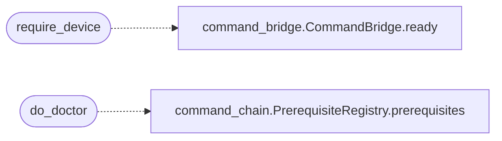

# `scripts/dirtyinit_drive.sh`

> Source: [scripts/dirtyinit_drive.sh:1](../../scripts/dirtyinit_drive.sh#L1) | language `sh` | coverage 3.4% | [API index](../index.md)

dirtyinit_drive.sh - operator-side driver for the DirtyInit Android root chain.

DirtyInit (https://github.com/combeng6th/DirtyInit) escalates a stock user app to the init namespace (u:r:init:s0) on Samsung devices. Upstream ships an app and two native sources but no build system, and the README leaves the device choreography to the operator. This driver closes that gap:  build    cross-compile the init-namespace client + libdfi_exploit.so and pack the APK with the NDK and the Android SDK build-tools install  adb install the APK and grant the storage appop launch   start the exploit activity auto     launch, tap EXECUTE EXPLOIT and EXTRACT CLI via uiautomator extract  pull the client from /sdcard stage    push the client to an exec-capable device path run      execute a command in the init namespace status   report the whole pipeline state  Usage: dirtyinit_drive.sh [--serial <adb-serial>] <action> [args]  Actions: doctor              toolchain and device report build               cross-compile the client and pack the APK install             adb install the APK and grant the storage appop launch              start the exploit activity auto                launch, tap EXECUTE EXPLOIT and EXTRACT CLI extract             pull the client from /sdcard stage               push the client to an exec-capable device path run <cmd> [args]    run a command in the init namespace

## Contents

- **Functions:** [`log`](#log), [`warn`](#warn), [`die`](#die), [`payload_value`](#payload_value), [`parse_flags`](#parse_flags), [`require_adb`](#require_adb), [`require_device`](#require_device), [`find_sdk`](#find_sdk), [`find_ndk`](#find_ndk), [`find_build_tools`](#find_build_tools), [`find_android_jar`](#find_android_jar), [`find_ndk_clang`](#find_ndk_clang), [`find_java_tool`](#find_java_tool), [`pack_apk`](#pack_apk), [`compile_activity`](#compile_activity), [`do_build`](#do_build), [`do_install`](#do_install), [`do_launch`](#do_launch), [`tap_button`](#tap_button), [`do_auto`](#do_auto), [`do_extract`](#do_extract), [`do_stage`](#do_stage), [`do_run`](#do_run), [`do_logs`](#do_logs), [`do_status`](#do_status), [`do_doctor`](#do_doctor), [`do_help`](#do_help), [`main`](#main)

## Call Graph

Solid arrows stay in this module, dashed arrows leave it.



## Functions

<a id="log"></a>

### `log`

`function` | [scripts/dirtyinit_drive.sh:65](../../scripts/dirtyinit_drive.sh#L65)

```bash
log() { printf '%s\n' "$*"; }
```

---

<a id="warn"></a>

### `warn`

`function` | [scripts/dirtyinit_drive.sh:66](../../scripts/dirtyinit_drive.sh#L66)

```bash
warn() { printf '[!] %s\n' "$*" >&2; }
```

---

<a id="die"></a>

### `die`

`function` | [scripts/dirtyinit_drive.sh:67](../../scripts/dirtyinit_drive.sh#L67)

```bash
die() { warn "$*"; exit 1; }
```

---

<a id="payload_value"></a>

### `payload_value`

`function` | [scripts/dirtyinit_drive.sh:69](../../scripts/dirtyinit_drive.sh#L69)

```bash
payload_value()
```

---

<a id="parse_flags"></a>

### `parse_flags`

`function` | [scripts/dirtyinit_drive.sh:89](../../scripts/dirtyinit_drive.sh#L89)

```bash
parse_flags()
```

---

<a id="require_adb"></a>

### `require_adb`

`function` | [scripts/dirtyinit_drive.sh:130](../../scripts/dirtyinit_drive.sh#L130)

```bash
require_adb()
```

---

<a id="require_device"></a>

### `require_device`

`function` | [scripts/dirtyinit_drive.sh:134](../../scripts/dirtyinit_drive.sh#L134)

```bash
require_device()
```

*Calls:* [`CommandBridge.ready`](core.command_bridge.py.md#commandbridge-ready)

---

<a id="find_sdk"></a>

### `find_sdk`

`function` | [scripts/dirtyinit_drive.sh:141](../../scripts/dirtyinit_drive.sh#L141)

```bash
find_sdk()
```

---

<a id="find_ndk"></a>

### `find_ndk`

`function` | [scripts/dirtyinit_drive.sh:152](../../scripts/dirtyinit_drive.sh#L152)

```bash
find_ndk()
```

---

<a id="find_build_tools"></a>

### `find_build_tools`

`function` | [scripts/dirtyinit_drive.sh:166](../../scripts/dirtyinit_drive.sh#L166)

```bash
find_build_tools()
```

---

<a id="find_android_jar"></a>

### `find_android_jar`

`function` | [scripts/dirtyinit_drive.sh:173](../../scripts/dirtyinit_drive.sh#L173)

```bash
find_android_jar()
```

---

<a id="find_ndk_clang"></a>

### `find_ndk_clang`

`function` | [scripts/dirtyinit_drive.sh:185](../../scripts/dirtyinit_drive.sh#L185)

```bash
find_ndk_clang()
```

---

<a id="find_java_tool"></a>

### `find_java_tool`

`function` | [scripts/dirtyinit_drive.sh:201](../../scripts/dirtyinit_drive.sh#L201)

```bash
find_java_tool()
```

---

<a id="pack_apk"></a>

### `pack_apk`

`function` | [scripts/dirtyinit_drive.sh:211](../../scripts/dirtyinit_drive.sh#L211)

```bash
pack_apk()
```

---

<a id="compile_activity"></a>

### `compile_activity`

`function` | [scripts/dirtyinit_drive.sh:255](../../scripts/dirtyinit_drive.sh#L255)

```bash
compile_activity()
```

---

<a id="do_build"></a>

### `do_build`

`function` | [scripts/dirtyinit_drive.sh:265](../../scripts/dirtyinit_drive.sh#L265)

```bash
do_build()
```

---

<a id="do_install"></a>

### `do_install`

`function` | [scripts/dirtyinit_drive.sh:329](../../scripts/dirtyinit_drive.sh#L329)

```bash
do_install()
```

---

<a id="do_launch"></a>

### `do_launch`

`function` | [scripts/dirtyinit_drive.sh:340](../../scripts/dirtyinit_drive.sh#L340)

```bash
do_launch()
```

---

<a id="tap_button"></a>

### `tap_button`

`function` | [scripts/dirtyinit_drive.sh:348](../../scripts/dirtyinit_drive.sh#L348)

```bash
tap_button()
```

---

<a id="do_auto"></a>

### `do_auto`

`function` | [scripts/dirtyinit_drive.sh:382](../../scripts/dirtyinit_drive.sh#L382)

```bash
do_auto()
```

---

<a id="do_extract"></a>

### `do_extract`

`function` | [scripts/dirtyinit_drive.sh:393](../../scripts/dirtyinit_drive.sh#L393)

```bash
do_extract()
```

---

<a id="do_stage"></a>

### `do_stage`

`function` | [scripts/dirtyinit_drive.sh:402](../../scripts/dirtyinit_drive.sh#L402)

```bash
do_stage()
```

---

<a id="do_run"></a>

### `do_run`

`function` | [scripts/dirtyinit_drive.sh:412](../../scripts/dirtyinit_drive.sh#L412)

```bash
do_run()
```

---

<a id="do_logs"></a>

### `do_logs`

`function` | [scripts/dirtyinit_drive.sh:418](../../scripts/dirtyinit_drive.sh#L418)

```bash
do_logs()
```

---

<a id="do_status"></a>

### `do_status`

`function` | [scripts/dirtyinit_drive.sh:423](../../scripts/dirtyinit_drive.sh#L423)

```bash
do_status()
```

---

<a id="do_doctor"></a>

### `do_doctor`

`function` | [scripts/dirtyinit_drive.sh:468](../../scripts/dirtyinit_drive.sh#L468)

```bash
do_doctor()
```

*Calls:* [`PrerequisiteRegistry.prerequisites`](cli.command_chain.py.md#prerequisiteregistry-prerequisites)

---

<a id="do_help"></a>

### `do_help`

`function` | [scripts/dirtyinit_drive.sh:525](../../scripts/dirtyinit_drive.sh#L525)

```bash
do_help()
```

---

<a id="main"></a>

### `main`

`function` | [scripts/dirtyinit_drive.sh:529](../../scripts/dirtyinit_drive.sh#L529)

```bash
main()
```

---
