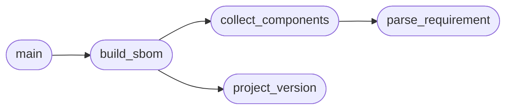

# `scripts.generate_sbom`

> Source: [scripts/generate_sbom.py:1](../../scripts/generate_sbom.py#L1) | language `py` | coverage 100.0% | [API index](../index.md)

Generate a minimal CycloneDX SBOM from the pinned requirements files.

Stdlib only, no network: parses ``requirements.txt`` (plus
``requirements-ml.txt`` with ``--with-ml``) and the project version from
``pyproject.toml``, and writes a CycloneDX 1.5 document.

Usage:
    python3 scripts/generate_sbom.py --out sbom.json
    python3 scripts/generate_sbom.py --with-ml --out sbom.json

## Contents

- **Functions:** [`parse_requirement`](#parse_requirement), [`collect_components`](#collect_components), [`project_version`](#project_version), [`build_sbom`](#build_sbom), [`main`](#main)
- **Constants:** [`ROOT`](#root)

## Call Graph

Solid arrows stay in this module, dashed arrows leave it.



## Functions

<a id="parse_requirement"></a>

### `parse_requirement`

`function` | [scripts/generate_sbom.py:25](../../scripts/generate_sbom.py#L25)

```python
def parse_requirement(line: str) -> tuple[str, str | None] | None
```

Split one requirements line into (name, pinned_version|None).

**Parameters**

| Name | Type | Default | Description |
|---|---|---|---|
| `line` | `str` |  |  |

**Returns:** `tuple[str, str | None] | None`

*Called by:* [`collect_components`](#collect_components)

---

<a id="collect_components"></a>

### `collect_components`

`function` | [scripts/generate_sbom.py:37](../../scripts/generate_sbom.py#L37)

```python
def collect_components(with_ml: bool) -> list[dict]
```

Parse requirements files into CycloneDX components, deduplicated.

**Parameters**

| Name | Type | Default | Description |
|---|---|---|---|
| `with_ml` | `bool` |  |  |

**Returns:** `list[dict]`

*Calls:* [`parse_requirement`](#parse_requirement)

*Called by:* [`build_sbom`](#build_sbom)

---

<a id="project_version"></a>

### `project_version`

`function` | [scripts/generate_sbom.py:68](../../scripts/generate_sbom.py#L68)

```python
def project_version() -> str
```

Read the package version from pyproject.toml.

**Returns:** `str`

*Called by:* [`build_sbom`](#build_sbom)

---

<a id="build_sbom"></a>

### `build_sbom`

`function` | [scripts/generate_sbom.py:74](../../scripts/generate_sbom.py#L74)

```python
def build_sbom(with_ml: bool) -> dict
```

Assemble the CycloneDX document.

**Parameters**

| Name | Type | Default | Description |
|---|---|---|---|
| `with_ml` | `bool` |  |  |

**Returns:** `dict`

*Calls:* [`collect_components`](#collect_components), [`project_version`](#project_version)

*Called by:* [`main`](#main)

---

<a id="main"></a>

### `main`

`function` | [scripts/generate_sbom.py:92](../../scripts/generate_sbom.py#L92)

```python
def main() -> int
```

CLI entry point.

**Returns:** `int`

*Calls:* [`build_sbom`](#build_sbom)

---

## Constants

<a id="root"></a>

### `ROOT`

`constant` | [scripts/generate_sbom.py:22](../../scripts/generate_sbom.py#L22)

```python
ROOT = Path(__file__).resolve().parent.parent
```

---
