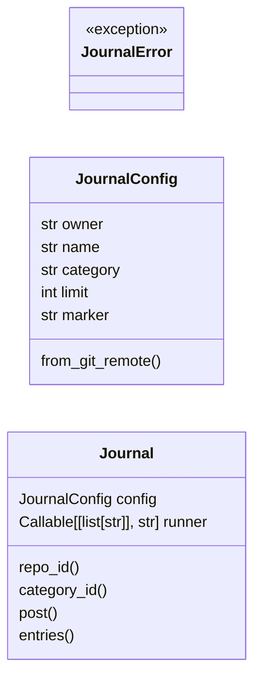
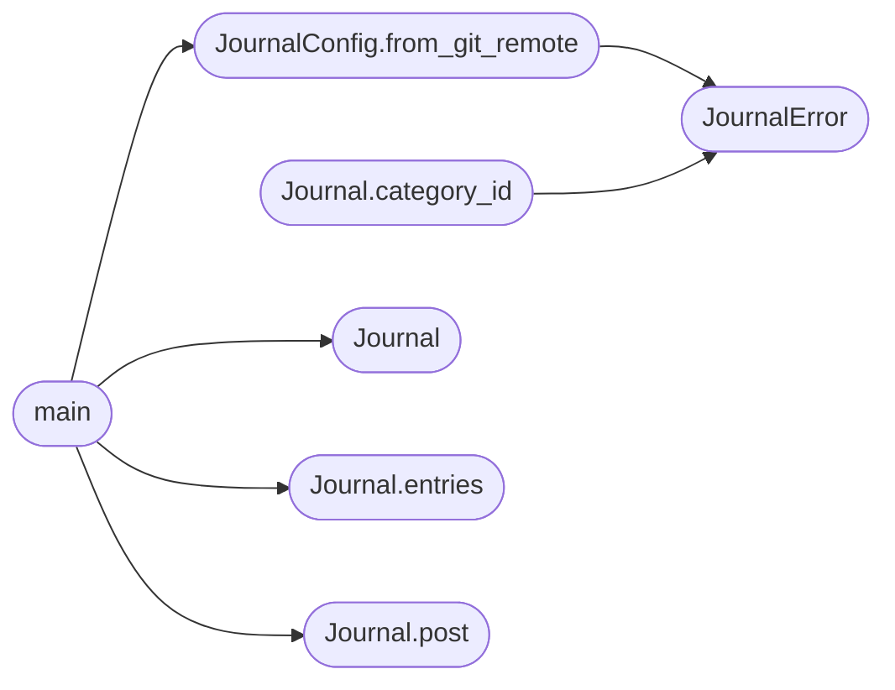

# `scripts.journal`

> Source: [scripts/journal.py:1](../../scripts/journal.py#L1) | language `py` | coverage 100.0% | [API index](../index.md)

Read-before-you-write journal over GitHub Discussions.

I keep a durable engineering journal in a GitHub Discussion category. Every
unit of work appends one entry with the reasoning that a stateless agent
cannot recover from the code alone. ``read_journal`` prints the recent
entries, and the ``read-before-write`` workflow forces the next change to
cite the journal before it lands.

The module never opens a shell. It drives ``gh api graphql`` with an argument
list, and the runner is injectable so the tests never touch the network.

## Contents

- **Classes:** [`JournalConfig`](#journalconfig), [`Journal`](#journal)
- **Exceptions:** [`JournalError`](#journalerror)
- **Functions:** [`main`](#main)
- **Constants:** [`DEFAULT_CATEGORY`](#default_category), [`DEFAULT_LIMIT`](#default_limit), [`GIT_TIMEOUT_SECONDS`](#git_timeout_seconds), [`GH_TIMEOUT_SECONDS`](#gh_timeout_seconds), [`REPO_QUERY`](#repo_query), [`CATEGORY_QUERY`](#category_query), [`CREATE_MUTATION`](#create_mutation), [`ENTRIES_QUERY`](#entries_query)

## Type Diagram



## Call Graph

Solid arrows stay in this module, dashed arrows leave it.



## Classes

<a id="journalconfig"></a>

### `JournalConfig`

`class` `dataclass` | [scripts/journal.py:53](../../scripts/journal.py#L53)

Decorators: `@dataclass`

```python
class JournalConfig
```

Configuration for the engineering journal.

**Attributes**

| Name | Type | Default | Description |
|---|---|---|---|
| [`owner`](#journalconfig-owner) | `str` |  | GitHub account or organization that owns the repository. |
| [`name`](#journalconfig-name) | `str` |  | Repository name. |
| [`category`](#journalconfig-category) | `str` | `DEFAULT_CATEGORY` | Discussion category that holds the journal entries. |
| [`limit`](#journalconfig-limit) | `int` | `DEFAULT_LIMIT` | Default number of entries ``read`` returns. |
| [`marker`](#journalconfig-marker) | `str` | `'Journal'` | Token the read-before-write workflow looks for in a PR body. |

**Members**

| Member | Kind | Summary |
|---|---|---|
| [`from_git_remote`](#journalconfig-from_git_remote) | classmethod | Build a config from the `[`origin`](modules.c2_profile_engine.py.md#websocketprofile-origin)` remote of the current checkout. |

<a id="journalconfig-from_git_remote"></a>

#### `JournalConfig.from_git_remote`

`classmethod` | [scripts/journal.py:71](../../scripts/journal.py#L71)

Decorators: `@classmethod`

```python
def from_git_remote(cls, remote: str | None = None, category: str = DEFAULT_CATEGORY) -> JournalConfig
```

Build a config from the `[`origin`](modules.c2_profile_engine.py.md#websocketprofile-origin)` remote of the current checkout.

**Parameters**

| Name | Type | Default | Description |
|---|---|---|---|
| `remote` | `str \| None` | `None` | Optional repository slug ``owner/name``. When omitted, the slug is read from ``git config --get remote.origin.url``. |
| `category` | `str` | `DEFAULT_CATEGORY` | Discussion category that holds the journal entries. |

**Returns:** `JournalConfig` - The resolved configuration.

**Raises**

- [`JournalError`](#journalerror): When the remote cannot be resolved to a slug.

*Calls:* [`JournalError`](#journalerror)

*Called by:* [`main`](#main), [`main`](scripts.read_journal.py.md#main)

---

<a id="journal"></a>

### `Journal`

`class` `dataclass` | [scripts/journal.py:149](../../scripts/journal.py#L149)

Decorators: `@dataclass`

```python
class Journal
```

GitHub Discussions backed journal.

**Attributes**

| Name | Type | Default | Description |
|---|---|---|---|
| [`config`](#journal-config) | `JournalConfig` |  | Active journal configuration. |
| [`runner`](#journal-runner) | `Callable[[list[str]], str]` | `_default_runner` | Callable that executes ``gh`` and returns its output. The default shells out through an argument list; tests inject a stub. |

**Members**

| Member | Kind | Summary |
|---|---|---|
| [`repo_id`](#journal-repo_id) | property | The GraphQL node id of the repository. |
| [`category_id`](#journal-category_id) | property | The GraphQL node id of the journal category. |
| [`post`](#journal-post) | method | Create a journal entry and return its number, url, and title. |
| [`entries`](#journal-entries) | method | Return the most recently updated journal entries. |

<a id="journal-repo_id"></a>

#### `Journal.repo_id`

`property` | [scripts/journal.py:184](../../scripts/journal.py#L184)

Decorators: `@property`

```python
def repo_id(self) -> str
```

The GraphQL node id of the repository.

**Returns:** `str`

<a id="journal-category_id"></a>

#### `Journal.category_id`

`property` | [scripts/journal.py:192](../../scripts/journal.py#L192)

Decorators: `@property`

```python
def category_id(self) -> str
```

The GraphQL node id of the journal category.

**Returns:** `str`

**Raises**

- [`JournalError`](#journalerror): (raised in the body, not documented)

*Calls:* [`JournalError`](#journalerror)

<a id="journal-post"></a>

#### `Journal.post`

`method` | [scripts/journal.py:206](../../scripts/journal.py#L206)

```python
def post(self, title: str, body: str) -> dict
```

Create a journal entry and return its number, url, and title.

**Parameters**

| Name | Type | Default | Description |
|---|---|---|---|
| `title` | `str` |  | Entry title. |
| `body` | `str` |  | Entry body in markdown. |

**Returns:** `dict` - A dict with ``number``, `[`url`](modules.lazy_oob.py.md#url)` and ``title``.

**Raises**

- [`JournalError`](#journalerror): When the mutation fails.

*Called by:* [`main`](#main)

<a id="journal-entries"></a>

#### `Journal.entries`

`method` | [scripts/journal.py:223](../../scripts/journal.py#L223)

```python
def entries(self, limit: int | None = None) -> list[dict]
```

Return the most recently updated journal entries.

**Parameters**

| Name | Type | Default | Description |
|---|---|---|---|
| `limit` | `int \| None` | `None` | Maximum number of entries. Defaults to the config limit. |

**Returns:** `list[dict]` - A list of dicts with ``number``, ``title``, ``body``, `[`url`](modules.lazy_oob.py.md#url)` and
``updatedAt``.

**Raises**

- [`JournalError`](#journalerror): When the query fails.

*Called by:* [`main`](#main), [`main`](scripts.read_journal.py.md#main)

---

## Exceptions

<a id="journalerror"></a>

### `JournalError`

`exception` | [scripts/journal.py:48](../../scripts/journal.py#L48)

```python
class JournalError(RuntimeError)
```

Bases: `RuntimeError`

Raised when the GitHub API call fails or the category is missing.

---

## Functions

<a id="main"></a>

### `main`

`function` | [scripts/journal.py:264](../../scripts/journal.py#L264)

```python
def main(argv: list[str] | None = None) -> int
```

Run the journal CLI and return the process exit code.

**Parameters**

| Name | Type | Default | Description |
|---|---|---|---|
| `argv` | `list[str] \| None` | `None` | Optional argument vector. Defaults to ``sys.argv``. |

**Returns:** `int` - 0 on success, 1 on a journal error.

*Calls:* [`Journal`](#journal), [`Journal.entries`](#journal-entries), [`Journal.post`](#journal-post), [`JournalConfig.from_git_remote`](#journalconfig-from_git_remote)

---

## Constants

<a id="default_category"></a>

### `DEFAULT_CATEGORY`

`constant` | [scripts/journal.py:24](../../scripts/journal.py#L24)

```python
DEFAULT_CATEGORY = 'Show and tell'
```

---

<a id="default_limit"></a>

### `DEFAULT_LIMIT`

`constant` | [scripts/journal.py:25](../../scripts/journal.py#L25)

```python
DEFAULT_LIMIT = 5
```

---

<a id="git_timeout_seconds"></a>

### `GIT_TIMEOUT_SECONDS`

`constant` | [scripts/journal.py:26](../../scripts/journal.py#L26)

```python
GIT_TIMEOUT_SECONDS = 10
```

---

<a id="gh_timeout_seconds"></a>

### `GH_TIMEOUT_SECONDS`

`constant` | [scripts/journal.py:27](../../scripts/journal.py#L27)

```python
GH_TIMEOUT_SECONDS = 60
```

---

<a id="repo_query"></a>

### `REPO_QUERY`

`constant` | [scripts/journal.py:29](../../scripts/journal.py#L29)

```python
REPO_QUERY = 'query($owner:String!,$name:String!){repository(owner:$owner,name:$name){id}}'
```

---

<a id="category_query"></a>

### `CATEGORY_QUERY`

`constant` | [scripts/journal.py:30](../../scripts/journal.py#L30)

```python
CATEGORY_QUERY
```

---

<a id="create_mutation"></a>

### `CREATE_MUTATION`

`constant` | [scripts/journal.py:35](../../scripts/journal.py#L35)

```python
CREATE_MUTATION
```

---

<a id="entries_query"></a>

### `ENTRIES_QUERY`

`constant` | [scripts/journal.py:40](../../scripts/journal.py#L40)

```python
ENTRIES_QUERY
```

---
