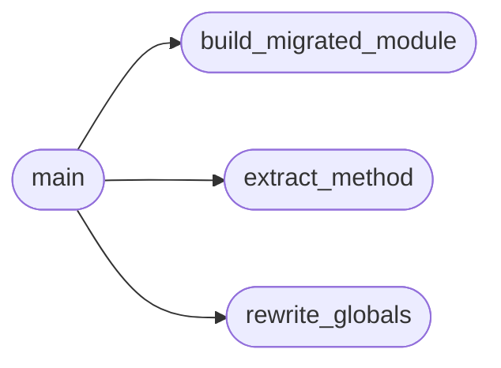

# `scripts.migrate_lazyown`

> Source: [scripts/migrate_lazyown.py:1](../../scripts/migrate_lazyown.py#L1) | language `py` | coverage 80.0% | [API index](../index.md)

Staged migration script: extract do_* methods from lazyown.py into cli/commands/.

Usage:
    python3 scripts/migrate_lazyown.py

What it does:
1. Parses lazyown.py with the ast module.
2. Groups every ``do_*`` method by its ``@cmd2.with_category(...)`` decorator.
3. For methods that reference module-level globals (api_key, rhost, …) it
   rewrites those references to ``self.params[...]``.
4. Writes a ``cli/commands/<phase>.py`` file per category that does NOT
   already exist.
5. Prints a diff-ready report so the operator can review before deleting
   the originals from ``lazyown.py``.

This script is **read-only** — it never edits ``lazyown.py``.

## Contents

- **Functions:** [`extract_method`](#extract_method), [`rewrite_globals`](#rewrite_globals), [`build_migrated_module`](#build_migrated_module), [`main`](#main)
- **Constants:** [`LAZYOWN_PATH`](#lazyown_path), [`OUTPUT_DIR`](#output_dir), [`MODULE_GLOBALS`](#module_globals), [`CATEGORY_TO_PHASE`](#category_to_phase)

## Call Graph

Solid arrows stay in this module, dashed arrows leave it.



## Functions

<a id="extract_method"></a>

### `extract_method`

`function` | [scripts/migrate_lazyown.py:88](../../scripts/migrate_lazyown.py#L88)

```python
def extract_method(source: str, node: ast.FunctionDef) -> str
```

Return the raw source text of a function definition.

**Parameters**

| Name | Type | Default | Description |
|---|---|---|---|
| `source` | `str` |  |  |
| `node` | `ast.FunctionDef` |  |  |

**Returns:** `str`

*Called by:* [`main`](#main)

---

<a id="rewrite_globals"></a>

### `rewrite_globals`

`function` | [scripts/migrate_lazyown.py:96](../../scripts/migrate_lazyown.py#L96)

```python
def rewrite_globals(method_source: str) -> str
```

Replace bare module-global names with ``self.params[...]``.

Uses a two-pass approach: first mask existing ``self.params["X"]``
calls with placeholders so the bare-variable regex does not double-
wrap string values, then restore the placeholders.

**Parameters**

| Name | Type | Default | Description |
|---|---|---|---|
| `method_source` | `str` |  |  |

**Returns:** `str`

*Called by:* [`main`](#main)

---

<a id="build_migrated_module"></a>

### `build_migrated_module`

`function` | [scripts/migrate_lazyown.py:124](../../scripts/migrate_lazyown.py#L124)

```python
def build_migrated_module(phase: str, category: str, methods: list[tuple[str, str]]) -> str
```

Return the source text of a migrated ``CommandSet`` module.

Kept as a pure function so the emitted ``__all__`` and the class name stay
in lockstep and can be unit-tested. A prior inline version emitted the
literal ``__all__ = [f"{phase.title()}CommandSet"]`` -- an f-string written
verbatim into the output, where ``phase`` is undefined at module scope, so
every generated module raised ``NameError`` on import and silently aborted
[`cli.registry.iter_command_sets`](cli.registry.py.md#iter_command_sets) discovery.

**Parameters**

| Name | Type | Default | Description |
|---|---|---|---|
| `phase` | `str` |  | Phase slug (for example ``recon``) driving the class name. |
| `category` | `str` |  | cmd2 ``@with_category`` value the methods belong to. |
| `methods` | `list[tuple[str, str]]` |  | ``(name, source)`` pairs already rewritten for ``self.params``. |

**Returns:** `str` - The complete module source, ending with a static ``__all__`` list that
names the single generated ``*CommandSet`` class.

*Called by:* [`main`](#main)

---

<a id="main"></a>

### `main`

`function` | [scripts/migrate_lazyown.py:173](../../scripts/migrate_lazyown.py#L173)

```python
def main() -> int
```

**Returns:** `int`

*Calls:* [`build_migrated_module`](#build_migrated_module), [`extract_method`](#extract_method), [`rewrite_globals`](#rewrite_globals)

---

## Constants

<a id="lazyown_path"></a>

### `LAZYOWN_PATH`

`constant` | [scripts/migrate_lazyown.py:27](../../scripts/migrate_lazyown.py#L27)

```python
LAZYOWN_PATH = Path('lazyown.py')
```

---

<a id="output_dir"></a>

### `OUTPUT_DIR`

`constant` | [scripts/migrate_lazyown.py:28](../../scripts/migrate_lazyown.py#L28)

```python
OUTPUT_DIR = Path('cli/commands')
```

---

<a id="module_globals"></a>

### `MODULE_GLOBALS`

`constant` | [scripts/migrate_lazyown.py:30](../../scripts/migrate_lazyown.py#L30)

```python
MODULE_GLOBALS
```

---

<a id="category_to_phase"></a>

### `CATEGORY_TO_PHASE`

`constant` | [scripts/migrate_lazyown.py:52](../../scripts/migrate_lazyown.py#L52)

```python
CATEGORY_TO_PHASE: dict[str, str]
```

---
