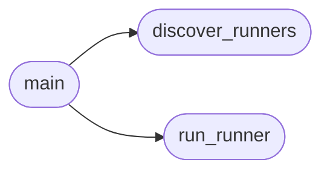

# `scripts.mutation_gate`

> Source: [scripts/mutation_gate.py:1](../../scripts/mutation_gate.py#L1) | language `py` | coverage 100.0% | [API index](../index.md)

Consolidated mutation gate for LazyOwn.

Runs the curated mutation runners under tests/ with one interface.
Each runner introduces targeted faults and requires the matching suite
to fail. A surviving mutant means the tests are too weak.

Usage:
    python scripts/mutation_gate.py --list
    python scripts/mutation_gate.py --all
    python scripts/mutation_gate.py tests/run_mutation_killchain.py

## Contents

- **Functions:** [`discover_runners`](#discover_runners), [`run_runner`](#run_runner), [`main`](#main)
- **Constants:** [`REPO_ROOT`](#repo_root), [`RUNNER_PATTERN`](#runner_pattern), [`DEFAULT_TIMEOUT_S`](#default_timeout_s)

## Call Graph

Solid arrows stay in this module, dashed arrows leave it.



## Functions

<a id="discover_runners"></a>

### `discover_runners`

`function` | [scripts/mutation_gate.py:25](../../scripts/mutation_gate.py#L25)

```python
def discover_runners() -> list[Path]
```

Return sorted curated mutation runners.

**Returns:** `list[Path]` - Sorted list of runner paths under tests/.

*Called by:* [`main`](#main)

---

<a id="run_runner"></a>

### `run_runner`

`function` | [scripts/mutation_gate.py:34](../../scripts/mutation_gate.py#L34)

```python
def run_runner(path: Path, timeout_s: int) -> int
```

Execute one mutation runner.

**Parameters**

| Name | Type | Default | Description |
|---|---|---|---|
| `path` | `Path` |  | Runner script path. |
| `timeout_s` | `int` |  | Per-runner timeout in seconds. |

**Returns:** `int` - Runner exit code, 2 when the runner times out.

*Called by:* [`main`](#main)

---

<a id="main"></a>

### `main`

`function` | [scripts/mutation_gate.py:63](../../scripts/mutation_gate.py#L63)

```python
def main(argv: list[str] | None = None) -> int
```

Entry point for the mutation gate.

**Parameters**

| Name | Type | Default | Description |
|---|---|---|---|
| `argv` | `list[str] \| None` | `None` | CLI arguments, defaults to process args. |

**Returns:** `int` - Zero when every mutant is killed, nonzero otherwise.

*Calls:* [`discover_runners`](#discover_runners), [`run_runner`](#run_runner)

---

## Constants

<a id="repo_root"></a>

### `REPO_ROOT`

`constant` | [scripts/mutation_gate.py:20](../../scripts/mutation_gate.py#L20)

```python
REPO_ROOT = Path(__file__).resolve().parent.parent
```

---

<a id="runner_pattern"></a>

### `RUNNER_PATTERN`

`constant` | [scripts/mutation_gate.py:21](../../scripts/mutation_gate.py#L21)

```python
RUNNER_PATTERN = 'run_mutation_*.py'
```

---

<a id="default_timeout_s"></a>

### `DEFAULT_TIMEOUT_S`

`constant` | [scripts/mutation_gate.py:22](../../scripts/mutation_gate.py#L22)

```python
DEFAULT_TIMEOUT_S = 1800
```

---
