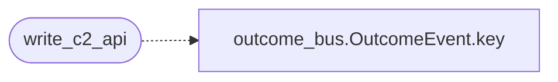

# `scripts/publish_wiki.sh`

> Source: [scripts/publish_wiki.sh:1](../../scripts/publish_wiki.sh#L1) | language `sh` | coverage 11.1% | [API index](../index.md)

Publish LazyOwn documentation to the GitHub wiki.

The wiki is a separate git repository (https://github.com/grisuno/LazyOwn.wiki.git). This script clones it (or pulls latest), regenerates pages from the documentation that already exists in this repository, commits, and pushes.  Usage: bash scripts/publish_wiki.sh [--dry-run] [--no-push] [--wiki-dir <path>]  --dry-run        Generate pages locally without committing or pushing. --no-push        Commit locally but do not push to GitHub. --wiki-dir <p>   Directory for the wiki checkout (default: /tmp/lazyown-wiki).  Idempotent: re-running it refreshes every page from current sources.

## Contents

- **Functions:** [`log`](#log), [`fail`](#fail), [`write_home`](#write_home), [`write_installation`](#write_installation), [`write_c2_api`](#write_c2_api), [`write_plugins`](#write_plugins), [`write_sidebar`](#write_sidebar), [`write_footer`](#write_footer)

## Call Graph

Solid arrows stay in this module, dashed arrows leave it.



## Functions

<a id="log"></a>

### `log`

`function` | [scripts/publish_wiki.sh:37](../../scripts/publish_wiki.sh#L37)

```bash
log() { echo "[$1] $2"; }
```

---

<a id="fail"></a>

### `fail`

`function` | [scripts/publish_wiki.sh:38](../../scripts/publish_wiki.sh#L38)

```bash
fail() { log "ERROR" "$1" >&2; exit 1; }
```

---

<a id="write_home"></a>

### `write_home`

`function` | [scripts/publish_wiki.sh:58](../../scripts/publish_wiki.sh#L58)

```bash
write_home()
```

---

<a id="write_installation"></a>

### `write_installation`

`function` | [scripts/publish_wiki.sh:92](../../scripts/publish_wiki.sh#L92)

```bash
write_installation()
```

---

<a id="write_c2_api"></a>

### `write_c2_api`

`function` | [scripts/publish_wiki.sh:150](../../scripts/publish_wiki.sh#L150)

```bash
write_c2_api()
```

*Calls:* [`OutcomeEvent.key`](modules.outcome_bus.py.md#outcomeevent-key)

---

<a id="write_plugins"></a>

### `write_plugins`

`function` | [scripts/publish_wiki.sh:174](../../scripts/publish_wiki.sh#L174)

```bash
write_plugins()
```

---

<a id="write_sidebar"></a>

### `write_sidebar`

`function` | [scripts/publish_wiki.sh:188](../../scripts/publish_wiki.sh#L188)

```bash
write_sidebar()
```

---

<a id="write_footer"></a>

### `write_footer`

`function` | [scripts/publish_wiki.sh:207](../../scripts/publish_wiki.sh#L207)

```bash
write_footer()
```

---
