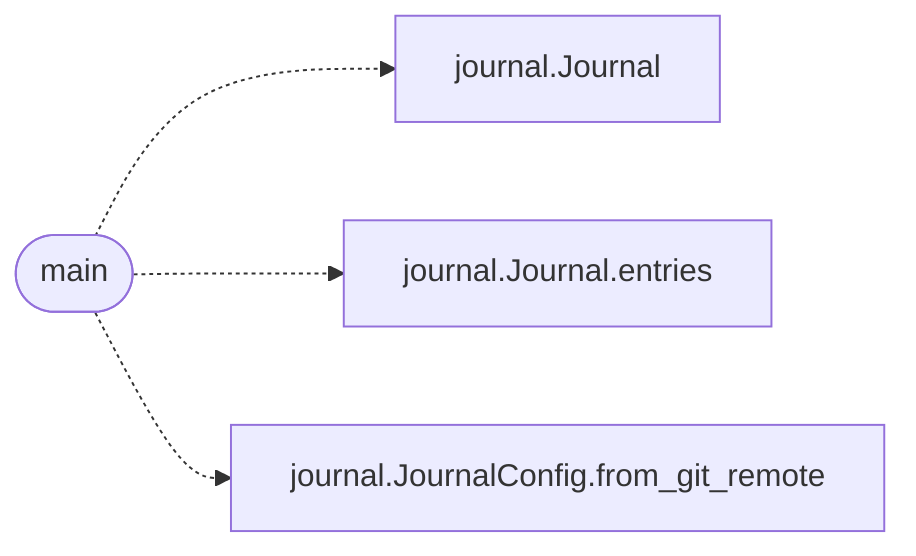

# `scripts.read_journal`

> Source: [scripts/read_journal.py:1](../../scripts/read_journal.py#L1) | language `py` | coverage 100.0% | [API index](../index.md)

Print the recent engineering journal before a change is written.

This is the read half of the read-before-you-write loop. Run it at the start
of a unit of work, then cite the entry number in the change. The
``read-before-write`` workflow rejects a pull request whose body does not cite
a journal entry.

## Contents

- **Functions:** [`main`](#main)

## Call Graph

Solid arrows stay in this module, dashed arrows leave it.



## Functions

<a id="main"></a>

### `main`

`function` | [scripts/read_journal.py:29](../../scripts/read_journal.py#L29)

```python
def main(argv: list[str] | None = None) -> int
```

Print the recent journal entries and return the process exit code.

**Parameters**

| Name | Type | Default | Description |
|---|---|---|---|
| `argv` | `list[str] \| None` | `None` | Optional argument vector. Defaults to ``sys.argv``. |

**Returns:** `int` - 0 on success, 1 when the journal cannot be read.

*Calls:* [`Journal`](scripts.journal.py.md#journal), [`Journal.entries`](scripts.journal.py.md#journal-entries), [`JournalConfig.from_git_remote`](scripts.journal.py.md#journalconfig-from_git_remote)

---
