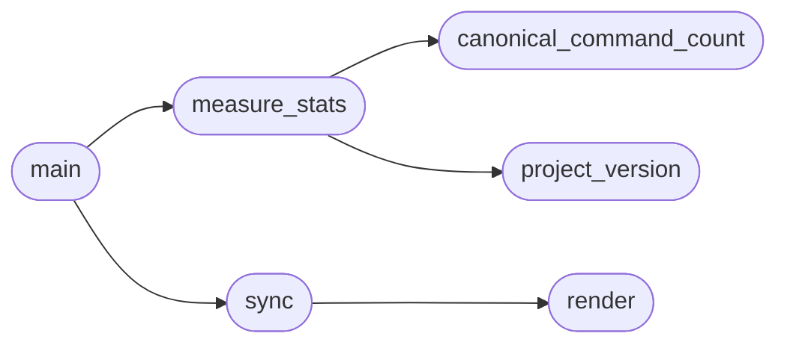

# `scripts.sync_doc_stats`

> Source: [scripts/sync_doc_stats.py:1](../../scripts/sync_doc_stats.py#L1) | language `py` | coverage 100.0% | [API index](../index.md)

Sync documentation numbers with the live codebase — single source of truth.

Counts are measured from the code itself and rewritten into the docs so the
README, guides and agent context never contradict each other again:

- ``cli_commands``   — ``do_`` methods in lazyown.py + cli/commands/*.py (AST)
- ``bridge_catalog`` — ``CatalogEntry(`` rows in modules/lazyown_bridge.py
- `[`mcp_tools`](skills.lazyown_automapper.py.md#automapper-mcp_tools)`      — ``name="lazyown_`` registrations in skills/lazyown_mcp.py
- ``aliases``        — keys in cli/aliases.yaml
- `[`addons`](cli.exploration.py.md#explorationengine-addons)`         — lazyaddons/*.yaml
- ``plugins``        — plugins/*.lua
- ``plugin_files``   — every file in plugins/
- `[`tools`](cli.exploration.py.md#explorationengine-tools)`          — tools/*.tool
- ``playbooks``      — playbooks/*.yaml
- ``version``        — ``version =`` in pyproject.toml

Usage:
    python3 scripts/sync_doc_stats.py           apply the replacements in place
    python3 scripts/sync_doc_stats.py --check   exit 1 when any doc is stale (CI)
    python3 scripts/sync_doc_stats.py --print   show the measured numbers only

## Contents

- **Functions:** [`canonical_command_count`](#canonical_command_count), [`project_version`](#project_version), [`measure_stats`](#measure_stats), [`render`](#render), [`sync`](#sync), [`main`](#main)
- **Constants:** [`REPO_ROOT`](#repo_root), [`REPLACEMENTS`](#replacements)

## Call Graph

Solid arrows stay in this module, dashed arrows leave it.



## Functions

<a id="canonical_command_count"></a>

### `canonical_command_count`

`function` | [scripts/sync_doc_stats.py:87](../../scripts/sync_doc_stats.py#L87)

```python
def canonical_command_count(root: Path = REPO_ROOT) -> int
```

Read the canonical command count from the committed command index.

The command index (``cli/command_index.json``) is the single source of
truth produced by ``scripts/build_command_index.py``. Re-counting the
AST here would reintroduce a second counting method and cause the same
drift this module exists to eliminate.

**Parameters**

| Name | Type | Default | Description |
|---|---|---|---|
| `root` | `Path` | `REPO_ROOT` |  |

**Returns:** `int`

*Called by:* [`measure_stats`](#measure_stats)

---

<a id="project_version"></a>

### `project_version`

`function` | [scripts/sync_doc_stats.py:100](../../scripts/sync_doc_stats.py#L100)

```python
def project_version(root: Path = REPO_ROOT) -> str
```

Read the package version from pyproject.toml, ``0.0.0`` when absent.

**Parameters**

| Name | Type | Default | Description |
|---|---|---|---|
| `root` | `Path` | `REPO_ROOT` |  |

**Returns:** `str`

*Called by:* [`measure_stats`](#measure_stats)

---

<a id="measure_stats"></a>

### `measure_stats`

`function` | [scripts/sync_doc_stats.py:109](../../scripts/sync_doc_stats.py#L109)

```python
def measure_stats(root: Path = REPO_ROOT) -> dict[str, int | str]
```

Measure every published count from the live tree.

**Parameters**

| Name | Type | Default | Description |
|---|---|---|---|
| `root` | `Path` | `REPO_ROOT` | Repository root. Injectable so tests can point at a fixture. |

**Returns:** `dict[str, int | str]`

*Calls:* [`canonical_command_count`](#canonical_command_count), [`project_version`](#project_version)

*Called by:* [`main`](#main)

---

<a id="render"></a>

### `render`

`function` | [scripts/sync_doc_stats.py:136](../../scripts/sync_doc_stats.py#L136)

```python
def render(template: str, stats: dict[str, object]) -> str
```

Format one replacement template with the measured stats.

**Parameters**

| Name | Type | Default | Description |
|---|---|---|---|
| `template` | `str` |  |  |
| `stats` | `dict[str, object]` |  |  |

**Returns:** `str`

*Called by:* [`sync`](#sync)

---

<a id="sync"></a>

### `sync`

`function` | [scripts/sync_doc_stats.py:141](../../scripts/sync_doc_stats.py#L141)

```python
def sync(check: bool, stats: dict[str, object], root: Path = REPO_ROOT) -> list[str]
```

Apply or verify every replacement; return the list of stale spots.

**Parameters**

| Name | Type | Default | Description |
|---|---|---|---|
| `check` | `bool` |  | When ``True`` verify without writing, returning stale spots. |
| `stats` | `dict[str, object]` |  | Measured counts produced by [`measure_stats`](#measure_stats). |
| `root` | `Path` | `REPO_ROOT` | Repository root. Injectable so tests can point at a fixture. |

**Returns:** `list[str]`

*Calls:* [`render`](#render)

*Called by:* [`main`](#main)

---

<a id="main"></a>

### `main`

`function` | [scripts/sync_doc_stats.py:165](../../scripts/sync_doc_stats.py#L165)

```python
def main() -> int
```

CLI entry point.

**Returns:** `int`

*Calls:* [`measure_stats`](#measure_stats), [`sync`](#sync)

---

## Constants

<a id="repo_root"></a>

### `REPO_ROOT`

`constant` | [scripts/sync_doc_stats.py:34](../../scripts/sync_doc_stats.py#L34)

```python
REPO_ROOT = Path(__file__).resolve().parent.parent
```

---

<a id="replacements"></a>

### `REPLACEMENTS`

`constant` | [scripts/sync_doc_stats.py:36](../../scripts/sync_doc_stats.py#L36)

```python
REPLACEMENTS: tuple[tuple[str, str, str], ...]
```

---
