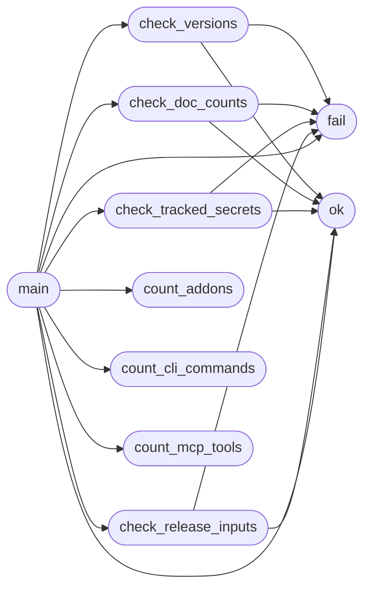

# `scripts.top_tier_check`

> Source: [scripts/top_tier_check.py:1](../../scripts/top_tier_check.py#L1) | language `py` | coverage 9.1% | [API index](../index.md)

Top-tier hygiene audit for LazyOwn.

Fails (exit 1) on any credibility blocker:
- version drift between README / pyproject.toml / version.json
- doc claims (command / MCP / addon counts) out of sync with repo reality
- secrets or session artefacts tracked by git
- missing release-hygiene inputs (requirements, SBOM source)

Usage: python3 scripts/top_tier_check.py

## Contents

- **Functions:** [`fail`](#fail), [`ok`](#ok), [`count_cli_commands`](#count_cli_commands), [`count_mcp_tools`](#count_mcp_tools), [`count_addons`](#count_addons), [`check_versions`](#check_versions), [`check_doc_counts`](#check_doc_counts), [`check_tracked_secrets`](#check_tracked_secrets), [`check_release_inputs`](#check_release_inputs), [`main`](#main)
- **Constants:** [`ROOT`](#root), [`FAILURES`](#failures)

## Call Graph

Solid arrows stay in this module, dashed arrows leave it.



## Functions

<a id="fail"></a>

### `fail`

`function` | [scripts/top_tier_check.py:23](../../scripts/top_tier_check.py#L23)

```python
def fail(message: str) -> None
```

**Parameters**

| Name | Type | Default | Description |
|---|---|---|---|
| `message` | `str` |  |  |

*Called by:* [`check_doc_counts`](#check_doc_counts), [`check_release_inputs`](#check_release_inputs), [`check_tracked_secrets`](#check_tracked_secrets), [`check_versions`](#check_versions), [`main`](#main)

---

<a id="ok"></a>

### `ok`

`function` | [scripts/top_tier_check.py:28](../../scripts/top_tier_check.py#L28)

```python
def ok(message: str) -> None
```

**Parameters**

| Name | Type | Default | Description |
|---|---|---|---|
| `message` | `str` |  |  |

*Called by:* [`check_doc_counts`](#check_doc_counts), [`check_release_inputs`](#check_release_inputs), [`check_tracked_secrets`](#check_tracked_secrets), [`check_versions`](#check_versions), [`main`](#main)

---

<a id="count_cli_commands"></a>

### `count_cli_commands`

`function` | [scripts/top_tier_check.py:32](../../scripts/top_tier_check.py#L32)

```python
def count_cli_commands() -> int
```

**Returns:** `int`

*Called by:* [`main`](#main)

---

<a id="count_mcp_tools"></a>

### `count_mcp_tools`

`function` | [scripts/top_tier_check.py:43](../../scripts/top_tier_check.py#L43)

```python
def count_mcp_tools() -> int
```

**Returns:** `int`

*Called by:* [`main`](#main)

---

<a id="count_addons"></a>

### `count_addons`

`function` | [scripts/top_tier_check.py:48](../../scripts/top_tier_check.py#L48)

```python
def count_addons() -> int
```

**Returns:** `int`

*Called by:* [`main`](#main)

---

<a id="check_versions"></a>

### `check_versions`

`function` | [scripts/top_tier_check.py:52](../../scripts/top_tier_check.py#L52)

```python
def check_versions() -> None
```

*Calls:* [`fail`](#fail), [`ok`](#ok)

*Called by:* [`main`](#main)

---

<a id="check_doc_counts"></a>

### `check_doc_counts`

`function` | [scripts/top_tier_check.py:70](../../scripts/top_tier_check.py#L70)

```python
def check_doc_counts(commands: int, mcp: int, addons: int) -> None
```

**Parameters**

| Name | Type | Default | Description |
|---|---|---|---|
| `commands` | `int` |  |  |
| `mcp` | `int` |  |  |
| `addons` | `int` |  |  |

*Calls:* [`fail`](#fail), [`ok`](#ok)

*Called by:* [`main`](#main)

---

<a id="check_tracked_secrets"></a>

### `check_tracked_secrets`

`function` | [scripts/top_tier_check.py:81](../../scripts/top_tier_check.py#L81)

```python
def check_tracked_secrets() -> None
```

*Calls:* [`fail`](#fail), [`ok`](#ok)

*Called by:* [`main`](#main)

---

<a id="check_release_inputs"></a>

### `check_release_inputs`

`function` | [scripts/top_tier_check.py:108](../../scripts/top_tier_check.py#L108)

```python
def check_release_inputs() -> None
```

*Calls:* [`fail`](#fail), [`ok`](#ok)

*Called by:* [`main`](#main)

---

<a id="main"></a>

### `main`

`function` | [scripts/top_tier_check.py:116](../../scripts/top_tier_check.py#L116)

```python
def main() -> int
```

**Returns:** `int`

*Calls:* [`check_doc_counts`](#check_doc_counts), [`check_release_inputs`](#check_release_inputs), [`check_tracked_secrets`](#check_tracked_secrets), [`check_versions`](#check_versions), [`count_addons`](#count_addons), [`count_cli_commands`](#count_cli_commands), [`count_mcp_tools`](#count_mcp_tools), [`fail`](#fail), [`ok`](#ok)

---

## Constants

<a id="root"></a>

### `ROOT`

`constant` | [scripts/top_tier_check.py:19](../../scripts/top_tier_check.py#L19)

```python
ROOT = Path(__file__).resolve().parent.parent
```

---

<a id="failures"></a>

### `FAILURES`

`constant` | [scripts/top_tier_check.py:20](../../scripts/top_tier_check.py#L20)

```python
FAILURES: list[str] = []
```

---
