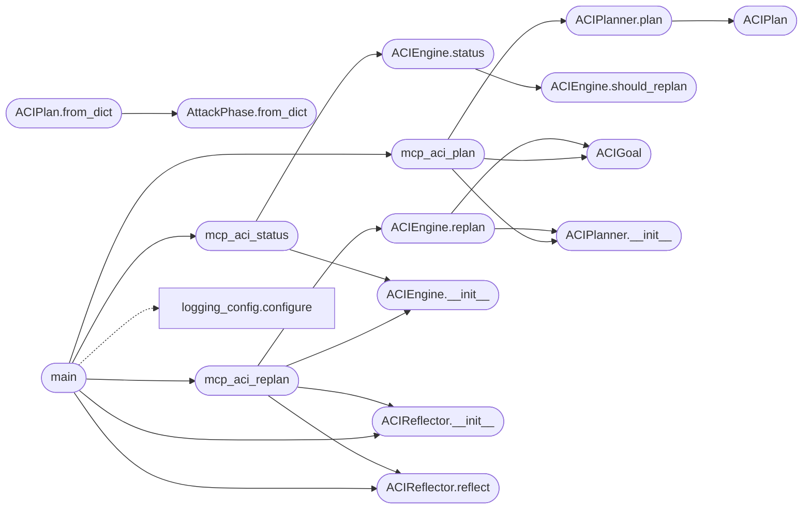

# `skills.aci_planner`

> Source: [skills/aci_planner.py:1](../../skills/aci_planner.py#L1) | language `py` | coverage 100.0% | [API index](../index.md)

Autonomous Campaign Intelligence (ACI) Planner =============================================== Decomposes a natural-language engagement goal into a MITRE ATT&CK-aligned tactical plan, injects each phase as objectives into the ObjectiveStore, monitors execution, and replans when too many objectives are blocked.

Architecture (SOLID)
--------------------
- ACIGoal          dataclass — immutable goal descriptor
- AttackPhase      dataclass — one tactical phase with ATT&CK metadata
- ACIPlan          dataclass — full mutable plan persisted to sessions/
- ACIPlanner       — decomposes goals (LLM-backed with static fallback)
- ACIEngine        — monitors plan state, decides when to replan
- ACIReflector     — generates campaign_lessons from plan outcomes
- mcp_aci_plan     — MCP bridge: plan a goal
- mcp_aci_status   — MCP bridge: live plan status
- mcp_aci_replan   — MCP bridge: force adaptive replan

Persistence
-----------
sessions/aci_plan.json   — current active plan (one plan at a time)
sessions/aci_history.jsonl — archived completed/abandoned plans
sessions/campaign_lessons.jsonl — lessons appended by ACIReflector

Usage (CLI)
-----------
    python3 skills/aci_planner.py plan  "Compromise the DC at corp.internal" --target 10.10.11.5
    python3 skills/aci_planner.py status
    python3 skills/aci_planner.py replan "Kerberoasting blocked, try AS-REP"

Usage (MCP)
-----------
    mcp_aci_plan(goal="...", target="10.10.11.5", scope=["10.10.11.0/24"])
    mcp_aci_status()
    mcp_aci_replan(reason="...")

## Contents

- **Classes:** [`ACIGoal`](#acigoal), [`AttackPhase`](#attackphase), [`ACIPlan`](#aciplan), [`ACIPlanner`](#aciplanner), [`ACIEngine`](#aciengine), [`ACIReflector`](#acireflector)
- **Functions:** [`mcp_aci_plan`](#mcp_aci_plan), [`mcp_aci_status`](#mcp_aci_status), [`mcp_aci_replan`](#mcp_aci_replan), [`main`](#main)
- **Constants:** [`BASE_DIR`](#base_dir), [`SESSIONS_DIR`](#sessions_dir), [`ACI_PLAN_FILE`](#aci_plan_file), [`ACI_HISTORY_FILE`](#aci_history_file), [`LESSONS_FILE`](#lessons_file), [`OBJECTIVES_FILE`](#objectives_file), [`REPLAN_THRESHOLD`](#replan_threshold), [`MAX_OBJECTIVES_PER_PHASE`](#max_objectives_per_phase), [`GROQ_API_URL`](#groq_api_url), [`GROQ_DEFAULT_MODEL`](#groq_default_model), [`MITRE_KILL_CHAIN`](#mitre_kill_chain), [`PHASE_OBJECTIVE_TEMPLATES`](#phase_objective_templates)

## Type Diagram

```mermaid
classDiagram
    direction LR
    class ACIGoal
    ACIGoal : str text
    ACIGoal : str target
    ACIGoal : list[str] scope
    ACIGoal : str domain
    ACIGoal : str os_hint
    class AttackPhase
    AttackPhase : str id
    AttackPhase : str phase
    AttackPhase : str tactic
    AttackPhase : str tactic_name
    AttackPhase : list[str] techniques
    AttackPhase : list[str] objectives
    AttackPhase : str status
    AttackPhase : str  None started_at
    AttackPhase : str  None completed_at
    AttackPhase : str block_reason
    AttackPhase : to_dict()
    AttackPhase : from_dict()
    class ACIPlan
    ACIPlan : str id
    ACIPlan : str goal
    ACIPlan : str target
    ACIPlan : list[str] scope
    ACIPlan : str created_at
    ACIPlan : str updated_at
    ACIPlan : str status
    ACIPlan : list[AttackPhase] phases
    ACIPlan : int replan_count
    ACIPlan : list[str] replan_reasons
    ACIPlan : str domain
    ACIPlan : str os_hint
    ACIPlan : active_phase()
    ACIPlan : completion_pct()
    ACIPlan : to_dict()
    ACIPlan : from_dict()
    class ACIPlanner
    ACIPlanner : __init__()
    ACIPlanner : plan()
    class ACIEngine
    ACIEngine : __init__()
    ACIEngine : status()
    ACIEngine : should_replan()
    ACIEngine : replan()
    ACIEngine : complete()
    class ACIReflector
    ACIReflector : __init__()
    ACIReflector : reflect()
```



## Call Graph

Solid arrows stay in this module, dashed arrows leave it.



## Classes

<a id="acigoal"></a>

### `ACIGoal`

`class` `dataclass` | [skills/aci_planner.py:146](../../skills/aci_planner.py#L146)

Decorators: `@dataclass`

```python
class ACIGoal
```

Immutable descriptor for a natural-language engagement goal.

**Attributes**

| Name | Type | Default | Description |
|---|---|---|---|
| [`text`](#acigoal-text) | `str` |  |  |
| [`target`](#acigoal-target) | `str` |  |  |
| [`scope`](#acigoal-scope) | `list[str]` | `field(default_factory=list)` |  |
| [`domain`](#acigoal-domain) | `str` | `''` |  |
| [`os_hint`](#acigoal-os_hint) | `str` | `'unknown'` |  |

---

<a id="attackphase"></a>

### `AttackPhase`

`class` `dataclass` | [skills/aci_planner.py:157](../../skills/aci_planner.py#L157)

Decorators: `@dataclass`

```python
class AttackPhase
```

One tactical phase inside an ACIPlan.

**Attributes**

| Name | Type | Default | Description |
|---|---|---|---|
| [`id`](#attackphase-id) | `str` |  |  |
| [`phase`](#attackphase-phase) | `str` |  |  |
| [`tactic`](#attackphase-tactic) | `str` |  |  |
| [`tactic_name`](#attackphase-tactic_name) | `str` |  |  |
| [`techniques`](#attackphase-techniques) | `list[str]` |  |  |
| [`objectives`](#attackphase-objectives) | `list[str]` |  |  |
| [`status`](#attackphase-status) | `str` | `'pending'` |  |
| [`started_at`](#attackphase-started_at) | `str \| None` | `None` |  |
| [`completed_at`](#attackphase-completed_at) | `str \| None` | `None` |  |
| [`block_reason`](#attackphase-block_reason) | `str` | `''` |  |

**Members**

| Member | Kind | Summary |
|---|---|---|
| [`to_dict`](#attackphase-to_dict) | method | Serialize to dict for JSON persistence. |
| [`from_dict`](#attackphase-from_dict) | classmethod | Deserialize from dict. |

<a id="attackphase-to_dict"></a>

#### `AttackPhase.to_dict`

`method` | [skills/aci_planner.py:171](../../skills/aci_planner.py#L171)

```python
def to_dict(self) -> dict
```

Serialize to dict for JSON persistence.

**Returns:** `dict`

<a id="attackphase-from_dict"></a>

#### `AttackPhase.from_dict`

`classmethod` | [skills/aci_planner.py:176](../../skills/aci_planner.py#L176)

Decorators: `@classmethod`

```python
def from_dict(cls, d: dict) -> AttackPhase
```

Deserialize from dict.

**Parameters**

| Name | Type | Default | Description |
|---|---|---|---|
| `d` | `dict` |  |  |

**Returns:** `AttackPhase`

*Called by:* [`ACIPlan.from_dict`](#aciplan-from_dict)

---

<a id="aciplan"></a>

### `ACIPlan`

`class` `dataclass` | [skills/aci_planner.py:182](../../skills/aci_planner.py#L182)

Decorators: `@dataclass`

```python
class ACIPlan
```

Full tactical plan for one engagement goal.

**Attributes**

| Name | Type | Default | Description |
|---|---|---|---|
| [`id`](#aciplan-id) | `str` |  |  |
| [`goal`](#aciplan-goal) | `str` |  |  |
| [`target`](#aciplan-target) | `str` |  |  |
| [`scope`](#aciplan-scope) | `list[str]` |  |  |
| [`created_at`](#aciplan-created_at) | `str` |  |  |
| [`updated_at`](#aciplan-updated_at) | `str` |  |  |
| [`status`](#aciplan-status) | `str` |  |  |
| [`phases`](#aciplan-phases) | `list[AttackPhase]` |  |  |
| [`replan_count`](#aciplan-replan_count) | `int` | `0` |  |
| [`replan_reasons`](#aciplan-replan_reasons) | `list[str]` | `field(default_factory=list)` |  |
| [`domain`](#aciplan-domain) | `str` | `''` |  |
| [`os_hint`](#aciplan-os_hint) | `str` | `'unknown'` |  |

**Members**

| Member | Kind | Summary |
|---|---|---|
| [`active_phase`](#aciplan-active_phase) | property | Return the first phase that is active or pending. |
| [`completion_pct`](#aciplan-completion_pct) | property | Percentage of phases that are done or skipped. |
| [`to_dict`](#aciplan-to_dict) | method | Serialize to dict for JSON persistence. |
| [`from_dict`](#aciplan-from_dict) | classmethod | Deserialize from dict. |

<a id="aciplan-active_phase"></a>

#### `ACIPlan.active_phase`

`property` | [skills/aci_planner.py:199](../../skills/aci_planner.py#L199)

Decorators: `@property`

```python
def active_phase(self) -> AttackPhase | None
```

Return the first phase that is active or pending.

**Returns:** `AttackPhase | None`

<a id="aciplan-completion_pct"></a>

#### `ACIPlan.completion_pct`

`property` | [skills/aci_planner.py:207](../../skills/aci_planner.py#L207)

Decorators: `@property`

```python
def completion_pct(self) -> int
```

Percentage of phases that are done or skipped.

**Returns:** `int`

<a id="aciplan-to_dict"></a>

#### `ACIPlan.to_dict`

`method` | [skills/aci_planner.py:214](../../skills/aci_planner.py#L214)

```python
def to_dict(self) -> dict
```

Serialize to dict for JSON persistence.

**Returns:** `dict`

<a id="aciplan-from_dict"></a>

#### `ACIPlan.from_dict`

`classmethod` | [skills/aci_planner.py:221](../../skills/aci_planner.py#L221)

Decorators: `@classmethod`

```python
def from_dict(cls, d: dict) -> ACIPlan
```

Deserialize from dict.

**Parameters**

| Name | Type | Default | Description |
|---|---|---|---|
| `d` | `dict` |  |  |

**Returns:** `ACIPlan`

*Calls:* [`AttackPhase.from_dict`](#attackphase-from_dict)

---

<a id="aciplanner"></a>

### `ACIPlanner`

`class` | [skills/aci_planner.py:449](../../skills/aci_planner.py#L449)

```python
class ACIPlanner
```

Decomposes a high-level engagement goal into an ACIPlan.

Uses the Groq LLM when an api_key is available; falls back to
the static MITRE kill-chain template otherwise.

**Parameters**

| Name | Type | Default | Description |
|---|---|---|---|
| `api_key` |  |  | Groq API key. If empty, static fallback is used. |
| `objectives_file` |  |  | Path override for ObjectiveStore (tests). |
| `plan_file` |  |  | Path override for ACI plan JSON (tests). |

**Members**

| Member | Kind | Summary |
|---|---|---|
| [`__init__`](#aciplanner-__init__) | constructor |  |
| [`plan`](#aciplanner-plan) | method | Decompose *goal* into an ACIPlan, inject objectives, persist. |

<a id="aciplanner-__init__"></a>

#### `ACIPlanner.__init__`

`constructor` | [skills/aci_planner.py:461](../../skills/aci_planner.py#L461)

```python
def __init__(self, api_key: str = '', objectives_file: Path | None = None, plan_file: Path | None = None) -> None
```

**Parameters**

| Name | Type | Default | Description |
|---|---|---|---|
| `api_key` | `str` | `''` | Groq API key. If empty, static fallback is used. |
| `objectives_file` | `Path \| None` | `None` | Path override for ObjectiveStore (tests). |
| `plan_file` | `Path \| None` | `None` | Path override for ACI plan JSON (tests). |

*Called by:* [`ACIEngine.replan`](#aciengine-replan), [`mcp_aci_plan`](#mcp_aci_plan)

<a id="aciplanner-plan"></a>

#### `ACIPlanner.plan`

`method` | [skills/aci_planner.py:471](../../skills/aci_planner.py#L471)

```python
def plan(self, goal: ACIGoal, phase_filter: list[str] | None = None) -> ACIPlan
```

Decompose *goal* into an ACIPlan, inject objectives, persist.

**Parameters**

| Name | Type | Default | Description |
|---|---|---|---|
| `goal` | `ACIGoal` |  | ACIGoal descriptor. |
| `phase_filter` | `list[str] \| None` | `None` | If provided, only include these phase slugs. |

**Returns:** `ACIPlan` - A new ACIPlan with status 'active'.

*Calls:* [`ACIPlan`](#aciplan)

*Called by:* [`mcp_aci_plan`](#mcp_aci_plan)

---

<a id="aciengine"></a>

### `ACIEngine`

`class` | [skills/aci_planner.py:593](../../skills/aci_planner.py#L593)

```python
class ACIEngine
```

Monitors ACIPlan execution and triggers replanning when stalled.

**Parameters**

| Name | Type | Default | Description |
|---|---|---|---|
| `api_key` |  |  | Groq API key for LLM-backed replan. |
| `plan_file` |  |  | Path override (tests). |
| `objectives_file` |  |  | Path override (tests). |
| `history_file` |  |  | Path override (tests). |
| `replan_threshold` |  |  | Blocked-objective count that triggers replan. |

**Members**

| Member | Kind | Summary |
|---|---|---|
| [`__init__`](#aciengine-__init__) | constructor |  |
| [`status`](#aciengine-status) | method | Return a structured status dict for the active plan. |
| [`should_replan`](#aciengine-should_replan) | method | Return True when the plan is stalled and a replan is warranted. |
| [`replan`](#aciengine-replan) | method | Generate a new set of objectives for blocked/remaining phases. |
| [`complete`](#aciengine-complete) | method | Mark the active plan as completed and archive it. |

<a id="aciengine-__init__"></a>

#### `ACIEngine.__init__`

`constructor` | [skills/aci_planner.py:604](../../skills/aci_planner.py#L604)

```python
def __init__(self, api_key: str = '', plan_file: Path | None = None, objectives_file: Path | None = None, history_file: Path | None = None, replan_threshold: int = REPLAN_THRESHOLD) -> None
```

**Parameters**

| Name | Type | Default | Description |
|---|---|---|---|
| `api_key` | `str` | `''` | Groq API key for LLM-backed replan. |
| `plan_file` | `Path \| None` | `None` | Path override (tests). |
| `objectives_file` | `Path \| None` | `None` | Path override (tests). |
| `history_file` | `Path \| None` | `None` | Path override (tests). |
| `replan_threshold` | `int` | `REPLAN_THRESHOLD` | Blocked-objective count that triggers replan. |

*Called by:* [`mcp_aci_replan`](#mcp_aci_replan), [`mcp_aci_status`](#mcp_aci_status)

<a id="aciengine-status"></a>

#### `ACIEngine.status`

`method` | [skills/aci_planner.py:618](../../skills/aci_planner.py#L618)

```python
def status(self) -> dict
```

Return a structured status dict for the active plan.

**Returns:** `dict` - Dict with keys: plan_id, goal, target, status, phases, completion_pct,
active_phase, blocked_count, replan_count, should_replan.

*Calls:* [`ACIEngine.should_replan`](#aciengine-should_replan)

*Called by:* [`mcp_aci_status`](#mcp_aci_status)

<a id="aciengine-should_replan"></a>

#### `ACIEngine.should_replan`

`method` | [skills/aci_planner.py:658](../../skills/aci_planner.py#L658)

```python
def should_replan(self, plan: ACIPlan | None = None) -> bool
```

Return True when the plan is stalled and a replan is warranted.

**Parameters**

| Name | Type | Default | Description |
|---|---|---|---|
| `plan` | `ACIPlan \| None` | `None` | Pre-loaded plan (avoids re-reading disk in tight loops). |

**Returns:** `bool`

*Called by:* [`ACIEngine.status`](#aciengine-status)

<a id="aciengine-replan"></a>

#### `ACIEngine.replan`

`method` | [skills/aci_planner.py:671](../../skills/aci_planner.py#L671)

```python
def replan(self, reason: str = '') -> tuple[ACIPlan | None, str]
```

Generate a new set of objectives for blocked/remaining phases.

**Parameters**

| Name | Type | Default | Description |
|---|---|---|---|
| `reason` | `str` | `''` | Human-readable explanation of why we're replanning. |

**Returns:** `tuple[ACIPlan | None, str]` - (updated_plan, message) — plan is None if no active plan exists.

*Calls:* [`ACIGoal`](#acigoal), [`ACIPlanner.__init__`](#aciplanner-__init__)

*Called by:* [`mcp_aci_replan`](#mcp_aci_replan)

<a id="aciengine-complete"></a>

#### `ACIEngine.complete`

`method` | [skills/aci_planner.py:741](../../skills/aci_planner.py#L741)

```python
def complete(self) -> str
```

Mark the active plan as completed and archive it.

**Returns:** `str`

---

<a id="acireflector"></a>

### `ACIReflector`

`class` | [skills/aci_planner.py:787](../../skills/aci_planner.py#L787)

```python
class ACIReflector
```

Generates campaign lessons from completed or replanned ACIPlan outcomes.

Lessons are appended to sessions/campaign_lessons.jsonl in the same
format used by EpisodeReflectionEngine in lazyown_campaign.py.

**Parameters**

| Name | Type | Default | Description |
|---|---|---|---|
| `lessons_file` |  |  | Path override (tests). |

**Members**

| Member | Kind | Summary |
|---|---|---|
| [`__init__`](#acireflector-__init__) | constructor |  |
| [`reflect`](#acireflector-reflect) | method | Analyse *plan* and generate lessons. |

<a id="acireflector-__init__"></a>

#### `ACIReflector.__init__`

`constructor` | [skills/aci_planner.py:797](../../skills/aci_planner.py#L797)

```python
def __init__(self, lessons_file: Path | None = None) -> None
```

**Parameters**

| Name | Type | Default | Description |
|---|---|---|---|
| `lessons_file` | `Path \| None` | `None` | Path override (tests). |

*Called by:* [`main`](#main), [`mcp_aci_replan`](#mcp_aci_replan)

<a id="acireflector-reflect"></a>

#### `ACIReflector.reflect`

`method` | [skills/aci_planner.py:800](../../skills/aci_planner.py#L800)

```python
def reflect(self, plan: ACIPlan) -> list[dict]
```

Analyse *plan* and generate lessons.

**Parameters**

| Name | Type | Default | Description |
|---|---|---|---|
| `plan` | `ACIPlan` |  | A completed or replanned ACIPlan. |

**Returns:** `list[dict]` - List of lesson dicts appended to campaign_lessons.jsonl.

*Called by:* [`main`](#main), [`mcp_aci_replan`](#mcp_aci_replan)

---

## Functions

<a id="mcp_aci_plan"></a>

### `mcp_aci_plan`

`function` | [skills/aci_planner.py:865](../../skills/aci_planner.py#L865)

```python
def mcp_aci_plan(goal: str, target: str, scope: list[str] | None = None, domain: str = '', os_hint: str = 'unknown', phase_filter: list[str] | None = None) -> str
```

Plan an engagement goal and return a JSON summary.

**Parameters**

| Name | Type | Default | Description |
|---|---|---|---|
| `goal` | `str` |  | Natural-language engagement goal. |
| `target` | `str` |  | Primary target IP or hostname. |
| `scope` | `list[str] \| None` | `None` | List of CIDR ranges or IPs in scope. |
| `domain` | `str` | `''` | Target domain (optional). |
| `os_hint` | `str` | `'unknown'` | Target OS hint: 'linux', 'windows', or 'unknown'. |
| `phase_filter` | `list[str] \| None` | `None` | Only include these phase slugs (e.g. ['recon','exploit']). |

**Returns:** `str` - JSON string with plan summary.

*Calls:* [`ACIGoal`](#acigoal), [`ACIPlanner.__init__`](#aciplanner-__init__), [`ACIPlanner.plan`](#aciplanner-plan)

*Called by:* [`main`](#main)

---

<a id="mcp_aci_status"></a>

### `mcp_aci_status`

`function` | [skills/aci_planner.py:923](../../skills/aci_planner.py#L923)

```python
def mcp_aci_status() -> str
```

Return live status of the active ACI plan as JSON.

**Returns:** `str` - JSON string with plan status, phase breakdown, and replan recommendation.

*Calls:* [`ACIEngine.__init__`](#aciengine-__init__), [`ACIEngine.status`](#aciengine-status)

*Called by:* [`main`](#main)

---

<a id="mcp_aci_replan"></a>

### `mcp_aci_replan`

`function` | [skills/aci_planner.py:940](../../skills/aci_planner.py#L940)

```python
def mcp_aci_replan(reason: str = '') -> str
```

Force adaptive replanning of the active ACI plan.

**Parameters**

| Name | Type | Default | Description |
|---|---|---|---|
| `reason` | `str` | `''` | Why replanning is needed (e.g. 'Kerberoasting blocked'). |

**Returns:** `str` - JSON string with replan result summary.

*Calls:* [`ACIEngine.__init__`](#aciengine-__init__), [`ACIEngine.replan`](#aciengine-replan), [`ACIReflector.__init__`](#acireflector-__init__), [`ACIReflector.reflect`](#acireflector-reflect)

*Called by:* [`main`](#main)

---

<a id="main"></a>

### `main`

`function` | [skills/aci_planner.py:1003](../../skills/aci_planner.py#L1003)

```python
def main(argv: list[str] | None = None) -> int
```

Entry point for CLI usage.

**Parameters**

| Name | Type | Default | Description |
|---|---|---|---|
| `argv` | `list[str] \| None` | `None` |  |

**Returns:** `int`

*Calls:* [`configure`](modules.logging_config.py.md#configure), [`ACIReflector.__init__`](#acireflector-__init__), [`ACIReflector.reflect`](#acireflector-reflect), [`mcp_aci_plan`](#mcp_aci_plan), [`mcp_aci_replan`](#mcp_aci_replan), [`mcp_aci_status`](#mcp_aci_status)

---

## Constants

<a id="base_dir"></a>

### `BASE_DIR`

`constant` | [skills/aci_planner.py:56](../../skills/aci_planner.py#L56)

```python
BASE_DIR = Path(__file__).parent.parent
```

---

<a id="sessions_dir"></a>

### `SESSIONS_DIR`

`constant` | [skills/aci_planner.py:57](../../skills/aci_planner.py#L57)

```python
SESSIONS_DIR = BASE_DIR / 'sessions'
```

---

<a id="aci_plan_file"></a>

### `ACI_PLAN_FILE`

`constant` | [skills/aci_planner.py:58](../../skills/aci_planner.py#L58)

```python
ACI_PLAN_FILE = SESSIONS_DIR / 'aci_plan.json'
```

---

<a id="aci_history_file"></a>

### `ACI_HISTORY_FILE`

`constant` | [skills/aci_planner.py:59](../../skills/aci_planner.py#L59)

```python
ACI_HISTORY_FILE = SESSIONS_DIR / 'aci_history.jsonl'
```

---

<a id="lessons_file"></a>

### `LESSONS_FILE`

`constant` | [skills/aci_planner.py:60](../../skills/aci_planner.py#L60)

```python
LESSONS_FILE = SESSIONS_DIR / 'campaign_lessons.jsonl'
```

---

<a id="objectives_file"></a>

### `OBJECTIVES_FILE`

`constant` | [skills/aci_planner.py:61](../../skills/aci_planner.py#L61)

```python
OBJECTIVES_FILE = SESSIONS_DIR / 'objectives.jsonl'
```

---

<a id="replan_threshold"></a>

### `REPLAN_THRESHOLD`

`constant` | [skills/aci_planner.py:67](../../skills/aci_planner.py#L67)

```python
REPLAN_THRESHOLD = 3
```

---

<a id="max_objectives_per_phase"></a>

### `MAX_OBJECTIVES_PER_PHASE`

`constant` | [skills/aci_planner.py:68](../../skills/aci_planner.py#L68)

```python
MAX_OBJECTIVES_PER_PHASE = 5
```

---

<a id="groq_api_url"></a>

### `GROQ_API_URL`

`constant` | [skills/aci_planner.py:69](../../skills/aci_planner.py#L69)

```python
GROQ_API_URL = 'https://api.groq.com/openai/v1/chat/completions'
```

---

<a id="groq_default_model"></a>

### `GROQ_DEFAULT_MODEL`

`constant` | [skills/aci_planner.py:70](../../skills/aci_planner.py#L70)

```python
GROQ_DEFAULT_MODEL = 'llama-3.3-70b-versatile'
```

---

<a id="mitre_kill_chain"></a>

### `MITRE_KILL_CHAIN`

`constant` | [skills/aci_planner.py:73](../../skills/aci_planner.py#L73)

```python
MITRE_KILL_CHAIN: list[dict]
```

---

<a id="phase_objective_templates"></a>

### `PHASE_OBJECTIVE_TEMPLATES`

`constant` | [skills/aci_planner.py:106](../../skills/aci_planner.py#L106)

```python
PHASE_OBJECTIVE_TEMPLATES: dict[str, list[str]]
```

---
