# `skills.autonomous_daemon`

> Source: [skills/autonomous_daemon.py:1](../../skills/autonomous_daemon.py#L1) | language `py` | coverage 87.8% | [API index](../index.md)

skills/autonomous_daemon.py — LazyOwn Autonomous Execution Daemon ================================================================== Bridges LazyOwn (Claude-assisted orchestrator) and a fully autonomous OpenClaw/OpenHands-style system.

The daemon runs as an independent process and does NOT need Claude Code
to operate between objectives. Claude remains the Borg Queen for injecting
high-level objectives, but the daemon executes them without intervention.

Architecture (4 concurrent asyncio roles)
------------------------------------------
  Role 1 — ObjectiveLoop    : Watches objectives.jsonl. When a pending
                              objective appears, takes it, plans, executes.
  Role 2 — ExecutionEngine  : Per-step execution loop (equivalent to
                              auto_loop in MCP but without MCP). Uses the
                              same command selection cascade:
                              reactive -> parquet -> bridge -> LLM -> fallback
  Role 3 — WorldModelWatcher: Watches world_model.json. When the phase
                              changes (recon->enum->exploit...) or new
                              hosts/credentials appear, injects derived
                              objectives and notifies hive drones.
  Role 4 — DroneCoordinator : Hive-mind bridge. When recon discovers a
                              host, launches exploit/analyze drones in
                              parallel. When a drone finishes, writes the
                              result to the stream and updates the objective.

Event streams (push, no polling)
----------------------------------
  sessions/autonomous_events.jsonl  — every action, finding, decision
  sessions/autonomous_status.json   — real-time daemon state

Management
-----------
  python3 skills/autonomous_daemon.py start   # fork and detach
  python3 skills/autonomous_daemon.py stop    # terminate by PID
  python3 skills/autonomous_daemon.py run     # foreground (debug)
  python3 skills/autonomous_daemon.py status  # read state
  python3 skills/autonomous_daemon.py inject "Objective" [--priority high]

MCP integration
----------------
  lazyown_autonomous_start(max_steps_per_objective=10, backend="groq")
  lazyown_autonomous_stop()
  lazyown_autonomous_status()
  lazyown_autonomous_inject(text, priority)

## Contents

- **Classes:** [`ICommandRunner`](#icommandrunner), [`MCPCommandRunner`](#mcpcommandrunner), [`PTYCommandRunner`](#ptycommandrunner), [`CommandRunnerChain`](#commandrunnerchain), [`CommandDecision`](#commanddecision), [`ICommandSelector`](#icommandselector), [`ReactiveSelector`](#reactiveselector), [`ParquetSelector`](#parquetselector), [`BridgeSelector`](#bridgeselector), [`LLMSelector`](#llmselector), [`SWANSelector`](#swanselector), [`FallbackSelector`](#fallbackselector), [`MetricsAwareSelector`](#metricsawareselector), [`CredentialSpraySelector`](#credentialsprayselector), [`CascadeStrategy`](#cascadestrategy), [`StrategyEngine`](#strategyengine), [`StepResult`](#stepresult), [`IObjectiveHandler`](#iobjectivehandler), [`ExecutionEngine`](#executionengine), [`DroneCoordinator`](#dronecoordinator), [`EnginePhaseStep`](#enginephasestep), [`EnginePhaseResult`](#enginephaseresult), [`IToolFallbackResolver`](#itoolfallbackresolver), [`StaticFallbackResolver`](#staticfallbackresolver), [`BridgeFallbackResolver`](#bridgefallbackresolver), [`EngageOrchestrator`](#engageorchestrator)
- **Functions:** [`compute_decision_seed`](#compute_decision_seed), [`mcp_engage_target`](#mcp_engage_target), [`mcp_engage_status`](#mcp_engage_status), [`mcp_engage_approve`](#mcp_engage_approve), [`mcp_engage_list_pending`](#mcp_engage_list_pending), [`cmd_engage`](#cmd_engage), [`objective_loop`](#objective_loop), [`world_model_watcher`](#world_model_watcher), [`heartbeat_loop`](#heartbeat_loop), [`cmd_run`](#cmd_run), [`cmd_start`](#cmd_start), [`cmd_stop`](#cmd_stop), [`cmd_status`](#cmd_status), [`cmd_inject`](#cmd_inject), [`mcp_autonomous_start`](#mcp_autonomous_start), [`mcp_autonomous_stop`](#mcp_autonomous_stop), [`mcp_autonomous_status`](#mcp_autonomous_status), [`mcp_autonomous_inject`](#mcp_autonomous_inject), [`mcp_autonomous_events`](#mcp_autonomous_events)
- **Constants:** [`SKILLS_DIR`](#skills_dir), [`LAZYOWN_DIR`](#lazyown_dir), [`MODULES_DIR`](#modules_dir), [`SESSIONS_DIR`](#sessions_dir), [`PAYLOAD_FILE`](#payload_file), [`PID_FILE`](#pid_file), [`STATUS_FILE`](#status_file), [`EVENTS_FILE`](#events_file), [`TASKS_FILE`](#tasks_file), [`OBJ_POLL_S`](#obj_poll_s), [`WM_POLL_S`](#wm_poll_s), [`STEP_TIMEOUT_S`](#step_timeout_s), [`STEP_DELAY_S`](#step_delay_s), [`MAX_STEPS_DEFAULT`](#max_steps_default), [`MAX_FAILS_PER_CMD`](#max_fails_per_cmd), [`HIVE_BACKEND`](#hive_backend), [`HIVE_MAX_ITER`](#hive_max_iter), [`HEARTBEAT_S`](#heartbeat_s), [`BLOCKED_ESCALATE_N`](#blocked_escalate_n), [`CONTROL_VETO_MAX_RETRIES`](#control_veto_max_retries), [`CONTROL_APPROVAL_TTL_S`](#control_approval_ttl_s), [`CONTROL_PAUSE_POLL_S`](#control_pause_poll_s), [`CONTROL_PAUSE_MAX_S`](#control_pause_max_s), [`METRICS_BIAS_ENABLED`](#metrics_bias_enabled), [`METRICS_BIAS_WINDOW_S`](#metrics_bias_window_s), [`METRICS_BIAS_MIN_SUCCESS`](#metrics_bias_min_success), [`METRICS_BIAS_MIN_ATTEMPTS`](#metrics_bias_min_attempts), [`METRICS_BIAS_CACHE_TTL_S`](#metrics_bias_cache_ttl_s), [`DECISION_SEED_LENGTH`](#decision_seed_length), [`REWARD_DISPLAY_PRECISION`](#reward_display_precision)

## Type Diagram

```mermaid
classDiagram
    direction LR
    class ICommandRunner
    ICommandRunner : run()
    ICommandRunner : name()
    class MCPCommandRunner
    MCPCommandRunner : name()
    MCPCommandRunner : run()
    class PTYCommandRunner
    PTYCommandRunner : name()
    PTYCommandRunner : run()
    class CommandRunnerChain
    CommandRunnerChain : __init__()
    CommandRunnerChain : name()
    CommandRunnerChain : run()
    class CommandDecision
    CommandDecision : str command
    CommandDecision : str args
    CommandDecision : str source
    CommandDecision : str reason
    CommandDecision : str mitre
    CommandDecision : int priority
    class ICommandSelector
    ICommandSelector : select()
    class ReactiveSelector
    ReactiveSelector : __init__()
    ReactiveSelector : register_output()
    ReactiveSelector : select()
    class ParquetSelector
    ParquetSelector : __init__()
    ParquetSelector : select()
    class BridgeSelector
    BridgeSelector : __init__()
    BridgeSelector : select()
    class LLMSelector
    LLMSelector : select()
    class SWANSelector
    SWANSelector : select()
    class FallbackSelector
    FallbackSelector : select()
    class MetricsAwareSelector
    MetricsAwareSelector : __init__()
    MetricsAwareSelector : wrapped()
    MetricsAwareSelector : select()
    class CredentialSpraySelector
    CredentialSpraySelector : __init__()
    CredentialSpraySelector : select()
    class CascadeStrategy
    CascadeStrategy : __init__()
    CascadeStrategy : next_command()
    class StrategyEngine
    StrategyEngine : __init__()
    StrategyEngine : register_output()
    StrategyEngine : next_command()
    class StepResult
    StepResult : int step
    StepResult : str command
    StepResult : str output
    StepResult : bool success
    StepResult : str source
    StepResult : list[dict] findings
    StepResult : str phase
    class IObjectiveHandler
    IObjectiveHandler : handle()
    class ExecutionEngine
    ExecutionEngine : __init__()
    ExecutionEngine : handle()
    ExecutionEngine : run_async()
    class DroneCoordinator
    DroneCoordinator : __init__()
    DroneCoordinator : process_findings()
    class EnginePhaseStep
    EnginePhaseStep : str phase
    EnginePhaseStep : str primary
    EnginePhaseStep : str label
    EnginePhaseStep : int timeout_s
    class EnginePhaseResult
    EnginePhaseResult : EnginePhaseStep step
    EnginePhaseResult : str command_used
    EnginePhaseResult : str output
    EnginePhaseResult : bool success
    EnginePhaseResult : str switched_from
    EnginePhaseResult : str skipped_reason
    EnginePhaseResult : str evidence
    EnginePhaseResult : did_switch()
    class IToolFallbackResolver
    IToolFallbackResolver : next_tool()
    class StaticFallbackResolver
    StaticFallbackResolver : next_tool()
    ICommandRunner <|-- MCPCommandRunner
    ICommandRunner <|-- PTYCommandRunner
    ICommandRunner <|-- CommandRunnerChain
    ICommandSelector <|-- ReactiveSelector
    ICommandSelector <|-- ParquetSelector
    ICommandSelector <|-- BridgeSelector
    ICommandSelector <|-- LLMSelector
    ICommandSelector <|-- SWANSelector
    ICommandSelector <|-- FallbackSelector
    ICommandSelector <|-- MetricsAwareSelector
    ICommandSelector <|-- CredentialSpraySelector
    IObjectiveHandler <|-- ExecutionEngine
    IToolFallbackResolver <|-- StaticFallbackResolver
```



## Call Graph

Solid arrows stay in this module, dashed arrows leave it.

```mermaid
flowchart LR
    n_skills_autonomous_daemon_py__ReactiveSelector_register_output(["ReactiveSelector.register_output"])
    n_skills_autonomous_daemon_py__CommandDecision(["CommandDecision"])
    n_skills_autonomous_daemon_py__ParquetSelector_select(["ParquetSelector.select"])
    n_skills_autonomous_daemon_py__FallbackSelector_select(["FallbackSelector.select"])
    n_skills_autonomous_daemon_py__CredentialSpraySelector_select(["CredentialSpraySelector.select"])
    n_skills_autonomous_daemon_py__CascadeStrategy_next_command(["CascadeStrategy.next_command"])
    n_skills_autonomous_daemon_py__StrategyEngine___init__(["StrategyEngine.__init__"])
    n_skills_autonomous_daemon_py__BridgeSelector___init__(["BridgeSelector.__init__"])
    n_skills_autonomous_daemon_py__CascadeStrategy___init__(["CascadeStrategy.__init__"])
    n_skills_autonomous_daemon_py__CredentialSpraySelector___init__(["CredentialSpraySelector.__init__"])
    n_skills_autonomous_daemon_py__FallbackSelector(["FallbackSelector"])
    n_skills_autonomous_daemon_py__LLMSelector(["LLMSelector"])
    n_skills_autonomous_daemon_py__ParquetSelector___init__(["ParquetSelector.__init__"])
    n_skills_autonomous_daemon_py__ReactiveSelector___init__(["ReactiveSelector.__init__"])
    n_skills_autonomous_daemon_py__SWANSelector(["SWANSelector"])
    n_skills_autonomous_daemon_py__StrategyEngine_register_output(["StrategyEngine.register_output"])
    n_skills_autonomous_daemon_py__StrategyEngine_next_command(["StrategyEngine.next_command"])
    n_skills_autonomous_daemon_py__BridgeFallbackResolver___init__(["BridgeFallbackResolver.__init__"])
    n_skills_autonomous_daemon_py__StaticFallbackResolver(["StaticFallbackResolver"])
    n_skills_autonomous_daemon_py__BridgeFallbackResolver_next_tool(["BridgeFallbackResolver.next_tool"])
    n_skills_autonomous_daemon_py__StaticFallbackResolver_next_tool(["StaticFallbackResolver.next_tool"])
    n_skills_autonomous_daemon_py__EngageOrchestrator___init__(["EngageOrchestrator.__init__"])
    n_skills_autonomous_daemon_py__EnginePhaseStep(["EnginePhaseStep"])
    n_skills_autonomous_daemon_py__cmd_engage(["cmd_engage"])
    n_skills_autonomous_daemon_py__mcp_engage_target(["mcp_engage_target"])
    n_skills_autonomous_daemon_py__objective_loop(["objective_loop"])
    n_skills_autonomous_daemon_py__DroneCoordinator___init__(["DroneCoordinator.__init__"])
    n_skills_autonomous_daemon_py__DroneCoordinator_process_findings(["DroneCoordinator.process_findings"])
    n_skills_autonomous_daemon_py__ExecutionEngine___init__(["ExecutionEngine.__init__"])
    n_skills_autonomous_daemon_py__ExecutionEngine_run_async(["ExecutionEngine.run_async"])
    n_skills_autonomous_daemon_py__ReactiveSelector_register_output --> n_skills_autonomous_daemon_py__CommandDecision
    n_skills_autonomous_daemon_py__ParquetSelector_select --> n_skills_autonomous_daemon_py__CommandDecision
    n_skills_autonomous_daemon_py__FallbackSelector_select --> n_skills_autonomous_daemon_py__CommandDecision
    n_skills_autonomous_daemon_py__CredentialSpraySelector_select --> n_skills_autonomous_daemon_py__CommandDecision
    n_skills_autonomous_daemon_py__CascadeStrategy_next_command --> n_skills_autonomous_daemon_py__CommandDecision
    n_skills_autonomous_daemon_py__StrategyEngine___init__ --> n_skills_autonomous_daemon_py__BridgeSelector___init__
    n_skills_autonomous_daemon_py__StrategyEngine___init__ --> n_skills_autonomous_daemon_py__CascadeStrategy___init__
    n_skills_autonomous_daemon_py__StrategyEngine___init__ --> n_skills_autonomous_daemon_py__CredentialSpraySelector___init__
    n_skills_autonomous_daemon_py__StrategyEngine___init__ --> n_skills_autonomous_daemon_py__FallbackSelector
    n_skills_autonomous_daemon_py__StrategyEngine___init__ --> n_skills_autonomous_daemon_py__LLMSelector
    n_skills_autonomous_daemon_py__StrategyEngine___init__ --> n_skills_autonomous_daemon_py__ParquetSelector___init__
    n_skills_autonomous_daemon_py__StrategyEngine___init__ --> n_skills_autonomous_daemon_py__ReactiveSelector___init__
    n_skills_autonomous_daemon_py__StrategyEngine___init__ --> n_skills_autonomous_daemon_py__SWANSelector
    n_skills_autonomous_daemon_py__StrategyEngine_register_output --> n_skills_autonomous_daemon_py__ReactiveSelector_register_output
    n_skills_autonomous_daemon_py__StrategyEngine_next_command --> n_skills_autonomous_daemon_py__CascadeStrategy_next_command
    n_skills_autonomous_daemon_py__BridgeFallbackResolver___init__ --> n_skills_autonomous_daemon_py__StaticFallbackResolver
    n_skills_autonomous_daemon_py__BridgeFallbackResolver_next_tool --> n_skills_autonomous_daemon_py__StaticFallbackResolver_next_tool
    n_skills_autonomous_daemon_py__EngageOrchestrator___init__ --> n_skills_autonomous_daemon_py__BridgeFallbackResolver___init__
    n_skills_autonomous_daemon_py__EngageOrchestrator___init__ --> n_skills_autonomous_daemon_py__EnginePhaseStep
    n_skills_autonomous_daemon_py__cmd_engage --> n_skills_autonomous_daemon_py__mcp_engage_target
    n_skills_autonomous_daemon_py__objective_loop --> n_skills_autonomous_daemon_py__DroneCoordinator___init__
    n_skills_autonomous_daemon_py__objective_loop --> n_skills_autonomous_daemon_py__DroneCoordinator_process_findings
    n_skills_autonomous_daemon_py__objective_loop --> n_skills_autonomous_daemon_py__ExecutionEngine___init__
    n_skills_autonomous_daemon_py__objective_loop --> n_skills_autonomous_daemon_py__ExecutionEngine_run_async
```



## Classes

<a id="icommandrunner"></a>

### `ICommandRunner`

`class` `abstract` | [skills/autonomous_daemon.py:422](../../skills/autonomous_daemon.py#L422)

```python
class ICommandRunner(ABC)
```

Bases: `ABC`

Subclasses: [`CommandRunnerChain`](#commandrunnerchain), [`MCPCommandRunner`](#mcpcommandrunner), [`PTYCommandRunner`](#ptycommandrunner)

Contract for executing a LazyOwn shell command.

**Members**

| Member | Kind | Summary |
|---|---|---|
| [`run`](#icommandrunner-run) | method | Execute command within timeout seconds. |
| [`name`](#icommandrunner-name) | property | Human-readable identifier for this runner. |

<a id="icommandrunner-run"></a>

#### `ICommandRunner.run`

`method` `abstract` | [skills/autonomous_daemon.py:426](../../skills/autonomous_daemon.py#L426)

Decorators: `@abstractmethod`

```python
def run(self, command: str, timeout: int) -> str
```

Execute command within timeout seconds.

Return text output.

**Parameters**

| Name | Type | Default | Description |
|---|---|---|---|
| `command` | `str` |  |  |
| `timeout` | `int` |  |  |

**Returns:** `str`

<a id="icommandrunner-name"></a>

#### `ICommandRunner.name`

`property` `abstract` | [skills/autonomous_daemon.py:431](../../skills/autonomous_daemon.py#L431)

Decorators: `@property`, `@abstractmethod`

```python
def name(self) -> str
```

Human-readable identifier for this runner.

**Returns:** `str`

---

<a id="mcpcommandrunner"></a>

### `MCPCommandRunner`

`class` | [skills/autonomous_daemon.py:475](../../skills/autonomous_daemon.py#L475)

```python
class MCPCommandRunner(ICommandRunner)
```

Bases: [`ICommandRunner`](#icommandrunner)

Delegates to lazyown_mcp._run_lazyown_command when available.

Single Responsibility: MCP import + delegation only.

**Members**

| Member | Kind | Summary |
|---|---|---|
| [`name`](#mcpcommandrunner-name) | property | Human-readable identifier for this runner. |
| [`run`](#mcpcommandrunner-run) | method | Try to import and call the MCP runner. |

<a id="mcpcommandrunner-name"></a>

#### `MCPCommandRunner.name`

`property` | [skills/autonomous_daemon.py:482](../../skills/autonomous_daemon.py#L482)

Decorators: `@property`

```python
def name(self) -> str
```

Human-readable identifier for this runner.

**Returns:** `str`

> **Inherited:** Documentation from [`ICommandRunner.name`](#icommandrunner-name) (skills/autonomous_daemon.py:431).

<a id="mcpcommandrunner-run"></a>

#### `MCPCommandRunner.run`

`method` | [skills/autonomous_daemon.py:485](../../skills/autonomous_daemon.py#L485)

```python
def run(self, command: str, timeout: int = STEP_TIMEOUT_S) -> str
```

Try to import and call the MCP runner.

Raises ImportError on failure.

**Parameters**

| Name | Type | Default | Description |
|---|---|---|---|
| `command` | `str` |  |  |
| `timeout` | `int` | `STEP_TIMEOUT_S` |  |

**Returns:** `str`

---

<a id="ptycommandrunner"></a>

### `PTYCommandRunner`

`class` | [skills/autonomous_daemon.py:494](../../skills/autonomous_daemon.py#L494)

```python
class PTYCommandRunner(ICommandRunner)
```

Bases: [`ICommandRunner`](#icommandrunner)

Full PTY-based command execution that mirrors _run_lazyown_command in the MCP but has no dependency on lazyown_mcp.

Single Responsibility: PTY subprocess management only.

**Members**

| Member | Kind | Summary |
|---|---|---|
| [`name`](#ptycommandrunner-name) | property | Human-readable identifier for this runner. |
| [`run`](#ptycommandrunner-run) | method | Execute command via PTY. |

<a id="ptycommandrunner-name"></a>

#### `PTYCommandRunner.name`

`property` | [skills/autonomous_daemon.py:502](../../skills/autonomous_daemon.py#L502)

Decorators: `@property`

```python
def name(self) -> str
```

Human-readable identifier for this runner.

**Returns:** `str`

> **Inherited:** Documentation from [`ICommandRunner.name`](#icommandrunner-name) (skills/autonomous_daemon.py:431).

<a id="ptycommandrunner-run"></a>

#### `PTYCommandRunner.run`

`method` | [skills/autonomous_daemon.py:505](../../skills/autonomous_daemon.py#L505)

```python
def run(self, command: str, timeout: int = STEP_TIMEOUT_S) -> str
```

Execute command via PTY.

Returns cleaned text output.

**Parameters**

| Name | Type | Default | Description |
|---|---|---|---|
| `command` | `str` |  |  |
| `timeout` | `int` | `STEP_TIMEOUT_S` |  |

**Returns:** `str`

---

<a id="commandrunnerchain"></a>

### `CommandRunnerChain`

`class` | [skills/autonomous_daemon.py:583](../../skills/autonomous_daemon.py#L583)

```python
class CommandRunnerChain(ICommandRunner)
```

Bases: [`ICommandRunner`](#icommandrunner)

Tries each runner in order and returns the first successful result.

Falls back to the next runner on any exception.

Chain of Responsibility pattern.
Open/Closed: add new runners without modifying this class.

**Members**

| Member | Kind | Summary |
|---|---|---|
| [`__init__`](#commandrunnerchain-__init__) | constructor |  |
| [`name`](#commandrunnerchain-name) | property | Human-readable identifier for this runner. |
| [`run`](#commandrunnerchain-run) | method | Try each runner in sequence. |

<a id="commandrunnerchain-__init__"></a>

#### `CommandRunnerChain.__init__`

`constructor` | [skills/autonomous_daemon.py:592](../../skills/autonomous_daemon.py#L592)

```python
def __init__(self, runners: list[ICommandRunner]) -> None
```

**Parameters**

| Name | Type | Default | Description |
|---|---|---|---|
| `runners` | `list[ICommandRunner]` |  |  |

**Raises**

- `ValueError`: (raised in the body, not documented)

<a id="commandrunnerchain-name"></a>

#### `CommandRunnerChain.name`

`property` | [skills/autonomous_daemon.py:598](../../skills/autonomous_daemon.py#L598)

Decorators: `@property`

```python
def name(self) -> str
```

Human-readable identifier for this runner.

**Returns:** `str`

> **Inherited:** Documentation from [`ICommandRunner.name`](#icommandrunner-name) (skills/autonomous_daemon.py:431).

<a id="commandrunnerchain-run"></a>

#### `CommandRunnerChain.run`

`method` | [skills/autonomous_daemon.py:601](../../skills/autonomous_daemon.py#L601)

```python
def run(self, command: str, timeout: int = STEP_TIMEOUT_S) -> str
```

Try each runner in sequence.

Return first successful output.

**Parameters**

| Name | Type | Default | Description |
|---|---|---|---|
| `command` | `str` |  |  |
| `timeout` | `int` | `STEP_TIMEOUT_S` |  |

**Returns:** `str`

**Raises**

- `RuntimeError`: (raised in the body, not documented)

---

<a id="commanddecision"></a>

### `CommandDecision`

`class` `dataclass` | [skills/autonomous_daemon.py:674](../../skills/autonomous_daemon.py#L674)

Decorators: `@dataclass`

```python
class CommandDecision
```

Result of a command selection.

**Attributes**

| Name | Type | Default | Description |
|---|---|---|---|
| [`command`](#commanddecision-command) | `str` |  |  |
| [`args`](#commanddecision-args) | `str` | `''` |  |
| [`source`](#commanddecision-source) | `str` | `'fallback'` |  |
| [`reason`](#commanddecision-reason) | `str` | `''` |  |
| [`mitre`](#commanddecision-mitre) | `str` | `''` |  |
| [`priority`](#commanddecision-priority) | `int` | `5` |  |

---

<a id="icommandselector"></a>

### `ICommandSelector`

`class` `abstract` | [skills/autonomous_daemon.py:685](../../skills/autonomous_daemon.py#L685)

```python
class ICommandSelector(ABC)
```

Bases: `ABC`

Subclasses: [`BridgeSelector`](#bridgeselector), [`CredentialSpraySelector`](#credentialsprayselector), [`FallbackSelector`](#fallbackselector), [`LLMSelector`](#llmselector), [`MetricsAwareSelector`](#metricsawareselector), [`ParquetSelector`](#parquetselector), [`ReactiveSelector`](#reactiveselector), [`SWANSelector`](#swanselector)

Contract for command selection strategies.

**Members**

| Member | Kind | Summary |
|---|---|---|
| [`select`](#icommandselector-select) | method | Return a CommandDecision or None if this selector has no suggestion. |

<a id="icommandselector-select"></a>

#### `ICommandSelector.select`

`method` `abstract` | [skills/autonomous_daemon.py:689](../../skills/autonomous_daemon.py#L689)

Decorators: `@abstractmethod`

```python
def select(self, target: str, phase: str, context: dict) -> CommandDecision | None
```

Return a CommandDecision or None if this selector has no suggestion.

**Parameters**

| Name | Type | Default | Description |
|---|---|---|---|
| `target` | `str` |  |  |
| `phase` | `str` |  |  |
| `context` | `dict` |  |  |

**Returns:** `CommandDecision | None`

---

<a id="reactiveselector"></a>

### `ReactiveSelector`

`class` | [skills/autonomous_daemon.py:698](../../skills/autonomous_daemon.py#L698)

```python
class ReactiveSelector(ICommandSelector)
```

Bases: [`ICommandSelector`](#icommandselector)

Returns a pending reactive engine decision if one is available.

Single Responsibility: reactive engine integration only.

**Members**

| Member | Kind | Summary |
|---|---|---|
| [`__init__`](#reactiveselector-__init__) | constructor |  |
| [`register_output`](#reactiveselector-register_output) | method | Feed reactive engine with last command output to generate new decisions. |
| [`select`](#reactiveselector-select) | method | Pop and return the pending reactive decision if present. |

<a id="reactiveselector-__init__"></a>

#### `ReactiveSelector.__init__`

`constructor` | [skills/autonomous_daemon.py:704](../../skills/autonomous_daemon.py#L704)

```python
def __init__(self, reactive_engine: Any) -> None
```

**Parameters**

| Name | Type | Default | Description |
|---|---|---|---|
| `reactive_engine` | `Any` |  |  |

*Called by:* [`StrategyEngine.__init__`](#strategyengine-__init__)

<a id="reactiveselector-register_output"></a>

#### `ReactiveSelector.register_output`

`method` | [skills/autonomous_daemon.py:708](../../skills/autonomous_daemon.py#L708)

```python
def register_output(self, output: str, command: str, platform: str = 'linux') -> None
```

Feed reactive engine with last command output to generate new decisions.

**Parameters**

| Name | Type | Default | Description |
|---|---|---|---|
| `output` | `str` |  |  |
| `command` | `str` |  |  |
| `platform` | `str` | `'linux'` |  |

*Calls:* [`CommandDecision`](#commanddecision)

*Called by:* [`StrategyEngine.register_output`](#strategyengine-register_output)

<a id="reactiveselector-select"></a>

#### `ReactiveSelector.select`

`method` | [skills/autonomous_daemon.py:735](../../skills/autonomous_daemon.py#L735)

```python
def select(self, target: str, phase: str, context: dict) -> CommandDecision | None
```

Pop and return the pending reactive decision if present.

**Parameters**

| Name | Type | Default | Description |
|---|---|---|---|
| `target` | `str` |  |  |
| `phase` | `str` |  |  |
| `context` | `dict` |  |  |

**Returns:** `CommandDecision | None`

---

<a id="parquetselector"></a>

### `ParquetSelector`

`class` | [skills/autonomous_daemon.py:744](../../skills/autonomous_daemon.py#L744)

```python
class ParquetSelector(ICommandSelector)
```

Bases: [`ICommandSelector`](#icommandselector)

Queries Parquet DB for commands that succeeded in past sessions.

Single Responsibility: Parquet history lookup only.

**Members**

| Member | Kind | Summary |
|---|---|---|
| [`__init__`](#parquetselector-__init__) | constructor |  |
| [`select`](#parquetselector-select) | method | Return the most-frequent successful command for this phase. |

<a id="parquetselector-__init__"></a>

#### `ParquetSelector.__init__`

`constructor` | [skills/autonomous_daemon.py:750](../../skills/autonomous_daemon.py#L750)

```python
def __init__(self, pdb: Any, fail_counts: dict[str, int]) -> None
```

**Parameters**

| Name | Type | Default | Description |
|---|---|---|---|
| `pdb` | `Any` |  |  |
| `fail_counts` | `dict[str, int]` |  |  |

*Called by:* [`StrategyEngine.__init__`](#strategyengine-__init__)

<a id="parquetselector-select"></a>

#### `ParquetSelector.select`

`method` | [skills/autonomous_daemon.py:754](../../skills/autonomous_daemon.py#L754)

```python
def select(self, target: str, phase: str, context: dict) -> CommandDecision | None
```

Return the most-frequent successful command for this phase.

**Parameters**

| Name | Type | Default | Description |
|---|---|---|---|
| `target` | `str` |  |  |
| `phase` | `str` |  |  |
| `context` | `dict` |  |  |

**Returns:** `CommandDecision | None`

*Calls:* [`CommandDecision`](#commanddecision)

---

<a id="bridgeselector"></a>

### `BridgeSelector`

`class` | [skills/autonomous_daemon.py:790](../../skills/autonomous_daemon.py#L790)

```python
class BridgeSelector(ICommandSelector)
```

Bases: [`ICommandSelector`](#icommandselector)

Queries the lazyown_bridge catalog for phase/service-appropriate commands.

Single Responsibility: bridge catalog lookup only.

**Members**

| Member | Kind | Summary |
|---|---|---|
| [`__init__`](#bridgeselector-__init__) | constructor |  |
| [`select`](#bridgeselector-select) | method | Return a bridge catalog suggestion for this phase. |

<a id="bridgeselector-__init__"></a>

#### `BridgeSelector.__init__`

`constructor` | [skills/autonomous_daemon.py:796](../../skills/autonomous_daemon.py#L796)

```python
def __init__(self, dispatcher: Any, fail_counts: dict[str, int]) -> None
```

**Parameters**

| Name | Type | Default | Description |
|---|---|---|---|
| `dispatcher` | `Any` |  |  |
| `fail_counts` | `dict[str, int]` |  |  |

*Called by:* [`StrategyEngine.__init__`](#strategyengine-__init__)

<a id="bridgeselector-select"></a>

#### `BridgeSelector.select`

`method` | [skills/autonomous_daemon.py:800](../../skills/autonomous_daemon.py#L800)

```python
def select(self, target: str, phase: str, context: dict) -> CommandDecision | None
```

Return a bridge catalog suggestion for this phase.

**Parameters**

| Name | Type | Default | Description |
|---|---|---|---|
| `target` | `str` |  |  |
| `phase` | `str` |  |  |
| `context` | `dict` |  |  |

**Returns:** `CommandDecision | None`

---

<a id="llmselector"></a>

### `LLMSelector`

`class` | [skills/autonomous_daemon.py:859](../../skills/autonomous_daemon.py#L859)

```python
class LLMSelector(ICommandSelector)
```

Bases: [`ICommandSelector`](#icommandselector)

Queries Groq/Ollama for a command suggestion.

Only active when AUTO_USE_LLM=1. Single Responsibility: LLM command recommendation only.

**Members**

| Member | Kind | Summary |
|---|---|---|
| [`select`](#llmselector-select) | method | Return an LLM-suggested command with catalog context, or None if disabled. |

<a id="llmselector-select"></a>

#### `LLMSelector.select`

`method` | [skills/autonomous_daemon.py:866](../../skills/autonomous_daemon.py#L866)

```python
def select(self, target: str, phase: str, context: dict) -> CommandDecision | None
```

Return an LLM-suggested command with catalog context, or None if disabled.

**Parameters**

| Name | Type | Default | Description |
|---|---|---|---|
| `target` | `str` |  |  |
| `phase` | `str` |  |  |
| `context` | `dict` |  |  |

**Returns:** `CommandDecision | None`

---

<a id="swanselector"></a>

### `SWANSelector`

`class` | [skills/autonomous_daemon.py:957](../../skills/autonomous_daemon.py#L957)

```python
class SWANSelector(ICommandSelector)
```

Bases: [`ICommandSelector`](#icommandselector)

SWAN (Scalable Weighted Adaptive Network) command selector.

Routes the command-recommendation query to the best MoE expert via
Q-learning-guided routing.  Only active when AUTO_USE_SWAN=1.

Single Responsibility : MoE/RL expert routing only — no direct execution.
Open/Closed           : Extend SwanOrchestrator subclasses; this selector
                        never changes to support new experts.
Dependency Inversion  : depends on ICommandSelector interface; imports
                        swan_agent lazily so the daemon starts even without
                        GROQ_API_KEY present.

**Members**

| Member | Kind | Summary |
|---|---|---|
| [`select`](#swanselector-select) | method | Ask the best MoE expert for a command recommendation. |

<a id="swanselector-select"></a>

#### `SWANSelector.select`

`method` | [skills/autonomous_daemon.py:988](../../skills/autonomous_daemon.py#L988)

```python
def select(self, target: str, phase: str, context: dict) -> CommandDecision | None
```

Ask the best MoE expert for a command recommendation.

Returns None if disabled.

**Parameters**

| Name | Type | Default | Description |
|---|---|---|---|
| `target` | `str` |  |  |
| `phase` | `str` |  |  |
| `context` | `dict` |  |  |

**Returns:** `CommandDecision | None`

---

<a id="fallbackselector"></a>

### `FallbackSelector`

`class` | [skills/autonomous_daemon.py:1027](../../skills/autonomous_daemon.py#L1027)

```python
class FallbackSelector(ICommandSelector)
```

Bases: [`ICommandSelector`](#icommandselector)

Static map fallback — always returns a CommandDecision, never None.

Selects OS-appropriate commands when the OS is known. Single Responsibility: static fallback map only.

**Members**

| Member | Kind | Summary |
|---|---|---|
| [`select`](#fallbackselector-select) | method | Return the static fallback command for this phase. |

<a id="fallbackselector-select"></a>

#### `FallbackSelector.select`

`method` | [skills/autonomous_daemon.py:1034](../../skills/autonomous_daemon.py#L1034)

```python
def select(self, target: str, phase: str, context: dict) -> CommandDecision | None
```

Return the static fallback command for this phase.

Never returns None.

**Parameters**

| Name | Type | Default | Description |
|---|---|---|---|
| `target` | `str` |  |  |
| `phase` | `str` |  |  |
| `context` | `dict` |  |  |

**Returns:** `CommandDecision | None`

*Calls:* [`CommandDecision`](#commanddecision)

---

<a id="metricsawareselector"></a>

### `MetricsAwareSelector`

`class` | [skills/autonomous_daemon.py:1050](../../skills/autonomous_daemon.py#L1050)

```python
class MetricsAwareSelector(ICommandSelector)
```

Bases: [`ICommandSelector`](#icommandselector)

Decorator that demotes commands with a poor recent track record.

Wraps another [`ICommandSelector`](#icommandselector). When the wrapped selector
proposes a command whose recent `[`success_rate`](modules.llm_evaluator.py.md#qualitymetrics-success_rate)` in
[`modules.metrics.MetricsRecorder`](modules.metrics.py.md#metricsrecorder) is below the configured
threshold and whose attempt count clears
[`METRICS_BIAS_MIN_ATTEMPTS`](#metrics_bias_min_attempts), the decision is dropped (returns
``None``) so the cascade falls through to the next selector. The
rejection itself is logged at debug level and broadcast as a
``METRICS_BIAS_SKIP`` event so operators can audit why the daemon
sidestepped an otherwise valid recommendation.

The fallback selector is intentionally left unwrapped at chain
composition time: when every other selector has been filtered, the
cascade must still converge on *something*.

**Members**

| Member | Kind | Summary |
|---|---|---|
| [`__init__`](#metricsawareselector-__init__) | constructor | Initialise the decorator. |
| [`wrapped`](#metricsawareselector-wrapped) | property | Return the underlying selector for introspection in tests. |
| [`select`](#metricsawareselector-select) | method | Honour the [`ICommandSelector`](#icommandselector) contract. |

<a id="metricsawareselector-__init__"></a>

#### `MetricsAwareSelector.__init__`

`constructor` | [skills/autonomous_daemon.py:1071](../../skills/autonomous_daemon.py#L1071)

```python
def __init__(self, wrapped: ICommandSelector, metrics_source: Any = None, min_success_rate: float = METRICS_BIAS_MIN_SUCCESS, min_attempts: int = METRICS_BIAS_MIN_ATTEMPTS, window_seconds: int = METRICS_BIAS_WINDOW_S, cache_ttl_s: float = METRICS_BIAS_CACHE_TTL_S, clock: Any | None = None) -> None
```

Initialise the decorator.

**Parameters**

| Name | Type | Default | Description |
|---|---|---|---|
| `wrapped` | `ICommandSelector` |  | The selector whose decisions may be filtered. |
| `metrics_source` | `Any` | `None` | Object exposing ``summarize(window_seconds)``. Defaults to [`modules.metrics.get_recorder`](modules.metrics.py.md#get_recorder) resolved lazily on first use so the module remains importable without the metrics package present. |
| `min_success_rate` | `float` | `METRICS_BIAS_MIN_SUCCESS` | Inclusive lower bound on `[`success_rate`](modules.llm_evaluator.py.md#qualitymetrics-success_rate)`; values strictly below this are considered failing. |
| `min_attempts` | `int` | `METRICS_BIAS_MIN_ATTEMPTS` | Minimum number of recorded attempts before a command can be filtered. Avoids over-reacting to a single failure. |
| `window_seconds` | `int` | `METRICS_BIAS_WINDOW_S` | Aggregation window forwarded to ``summarize``. Set to ``0`` or a negative value to aggregate the whole log. |
| `cache_ttl_s` | `float` | `METRICS_BIAS_CACHE_TTL_S` | Time-to-live for the in-memory summary cache. Repeated calls within the TTL reuse the cached aggregate to avoid re-reading the JSONL log every step. |
| `clock` | `Any \| None` | `None` | Callable returning the current monotonic time. Injected in tests; defaults to `time.monotonic`. |

<a id="metricsawareselector-wrapped"></a>

#### `MetricsAwareSelector.wrapped`

`property` | [skills/autonomous_daemon.py:1117](../../skills/autonomous_daemon.py#L1117)

Decorators: `@property`

```python
def wrapped(self) -> ICommandSelector
```

Return the underlying selector for introspection in tests.

**Returns:** `ICommandSelector`

<a id="metricsawareselector-select"></a>

#### `MetricsAwareSelector.select`

`method` | [skills/autonomous_daemon.py:1203](../../skills/autonomous_daemon.py#L1203)

```python
def select(self, target: str, phase: str, context: dict) -> CommandDecision | None
```

Honour the [`ICommandSelector`](#icommandselector) contract.

Delegates to the wrapped selector. When the proposed command
fails the success-rate gate, returns ``None`` and emits a
``METRICS_BIAS_SKIP`` event so the rejection is auditable.

**Parameters**

| Name | Type | Default | Description |
|---|---|---|---|
| `target` | `str` |  |  |
| `phase` | `str` |  |  |
| `context` | `dict` |  |  |

**Returns:** `CommandDecision | None`

---

<a id="credentialsprayselector"></a>

### `CredentialSpraySelector`

`class` | [skills/autonomous_daemon.py:1281](../../skills/autonomous_daemon.py#L1281)

```python
class CredentialSpraySelector(ICommandSelector)
```

Bases: [`ICommandSelector`](#icommandselector)

When credentials exist in payload.json and open services are known, generates credential-spray commands against those services.

Only activates in exploit/lateral/privesc/cred phases.
Tracks sprayed (command, target, user) tuples to avoid repeating.
Single Responsibility: credential reuse selection only.

**Members**

| Member | Kind | Summary |
|---|---|---|
| [`__init__`](#credentialsprayselector-__init__) | constructor |  |
| [`select`](#credentialsprayselector-select) | method | Return a spray command when credentials + matching service are available. |

<a id="credentialsprayselector-__init__"></a>

#### `CredentialSpraySelector.__init__`

`constructor` | [skills/autonomous_daemon.py:1304](../../skills/autonomous_daemon.py#L1304)

```python
def __init__(self, fail_counts: dict[str, int]) -> None
```

**Parameters**

| Name | Type | Default | Description |
|---|---|---|---|
| `fail_counts` | `dict[str, int]` |  |  |

*Called by:* [`StrategyEngine.__init__`](#strategyengine-__init__)

<a id="credentialsprayselector-select"></a>

#### `CredentialSpraySelector.select`

`method` | [skills/autonomous_daemon.py:1308](../../skills/autonomous_daemon.py#L1308)

```python
def select(self, target: str, phase: str, context: dict) -> CommandDecision | None
```

Return a spray command when credentials + matching service are available.

**Parameters**

| Name | Type | Default | Description |
|---|---|---|---|
| `target` | `str` |  |  |
| `phase` | `str` |  |  |
| `context` | `dict` |  |  |

**Returns:** `CommandDecision | None`

*Calls:* [`CommandDecision`](#commanddecision)

---

<a id="cascadestrategy"></a>

### `CascadeStrategy`

`class` | [skills/autonomous_daemon.py:1337](../../skills/autonomous_daemon.py#L1337)

```python
class CascadeStrategy
```

Chains selectors in order and returns the first non-None result.

Open/Closed: extend by adding selectors without modifying existing ones.

**Members**

| Member | Kind | Summary |
|---|---|---|
| [`__init__`](#cascadestrategy-__init__) | constructor |  |
| [`next_command`](#cascadestrategy-next_command) | method | Try each selector in order. |

<a id="cascadestrategy-__init__"></a>

#### `CascadeStrategy.__init__`

`constructor` | [skills/autonomous_daemon.py:1344](../../skills/autonomous_daemon.py#L1344)

```python
def __init__(self, selectors: list[ICommandSelector]) -> None
```

**Parameters**

| Name | Type | Default | Description |
|---|---|---|---|
| `selectors` | `list[ICommandSelector]` |  |  |

*Called by:* [`StrategyEngine.__init__`](#strategyengine-__init__)

<a id="cascadestrategy-next_command"></a>

#### `CascadeStrategy.next_command`

`method` | [skills/autonomous_daemon.py:1347](../../skills/autonomous_daemon.py#L1347)

```python
def next_command(self, target: str, phase: str, context: dict | None = None) -> CommandDecision
```

Try each selector in order.

The FallbackSelector ensures a result.

**Parameters**

| Name | Type | Default | Description |
|---|---|---|---|
| `target` | `str` |  |  |
| `phase` | `str` |  |  |
| `context` | `dict \| None` | `None` |  |

**Returns:** `CommandDecision`

*Calls:* [`CommandDecision`](#commanddecision)

*Called by:* [`StrategyEngine.next_command`](#strategyengine-next_command)

---

<a id="strategyengine"></a>

### `StrategyEngine`

`class` | [skills/autonomous_daemon.py:1368](../../skills/autonomous_daemon.py#L1368)

```python
class StrategyEngine
```

Decides the next command for a (target, phase) pair.

Cascade identical to lazyown_mcp.py auto_loop:
  1. Reactive engine (if a high-priority decision is pending)
  2. Parquet (successful commands from previous sessions)
  3. Bridge catalog (commands for the phase/services)
  4. LLM (Groq/Ollama if AUTO_USE_LLM=1)
  5. Static fallback

Dependency Inversion: runner and selectors are injected.

**Members**

| Member | Kind | Summary |
|---|---|---|
| [`__init__`](#strategyengine-__init__) | constructor |  |
| [`register_output`](#strategyengine-register_output) | method | Feed the reactive selector with the last command output. |
| [`next_command`](#strategyengine-next_command) | method | Select the next command for target/phase using the cascade. |

<a id="strategyengine-__init__"></a>

#### `StrategyEngine.__init__`

`constructor` | [skills/autonomous_daemon.py:1382](../../skills/autonomous_daemon.py#L1382)

```python
def __init__(self, runner: ICommandRunner, selectors: list[ICommandSelector] | None = None) -> None
```

**Parameters**

| Name | Type | Default | Description |
|---|---|---|---|
| `runner` | `ICommandRunner` |  |  |
| `selectors` | `list[ICommandSelector] \| None` | `None` |  |

*Calls:* [`BridgeSelector.__init__`](#bridgeselector-__init__), [`CascadeStrategy.__init__`](#cascadestrategy-__init__), [`CredentialSpraySelector.__init__`](#credentialsprayselector-__init__), [`FallbackSelector`](#fallbackselector), [`LLMSelector`](#llmselector), [`ParquetSelector.__init__`](#parquetselector-__init__), [`ReactiveSelector.__init__`](#reactiveselector-__init__), [`SWANSelector`](#swanselector)

*Called by:* [`objective_loop`](#objective_loop)

<a id="strategyengine-register_output"></a>

#### `StrategyEngine.register_output`

`method` | [skills/autonomous_daemon.py:1409](../../skills/autonomous_daemon.py#L1409)

```python
def register_output(self, output: str, command: str, platform: str = 'linux', success: bool = True) -> None
```

Feed the reactive selector with the last command output.

**Parameters**

| Name | Type | Default | Description |
|---|---|---|---|
| `output` | `str` |  |  |
| `command` | `str` |  |  |
| `platform` | `str` | `'linux'` |  |
| `success` | `bool` | `True` |  |

*Calls:* [`ReactiveSelector.register_output`](#reactiveselector-register_output)

<a id="strategyengine-next_command"></a>

#### `StrategyEngine.next_command`

`method` | [skills/autonomous_daemon.py:1423](../../skills/autonomous_daemon.py#L1423)

```python
def next_command(self, target: str, phase: str, services: list[str] | None = None, os_hint: str = 'unknown') -> CommandDecision
```

Select the next command for target/phase using the cascade.

**Parameters**

| Name | Type | Default | Description |
|---|---|---|---|
| `target` | `str` |  |  |
| `phase` | `str` |  |  |
| `services` | `list[str] \| None` | `None` |  |
| `os_hint` | `str` | `'unknown'` |  |

**Returns:** `CommandDecision`

*Calls:* [`CascadeStrategy.next_command`](#cascadestrategy-next_command)

---

<a id="stepresult"></a>

### `StepResult`

`class` `dataclass` | [skills/autonomous_daemon.py:1441](../../skills/autonomous_daemon.py#L1441)

Decorators: `@dataclass`

```python
class StepResult
```

Result of a single execution step.

**Attributes**

| Name | Type | Default | Description |
|---|---|---|---|
| [`step`](#stepresult-step) | `int` |  |  |
| [`command`](#stepresult-command) | `str` |  |  |
| [`output`](#stepresult-output) | `str` |  |  |
| [`success`](#stepresult-success) | `bool` |  |  |
| [`source`](#stepresult-source) | `str` |  |  |
| [`findings`](#stepresult-findings) | `list[dict]` | `field(default_factory=list)` |  |
| [`phase`](#stepresult-phase) | `str` | `''` |  |

---

<a id="iobjectivehandler"></a>

### `IObjectiveHandler`

`class` `abstract` | [skills/autonomous_daemon.py:1453](../../skills/autonomous_daemon.py#L1453)

```python
class IObjectiveHandler(ABC)
```

Bases: `ABC`

Subclasses: [`ExecutionEngine`](#executionengine)

Contract for running an objective to completion.

**Members**

| Member | Kind | Summary |
|---|---|---|
| [`handle`](#iobjectivehandler-handle) | method | Execute objective and return a list of step results. |

<a id="iobjectivehandler-handle"></a>

#### `IObjectiveHandler.handle`

`method` `abstract` | [skills/autonomous_daemon.py:1457](../../skills/autonomous_daemon.py#L1457)

Decorators: `@abstractmethod`

```python
def handle(self, objective_id: str, objective_text: str, target: str, context: dict) -> list[StepResult]
```

Execute objective and return a list of step results.

**Parameters**

| Name | Type | Default | Description |
|---|---|---|---|
| `objective_id` | `str` |  |  |
| `objective_text` | `str` |  |  |
| `target` | `str` |  |  |
| `context` | `dict` |  |  |

**Returns:** `list[StepResult]`

---

<a id="executionengine"></a>

### `ExecutionEngine`

`class` | [skills/autonomous_daemon.py:1467](../../skills/autonomous_daemon.py#L1467)

```python
class ExecutionEngine(IObjectiveHandler)
```

Bases: [`IObjectiveHandler`](#iobjectivehandler)

Implements the per-objective execution loop.

Selects commands, runs them, parses output, updates world model,
emits events. Equivalent to the former _run_objective coroutine but
encapsulated as a class to satisfy Open/Closed (subclass to override
step logic without modifying this class).

Dependency Inversion: strategy (which wraps runner) is injected.

**Members**

| Member | Kind | Summary |
|---|---|---|
| [`__init__`](#executionengine-__init__) | constructor |  |
| [`handle`](#executionengine-handle) | method | Synchronous entry point. |
| [`run_async`](#executionengine-run_async) | method | Asyncio entry point used by objective_loop. |

<a id="executionengine-__init__"></a>

#### `ExecutionEngine.__init__`

`constructor` | [skills/autonomous_daemon.py:1479](../../skills/autonomous_daemon.py#L1479)

```python
def __init__(self, strategy: StrategyEngine, max_steps: int = MAX_STEPS_DEFAULT, world_model: Any = None, obs_parser: Any = None, facts: Any = None, loop: asyncio.AbstractEventLoop | None = None) -> None
```

**Parameters**

| Name | Type | Default | Description |
|---|---|---|---|
| `strategy` | `StrategyEngine` |  |  |
| `max_steps` | `int` | `MAX_STEPS_DEFAULT` |  |
| `world_model` | `Any` | `None` |  |
| `obs_parser` | `Any` | `None` |  |
| `facts` | `Any` | `None` |  |
| `loop` | `asyncio.AbstractEventLoop \| None` | `None` |  |

*Called by:* [`objective_loop`](#objective_loop)

<a id="executionengine-handle"></a>

#### `ExecutionEngine.handle`

`method` | [skills/autonomous_daemon.py:1495](../../skills/autonomous_daemon.py#L1495)

```python
def handle(self, objective_id: str, objective_text: str, target: str, context: dict | None = None) -> list[StepResult]
```

Synchronous entry point.

Delegates to _run_sync.

**Parameters**

| Name | Type | Default | Description |
|---|---|---|---|
| `objective_id` | `str` |  |  |
| `objective_text` | `str` |  |  |
| `target` | `str` |  |  |
| `context` | `dict \| None` | `None` |  |

**Returns:** `list[StepResult]`

<a id="executionengine-run_async"></a>

#### `ExecutionEngine.run_async`

`method` `async` | [skills/autonomous_daemon.py:1505](../../skills/autonomous_daemon.py#L1505)

```python
async def run_async(self, objective_id: str, objective_text: str, target: str) -> list[StepResult]
```

Asyncio entry point used by objective_loop.

**Parameters**

| Name | Type | Default | Description |
|---|---|---|---|
| `objective_id` | `str` |  |  |
| `objective_text` | `str` |  |  |
| `target` | `str` |  |  |

**Returns:** `list[StepResult]`

*Called by:* [`objective_loop`](#objective_loop)

---

<a id="dronecoordinator"></a>

### `DroneCoordinator`

`class` | [skills/autonomous_daemon.py:2805](../../skills/autonomous_daemon.py#L2805)

```python
class DroneCoordinator
```

Watches ExecutionEngine results and launches hive drones when events worth parallel analysis are detected: - New host discovered  -> recon drone - Exploitable service  -> exploit drone - Hash/credential      -> cred drone

**Members**

| Member | Kind | Summary |
|---|---|---|
| [`__init__`](#dronecoordinator-__init__) | constructor |  |
| [`process_findings`](#dronecoordinator-process_findings) | method | Launch drones for relevant findings. |

<a id="dronecoordinator-__init__"></a>

#### `DroneCoordinator.__init__`

`constructor` | [skills/autonomous_daemon.py:2814](../../skills/autonomous_daemon.py#L2814)

```python
def __init__(self) -> None
```

*Called by:* [`objective_loop`](#objective_loop)

<a id="dronecoordinator-process_findings"></a>

#### `DroneCoordinator.process_findings`

`method` | [skills/autonomous_daemon.py:2819](../../skills/autonomous_daemon.py#L2819)

```python
def process_findings(self, findings: list[dict], target: str, objective_id: str, payload_key: str = '') -> list[str]
```

Launch drones for relevant findings.

Returns list of drone_ids.

**Parameters**

| Name | Type | Default | Description |
|---|---|---|---|
| `findings` | `list[dict]` |  |  |
| `target` | `str` |  |  |
| `objective_id` | `str` |  |  |
| `payload_key` | `str` | `''` |  |

**Returns:** `list[str]`

*Called by:* [`objective_loop`](#objective_loop)

---

<a id="enginephasestep"></a>

### `EnginePhaseStep`

`class` `dataclass` | [skills/autonomous_daemon.py:3091](../../skills/autonomous_daemon.py#L3091)

Decorators: `@dataclass(frozen=True)`

```python
class EnginePhaseStep
```

One step in the EngageOrchestrator plan.

**Attributes**

| Name | Type | Default | Description |
|---|---|---|---|
| [`phase`](#enginephasestep-phase) | `str` |  | Canonical engagement phase tag (recon, enum, exploit, ...). |
| [`primary`](#enginephasestep-primary) | `str` |  | Preferred LazyOwn shell command for this step. |
| [`label`](#enginephasestep-label) | `str` |  | Operator-facing short description used by the narrator. |
| [`timeout_s`](#enginephasestep-timeout_s) | `int` | `STEP_TIMEOUT_S` | Per-step execution timeout. Defaults to STEP_TIMEOUT_S. |

---

<a id="enginephaseresult"></a>

### `EnginePhaseResult`

`class` `dataclass` | [skills/autonomous_daemon.py:3108](../../skills/autonomous_daemon.py#L3108)

Decorators: `@dataclass(frozen=True)`

```python
class EnginePhaseResult
```

Result of one EnginePhaseStep execution.

**Attributes**

| Name | Type | Default | Description |
|---|---|---|---|
| [`step`](#enginephaseresult-step) | `EnginePhaseStep` |  |  |
| [`command_used`](#enginephaseresult-command_used) | `str` |  |  |
| [`output`](#enginephaseresult-output) | `str` |  |  |
| [`success`](#enginephaseresult-success) | `bool` |  |  |
| [`switched_from`](#enginephaseresult-switched_from) | `str` | `''` |  |
| [`skipped_reason`](#enginephaseresult-skipped_reason) | `str` | `''` |  |
| [`evidence`](#enginephaseresult-evidence) | `str` | `''` |  |

**Members**

| Member | Kind | Summary |
|---|---|---|
| [`did_switch`](#enginephaseresult-did_switch) | property | True when the orchestrator used a fallback tool. |

<a id="enginephaseresult-did_switch"></a>

#### `EnginePhaseResult.did_switch`

`property` | [skills/autonomous_daemon.py:3120](../../skills/autonomous_daemon.py#L3120)

Decorators: `@property`

```python
def did_switch(self) -> bool
```

True when the orchestrator used a fallback tool.

**Returns:** `bool`

---

<a id="itoolfallbackresolver"></a>

### `IToolFallbackResolver`

`class` `abstract` | [skills/autonomous_daemon.py:3125](../../skills/autonomous_daemon.py#L3125)

```python
class IToolFallbackResolver(ABC)
```

Bases: `ABC`

Subclasses: [`BridgeFallbackResolver`](#bridgefallbackresolver), [`StaticFallbackResolver`](#staticfallbackresolver)

Contract for choosing a replacement tool after a failure.

**Members**

| Member | Kind | Summary |
|---|---|---|
| [`next_tool`](#itoolfallbackresolver-next_tool) | method | Return the next candidate command or None when exhausted. |

<a id="itoolfallbackresolver-next_tool"></a>

#### `IToolFallbackResolver.next_tool`

`method` `abstract` | [skills/autonomous_daemon.py:3129](../../skills/autonomous_daemon.py#L3129)

Decorators: `@abstractmethod`

```python
def next_tool(self, failed_command: str, phase: str, attempt: int) -> str | None
```

Return the next candidate command or None when exhausted.

**Parameters**

| Name | Type | Default | Description |
|---|---|---|---|
| `failed_command` | `str` |  |  |
| `phase` | `str` |  |  |
| `attempt` | `int` |  |  |

**Returns:** `str | None`

---

<a id="staticfallbackresolver"></a>

### `StaticFallbackResolver`

`class` | [skills/autonomous_daemon.py:3138](../../skills/autonomous_daemon.py#L3138)

```python
class StaticFallbackResolver(IToolFallbackResolver)
```

Bases: [`IToolFallbackResolver`](#itoolfallbackresolver)

Resolver backed by the static `_TOOL_FALLBACK_MAP`.

Used when the bridge catalog is unavailable (eg the lazyown_bridge
module failed to import). Picks the i-th alternative for the given
primary command, returning None once the list is exhausted.

**Members**

| Member | Kind | Summary |
|---|---|---|
| [`next_tool`](#staticfallbackresolver-next_tool) | method | Return the next candidate command or None when exhausted. |

<a id="staticfallbackresolver-next_tool"></a>

#### `StaticFallbackResolver.next_tool`

`method` | [skills/autonomous_daemon.py:3146](../../skills/autonomous_daemon.py#L3146)

```python
def next_tool(self, failed_command: str, phase: str, attempt: int) -> str | None
```

Return the next candidate command or None when exhausted.

**Parameters**

| Name | Type | Default | Description |
|---|---|---|---|
| `failed_command` | `str` |  |  |
| `phase` | `str` |  |  |
| `attempt` | `int` |  |  |

**Returns:** `str | None`

> **Inherited:** Documentation from [`IToolFallbackResolver.next_tool`](#itoolfallbackresolver-next_tool) (skills/autonomous_daemon.py:3129).

*Called by:* [`BridgeFallbackResolver.next_tool`](#bridgefallbackresolver-next_tool)

---

<a id="bridgefallbackresolver"></a>

### `BridgeFallbackResolver`

`class` | [skills/autonomous_daemon.py:3159](../../skills/autonomous_daemon.py#L3159)

```python
class BridgeFallbackResolver(IToolFallbackResolver)
```

Bases: [`IToolFallbackResolver`](#itoolfallbackresolver)

Resolver that asks the bridge catalog for phase-appropriate alternatives.

Falls back to the static map when the bridge cannot answer, so the
orchestrator always converges instead of stalling. The internal
candidate cache is keyed by (phase, primary) so repeated failures
don't re-query the catalog.

**Members**

| Member | Kind | Summary |
|---|---|---|
| [`__init__`](#bridgefallbackresolver-__init__) | constructor |  |
| [`next_tool`](#bridgefallbackresolver-next_tool) | method | Return the next candidate command or None when exhausted. |

<a id="bridgefallbackresolver-__init__"></a>

#### `BridgeFallbackResolver.__init__`

`constructor` | [skills/autonomous_daemon.py:3168](../../skills/autonomous_daemon.py#L3168)

```python
def __init__(self, dispatcher: Any = None) -> None
```

**Parameters**

| Name | Type | Default | Description |
|---|---|---|---|
| `dispatcher` | `Any` | `None` |  |

*Calls:* [`StaticFallbackResolver`](#staticfallbackresolver)

*Called by:* [`EngageOrchestrator.__init__`](#engageorchestrator-__init__)

<a id="bridgefallbackresolver-next_tool"></a>

#### `BridgeFallbackResolver.next_tool`

`method` | [skills/autonomous_daemon.py:3193](../../skills/autonomous_daemon.py#L3193)

```python
def next_tool(self, failed_command: str, phase: str, attempt: int) -> str | None
```

Return the next candidate command or None when exhausted.

**Parameters**

| Name | Type | Default | Description |
|---|---|---|---|
| `failed_command` | `str` |  |  |
| `phase` | `str` |  |  |
| `attempt` | `int` |  |  |

**Returns:** `str | None`

> **Inherited:** Documentation from [`IToolFallbackResolver.next_tool`](#itoolfallbackresolver-next_tool) (skills/autonomous_daemon.py:3129).

*Calls:* [`StaticFallbackResolver.next_tool`](#staticfallbackresolver-next_tool)

---

<a id="engageorchestrator"></a>

### `EngageOrchestrator`

`class` | [skills/autonomous_daemon.py:3298](../../skills/autonomous_daemon.py#L3298)

```python
class EngageOrchestrator
```

Single-target kill-chain orchestrator backing the ``engage`` verb.

Public usage:
    orch = EngageOrchestrator(target="10.10.11.5")
    summary = orch.run()

The orchestrator never raises. Every error path is logged through the
narrator and reflected in the returned summary so the operator (or the
MCP caller) sees the full timeline.

**Attributes**

| Name | Type | Default | Description |
|---|---|---|---|
| [`DEFAULT_MAX_SWITCHES_PER_STEP`](#engageorchestrator-default_max_switches_per_step) |  | `3` |  |

**Members**

| Member | Kind | Summary |
|---|---|---|
| [`__init__`](#engageorchestrator-__init__) | constructor |  |
| [`engagement_id`](#engageorchestrator-engagement_id) | property | Stable id for this engagement (correlates events in logs). |
| [`run`](#engageorchestrator-run) | method | Drive the full plan against the configured target. |

<a id="engageorchestrator-__init__"></a>

#### `EngageOrchestrator.__init__`

`constructor` | [skills/autonomous_daemon.py:3312](../../skills/autonomous_daemon.py#L3312)

```python
def __init__(self, target: str, runner: ICommandRunner | None = None, narrator: Any = None, approval_gate: Any = None, fallback_resolver: IToolFallbackResolver | None = None, shell_detector: _ShellDetector | None = None, plan: tuple[EnginePhaseStep, ...] | None = None, max_switches_per_step: int = DEFAULT_MAX_SWITCHES_PER_STEP, safety_guard: Any = None) -> None
```

**Parameters**

| Name | Type | Default | Description |
|---|---|---|---|
| `target` | `str` |  |  |
| `runner` | `ICommandRunner \| None` | `None` |  |
| `narrator` | `Any` | `None` |  |
| `approval_gate` | `Any` | `None` |  |
| `fallback_resolver` | `IToolFallbackResolver \| None` | `None` |  |
| `shell_detector` | `_ShellDetector \| None` | `None` |  |
| `plan` | `tuple[EnginePhaseStep, ...] \| None` | `None` |  |
| `max_switches_per_step` | `int` | `DEFAULT_MAX_SWITCHES_PER_STEP` |  |
| `safety_guard` | `Any` | `None` |  |

**Raises**

- `ValueError`: (raised in the body, not documented)

*Calls:* [`BridgeFallbackResolver.__init__`](#bridgefallbackresolver-__init__), [`EnginePhaseStep`](#enginephasestep)

<a id="engageorchestrator-engagement_id"></a>

#### `EngageOrchestrator.engagement_id`

`property` | [skills/autonomous_daemon.py:3357](../../skills/autonomous_daemon.py#L3357)

Decorators: `@property`

```python
def engagement_id(self) -> str
```

Stable id for this engagement (correlates events in logs).

**Returns:** `str`

<a id="engageorchestrator-run"></a>

#### `EngageOrchestrator.run`

`method` | [skills/autonomous_daemon.py:3361](../../skills/autonomous_daemon.py#L3361)

```python
def run(self) -> dict[str, Any]
```

Drive the full plan against the configured target.

Returns a summary dict with the engagement_id, target, per-step
results, switch counts, and the final shell-obtained flag.

**Returns:** `dict[str, Any]`

---

## Functions

<a id="compute_decision_seed"></a>

### `compute_decision_seed`

`function` | [skills/autonomous_daemon.py:394](../../skills/autonomous_daemon.py#L394)

```python
def compute_decision_seed(objective_id: str, step_n: int, source: str) -> str
```

Return a deterministic identifier for a daemon decision.

The seed is the truncated SHA-256 of the tuple
``(objective_id, step_n, source)``. Replay tooling uses it to verify
that the recorded selector chain would still produce the recorded
command when fed the same objective and step counter. A mismatch on
replay is surfaced as a divergence, never as an abort.

**Parameters**

| Name | Type | Default | Description |
|---|---|---|---|
| `objective_id` | `str` |  | Stable identifier of the parent objective. |
| `step_n` | `int` |  | Zero-indexed step counter inside the objective. |
| `source` | `str` |  | Name of the selector that produced the decision. |

**Returns:** `str` - Hex digest truncated to [`DECISION_SEED_LENGTH`](#decision_seed_length) characters.

---

<a id="mcp_engage_target"></a>

### `mcp_engage_target`

`function` | [skills/autonomous_daemon.py:4005](../../skills/autonomous_daemon.py#L4005)

```python
def mcp_engage_target(target: str, max_switches_per_step: int = 3, detach: bool = True, auto: bool = False) -> str
```

Public MCP / CLI entry point for the engage verb.

**Parameters**

| Name | Type | Default | Description |
|---|---|---|---|
| `target` | `str` |  | IPv4 dotted-quad or hostname to engage. |
| `max_switches_per_step` | `int` | `3` | Maximum number of fallback tools per phase. |
| `detach` | `bool` | `True` | When True (default) the orchestrator runs in a background thread and the call returns immediately with the engagement id; the operator polls progress via lazyown_engage_status. When False the call blocks until the kill-chain finishes and returns the full summary JSON. |
| `auto` | `bool` | `False` | When True the engagement runs fully unattended. Approval is delegated to a `[`ScopeBoundAutoGate`](skills.lazyown_policy.py.md#scopeboundautogate)` that never prompts a human: it approves in-scope steps, denies out-of-scope steps when `[`scope_enforcement`](lazyown.py.md#lazyownshell-scope_enforcement)` is ``enforce`` (the single fail-closed safety boundary), and a client-ready report is generated when the run finishes. |

**Returns:** `str` - JSON string with `[`engagement_id`](#engageorchestrator-engagement_id)` and ``status`` (started|done)
plus the full result payload when detach is False.

*Called by:* [`cmd_engage`](#cmd_engage)

---

<a id="mcp_engage_status"></a>

### `mcp_engage_status`

`function` | [skills/autonomous_daemon.py:4095](../../skills/autonomous_daemon.py#L4095)

```python
def mcp_engage_status(last_n: int = 20) -> str
```

Return the last N lines of sessions/engagement.log plus pending approvals.

**Parameters**

| Name | Type | Default | Description |
|---|---|---|---|
| `last_n` | `int` | `20` |  |

**Returns:** `str`

*Calls:* [`list_pending_approvals`](modules.engagement_hooks.py.md#list_pending_approvals)

---

<a id="mcp_engage_approve"></a>

### `mcp_engage_approve`

`function` | [skills/autonomous_daemon.py:4121](../../skills/autonomous_daemon.py#L4121)

```python
def mcp_engage_approve(approval_id: str, decision: str, operator: str = '') -> str
```

Resolve a pending approval. decision must be 'approved' or 'denied'.

**Parameters**

| Name | Type | Default | Description |
|---|---|---|---|
| `approval_id` | `str` |  |  |
| `decision` | `str` |  |  |
| `operator` | `str` | `''` |  |

**Returns:** `str`

*Calls:* [`resolve_approval`](modules.engagement_hooks.py.md#resolve_approval)

---

<a id="mcp_engage_list_pending"></a>

### `mcp_engage_list_pending`

`function` | [skills/autonomous_daemon.py:4146](../../skills/autonomous_daemon.py#L4146)

```python
def mcp_engage_list_pending() -> str
```

List every pending approval awaiting an operator decision.

**Returns:** `str`

*Calls:* [`list_pending_approvals`](modules.engagement_hooks.py.md#list_pending_approvals)

---

<a id="cmd_engage"></a>

### `cmd_engage`

`function` | [skills/autonomous_daemon.py:4164](../../skills/autonomous_daemon.py#L4164)

```python
def cmd_engage(target: str, max_switches_per_step: int = 3, detach: bool = False) -> None
```

CLI helper bound to the `engage <ip>` daemon subcommand.

**Parameters**

| Name | Type | Default | Description |
|---|---|---|---|
| `target` | `str` |  |  |
| `max_switches_per_step` | `int` | `3` |  |
| `detach` | `bool` | `False` |  |

*Calls:* [`mcp_engage_target`](#mcp_engage_target)

---

<a id="objective_loop"></a>

### `objective_loop`

`function` `async` | [skills/autonomous_daemon.py:4203](../../skills/autonomous_daemon.py#L4203)

```python
async def objective_loop(max_steps: int, loop: asyncio.AbstractEventLoop) -> None
```

Root autonomous loop: takes pending objectives from objectives.jsonl and executes them without waiting for Claude input between objectives.

**Parameters**

| Name | Type | Default | Description |
|---|---|---|---|
| `max_steps` | `int` |  |  |
| `loop` | `asyncio.AbstractEventLoop` |  |  |

*Calls:* [`DroneCoordinator.__init__`](#dronecoordinator-__init__), [`DroneCoordinator.process_findings`](#dronecoordinator-process_findings), [`ExecutionEngine.__init__`](#executionengine-__init__), [`ExecutionEngine.run_async`](#executionengine-run_async), [`StrategyEngine.__init__`](#strategyengine-__init__)

---

<a id="world_model_watcher"></a>

### `world_model_watcher`

`function` `async` | [skills/autonomous_daemon.py:4346](../../skills/autonomous_daemon.py#L4346)

```python
async def world_model_watcher(loop: asyncio.AbstractEventLoop) -> None
```

Watch world_model.json.

When the phase changes, new hosts appear, new service versions are found, or active beacons are detected, auto-inject derived objectives.

**Parameters**

| Name | Type | Default | Description |
|---|---|---|---|
| `loop` | `asyncio.AbstractEventLoop` |  |  |

---

<a id="heartbeat_loop"></a>

### `heartbeat_loop`

`function` `async` | [skills/autonomous_daemon.py:4537](../../skills/autonomous_daemon.py#L4537)

```python
async def heartbeat_loop() -> None
```

Emit heartbeat and write status every HEARTBEAT_S seconds.

---

<a id="cmd_run"></a>

### `cmd_run`

`function` | [skills/autonomous_daemon.py:4664](../../skills/autonomous_daemon.py#L4664)

```python
def cmd_run(max_steps: int = MAX_STEPS_DEFAULT) -> None
```

Run daemon in foreground (debug mode).

**Parameters**

| Name | Type | Default | Description |
|---|---|---|---|
| `max_steps` | `int` | `MAX_STEPS_DEFAULT` |  |

---

<a id="cmd_start"></a>

### `cmd_start`

`function` | [skills/autonomous_daemon.py:4673](../../skills/autonomous_daemon.py#L4673)

```python
def cmd_start(max_steps: int = MAX_STEPS_DEFAULT) -> None
```

Fork, detach, and run daemon in background.

**Parameters**

| Name | Type | Default | Description |
|---|---|---|---|
| `max_steps` | `int` | `MAX_STEPS_DEFAULT` |  |

---

<a id="cmd_stop"></a>

### `cmd_stop`

`function` | [skills/autonomous_daemon.py:4703](../../skills/autonomous_daemon.py#L4703)

```python
def cmd_stop() -> None
```

Send SIGTERM to the running daemon.

---

<a id="cmd_status"></a>

### `cmd_status`

`function` | [skills/autonomous_daemon.py:4720](../../skills/autonomous_daemon.py#L4720)

```python
def cmd_status() -> None
```

Print current daemon status to stdout.

---

<a id="cmd_inject"></a>

### `cmd_inject`

`function` | [skills/autonomous_daemon.py:4736](../../skills/autonomous_daemon.py#L4736)

```python
def cmd_inject(text: str, priority: str = 'high') -> None
```

Inject an objective from the CLI, split into verifiable sub-goals.

**Parameters**

| Name | Type | Default | Description |
|---|---|---|---|
| `text` | `str` |  |  |
| `priority` | `str` | `'high'` |  |

---

<a id="mcp_autonomous_start"></a>

### `mcp_autonomous_start`

`function` | [skills/autonomous_daemon.py:4770](../../skills/autonomous_daemon.py#L4770)

```python
def mcp_autonomous_start(max_steps: int = MAX_STEPS_DEFAULT, backend: str = HIVE_BACKEND) -> str
```

Start the autonomous daemon in a background thread (for MCP calls).

**Parameters**

| Name | Type | Default | Description |
|---|---|---|---|
| `max_steps` | `int` | `MAX_STEPS_DEFAULT` |  |
| `backend` | `str` | `HIVE_BACKEND` |  |

**Returns:** `str`

---

<a id="mcp_autonomous_stop"></a>

### `mcp_autonomous_stop`

`function` | [skills/autonomous_daemon.py:4812](../../skills/autonomous_daemon.py#L4812)

```python
def mcp_autonomous_stop() -> str
```

Stop the autonomous daemon.

**Returns:** `str`

---

<a id="mcp_autonomous_status"></a>

### `mcp_autonomous_status`

`function` | [skills/autonomous_daemon.py:4828](../../skills/autonomous_daemon.py#L4828)

```python
def mcp_autonomous_status() -> str
```

Current daemon state: objectives, steps, drones, phase.

**Returns:** `str`

---

<a id="mcp_autonomous_inject"></a>

### `mcp_autonomous_inject`

`function` | [skills/autonomous_daemon.py:4841](../../skills/autonomous_daemon.py#L4841)

```python
def mcp_autonomous_inject(text: str, priority: str = 'high', target: str = '') -> str
```

Inject an objective into the daemon queue and into sessions/tasks.json.

**Parameters**

| Name | Type | Default | Description |
|---|---|---|---|
| `text` | `str` |  |  |
| `priority` | `str` | `'high'` |  |
| `target` | `str` | `''` |  |

**Returns:** `str`

---

<a id="mcp_autonomous_events"></a>

### `mcp_autonomous_events`

`function` | [skills/autonomous_daemon.py:4885](../../skills/autonomous_daemon.py#L4885)

```python
def mcp_autonomous_events(last_n: int = 20) -> str
```

Read the last N events from autonomous_events.jsonl.

**Parameters**

| Name | Type | Default | Description |
|---|---|---|---|
| `last_n` | `int` | `20` |  |

**Returns:** `str`

---

## Constants

<a id="skills_dir"></a>

### `SKILLS_DIR`

`constant` | [skills/autonomous_daemon.py:72](../../skills/autonomous_daemon.py#L72)

```python
SKILLS_DIR = Path(__file__).parent
```

---

<a id="lazyown_dir"></a>

### `LAZYOWN_DIR`

`constant` | [skills/autonomous_daemon.py:73](../../skills/autonomous_daemon.py#L73)

```python
LAZYOWN_DIR = Path(os.environ.get('LAZYOWN_DIR', str(SKILLS_DIR.parent)))
```

---

<a id="modules_dir"></a>

### `MODULES_DIR`

`constant` | [skills/autonomous_daemon.py:74](../../skills/autonomous_daemon.py#L74)

```python
MODULES_DIR = LAZYOWN_DIR / 'modules'
```

---

<a id="sessions_dir"></a>

### `SESSIONS_DIR`

`constant` | [skills/autonomous_daemon.py:75](../../skills/autonomous_daemon.py#L75)

```python
SESSIONS_DIR = LAZYOWN_DIR / 'sessions'
```

---

<a id="payload_file"></a>

### `PAYLOAD_FILE`

`constant` | [skills/autonomous_daemon.py:76](../../skills/autonomous_daemon.py#L76)

```python
PAYLOAD_FILE = LAZYOWN_DIR / 'payload.json'
```

---

<a id="pid_file"></a>

### `PID_FILE`

`constant` | [skills/autonomous_daemon.py:84](../../skills/autonomous_daemon.py#L84)

```python
PID_FILE = SESSIONS_DIR / 'autonomous_daemon.pid'
```

---

<a id="status_file"></a>

### `STATUS_FILE`

`constant` | [skills/autonomous_daemon.py:85](../../skills/autonomous_daemon.py#L85)

```python
STATUS_FILE = SESSIONS_DIR / 'autonomous_status.json'
```

---

<a id="events_file"></a>

### `EVENTS_FILE`

`constant` | [skills/autonomous_daemon.py:86](../../skills/autonomous_daemon.py#L86)

```python
EVENTS_FILE = SESSIONS_DIR / 'autonomous_events.jsonl'
```

---

<a id="tasks_file"></a>

### `TASKS_FILE`

`constant` | [skills/autonomous_daemon.py:87](../../skills/autonomous_daemon.py#L87)

```python
TASKS_FILE = SESSIONS_DIR / 'tasks.json'
```

---

<a id="obj_poll_s"></a>

### `OBJ_POLL_S`

`constant` | [skills/autonomous_daemon.py:102](../../skills/autonomous_daemon.py#L102)

```python
OBJ_POLL_S = float(os.environ.get('AUTO_OBJ_POLL', '5'))
```

---

<a id="wm_poll_s"></a>

### `WM_POLL_S`

`constant` | [skills/autonomous_daemon.py:103](../../skills/autonomous_daemon.py#L103)

```python
WM_POLL_S = float(os.environ.get('AUTO_WM_POLL', '8'))
```

---

<a id="step_timeout_s"></a>

### `STEP_TIMEOUT_S`

`constant` | [skills/autonomous_daemon.py:104](../../skills/autonomous_daemon.py#L104)

```python
STEP_TIMEOUT_S = int(os.environ.get('AUTO_STEP_TIMEOUT', '60'))
```

---

<a id="step_delay_s"></a>

### `STEP_DELAY_S`

`constant` | [skills/autonomous_daemon.py:105](../../skills/autonomous_daemon.py#L105)

```python
STEP_DELAY_S = float(os.environ.get('AUTO_STEP_DELAY', '3'))
```

---

<a id="max_steps_default"></a>

### `MAX_STEPS_DEFAULT`

`constant` | [skills/autonomous_daemon.py:106](../../skills/autonomous_daemon.py#L106)

```python
MAX_STEPS_DEFAULT = int(os.environ.get('AUTO_MAX_STEPS', '10'))
```

---

<a id="max_fails_per_cmd"></a>

### `MAX_FAILS_PER_CMD`

`constant` | [skills/autonomous_daemon.py:107](../../skills/autonomous_daemon.py#L107)

```python
MAX_FAILS_PER_CMD = int(os.environ.get('AUTO_MAX_FAILS', '2'))
```

---

<a id="hive_backend"></a>

### `HIVE_BACKEND`

`constant` | [skills/autonomous_daemon.py:108](../../skills/autonomous_daemon.py#L108)

```python
HIVE_BACKEND = os.environ.get('AUTO_HIVE_BACKEND', 'groq')
```

---

<a id="hive_max_iter"></a>

### `HIVE_MAX_ITER`

`constant` | [skills/autonomous_daemon.py:109](../../skills/autonomous_daemon.py#L109)

```python
HIVE_MAX_ITER = int(os.environ.get('AUTO_HIVE_MAX_ITER', '8'))
```

---

<a id="heartbeat_s"></a>

### `HEARTBEAT_S`

`constant` | [skills/autonomous_daemon.py:110](../../skills/autonomous_daemon.py#L110)

```python
HEARTBEAT_S = float(os.environ.get('AUTO_HEARTBEAT', '30'))
```

---

<a id="blocked_escalate_n"></a>

### `BLOCKED_ESCALATE_N`

`constant` | [skills/autonomous_daemon.py:111](../../skills/autonomous_daemon.py#L111)

```python
BLOCKED_ESCALATE_N = int(os.environ.get('AUTO_BLOCKED_ESCALATE', '2'))
```

---

<a id="control_veto_max_retries"></a>

### `CONTROL_VETO_MAX_RETRIES`

`constant` | [skills/autonomous_daemon.py:112](../../skills/autonomous_daemon.py#L112)

```python
CONTROL_VETO_MAX_RETRIES = int(os.environ.get('AUTO_VETO_RETRIES', '3'))
```

---

<a id="control_approval_ttl_s"></a>

### `CONTROL_APPROVAL_TTL_S`

`constant` | [skills/autonomous_daemon.py:113](../../skills/autonomous_daemon.py#L113)

```python
CONTROL_APPROVAL_TTL_S = float(os.environ.get('AUTO_APPROVAL_TTL', '30'))
```

---

<a id="control_pause_poll_s"></a>

### `CONTROL_PAUSE_POLL_S`

`constant` | [skills/autonomous_daemon.py:114](../../skills/autonomous_daemon.py#L114)

```python
CONTROL_PAUSE_POLL_S = float(os.environ.get('AUTO_PAUSE_POLL', '1'))
```

---

<a id="control_pause_max_s"></a>

### `CONTROL_PAUSE_MAX_S`

`constant` | [skills/autonomous_daemon.py:115](../../skills/autonomous_daemon.py#L115)

```python
CONTROL_PAUSE_MAX_S = float(os.environ.get('AUTO_PAUSE_MAX', '3600'))
```

---

<a id="metrics_bias_enabled"></a>

### `METRICS_BIAS_ENABLED`

`constant` | [skills/autonomous_daemon.py:117](../../skills/autonomous_daemon.py#L117)

```python
METRICS_BIAS_ENABLED
```

---

<a id="metrics_bias_window_s"></a>

### `METRICS_BIAS_WINDOW_S`

`constant` | [skills/autonomous_daemon.py:118](../../skills/autonomous_daemon.py#L118)

```python
METRICS_BIAS_WINDOW_S = int(os.environ.get('AUTO_METRICS_WINDOW_S', '1800'))
```

---

<a id="metrics_bias_min_success"></a>

### `METRICS_BIAS_MIN_SUCCESS`

`constant` | [skills/autonomous_daemon.py:119](../../skills/autonomous_daemon.py#L119)

```python
METRICS_BIAS_MIN_SUCCESS = float(os.environ.get('AUTO_METRICS_MIN_SUCCESS', '0.25'))
```

---

<a id="metrics_bias_min_attempts"></a>

### `METRICS_BIAS_MIN_ATTEMPTS`

`constant` | [skills/autonomous_daemon.py:120](../../skills/autonomous_daemon.py#L120)

```python
METRICS_BIAS_MIN_ATTEMPTS = int(os.environ.get('AUTO_METRICS_MIN_ATTEMPTS', '3'))
```

---

<a id="metrics_bias_cache_ttl_s"></a>

### `METRICS_BIAS_CACHE_TTL_S`

`constant` | [skills/autonomous_daemon.py:121](../../skills/autonomous_daemon.py#L121)

```python
METRICS_BIAS_CACHE_TTL_S = float(os.environ.get('AUTO_METRICS_CACHE_TTL_S', '5'))
```

---

<a id="decision_seed_length"></a>

### `DECISION_SEED_LENGTH`

`constant` | [skills/autonomous_daemon.py:309](../../skills/autonomous_daemon.py#L309)

```python
DECISION_SEED_LENGTH: int = 16
```

---

<a id="reward_display_precision"></a>

### `REWARD_DISPLAY_PRECISION`

`constant` | [skills/autonomous_daemon.py:310](../../skills/autonomous_daemon.py#L310)

```python
REWARD_DISPLAY_PRECISION: int = 3
```

---
