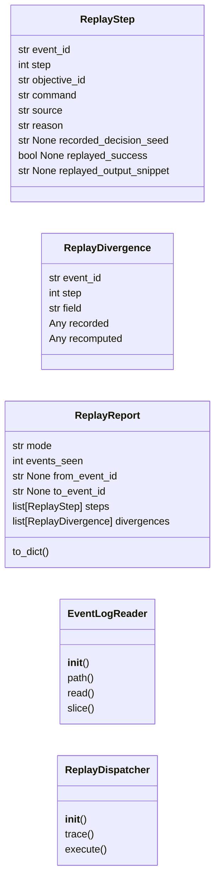
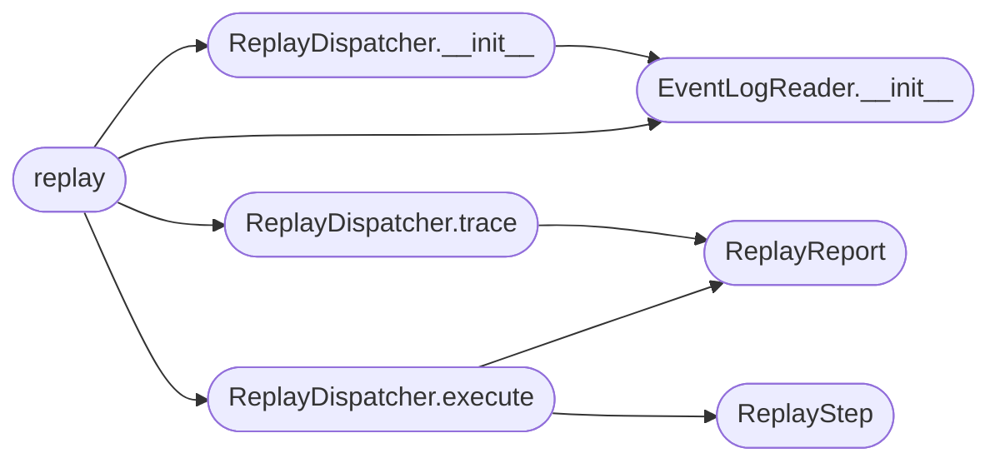

# `skills.autonomous_replay`

> Source: [skills/autonomous_replay.py:1](../../skills/autonomous_replay.py#L1) | language `py` | coverage 100.0% | [API index](../index.md)

Deterministic replay of past autonomous-daemon runs.

The autonomous daemon (``skills/autonomous_daemon.py``) emits structured
events to ``sessions/autonomous_events.jsonl``. This module reads that
log back and reproduces the recorded decision sequence in two flavours:

* `[`trace`](#replaydispatcher-trace)` — pure analysis, no command is re-executed. The recorded
  decisions are validated against the deterministic
  ``decision_seed`` stored with each ``STEP_START`` event, surfacing
  any divergence (for example a selector chain that was edited
  between the original run and the replay attempt).
* `[`execute`](contrib.legacy.lazyssh.py.md#execute)` — same sequence, but each recorded command is rerun
  through the existing `ICommandRunner` chain so the operator
  can compare current output against the recorded snippet. The
  runner chain is **the same** the live daemon uses, so the harness
  layers (permissions, hooks) still apply.

Replay never bypasses the operator approval flow; it stops at the same
checkpoints the live daemon would.

## Contents

- **Classes:** [`ReplayStep`](#replaystep), [`ReplayDivergence`](#replaydivergence), [`ReplayReport`](#replayreport), [`EventLogReader`](#eventlogreader), [`ReplayDispatcher`](#replaydispatcher)
- **Functions:** [`replay`](#replay)
- **Constants:** [`REPLAY_MODE_TRACE`](#replay_mode_trace), [`REPLAY_MODE_EXECUTE`](#replay_mode_execute), [`SUPPORTED_REPLAY_MODES`](#supported_replay_modes), [`STEP_START_TYPE`](#step_start_type), [`STEP_DONE_TYPE`](#step_done_type), [`OUTPUT_SNIPPET_LIMIT`](#output_snippet_limit), [`LAZYOWN_DIR`](#lazyown_dir), [`SESSIONS_DIR`](#sessions_dir), [`DEFAULT_EVENTS_FILE`](#default_events_file)

## Type Diagram



## Call Graph

Solid arrows stay in this module, dashed arrows leave it.



## Classes

<a id="replaystep"></a>

### `ReplayStep`

`class` `dataclass` | [skills/autonomous_replay.py:53](../../skills/autonomous_replay.py#L53)

Decorators: `@dataclass(frozen=True)`

```python
class ReplayStep
```

One reproduced decision in a replay run.

**Attributes**

| Name | Type | Default | Description |
|---|---|---|---|
| [`event_id`](#replaystep-event_id) | `str` |  | ``id`` of the source ``STEP_START`` event. |
| [`step`](#replaystep-step) | `int` |  | Step counter inside the parent objective. |
| [`objective_id`](#replaystep-objective_id) | `str` |  | Identifier of the parent objective. |
| [`command`](#replaystep-command) | `str` |  | Command that was recorded. |
| [`source`](#replaystep-source) | `str` |  | Name of the selector that produced the decision. |
| [`reason`](#replaystep-reason) | `str` |  | Free-form rationale recorded by the daemon. |
| [`recorded_decision_seed`](#replaystep-recorded_decision_seed) | `str \| None` |  | Decision seed stored at recording time. |
| [`replayed_success`](#replaystep-replayed_success) | `bool \| None` | `None` | ``None`` in trace mode, ``True``/``False`` once [`ReplayDispatcher.execute`](#replaydispatcher-execute) has run the command. |
| [`replayed_output_snippet`](#replaystep-replayed_output_snippet) | `str \| None` | `None` | Trimmed output from the replayed run, ``None`` in trace mode. |

---

<a id="replaydivergence"></a>

### `ReplayDivergence`

`class` `dataclass` | [skills/autonomous_replay.py:82](../../skills/autonomous_replay.py#L82)

Decorators: `@dataclass(frozen=True)`

```python
class ReplayDivergence
```

Marker emitted when a replayed step does not match the recording.

**Attributes**

| Name | Type | Default | Description |
|---|---|---|---|
| [`event_id`](#replaydivergence-event_id) | `str` |  |  |
| [`step`](#replaydivergence-step) | `int` |  |  |
| [`field`](#replaydivergence-field) | `str` |  |  |
| [`recorded`](#replaydivergence-recorded) | `Any` |  |  |
| [`recomputed`](#replaydivergence-recomputed) | `Any` |  |  |

---

<a id="replayreport"></a>

### `ReplayReport`

`class` `dataclass` | [skills/autonomous_replay.py:93](../../skills/autonomous_replay.py#L93)

Decorators: `@dataclass`

```python
class ReplayReport
```

Final outcome of a [`ReplayDispatcher`](#replaydispatcher) call.

**Attributes**

| Name | Type | Default | Description |
|---|---|---|---|
| [`mode`](#replayreport-mode) | `str` |  | ``"trace"`` or ``"execute"``. |
| [`events_seen`](#replayreport-events_seen) | `int` |  | Total ``STEP_START`` events considered, before any filtering. |
| [`from_event_id`](#replayreport-from_event_id) | `str \| None` |  | Inclusive lower bound used during the run. |
| [`to_event_id`](#replayreport-to_event_id) | `str \| None` |  | Inclusive upper bound used during the run. |
| [`steps`](#replayreport-steps) | `list[ReplayStep]` | `field(default_factory=list)` | Reproduced steps, in chronological order. |
| [`divergences`](#replayreport-divergences) | `list[ReplayDivergence]` | `field(default_factory=list)` | Detected divergences (empty when the recording is consistent). |

**Members**

| Member | Kind | Summary |
|---|---|---|
| [`to_dict`](#replayreport-to_dict) | method | Return the report as a JSON-serialisable dictionary. |

<a id="replayreport-to_dict"></a>

#### `ReplayReport.to_dict`

`method` | [skills/autonomous_replay.py:114](../../skills/autonomous_replay.py#L114)

```python
def to_dict(self) -> dict[str, Any]
```

Return the report as a JSON-serialisable dictionary.

**Returns:** `dict[str, Any]`

---

<a id="eventlogreader"></a>

### `EventLogReader`

`class` | [skills/autonomous_replay.py:127](../../skills/autonomous_replay.py#L127)

```python
class EventLogReader
```

Parse ``autonomous_events.jsonl`` into in-memory events.

Malformed lines are skipped with a debug log entry so a single
truncated line never blocks an entire replay. The reader does not
perform any filtering on its own; slicing by event id lives in
[`ReplayDispatcher`](#replaydispatcher).

**Members**

| Member | Kind | Summary |
|---|---|---|
| [`__init__`](#eventlogreader-__init__) | constructor | Initialise the reader. |
| [`path`](#eventlogreader-path) | property | Return the source path. |
| [`read`](#eventlogreader-read) | method | Return every event in the log, oldest first. |
| [`slice`](#eventlogreader-slice) | method | Return the inclusive subrange of *events* by ``id``. |

<a id="eventlogreader-__init__"></a>

#### `EventLogReader.__init__`

`constructor` | [skills/autonomous_replay.py:136](../../skills/autonomous_replay.py#L136)

```python
def __init__(self, path: Path = DEFAULT_EVENTS_FILE) -> None
```

Initialise the reader.

**Parameters**

| Name | Type | Default | Description |
|---|---|---|---|
| `path` | `Path` | `DEFAULT_EVENTS_FILE` | Source JSONL file. Defaults to [`DEFAULT_EVENTS_FILE`](#default_events_file). |

*Called by:* [`ReplayDispatcher.__init__`](#replaydispatcher-__init__), [`replay`](#replay)

<a id="eventlogreader-path"></a>

#### `EventLogReader.path`

`property` | [skills/autonomous_replay.py:147](../../skills/autonomous_replay.py#L147)

Decorators: `@property`

```python
def path(self) -> Path
```

Return the source path.

**Returns:** `Path`

<a id="eventlogreader-read"></a>

#### `EventLogReader.read`

`method` | [skills/autonomous_replay.py:152](../../skills/autonomous_replay.py#L152)

```python
def read(self) -> list[dict[str, Any]]
```

Return every event in the log, oldest first.

**Returns:** `list[dict[str, Any]]` - A list of decoded events. Empty when the file does not
exist or cannot be read.

<a id="eventlogreader-slice"></a>

#### `EventLogReader.slice`

`method` | [skills/autonomous_replay.py:177](../../skills/autonomous_replay.py#L177)

```python
def slice(self, events: list[dict[str, Any]], from_event_id: str | None = None, to_event_id: str | None = None) -> list[dict[str, Any]]
```

Return the inclusive subrange of *events* by ``id``.

**Parameters**

| Name | Type | Default | Description |
|---|---|---|---|
| `events` | `list[dict[str, Any]]` |  | Source list as returned by [`read`](#eventlogreader-read). |
| `from_event_id` | `str \| None` | `None` | Inclusive lower bound. ``None`` keeps the beginning of the log. |
| `to_event_id` | `str \| None` | `None` | Inclusive upper bound. ``None`` keeps the end of the log. |

**Returns:** `list[dict[str, Any]]` - A subrange of *events*. When both bounds are ``None`` the
input list is returned unchanged.

*Called by:* [`Ct.G.I.J.L.M.N.N.Ot.Q.R.S.S.St.T.X.Y.Z.a.b.c.c.d.et.extends.extends.extends.extends.extends.extends.extends.extends.extends.extends.extends.f.g.h.h.h.i.i.i.i.i.j.jt.k.k.m.m.n.o.o.o.o.ot.qt.rt.s.s.t.t.t.t.t.tt.u.u.w`](static.js.quill-2.0.3.js.md#ct-g-i-j-l-m-n-n-ot-q-r-s-s-st-t-x-y-z-a-b-c-c-d-et-extends-extends-extends-extends-extends-extends-extends-extends-extends-extends-extends-f-g-h-h-h-i-i-i-i-i-j-jt-k-k-m-m-n-o-o-o-o-ot-qt-rt-s-s-t-t-t-t-t-tt-u-u-w)

---

<a id="replaydispatcher"></a>

### `ReplayDispatcher`

`class` | [skills/autonomous_replay.py:212](../../skills/autonomous_replay.py#L212)

```python
class ReplayDispatcher
```

Drive a replay run over a parsed event log.

Depends on a [`EventLogReader`](#eventlogreader) for input and (in execute
mode) on a runner exposing a ``run(command, timeout) -> str``
interface compatible with
[`skills.autonomous_daemon.ICommandRunner`](skills.autonomous_daemon.py.md#icommandrunner).

**Members**

| Member | Kind | Summary |
|---|---|---|
| [`__init__`](#replaydispatcher-__init__) | constructor | Initialise the dispatcher. |
| [`trace`](#replaydispatcher-trace) | method | Replay the recorded decision sequence without executing it. |
| [`execute`](#replaydispatcher-execute) | method | Replay the recorded sequence and re-run each command. |

<a id="replaydispatcher-__init__"></a>

#### `ReplayDispatcher.__init__`

`constructor` | [skills/autonomous_replay.py:221](../../skills/autonomous_replay.py#L221)

```python
def __init__(self, reader: EventLogReader | None = None, seed_fn: Callable[[str, int, str], str] | None = None) -> None
```

Initialise the dispatcher.

**Parameters**

| Name | Type | Default | Description |
|---|---|---|---|
| `reader` | `EventLogReader \| None` | `None` | Source reader. Defaults to a fresh [`EventLogReader`](#eventlogreader) against [`DEFAULT_EVENTS_FILE`](#default_events_file). |
| `seed_fn` | `Callable[[str, int, str], str] \| None` | `None` | Decision-seed function. Defaults to `autonomous_daemon.compute_decision_seed`. Injected in tests. |

*Calls:* [`EventLogReader.__init__`](#eventlogreader-__init__)

*Called by:* [`replay`](#replay)

<a id="replaydispatcher-trace"></a>

#### `ReplayDispatcher.trace`

`method` | [skills/autonomous_replay.py:325](../../skills/autonomous_replay.py#L325)

```python
def trace(self, from_event_id: str | None = None, to_event_id: str | None = None) -> ReplayReport
```

Replay the recorded decision sequence without executing it.

**Parameters**

| Name | Type | Default | Description |
|---|---|---|---|
| `from_event_id` | `str \| None` | `None` | Inclusive lower bound on event id. |
| `to_event_id` | `str \| None` | `None` | Inclusive upper bound on event id. |

**Returns:** `ReplayReport` - A [`ReplayReport`](#replayreport) populated with one step per
``STEP_START`` event in the requested range.

*Calls:* [`ReplayReport`](#replayreport)

*Called by:* [`replay`](#replay)

<a id="replaydispatcher-execute"></a>

#### `ReplayDispatcher.execute`

`method` | [skills/autonomous_replay.py:357](../../skills/autonomous_replay.py#L357)

```python
def execute(self, from_event_id: str | None = None, to_event_id: str | None = None, runner: Any | None = None, timeout: int = 60) -> ReplayReport
```

Replay the recorded sequence and re-run each command.

**Parameters**

| Name | Type | Default | Description |
|---|---|---|---|
| `from_event_id` | `str \| None` | `None` | Inclusive lower bound on event id. |
| `to_event_id` | `str \| None` | `None` | Inclusive upper bound on event id. |
| `runner` | `Any \| None` | `None` | Runner exposing ``run(command, timeout) -> str``. Defaults to the same chain [`skills.autonomous_daemon.CommandRunnerChain`](skills.autonomous_daemon.py.md#commandrunnerchain) uses live, so the harness layers (permissions, hooks) still apply. |
| `timeout` | `int` | `60` | Per-command timeout in seconds. |

**Returns:** `ReplayReport` - A [`ReplayReport`](#replayreport) whose steps carry the freshly
captured output snippets and a recomputed success flag.

*Calls:* [`ReplayReport`](#replayreport), [`ReplayStep`](#replaystep)

*Called by:* [`replay`](#replay)

---

## Functions

<a id="replay"></a>

### `replay`

`function` | [skills/autonomous_replay.py:473](../../skills/autonomous_replay.py#L473)

```python
def replay(from_event_id: str | None = None, to_event_id: str | None = None, mode: Literal['trace', 'execute'] = REPLAY_MODE_TRACE, events_path: Path | None = None, runner: Any | None = None, timeout: int = 60) -> dict[str, Any]
```

Convenience entry point used by the MCP tool layer.

**Parameters**

| Name | Type | Default | Description |
|---|---|---|---|
| `from_event_id` | `str \| None` | `None` | Inclusive lower bound on event id. |
| `to_event_id` | `str \| None` | `None` | Inclusive upper bound on event id. |
| `mode` | `Literal['trace', 'execute']` | `REPLAY_MODE_TRACE` | ``"trace"`` (default) or ``"execute"``. |
| `events_path` | `Path \| None` | `None` | Override for the JSONL source file. Defaults to [`DEFAULT_EVENTS_FILE`](#default_events_file). |
| `runner` | `Any \| None` | `None` | Optional runner injection used only in ``"execute"`` mode. |
| `timeout` | `int` | `60` | Per-command timeout in seconds, ``"execute"`` mode only. |

**Returns:** `dict[str, Any]` - Serialised [`ReplayReport`](#replayreport) dictionary.

**Raises**

- `ValueError`: If *mode* is not one of [`SUPPORTED_REPLAY_MODES`](#supported_replay_modes).

*Calls:* [`EventLogReader.__init__`](#eventlogreader-__init__), [`ReplayDispatcher.__init__`](#replaydispatcher-__init__), [`ReplayDispatcher.execute`](#replaydispatcher-execute), [`ReplayDispatcher.trace`](#replaydispatcher-trace)

---

## Constants

<a id="replay_mode_trace"></a>

### `REPLAY_MODE_TRACE`

`constant` | [skills/autonomous_replay.py:32](../../skills/autonomous_replay.py#L32)

```python
REPLAY_MODE_TRACE: str = 'trace'
```

---

<a id="replay_mode_execute"></a>

### `REPLAY_MODE_EXECUTE`

`constant` | [skills/autonomous_replay.py:33](../../skills/autonomous_replay.py#L33)

```python
REPLAY_MODE_EXECUTE: str = 'execute'
```

---

<a id="supported_replay_modes"></a>

### `SUPPORTED_REPLAY_MODES`

`constant` | [skills/autonomous_replay.py:34](../../skills/autonomous_replay.py#L34)

```python
SUPPORTED_REPLAY_MODES: tuple = (REPLAY_MODE_TRACE, REPLAY_MODE_EXECUTE)
```

---

<a id="step_start_type"></a>

### `STEP_START_TYPE`

`constant` | [skills/autonomous_replay.py:36](../../skills/autonomous_replay.py#L36)

```python
STEP_START_TYPE: str = 'STEP_START'
```

---

<a id="step_done_type"></a>

### `STEP_DONE_TYPE`

`constant` | [skills/autonomous_replay.py:37](../../skills/autonomous_replay.py#L37)

```python
STEP_DONE_TYPE: str = 'STEP_DONE'
```

---

<a id="output_snippet_limit"></a>

### `OUTPUT_SNIPPET_LIMIT`

`constant` | [skills/autonomous_replay.py:38](../../skills/autonomous_replay.py#L38)

```python
OUTPUT_SNIPPET_LIMIT: int = 280
```

---

<a id="lazyown_dir"></a>

### `LAZYOWN_DIR`

`constant` | [skills/autonomous_replay.py:40](../../skills/autonomous_replay.py#L40)

```python
LAZYOWN_DIR: Path = Path(os.environ.get('LAZYOWN_DIR', str(Path(__file__).resolve().parent.parent)))
```

---

<a id="sessions_dir"></a>

### `SESSIONS_DIR`

`constant` | [skills/autonomous_replay.py:46](../../skills/autonomous_replay.py#L46)

```python
SESSIONS_DIR: Path = LAZYOWN_DIR / 'sessions'
```

---

<a id="default_events_file"></a>

### `DEFAULT_EVENTS_FILE`

`constant` | [skills/autonomous_replay.py:47](../../skills/autonomous_replay.py#L47)

```python
DEFAULT_EVENTS_FILE: Path = SESSIONS_DIR / 'autonomous_events.jsonl'
```

---
