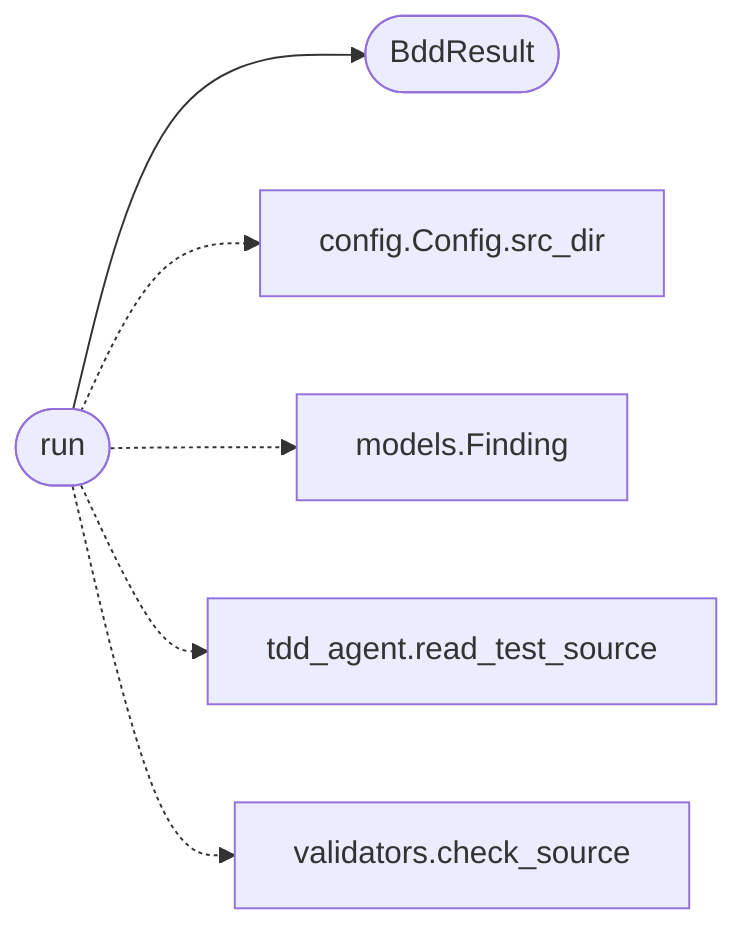

# `skills.claude_md_orchestrator.bdd_agent`

> Source: [skills/claude_md_orchestrator/bdd_agent.py:1](../../skills/claude_md_orchestrator/bdd_agent.py#L1) | language `py` | coverage 100.0% | [API index](../index.md)

Behavior-Driven Development agent.

The agent reads the spec and the failing tests the tdd agent produced.
The agent writes the implementation that satisfies the tests. The
cycle halts at green. The agent will not advance to the next stage
until pytest reports pass for every test the tdd agent wrote.

The implementation is a single self contained module per contract. The
module exposes a `[`run`](#run)` function that returns the string `[`ok`](scripts.top_tier_check.py.md#ok)` on the
happy path and a ``handle_sad_NN`` function per sad path that returns
the string ``handled``. The shape mirrors what the tdd agent imports
so the two agents never disagree.

## Contents

- **Classes:** [`BddResult`](#bddresult)
- **Functions:** [`run`](#run)
- **Constants:** [`IMPLEMENTATION_TEMPLATE`](#implementation_template)

## Call Graph

Solid arrows stay in this module, dashed arrows leave it.



## Classes

<a id="bddresult"></a>

### `BddResult`

`class` `dataclass` | [skills/claude_md_orchestrator/bdd_agent.py:113](../../skills/claude_md_orchestrator/bdd_agent.py#L113)

Decorators: `@dataclass`

```python
class BddResult
```

Outcome of running the implementation agent.

**Attributes**

| Name | Type | Default | Description |
|---|---|---|---|
| [`source_path`](#bddresult-source_path) | `Path` |  | Absolute path of the implementation module the agent wrote. |
| [`findings`](#bddresult-findings) | `list[Finding]` |  | DoD findings the agent collected. |
| [`green`](#bddresult-green) | `bool` |  | True when pytest reported pass for every new test. |
| [`duration_seconds`](#bddresult-duration_seconds) | `float` |  | Wall clock duration of the pytest run. |

---

## Functions

<a id="run"></a>

### `run`

`function` | [skills/claude_md_orchestrator/bdd_agent.py:151](../../skills/claude_md_orchestrator/bdd_agent.py#L151)

```python
def run(contract: Contract, spec: Spec, suite: TestSuite, config: Config) -> BddResult
```

Run the implementation agent for one contract.

**Parameters**

| Name | Type | Default | Description |
|---|---|---|---|
| `contract` | `Contract` |  | The contract the spec implements. |
| `spec` | `Spec` |  | The spec the implementation satisfies. |
| `suite` | `TestSuite` |  | The TestSuite the tdd agent produced. |
| `config` | `Config` |  | Active runtime configuration. |

**Returns:** `BddResult` - The result the orchestrator persists. The green flag is True
when pytest reported pass for every new test. The orchestrator
advances only when green is True.

*Calls:* [`BddResult`](#bddresult), [`Config.src_dir`](skills.claude_md_orchestrator.config.py.md#config-src_dir), [`Finding`](skills.claude_md_orchestrator.models.py.md#finding), [`read_test_source`](skills.claude_md_orchestrator.tdd_agent.py.md#read_test_source), [`check_source`](skills.claude_md_orchestrator.validators.py.md#check_source)

---

## Constants

<a id="implementation_template"></a>

### `IMPLEMENTATION_TEMPLATE`

`constant` | [skills/claude_md_orchestrator/bdd_agent.py:28](../../skills/claude_md_orchestrator/bdd_agent.py#L28)

```python
IMPLEMENTATION_TEMPLATE
```

---
