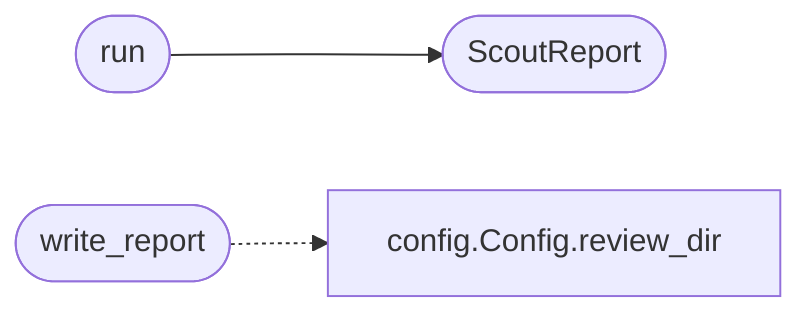

# `skills.claude_md_orchestrator.boy_scout`

> Source: [skills/claude_md_orchestrator/boy_scout.py:1](../../skills/claude_md_orchestrator/boy_scout.py#L1) | language `py` | coverage 100.0% | [API index](../index.md)

Boy Scout refactor pass.

The pass runs after the green stage. The pass scans the artifacts the
bdd agent produced for tech debt and security gaps the DoD validators
catch. The pass generates a fix plan and writes a refactor proposal
the operator can review. The pass never mutates source by itself; the
operator is the only one who applies the fix.

The pass is intentionally narrow. The DoD is enforced by the
reviewer. The boy scout pass focuses on the cleanup that does not
change behaviour: removed unused imports, deduplicated literals, and
the documentation drift.

## Contents

- **Classes:** [`ScoutReport`](#scoutreport)
- **Functions:** [`run`](#run), [`write_report`](#write_report)
- **Constants:** [`UNUSED_IMPORT_PATTERN`](#unused_import_pattern), [`DEAD_CODE_HINT`](#dead_code_hint)

## Call Graph

Solid arrows stay in this module, dashed arrows leave it.



## Classes

<a id="scoutreport"></a>

### `ScoutReport`

`class` `dataclass` | [skills/claude_md_orchestrator/boy_scout.py:30](../../skills/claude_md_orchestrator/boy_scout.py#L30)

Decorators: `@dataclass`

```python
class ScoutReport
```

Outcome of a boy scout pass.

**Attributes**

| Name | Type | Default | Description |
|---|---|---|---|
| [`contract_id`](#scoutreport-contract_id) | `str` |  | Identifier of the contract the pass ran for. |
| [`findings`](#scoutreport-findings) | `list[Finding]` | `field(default_factory=list)` | Findings the pass collected. |
| [`proposal`](#scoutreport-proposal) | `str` | `''` | Free form text the operator can read before applying the refactor. |

---

## Functions

<a id="run"></a>

### `run`

`function` | [skills/claude_md_orchestrator/boy_scout.py:90](../../skills/claude_md_orchestrator/boy_scout.py#L90)

```python
def run(state, config: Config) -> ScoutReport
```

Run the boy scout pass for one contract.

**Parameters**

| Name | Type | Default | Description |
|---|---|---|---|
| `state` |  |  | Per contract state the pass reads the artifacts from. |
| `config` | `Config` |  | Active runtime configuration. |

**Returns:** `ScoutReport` - The structured report the orchestrator persists.

*Calls:* [`ScoutReport`](#scoutreport)

---

<a id="write_report"></a>

### `write_report`

`function` | [skills/claude_md_orchestrator/boy_scout.py:110](../../skills/claude_md_orchestrator/boy_scout.py#L110)

```python
def write_report(report: ScoutReport, config: Config) -> Path
```

Persist the boy scout proposal to disk.

**Parameters**

| Name | Type | Default | Description |
|---|---|---|---|
| `report` | `ScoutReport` |  |  |
| `config` | `Config` |  |  |

**Returns:** `Path`

*Calls:* [`Config.review_dir`](skills.claude_md_orchestrator.config.py.md#config-review_dir)

---

## Constants

<a id="unused_import_pattern"></a>

### `UNUSED_IMPORT_PATTERN`

`constant` | [skills/claude_md_orchestrator/boy_scout.py:25](../../skills/claude_md_orchestrator/boy_scout.py#L25)

```python
UNUSED_IMPORT_PATTERN
```

---

<a id="dead_code_hint"></a>

### `DEAD_CODE_HINT`

`constant` | [skills/claude_md_orchestrator/boy_scout.py:26](../../skills/claude_md_orchestrator/boy_scout.py#L26)

```python
DEAD_CODE_HINT = re.compile('\\b(pass\\s*$|\\.\\.\\.\\s*$|TODO|FIXME)', re.MULTILINE)
```

---
