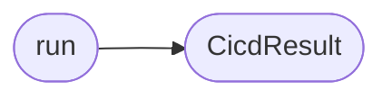

# `skills.claude_md_orchestrator.cicd_agent`

> Source: [skills/claude_md_orchestrator/cicd_agent.py:1](../../skills/claude_md_orchestrator/cicd_agent.py#L1) | language `py` | coverage 100.0% | [API index](../index.md)

CI and CD agent.

The agent cuts a feature branch, stages the artifacts, prepares the CI
pipeline, and writes the PR body. The agent never pushes and never
deploys. The deploy gate is closed by default. The orchestrator only
opens the gate when the operator supplies the deploy gate token.

The pipeline file is a real GitHub Actions workflow. The agent keeps
the workflow minimal and explicit. The workflow runs ruff, mypy,
bandit, and pytest. The workflow fails when any of those return a
non zero exit code. The agent does not invent matrix builds or
release pipelines. The skill stays portable across LazyOwn releases.

## Contents

- **Classes:** [`CicdResult`](#cicdresult)
- **Functions:** [`run`](#run)
- **Constants:** [`SAFE_BRANCH`](#safe_branch), [`PIPELINE_TEMPLATE`](#pipeline_template)

## Call Graph

Solid arrows stay in this module, dashed arrows leave it.



## Classes

<a id="cicdresult"></a>

### `CicdResult`

`class` `dataclass` | [skills/claude_md_orchestrator/cicd_agent.py:71](../../skills/claude_md_orchestrator/cicd_agent.py#L71)

Decorators: `@dataclass`

```python
class CicdResult
```

Outcome of the CI and CD agent.

**Attributes**

| Name | Type | Default | Description |
|---|---|---|---|
| [`branch`](#cicdresult-branch) | `str` |  | Name of the feature branch the agent cut. |
| [`pipeline_path`](#cicdresult-pipeline_path) | `Path` |  | Absolute path of the workflow file. |
| [`pr_body_path`](#cicdresult-pr_body_path) | `Path` |  | Absolute path of the PR body file. |
| [`deployed`](#cicdresult-deployed) | `bool` |  | True when the deploy gate was open and the agent ran the deploy command. The default leaves the gate closed. |
| [`findings`](#cicdresult-findings) | `list[str]` |  | DoD findings the agent collected. |

---

## Functions

<a id="run"></a>

### `run`

`function` | [skills/claude_md_orchestrator/cicd_agent.py:177](../../skills/claude_md_orchestrator/cicd_agent.py#L177)

```python
def run(contract: Contract, spec: Spec, report: ReviewReport | None, config: Config, *, auto_commit: bool = False, deploy_token: str | None = None) -> CicdResult
```

Run the CI and CD agent for one contract.

**Parameters**

| Name | Type | Default | Description |
|---|---|---|---|
| `contract` | `Contract` |  | The contract the cycle finished. |
| `spec` | `Spec` |  | The spec the implementation satisfies. |
| `report` | `ReviewReport \| None` |  | The review report. The agent only ships when the report is approved. |
| `config` | `Config` |  | Active runtime configuration. |
| `auto_commit` | `bool` | `False` | When True the agent stages the artifacts and commits them on the feature branch. The default keeps the operator in control of the commit boundary. |
| `deploy_token` | `str \| None` | `None` | Shared secret the agent checks before it runs any deploy command. The gate is closed when the value is None or empty. |

**Returns:** `CicdResult` - The result the orchestrator persists. The deployed flag is
always False in the default posture.

*Calls:* [`CicdResult`](#cicdresult)

---

## Constants

<a id="safe_branch"></a>

### `SAFE_BRANCH`

`constant` | [skills/claude_md_orchestrator/cicd_agent.py:26](../../skills/claude_md_orchestrator/cicd_agent.py#L26)

```python
SAFE_BRANCH = re.compile('[^a-z0-9-]+')
```

---

<a id="pipeline_template"></a>

### `PIPELINE_TEMPLATE`

`constant` | [skills/claude_md_orchestrator/cicd_agent.py:29](../../skills/claude_md_orchestrator/cicd_agent.py#L29)

```python
PIPELINE_TEMPLATE
```

---
