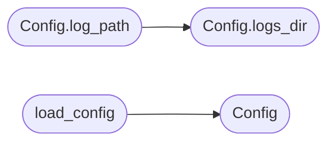

# `skills.claude_md_orchestrator.config`

> Source: [skills/claude_md_orchestrator/config.py:1](../../skills/claude_md_orchestrator/config.py#L1) | language `py` | coverage 100.0% | [API index](../index.md)

Centralized configuration for the claude_md_orchestrator skill.

The orchestrator reads every runtime value from this module. Tests and
runtime both consume the same dataclass. The defaults point to a local
run directory inside the skill so a fresh checkout is runnable without
external state. The orchestrator may override any field at construction
time.

## Contents

- **Classes:** [`Config`](#config)
- **Functions:** [`load_config`](#load_config), [`resolve_optional`](#resolve_optional)
- **Constants:** [`REPO_ROOT_ENV`](#repo_root_env), [`RUN_DIR_ENV`](#run_dir_env), [`CLAUDE_MD_ENV`](#claude_md_env), [`DEPLOY_GATE_ENV`](#deploy_gate_env)

## Call Graph

Solid arrows stay in this module, dashed arrows leave it.



## Classes

<a id="config"></a>

### `Config`

`class` `dataclass` | [skills/claude_md_orchestrator/config.py:67](../../skills/claude_md_orchestrator/config.py#L67)

Decorators: `@dataclass`

```python
class Config
```

Runtime configuration for the orchestrator.

**Attributes**

| Name | Type | Default | Description |
|---|---|---|---|
| [`repo_root`](#config-repo_root) | `Path` | `field(default_factory=_repo_root)` | Absolute path of the LazyOwn repository. |
| [`run_dir`](#config-run_dir) | `Path` | `field(default_factory=_default_run_dir)` | Absolute path of the working directory for the active cycle. The orchestrator creates the subdirectories specs, tests, src, review, docs, and logs under this root. |
| [`claude_md_path`](#config-claude_md_path) | `Path` | `field(default_factory=_default_claude_md)` | Absolute path of the markdown file the parser consumes. |
| [`base_branch`](#config-base_branch) | `str` | `'dev'` | Branch from which the cicd agent cuts the feature branch. The default follows the LazyOwn branching model. |
| [`feature_branch_prefix`](#config-feature_branch_prefix) | `str` | `'feature'` | Prefix the cicd agent prepends to every feature branch it cuts. |
| [`max_sad_paths`](#config-max_sad_paths) | `int` | `6` | Minimum number of sad paths the spec writer must document. The DoD enforces six. |
| [`test_min_red_seconds`](#config-test_min_red_seconds) | `float` | `0.0` | Lower bound the orchestrator enforces on the red stage so a flaky runner cannot race through. |
| [`reviewer_strict`](#config-reviewer_strict) | `bool` | `True` | When True the reviewer treats every warning as a blocker. When False the reviewer reports non blockers and lets the operator decide. |
| [`llm_backend`](#config-llm_backend) | `str` | `''` | Identifier of the LLM backend the agents use. The value comes from the LazyOwn llm_factory module when available. The orchestrator falls back to the mock template engine when the value is empty or unknown. |
| [`deploy_gate_token`](#config-deploy_gate_token) | `str` | `field(default_factory=lambda: os.environ.get(DEPLOY_GATE_ENV, ''))` | Shared secret the cicd agent checks before it calls any deploy tool. The orchestrator reads the value from the LAZYOWN_DEPLOY_GATE_TOKEN environment variable. A missing token keeps the gate closed by design. |
| [`verbose`](#config-verbose) | `bool` | `True` | When True the orchestrator prints a stage banner to stderr after every transition. |

**Members**

| Member | Kind | Summary |
|---|---|---|
| [`ensure`](#config-ensure) | method | Create the run subdirectories if they do not exist. |
| [`state_path`](#config-state_path) | method | Return the absolute path of the cycle state file. |
| [`specs_dir`](#config-specs_dir) | method | Return the absolute path of the spec directory. |
| [`tests_dir`](#config-tests_dir) | method | Return the absolute path of the test directory. |
| [`src_dir`](#config-src_dir) | method | Return the absolute path of the implementation directory. |
| [`review_dir`](#config-review_dir) | method | Return the absolute path of the review directory. |
| [`docs_dir`](#config-docs_dir) | method | Return the absolute path of the documentation directory. |
| [`logs_dir`](#config-logs_dir) | method | Return the absolute path of the log directory. |
| [`log_path`](#config-log_path) | method | Return the absolute path of the JSONL log for the active run. |

<a id="config-ensure"></a>

#### `Config.ensure`

`method` | [skills/claude_md_orchestrator/config.py:112](../../skills/claude_md_orchestrator/config.py#L112)

```python
def ensure(self) -> None
```

Create the run subdirectories if they do not exist.

The orchestrator calls this method before it dispatches the
first agent so downstream agents can write without checking the
filesystem.

*Called by:* [`run`](skills.claude_md_orchestrator.orchestrator.py.md#run)

<a id="config-state_path"></a>

#### `Config.state_path`

`method` | [skills/claude_md_orchestrator/config.py:122](../../skills/claude_md_orchestrator/config.py#L122)

```python
def state_path(self) -> Path
```

Return the absolute path of the cycle state file.

**Returns:** `Path`

<a id="config-specs_dir"></a>

#### `Config.specs_dir`

`method` | [skills/claude_md_orchestrator/config.py:126](../../skills/claude_md_orchestrator/config.py#L126)

```python
def specs_dir(self) -> Path
```

Return the absolute path of the spec directory.

**Returns:** `Path`

*Called by:* [`run`](skills.claude_md_orchestrator.sdd_agent.py.md#run)

<a id="config-tests_dir"></a>

#### `Config.tests_dir`

`method` | [skills/claude_md_orchestrator/config.py:130](../../skills/claude_md_orchestrator/config.py#L130)

```python
def tests_dir(self) -> Path
```

Return the absolute path of the test directory.

**Returns:** `Path`

*Called by:* [`run`](skills.claude_md_orchestrator.tdd_agent.py.md#run)

<a id="config-src_dir"></a>

#### `Config.src_dir`

`method` | [skills/claude_md_orchestrator/config.py:134](../../skills/claude_md_orchestrator/config.py#L134)

```python
def src_dir(self) -> Path
```

Return the absolute path of the implementation directory.

**Returns:** `Path`

*Called by:* [`run`](skills.claude_md_orchestrator.bdd_agent.py.md#run)

<a id="config-review_dir"></a>

#### `Config.review_dir`

`method` | [skills/claude_md_orchestrator/config.py:138](../../skills/claude_md_orchestrator/config.py#L138)

```python
def review_dir(self) -> Path
```

Return the absolute path of the review directory.

**Returns:** `Path`

*Called by:* [`write_report`](skills.claude_md_orchestrator.boy_scout.py.md#write_report), [`write_report`](skills.claude_md_orchestrator.reviewer_agent.py.md#write_report)

<a id="config-docs_dir"></a>

#### `Config.docs_dir`

`method` | [skills/claude_md_orchestrator/config.py:142](../../skills/claude_md_orchestrator/config.py#L142)

```python
def docs_dir(self) -> Path
```

Return the absolute path of the documentation directory.

**Returns:** `Path`

*Called by:* [`run`](skills.claude_md_orchestrator.documentation_agent.py.md#run)

<a id="config-logs_dir"></a>

#### `Config.logs_dir`

`method` | [skills/claude_md_orchestrator/config.py:146](../../skills/claude_md_orchestrator/config.py#L146)

```python
def logs_dir(self) -> Path
```

Return the absolute path of the log directory.

**Returns:** `Path`

*Called by:* [`Config.log_path`](#config-log_path)

<a id="config-log_path"></a>

#### `Config.log_path`

`method` | [skills/claude_md_orchestrator/config.py:150](../../skills/claude_md_orchestrator/config.py#L150)

```python
def log_path(self) -> Path
```

Return the absolute path of the JSONL log for the active run.

**Returns:** `Path`

*Calls:* [`Config.logs_dir`](#config-logs_dir)

---

## Functions

<a id="load_config"></a>

### `load_config`

`function` | [skills/claude_md_orchestrator/config.py:155](../../skills/claude_md_orchestrator/config.py#L155)

```python
def load_config() -> Config
```

Build a Config from environment variables and return it.

The function never mutates global state. It exists so the test
suite and the CLI entry point share the same resolution path.

**Returns:** `Config`

*Calls:* [`Config`](#config)

*Called by:* [`main`](skills.claude_md_orchestrator.orchestrator.py.md#main)

---

<a id="resolve_optional"></a>

### `resolve_optional`

`function` | [skills/claude_md_orchestrator/config.py:164](../../skills/claude_md_orchestrator/config.py#L164)

```python
def resolve_optional(config: Config, key: str) -> str | None
```

Return the environment value for a key or None when missing.

The helper keeps the call sites free of repeated os.environ lookups
so the production code reads as a single conditional.

**Parameters**

| Name | Type | Default | Description |
|---|---|---|---|
| `config` | `Config` |  |  |
| `key` | `str` |  |  |

**Returns:** `str | None`

---

## Constants

<a id="repo_root_env"></a>

### `REPO_ROOT_ENV`

`constant` | [skills/claude_md_orchestrator/config.py:16](../../skills/claude_md_orchestrator/config.py#L16)

```python
REPO_ROOT_ENV = 'LAZYOWN_REPO_ROOT'
```

---

<a id="run_dir_env"></a>

### `RUN_DIR_ENV`

`constant` | [skills/claude_md_orchestrator/config.py:17](../../skills/claude_md_orchestrator/config.py#L17)

```python
RUN_DIR_ENV = 'LAZYOWN_ORCH_RUN_DIR'
```

---

<a id="claude_md_env"></a>

### `CLAUDE_MD_ENV`

`constant` | [skills/claude_md_orchestrator/config.py:18](../../skills/claude_md_orchestrator/config.py#L18)

```python
CLAUDE_MD_ENV = 'LAZYOWN_CLAUDE_MD_PATH'
```

---

<a id="deploy_gate_env"></a>

### `DEPLOY_GATE_ENV`

`constant` | [skills/claude_md_orchestrator/config.py:19](../../skills/claude_md_orchestrator/config.py#L19)

```python
DEPLOY_GATE_ENV = 'LAZYOWN_DEPLOY_GATE_TOKEN'
```

---
