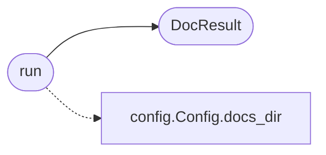

# `skills.claude_md_orchestrator.documentation_agent`

> Source: [skills/claude_md_orchestrator/documentation_agent.py:1](../../skills/claude_md_orchestrator/documentation_agent.py#L1) | language `py` | coverage 100.0% | [API index](../index.md)

Documentation agent.

The agent writes the user facing documentation for a contract. The
output is first person scientific English. The agent never uses emoji
or em dash. The agent never uses grand claims that the tests do not
back. The output is a markdown block wrapped in a triple backtick
fence, ready for copy and paste, signed by grisun0.

The agent is deterministic. The LLM enrichment is optional and runs
only when the operator configures a backend. The default template
captures the metadata the orchestrator already knows, so the
documentation is reproducible.

## Contents

- **Classes:** [`DocResult`](#docresult)
- **Functions:** [`run`](#run)
- **Constants:** [`SIGNATURE`](#signature), [`FENCE`](#fence)

## Call Graph

Solid arrows stay in this module, dashed arrows leave it.



## Classes

<a id="docresult"></a>

### `DocResult`

`class` `dataclass` | [skills/claude_md_orchestrator/documentation_agent.py:28](../../skills/claude_md_orchestrator/documentation_agent.py#L28)

Decorators: `@dataclass`

```python
class DocResult
```

Outcome of the documentation agent.

**Attributes**

| Name | Type | Default | Description |
|---|---|---|---|
| [`path`](#docresult-path) | `Path` |  | Absolute path of the doc file the agent wrote. |
| [`body`](#docresult-body) | `str` |  | The rendered markdown body inside the fence. |

---

## Functions

<a id="run"></a>

### `run`

`function` | [skills/claude_md_orchestrator/documentation_agent.py:123](../../skills/claude_md_orchestrator/documentation_agent.py#L123)

```python
def run(contract: Contract, spec: Spec, report: ReviewReport | None, config: Config) -> DocResult
```

Run the documentation agent for one contract.

**Parameters**

| Name | Type | Default | Description |
|---|---|---|---|
| `contract` | `Contract` |  | The contract the spec implements. |
| `spec` | `Spec` |  | The spec the documentation covers. |
| `report` | `ReviewReport \| None` |  | The review report the documentation summarises. Pass None when the reviewer has not run yet. |
| `config` | `Config` |  | Active runtime configuration. |

**Returns:** `DocResult` - The result the orchestrator persists. The path points at a
markdown file that the operator can copy and paste into the
repository docs.

*Calls:* [`Config.docs_dir`](skills.claude_md_orchestrator.config.py.md#config-docs_dir), [`DocResult`](#docresult)

---

## Constants

<a id="signature"></a>

### `SIGNATURE`

`constant` | [skills/claude_md_orchestrator/documentation_agent.py:23](../../skills/claude_md_orchestrator/documentation_agent.py#L23)

```python
SIGNATURE = 'grisun0'
```

---

<a id="fence"></a>

### `FENCE`

`constant` | [skills/claude_md_orchestrator/documentation_agent.py:24](../../skills/claude_md_orchestrator/documentation_agent.py#L24)

```python
FENCE = '```markdown'
```

---
