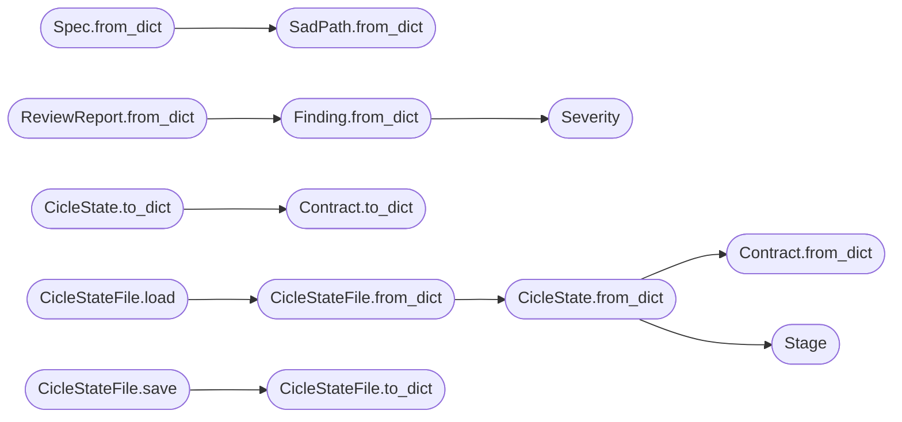

# `skills.claude_md_orchestrator.models`

> Source: [skills/claude_md_orchestrator/models.py:1](../../skills/claude_md_orchestrator/models.py#L1) | language `py` | coverage 100.0% | [API index](../index.md)

Data models for the claude_md_orchestrator skill.

The orchestrator is a pure data pipeline. Every agent reads its inputs
from disk, mutates an immutable dataclass, and writes the result back to
disk. The shape of those dataclasses is the contract between the
agents.

## Contents

- **Classes:** [`Contract`](#contract), [`SadPath`](#sadpath), [`Spec`](#spec), [`TestSuite`](#testsuite), [`Finding`](#finding), [`ReviewReport`](#reviewreport), [`CicleState`](#ciclestate), [`CicleStateFile`](#ciclestatefile)
- **Enums:** [`Stage`](#stage), [`Severity`](#severity)
- **Functions:** [`write_jsonl`](#write_jsonl)

## Type Diagram

```mermaid
classDiagram
    direction LR
    class Stage
    <<enum>> Stage
    Stage : PENDING
    Stage : SDD
    Stage : TDD
    Stage : BDD
    Stage : REVIEW
    Stage : CICD
    Stage : DONE
    class Severity
    <<enum>> Severity
    Severity : INFO
    Severity : WARN
    Severity : BLOCK
    class Contract
    Contract : str contract_id
    Contract : str title
    Contract : str rationale
    Contract : list[str] scope
    Contract : str source_section
    Contract : str raw_text
    Contract : to_dict()
    Contract : from_dict()
    class SadPath
    SadPath : str condition
    SadPath : str expected
    SadPath : to_dict()
    SadPath : from_dict()
    class Spec
    Spec : str contract_id
    Spec : str goal
    Spec : str trigger
    Spec : list[str] inputs
    Spec : list[str] happy_path
    Spec : list[SadPath] sad_paths
    Spec : str data_flow
    Spec : str observability
    Spec : list[str] out_of_scope
    Spec : str author
    Spec : str created_at
    Spec : to_dict()
    Spec : from_dict()
    Spec : validate()
    class TestSuite
    TestSuite : str contract_id
    TestSuite : Path test_path
    TestSuite : str expected_outcome
    TestSuite : list[str] test_names
    TestSuite : float duration_seconds
    TestSuite : to_dict()
    TestSuite : from_dict()
    class Finding
    Finding : Severity severity
    Finding : str rule
    Finding : str message
    Finding : str path
    Finding : to_dict()
    Finding : from_dict()
    class ReviewReport
    ReviewReport : str contract_id
    ReviewReport : bool approved
    ReviewReport : list[Finding] findings
    ReviewReport : int ruff_exit
    ReviewReport : int mypy_exit
    ReviewReport : int bandit_exit
    ReviewReport : int pytest_exit
    ReviewReport : str summary
    ReviewReport : blockers()
    ReviewReport : to_dict()
    ReviewReport : from_dict()
    class CicleState
    CicleState : Contract contract
    CicleState : Stage stage
    CicleState : Path  None spec_path
    CicleState : Path  None test_path
    CicleState : Path  None src_path
    CicleState : Path  None review_path
    CicleState : Path  None doc_path
    CicleState : str branch_name
    CicleState : Path  None pipeline_path
    CicleState : Path  None pr_body_path
    CicleState : bool approved
    CicleState : bool deployed
    CicleState : str started_at
    CicleState : str updated_at
    CicleState : to_dict()
    CicleState : from_dict()
    class CicleStateFile
    CicleStateFile : str run_id
    CicleStateFile : str started_at
    CicleStateFile : str updated_at
    CicleStateFile : dict[str, CicleState] contracts
    CicleStateFile : to_dict()
    CicleStateFile : from_dict()
    CicleStateFile : save()
    CicleStateFile : load()
```



## Call Graph

Solid arrows stay in this module, dashed arrows leave it.



## Classes

<a id="contract"></a>

### `Contract`

`class` `dataclass` | [skills/claude_md_orchestrator/models.py:68](../../skills/claude_md_orchestrator/models.py#L68)

Decorators: `@dataclass`

```python
class Contract
```

A single actionable contract parsed from CLAUDE.md.

**Attributes**

| Name | Type | Default | Description |
|---|---|---|---|
| [`contract_id`](#contract-contract_id) | `str` |  | Stable identifier the orchestrator uses to wire the files together. The parser derives the value from the markdown section number when present. |
| [`title`](#contract-title) | `str` |  | Short label the agents log with. |
| [`rationale`](#contract-rationale) | `str` |  | One paragraph that explains why the contract exists. |
| [`scope`](#contract-scope) | `list[str]` | `field(default_factory=list)` | Bullet list of what the contract must deliver. |
| [`source_section`](#contract-source_section) | `str` | `''` | Heading path inside CLAUDE.md the parser extracted the contract from. |
| [`raw_text`](#contract-raw_text) | `str` | `''` | Verbatim markdown the parser used. Kept so the documentation agent can quote the source. |

**Members**

| Member | Kind | Summary |
|---|---|---|
| [`to_dict`](#contract-to_dict) | method | Return a JSON friendly view of the contract. |
| [`from_dict`](#contract-from_dict) | classmethod | Build a Contract from a JSON friendly dictionary. |

<a id="contract-to_dict"></a>

#### `Contract.to_dict`

`method` | [skills/claude_md_orchestrator/models.py:91](../../skills/claude_md_orchestrator/models.py#L91)

```python
def to_dict(self) -> dict[str, Any]
```

Return a JSON friendly view of the contract.

**Returns:** `dict[str, Any]`

*Called by:* [`CicleState.to_dict`](#ciclestate-to_dict)

<a id="contract-from_dict"></a>

#### `Contract.from_dict`

`classmethod` | [skills/claude_md_orchestrator/models.py:96](../../skills/claude_md_orchestrator/models.py#L96)

Decorators: `@classmethod`

```python
def from_dict(cls, data: dict[str, Any]) -> Contract
```

Build a Contract from a JSON friendly dictionary.

**Parameters**

| Name | Type | Default | Description |
|---|---|---|---|
| `data` | `dict[str, Any]` |  |  |

**Returns:** `Contract`

*Called by:* [`CicleState.from_dict`](#ciclestate-from_dict)

---

<a id="sadpath"></a>

### `SadPath`

`class` `dataclass` | [skills/claude_md_orchestrator/models.py:109](../../skills/claude_md_orchestrator/models.py#L109)

Decorators: `@dataclass`

```python
class SadPath
```

A single failure scenario a spec must cover.

**Attributes**

| Name | Type | Default | Description |
|---|---|---|---|
| [`condition`](#sadpath-condition) | `str` |  | Human readable trigger. |
| [`expected`](#sadpath-expected) | `str` |  | Expected behaviour the implementation must produce. |

**Members**

| Member | Kind | Summary |
|---|---|---|
| [`to_dict`](#sadpath-to_dict) | method | Return a JSON friendly view of the sad path. |
| [`from_dict`](#sadpath-from_dict) | classmethod | Build a SadPath from a JSON friendly dictionary. |

<a id="sadpath-to_dict"></a>

#### `SadPath.to_dict`

`method` | [skills/claude_md_orchestrator/models.py:120](../../skills/claude_md_orchestrator/models.py#L120)

```python
def to_dict(self) -> dict[str, str]
```

Return a JSON friendly view of the sad path.

**Returns:** `dict[str, str]`

<a id="sadpath-from_dict"></a>

#### `SadPath.from_dict`

`classmethod` | [skills/claude_md_orchestrator/models.py:125](../../skills/claude_md_orchestrator/models.py#L125)

Decorators: `@classmethod`

```python
def from_dict(cls, data: dict[str, str]) -> SadPath
```

Build a SadPath from a JSON friendly dictionary.

**Parameters**

| Name | Type | Default | Description |
|---|---|---|---|
| `data` | `dict[str, str]` |  |  |

**Returns:** `SadPath`

*Called by:* [`Spec.from_dict`](#spec-from_dict)

---

<a id="spec"></a>

### `Spec`

`class` `dataclass` | [skills/claude_md_orchestrator/models.py:134](../../skills/claude_md_orchestrator/models.py#L134)

Decorators: `@dataclass`

```python
class Spec
```

Spec-Driven Development output for one contract.

**Attributes**

| Name | Type | Default | Description |
|---|---|---|---|
| [`contract_id`](#spec-contract_id) | `str` |  | Contract this spec implements. |
| [`goal`](#spec-goal) | `str` |  | One line summary. |
| [`trigger`](#spec-trigger) | `str` |  | Observable trigger the spec covers. |
| [`inputs`](#spec-inputs) | `list[str]` | `field(default_factory=list)` | List of inputs the implementation consumes. |
| [`happy_path`](#spec-happy_path) | `list[str]` | `field(default_factory=list)` | Ordered steps the implementation must follow on the happy path. |
| [`sad_paths`](#spec-sad_paths) | `list[SadPath]` | `field(default_factory=list)` | At least six failure scenarios. |
| [`data_flow`](#spec-data_flow) | `str` | `''` | Free form description of the data flow. |
| [`observability`](#spec-observability) | `str` | `''` | Free form description of how the operator observes success. |
| [`out_of_scope`](#spec-out_of_scope) | `list[str]` | `field(default_factory=list)` | Bullet list of what the contract does not cover. |
| [`author`](#spec-author) | `str` | `'claude_md_orchestrator'` | Author of the spec. Defaults to the orchestrator. |
| [`created_at`](#spec-created_at) | `str` | `field(default_factory=_now_iso)` | ISO 8601 timestamp. |

**Members**

| Member | Kind | Summary |
|---|---|---|
| [`to_dict`](#spec-to_dict) | method | Return a JSON friendly view of the spec. |
| [`from_dict`](#spec-from_dict) | classmethod | Build a Spec from a JSON friendly dictionary. |
| [`validate`](#spec-validate) | method | Return the list of DoD violations the spec carries. |

<a id="spec-to_dict"></a>

#### `Spec.to_dict`

`method` | [skills/claude_md_orchestrator/models.py:166](../../skills/claude_md_orchestrator/models.py#L166)

```python
def to_dict(self) -> dict[str, Any]
```

Return a JSON friendly view of the spec.

**Returns:** `dict[str, Any]`

<a id="spec-from_dict"></a>

#### `Spec.from_dict`

`classmethod` | [skills/claude_md_orchestrator/models.py:173](../../skills/claude_md_orchestrator/models.py#L173)

Decorators: `@classmethod`

```python
def from_dict(cls, data: dict[str, Any]) -> Spec
```

Build a Spec from a JSON friendly dictionary.

**Parameters**

| Name | Type | Default | Description |
|---|---|---|---|
| `data` | `dict[str, Any]` |  |  |

**Returns:** `Spec`

*Calls:* [`SadPath.from_dict`](#sadpath-from_dict)

<a id="spec-validate"></a>

#### `Spec.validate`

`method` | [skills/claude_md_orchestrator/models.py:189](../../skills/claude_md_orchestrator/models.py#L189)

```python
def validate(self, min_sad_paths: int) -> list[str]
```

Return the list of DoD violations the spec carries.

**Parameters**

| Name | Type | Default | Description |
|---|---|---|---|
| `min_sad_paths` | `int` |  | Minimum number of sad paths the spec must document. |

**Returns:** `list[str]` - A list of human readable violation messages. Empty list
means the spec is compliant.

*Called by:* [`check_spec`](skills.claude_md_orchestrator.validators.py.md#check_spec)

---

<a id="testsuite"></a>

### `TestSuite`

`class` `dataclass` | [skills/claude_md_orchestrator/models.py:217](../../skills/claude_md_orchestrator/models.py#L217)

Decorators: `@dataclass`

```python
class TestSuite
```

Test-Driven Development output for one contract.

**Attributes**

| Name | Type | Default | Description |
|---|---|---|---|
| [`contract_id`](#testsuite-contract_id) | `str` |  | Contract this test suite covers. |
| [`test_path`](#testsuite-test_path) | `Path` |  | Absolute path of the pytest module. |
| [`expected_outcome`](#testsuite-expected_outcome) | `str` |  | Outcome the agent expects from pytest. The orchestrator checks the value before advancing. The value is RED for the tdd agent and GREEN for the bdd agent. |
| [`test_names`](#testsuite-test_names) | `list[str]` | `field(default_factory=list)` | Names of the test functions the agent produced. |
| [`duration_seconds`](#testsuite-duration_seconds) | `float` | `0.0` | Wall clock duration of the pytest run. |

**Members**

| Member | Kind | Summary |
|---|---|---|
| [`to_dict`](#testsuite-to_dict) | method | Return a JSON friendly view of the test suite. |
| [`from_dict`](#testsuite-from_dict) | classmethod | Build a TestSuite from a JSON friendly dictionary. |

<a id="testsuite-to_dict"></a>

#### `TestSuite.to_dict`

`method` | [skills/claude_md_orchestrator/models.py:236](../../skills/claude_md_orchestrator/models.py#L236)

```python
def to_dict(self) -> dict[str, Any]
```

Return a JSON friendly view of the test suite.

**Returns:** `dict[str, Any]`

<a id="testsuite-from_dict"></a>

#### `TestSuite.from_dict`

`classmethod` | [skills/claude_md_orchestrator/models.py:243](../../skills/claude_md_orchestrator/models.py#L243)

Decorators: `@classmethod`

```python
def from_dict(cls, data: dict[str, Any]) -> TestSuite
```

Build a TestSuite from a JSON friendly dictionary.

**Parameters**

| Name | Type | Default | Description |
|---|---|---|---|
| `data` | `dict[str, Any]` |  |  |

**Returns:** `TestSuite`

---

<a id="finding"></a>

### `Finding`

`class` `dataclass` | [skills/claude_md_orchestrator/models.py:255](../../skills/claude_md_orchestrator/models.py#L255)

Decorators: `@dataclass`

```python
class Finding
```

Single review finding.

**Attributes**

| Name | Type | Default | Description |
|---|---|---|---|
| [`severity`](#finding-severity) | `Severity` |  | Severity of the finding. |
| [`rule`](#finding-rule) | `str` |  | Identifier of the rule the agent broke. |
| [`message`](#finding-message) | `str` |  | Human readable description. |
| [`path`](#finding-path) | `str` | `''` | Relative path of the file the finding refers to. |

**Members**

| Member | Kind | Summary |
|---|---|---|
| [`to_dict`](#finding-to_dict) | method | Return a JSON friendly view of the finding. |
| [`from_dict`](#finding-from_dict) | classmethod | Build a Finding from a JSON friendly dictionary. |

<a id="finding-to_dict"></a>

#### `Finding.to_dict`

`method` | [skills/claude_md_orchestrator/models.py:270](../../skills/claude_md_orchestrator/models.py#L270)

```python
def to_dict(self) -> dict[str, str]
```

Return a JSON friendly view of the finding.

**Returns:** `dict[str, str]`

<a id="finding-from_dict"></a>

#### `Finding.from_dict`

`classmethod` | [skills/claude_md_orchestrator/models.py:280](../../skills/claude_md_orchestrator/models.py#L280)

Decorators: `@classmethod`

```python
def from_dict(cls, data: dict[str, str]) -> Finding
```

Build a Finding from a JSON friendly dictionary.

**Parameters**

| Name | Type | Default | Description |
|---|---|---|---|
| `data` | `dict[str, str]` |  |  |

**Returns:** `Finding`

*Calls:* [`Severity`](#severity)

*Called by:* [`ReviewReport.from_dict`](#reviewreport-from_dict)

---

<a id="reviewreport"></a>

### `ReviewReport`

`class` `dataclass` | [skills/claude_md_orchestrator/models.py:291](../../skills/claude_md_orchestrator/models.py#L291)

Decorators: `@dataclass`

```python
class ReviewReport
```

Reviewer agent output for one contract.

**Attributes**

| Name | Type | Default | Description |
|---|---|---|---|
| [`contract_id`](#reviewreport-contract_id) | `str` |  | Contract this report covers. |
| [`approved`](#reviewreport-approved) | `bool` |  | True when the reviewer has no blockers. The orchestrator advances to the next stage only when approved is True. |
| [`findings`](#reviewreport-findings) | `list[Finding]` | `field(default_factory=list)` | List of findings the reviewer collected. |
| [`ruff_exit`](#reviewreport-ruff_exit) | `int` | `0` | Exit code of the ruff run. |
| [`mypy_exit`](#reviewreport-mypy_exit) | `int` | `0` | Exit code of the mypy run. |
| [`bandit_exit`](#reviewreport-bandit_exit) | `int` | `0` | Exit code of the bandit run. |
| [`pytest_exit`](#reviewreport-pytest_exit) | `int` | `0` | Exit code of the pytest run. |
| [`summary`](#reviewreport-summary) | `str` | `''` | Short text the operator reads first. |

**Members**

| Member | Kind | Summary |
|---|---|---|
| [`blockers`](#reviewreport-blockers) | method | Return the list of blocker findings. |
| [`to_dict`](#reviewreport-to_dict) | method | Return a JSON friendly view of the report. |
| [`from_dict`](#reviewreport-from_dict) | classmethod | Build a ReviewReport from a JSON friendly dictionary. |

<a id="reviewreport-blockers"></a>

#### `ReviewReport.blockers`

`method` | [skills/claude_md_orchestrator/models.py:315](../../skills/claude_md_orchestrator/models.py#L315)

```python
def blockers(self) -> list[Finding]
```

Return the list of blocker findings.

**Returns:** `list[Finding]`

<a id="reviewreport-to_dict"></a>

#### `ReviewReport.to_dict`

`method` | [skills/claude_md_orchestrator/models.py:319](../../skills/claude_md_orchestrator/models.py#L319)

```python
def to_dict(self) -> dict[str, Any]
```

Return a JSON friendly view of the report.

**Returns:** `dict[str, Any]`

*Called by:* [`write_report`](skills.claude_md_orchestrator.reviewer_agent.py.md#write_report)

<a id="reviewreport-from_dict"></a>

#### `ReviewReport.from_dict`

`classmethod` | [skills/claude_md_orchestrator/models.py:333](../../skills/claude_md_orchestrator/models.py#L333)

Decorators: `@classmethod`

```python
def from_dict(cls, data: dict[str, Any]) -> ReviewReport
```

Build a ReviewReport from a JSON friendly dictionary.

**Parameters**

| Name | Type | Default | Description |
|---|---|---|---|
| `data` | `dict[str, Any]` |  |  |

**Returns:** `ReviewReport`

*Calls:* [`Finding.from_dict`](#finding-from_dict)

---

<a id="ciclestate"></a>

### `CicleState`

`class` `dataclass` | [skills/claude_md_orchestrator/models.py:348](../../skills/claude_md_orchestrator/models.py#L348)

Decorators: `@dataclass`

```python
class CicleState
```

State of a single contract through the pipeline.

**Attributes**

| Name | Type | Default | Description |
|---|---|---|---|
| [`contract`](#ciclestate-contract) | `Contract` |  | The contract the cycle processes. |
| [`stage`](#ciclestate-stage) | `Stage` | `Stage.PENDING` | The stage the contract is currently in. |
| [`spec_path`](#ciclestate-spec_path) | `Path \| None` | `None` | Absolute path of the spec file. |
| [`test_path`](#ciclestate-test_path) | `Path \| None` | `None` | Absolute path of the test file. |
| [`src_path`](#ciclestate-src_path) | `Path \| None` | `None` | Absolute path of the source file. |
| [`review_path`](#ciclestate-review_path) | `Path \| None` | `None` | Absolute path of the review report. |
| [`doc_path`](#ciclestate-doc_path) | `Path \| None` | `None` | Absolute path of the documentation file. |
| [`branch_name`](#ciclestate-branch_name) | `str` | `''` | Name of the feature branch the cicd agent cut. |
| [`pipeline_path`](#ciclestate-pipeline_path) | `Path \| None` | `None` | Absolute path of the CI pipeline file. |
| [`pr_body_path`](#ciclestate-pr_body_path) | `Path \| None` | `None` | Absolute path of the PR body file. |
| [`approved`](#ciclestate-approved) | `bool` | `False` | True when the reviewer approved the contract. |
| [`deployed`](#ciclestate-deployed) | `bool` | `False` | True when the human signalled deploy. |
| [`started_at`](#ciclestate-started_at) | `str` | `field(default_factory=_now_iso)` | ISO 8601 timestamp when the cycle started. |
| [`updated_at`](#ciclestate-updated_at) | `str` | `field(default_factory=_now_iso)` | ISO 8601 timestamp when the last stage finished. |

**Members**

| Member | Kind | Summary |
|---|---|---|
| [`to_dict`](#ciclestate-to_dict) | method | Return a JSON friendly view of the state. |
| [`from_dict`](#ciclestate-from_dict) | classmethod | Build a CicleState from a JSON friendly dictionary. |

<a id="ciclestate-to_dict"></a>

#### `CicleState.to_dict`

`method` | [skills/claude_md_orchestrator/models.py:383](../../skills/claude_md_orchestrator/models.py#L383)

```python
def to_dict(self) -> dict[str, Any]
```

Return a JSON friendly view of the state.

**Returns:** `dict[str, Any]`

*Calls:* [`Contract.to_dict`](#contract-to_dict)

<a id="ciclestate-from_dict"></a>

#### `CicleState.from_dict`

`classmethod` | [skills/claude_md_orchestrator/models.py:402](../../skills/claude_md_orchestrator/models.py#L402)

Decorators: `@classmethod`

```python
def from_dict(cls, data: dict[str, Any]) -> CicleState
```

Build a CicleState from a JSON friendly dictionary.

**Parameters**

| Name | Type | Default | Description |
|---|---|---|---|
| `data` | `dict[str, Any]` |  |  |

**Returns:** `CicleState`

*Calls:* [`Contract.from_dict`](#contract-from_dict), [`Stage`](#stage)

*Called by:* [`CicleStateFile.from_dict`](#ciclestatefile-from_dict)

---

<a id="ciclestatefile"></a>

### `CicleStateFile`

`class` `dataclass` | [skills/claude_md_orchestrator/models.py:424](../../skills/claude_md_orchestrator/models.py#L424)

Decorators: `@dataclass`

```python
class CicleStateFile
```

Top level state the orchestrator persists to disk.

**Attributes**

| Name | Type | Default | Description |
|---|---|---|---|
| [`run_id`](#ciclestatefile-run_id) | `str` |  | Identifier of the run. Defaults to the run directory name so a developer can tell runs apart at a glance. |
| [`started_at`](#ciclestatefile-started_at) | `str` | `field(default_factory=_now_iso)` | ISO 8601 timestamp when the run started. |
| [`updated_at`](#ciclestatefile-updated_at) | `str` | `field(default_factory=_now_iso)` | ISO 8601 timestamp when the last transition ran. |
| [`contracts`](#ciclestatefile-contracts) | `dict[str, CicleState]` | `field(default_factory=dict)` | Per contract state keyed by contract_id. |

**Members**

| Member | Kind | Summary |
|---|---|---|
| [`to_dict`](#ciclestatefile-to_dict) | method | Return a JSON friendly view of the state file. |
| [`from_dict`](#ciclestatefile-from_dict) | classmethod | Build a CicleStateFile from a JSON friendly dictionary. |
| [`save`](#ciclestatefile-save) | method | Persist the state to disk as pretty JSON. |
| [`load`](#ciclestatefile-load) | classmethod | Read the state from disk. |

<a id="ciclestatefile-to_dict"></a>

#### `CicleStateFile.to_dict`

`method` | [skills/claude_md_orchestrator/models.py:440](../../skills/claude_md_orchestrator/models.py#L440)

```python
def to_dict(self) -> dict[str, Any]
```

Return a JSON friendly view of the state file.

**Returns:** `dict[str, Any]`

*Called by:* [`CicleStateFile.save`](#ciclestatefile-save)

<a id="ciclestatefile-from_dict"></a>

#### `CicleStateFile.from_dict`

`classmethod` | [skills/claude_md_orchestrator/models.py:450](../../skills/claude_md_orchestrator/models.py#L450)

Decorators: `@classmethod`

```python
def from_dict(cls, data: dict[str, Any]) -> CicleStateFile
```

Build a CicleStateFile from a JSON friendly dictionary.

**Parameters**

| Name | Type | Default | Description |
|---|---|---|---|
| `data` | `dict[str, Any]` |  |  |

**Returns:** `CicleStateFile`

*Calls:* [`CicleState.from_dict`](#ciclestate-from_dict)

*Called by:* [`CicleStateFile.load`](#ciclestatefile-load)

<a id="ciclestatefile-save"></a>

#### `CicleStateFile.save`

`method` | [skills/claude_md_orchestrator/models.py:459](../../skills/claude_md_orchestrator/models.py#L459)

```python
def save(self, path: Path) -> None
```

Persist the state to disk as pretty JSON.

**Parameters**

| Name | Type | Default | Description |
|---|---|---|---|
| `path` | `Path` |  |  |

*Calls:* [`CicleStateFile.to_dict`](#ciclestatefile-to_dict)

<a id="ciclestatefile-load"></a>

#### `CicleStateFile.load`

`classmethod` | [skills/claude_md_orchestrator/models.py:467](../../skills/claude_md_orchestrator/models.py#L467)

Decorators: `@classmethod`

```python
def load(cls, path: Path) -> CicleStateFile
```

Read the state from disk.

**Parameters**

| Name | Type | Default | Description |
|---|---|---|---|
| `path` | `Path` |  | Absolute path of the state file. |

**Returns:** `CicleStateFile` - The loaded state. Empty when the file does not exist.

*Calls:* [`CicleStateFile.from_dict`](#ciclestatefile-from_dict)

---

## Enums

<a id="stage"></a>

### `Stage`

`enum` | [skills/claude_md_orchestrator/models.py:28](../../skills/claude_md_orchestrator/models.py#L28)

```python
class Stage(StrEnum)
```

Bases: `StrEnum`

Pipeline stages the orchestrator walks through in order.

**Attributes**

| Name | Type | Default | Description |
|---|---|---|---|
| [`PENDING`](#stage-pending) |  | `'pending'` | the contract has been parsed but no agent has run. |
| [`SDD`](#stage-sdd) |  | `'sdd'` | the spec agent has produced the spec. |
| [`TDD`](#stage-tdd) |  | `'tdd'` | the test agent has produced the failing tests. |
| [`BDD`](#stage-bdd) |  | `'bdd'` | the implementation agent has produced the source. |
| [`REVIEW`](#stage-review) |  | `'review'` | the reviewer agent has produced the report. |
| [`CICD`](#stage-cicd) |  | `'cicd'` | the cicd agent has produced the branch and the pipeline. |
| [`DONE`](#stage-done) |  | `'done'` | every stage finished and the human signalled deploy. |

---

<a id="severity"></a>

### `Severity`

`enum` | [skills/claude_md_orchestrator/models.py:50](../../skills/claude_md_orchestrator/models.py#L50)

```python
class Severity(StrEnum)
```

Bases: `StrEnum`

Severity levels the reviewer emits.

**Attributes**

| Name | Type | Default | Description |
|---|---|---|---|
| [`INFO`](#severity-info) |  | `'info'` | cosmetic note. Never a blocker. |
| [`WARN`](#severity-warn) |  | `'warn'` | deviation from the DoD that the boy scout can fix in a follow up. The reviewer reports it but lets the cycle continue when reviewer_strict is False. |
| [`BLOCK`](#severity-block) |  | `'block'` | violation of the DoD. The cycle halts until the agent fixes the artifact. |

---

## Functions

<a id="write_jsonl"></a>

### `write_jsonl`

`function` | [skills/claude_md_orchestrator/models.py:480](../../skills/claude_md_orchestrator/models.py#L480)

```python
def write_jsonl(path: Path, event: dict[str, Any]) -> None
```

Append a single JSONL event to the log file.

**Parameters**

| Name | Type | Default | Description |
|---|---|---|---|
| `path` | `Path` |  | Absolute path of the log file. |
| `event` | `dict[str, Any]` |  | JSON friendly dictionary. |

---
