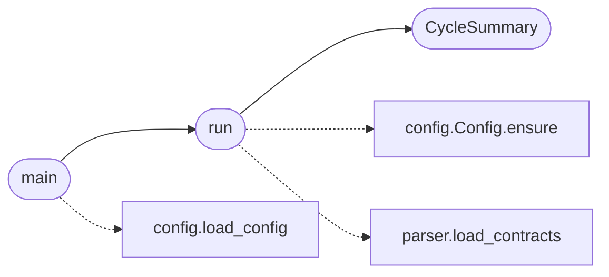

# `skills.claude_md_orchestrator.orchestrator`

> Source: [skills/claude_md_orchestrator/orchestrator.py:1](../../skills/claude_md_orchestrator/orchestrator.py#L1) | language `py` | coverage 100.0% | [API index](../index.md)

Orchestrator that wires the agents into a deterministic pipeline.

The orchestrator walks every contract through the same six stages:
spec, test red, implementation green, review, cicd, and done. The
state is persisted to disk after every stage so a crash resumes the
cycle from the last green stage. The orchestrator never blocks on
deploy. The deploy gate stays closed by design.

## Contents

- **Classes:** [`CycleSummary`](#cyclesummary)
- **Functions:** [`run`](#run), [`summary_to_dict`](#summary_to_dict), [`main`](#main)

## Call Graph

Solid arrows stay in this module, dashed arrows leave it.



## Classes

<a id="cyclesummary"></a>

### `CycleSummary`

`class` `dataclass` | [skills/claude_md_orchestrator/orchestrator.py:34](../../skills/claude_md_orchestrator/orchestrator.py#L34)

Decorators: `@dataclass`

```python
class CycleSummary
```

Top level result of running the orchestrator.

**Attributes**

| Name | Type | Default | Description |
|---|---|---|---|
| [`run_id`](#cyclesummary-run_id) | `str` |  | Identifier of the run. |
| [`contracts`](#cyclesummary-contracts) | `dict[str, CicleState]` |  | Per contract state after the cycle. |
| [`halted_at`](#cyclesummary-halted_at) | `str \| None` | `None` | Identifier of the contract the orchestrator halted on. None when every contract reached the DONE stage. |
| [`halt_reason`](#cyclesummary-halt_reason) | `str` | `''` | Free form text the operator reads to understand why the orchestrator halted. |

---

## Functions

<a id="run"></a>

### `run`

`function` | [skills/claude_md_orchestrator/orchestrator.py:275](../../skills/claude_md_orchestrator/orchestrator.py#L275)

```python
def run(config: Config, options: dict) -> CycleSummary
```

Run the orchestrator for the current run directory.

**Parameters**

| Name | Type | Default | Description |
|---|---|---|---|
| `config` | `Config` |  | Active runtime configuration. |
| `options` | `dict` |  | CLI options the orchestrator forwards to the cicd agent. |

**Returns:** `CycleSummary` - The cycle summary the CLI prints.

**Raises**

- `RuntimeError`: (raised in the body, not documented)

*Calls:* [`Config.ensure`](skills.claude_md_orchestrator.config.py.md#config-ensure), [`CycleSummary`](#cyclesummary), [`load_contracts`](skills.claude_md_orchestrator.parser.py.md#load_contracts)

*Called by:* [`main`](#main)

---

<a id="summary_to_dict"></a>

### `summary_to_dict`

`function` | [skills/claude_md_orchestrator/orchestrator.py:306](../../skills/claude_md_orchestrator/orchestrator.py#L306)

```python
def summary_to_dict(summary: CycleSummary) -> dict
```

Return a JSON friendly view of the summary.

**Parameters**

| Name | Type | Default | Description |
|---|---|---|---|
| `summary` | `CycleSummary` |  |  |

**Returns:** `dict`

---

<a id="main"></a>

### `main`

`function` | [skills/claude_md_orchestrator/orchestrator.py:393](../../skills/claude_md_orchestrator/orchestrator.py#L393)

```python
def main(argv: list[str] | None = None) -> int
```

Run the orchestrator CLI and return the process exit code.

**Parameters**

| Name | Type | Default | Description |
|---|---|---|---|
| `argv` | `list[str] \| None` | `None` |  |

**Returns:** `int`

**Raises**

- `SystemExit`: (raised in the body, not documented)

*Calls:* [`load_config`](skills.claude_md_orchestrator.config.py.md#load_config), [`run`](#run)

---
