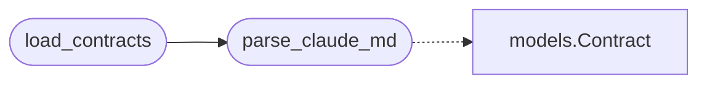

# `skills.claude_md_orchestrator.parser`

> Source: [skills/claude_md_orchestrator/parser.py:1](../../skills/claude_md_orchestrator/parser.py#L1) | language `py` | coverage 100.0% | [API index](../index.md)

Parser that turns a CLAUDE.md into actionable contracts.

The parser is deterministic. It does not call any LLM. It walks the
markdown as a tree of sections and lifts every actionable bullet that
lives under a heading that carries a flag. The flag is the keyword
CONTRACT in the heading text. The orchestrator does not assume the
markdown is well formed. The parser records every malformed input and
returns a structured error alongside the partial result.

The parser also produces the rationale for each contract by combining
the parent section text with the first paragraph of the body. The
documentation agent can quote the source verbatim.

## Contents

- **Functions:** [`parse_claude_md`](#parse_claude_md), [`load_contracts`](#load_contracts)
- **Constants:** [`CONTRACT_HEADING_PATTERN`](#contract_heading_pattern), [`CONTRACT_TAG_PATTERN`](#contract_tag_pattern), [`CONTRACT_ID_PATTERN`](#contract_id_pattern), [`BULLET_PATTERN`](#bullet_pattern), [`NUMBERED_PATTERN`](#numbered_pattern), [`HEADING_ID_DERIVE`](#heading_id_derive)

## Call Graph

Solid arrows stay in this module, dashed arrows leave it.



## Functions

<a id="parse_claude_md"></a>

### `parse_claude_md`

`function` | [skills/claude_md_orchestrator/parser.py:167](../../skills/claude_md_orchestrator/parser.py#L167)

```python
def parse_claude_md(path: Path) -> list[Contract]
```

Parse a CLAUDE.md file and return the list of contracts.

**Parameters**

| Name | Type | Default | Description |
|---|---|---|---|
| `path` | `Path` |  | Absolute path of the markdown file. |

**Returns:** `list[Contract]` - A list of Contract objects. Empty list when the file does not
exist or contains no actionable section.

**Raises**

- `FileNotFoundError`: when the path is missing.

*Calls:* [`Contract`](skills.claude_md_orchestrator.models.py.md#contract)

*Called by:* [`load_contracts`](#load_contracts)

---

<a id="load_contracts"></a>

### `load_contracts`

`function` | [skills/claude_md_orchestrator/parser.py:225](../../skills/claude_md_orchestrator/parser.py#L225)

```python
def load_contracts(config: Config, seeds: list[dict[str, str]] | None = None) -> list[Contract]
```

Return the contracts the orchestrator should process.

**Parameters**

| Name | Type | Default | Description |
|---|---|---|---|
| `config` | `Config` |  | Active runtime configuration. |
| `seeds` | `list[dict[str, str]] \| None` | `None` | Optional list of seed contracts the caller wants to mix in. The orchestrator uses the seeds when the markdown parser returns zero contracts so the operator can drive the cycle from a focused file. |

**Returns:** `list[Contract]` - The merged list of contracts. The list is deduplicated by
contract_id while preserving the original order.

*Calls:* [`parse_claude_md`](#parse_claude_md)

*Called by:* [`run`](skills.claude_md_orchestrator.orchestrator.py.md#run)

---

## Constants

<a id="contract_heading_pattern"></a>

### `CONTRACT_HEADING_PATTERN`

`constant` | [skills/claude_md_orchestrator/parser.py:25](../../skills/claude_md_orchestrator/parser.py#L25)

```python
CONTRACT_HEADING_PATTERN = re.compile('^(?P<hashes>#{1,6})\\s+(?P<title>.+)$', re.MULTILINE)
```

---

<a id="contract_tag_pattern"></a>

### `CONTRACT_TAG_PATTERN`

`constant` | [skills/claude_md_orchestrator/parser.py:26](../../skills/claude_md_orchestrator/parser.py#L26)

```python
CONTRACT_TAG_PATTERN = re.compile('\\bCONTRACT\\b', re.IGNORECASE)
```

---

<a id="contract_id_pattern"></a>

### `CONTRACT_ID_PATTERN`

`constant` | [skills/claude_md_orchestrator/parser.py:27](../../skills/claude_md_orchestrator/parser.py#L27)

```python
CONTRACT_ID_PATTERN = re.compile('\\bC-\\d{3,}\\b')
```

---

<a id="bullet_pattern"></a>

### `BULLET_PATTERN`

`constant` | [skills/claude_md_orchestrator/parser.py:28](../../skills/claude_md_orchestrator/parser.py#L28)

```python
BULLET_PATTERN = re.compile('^\\s*[-*+]\\s+(?P<body>.+)$', re.MULTILINE)
```

---

<a id="numbered_pattern"></a>

### `NUMBERED_PATTERN`

`constant` | [skills/claude_md_orchestrator/parser.py:29](../../skills/claude_md_orchestrator/parser.py#L29)

```python
NUMBERED_PATTERN = re.compile('^\\s*\\d+\\.\\s+(?P<body>.+)$', re.MULTILINE)
```

---

<a id="heading_id_derive"></a>

### `HEADING_ID_DERIVE`

`constant` | [skills/claude_md_orchestrator/parser.py:30](../../skills/claude_md_orchestrator/parser.py#L30)

```python
HEADING_ID_DERIVE = re.compile('[^a-z0-9]+')
```

---
