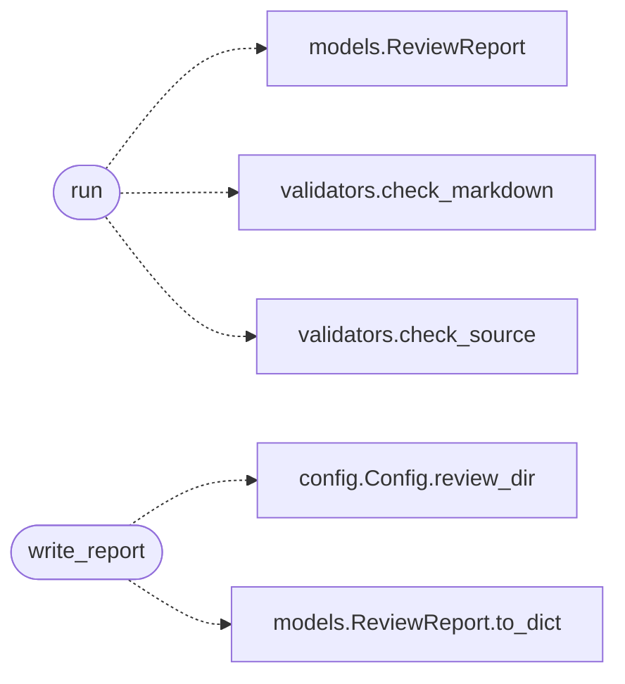

# `skills.claude_md_orchestrator.reviewer_agent`

> Source: [skills/claude_md_orchestrator/reviewer_agent.py:1](../../skills/claude_md_orchestrator/reviewer_agent.py#L1) | language `py` | coverage 100.0% | [API index](../index.md)

Code Reviewer and Quality Assurance agent.

The agent runs the static analyzers the LazyOwn repository already
configures. The agent collects the DoD findings every analyzer emits
plus the findings the in house validators emit. The agent approves
the contract when the report carries zero blockers. The orchestrator
advances only when the report is approved.

The agent never blocks on warnings when the strict flag is False. The
agent always blocks on a non zero exit code from any analyzer.

## Contents

- **Classes:** [`AnalyzerResult`](#analyzerresult)
- **Functions:** [`run`](#run), [`write_report`](#write_report)
- **Constants:** [`REVIEWABLE_SUFFIXES`](#reviewable_suffixes)

## Call Graph

Solid arrows stay in this module, dashed arrows leave it.



## Classes

<a id="analyzerresult"></a>

### `AnalyzerResult`

`class` `dataclass` | [skills/claude_md_orchestrator/reviewer_agent.py:30](../../skills/claude_md_orchestrator/reviewer_agent.py#L30)

Decorators: `@dataclass`

```python
class AnalyzerResult
```

Outcome of running one external analyzer.

**Attributes**

| Name | Type | Default | Description |
|---|---|---|---|
| [`tool`](#analyzerresult-tool) | `str` |  | Name of the analyzer. |
| [`exit_code`](#analyzerresult-exit_code) | `int` |  | Return code of the analyzer. |
| [`stdout`](#analyzerresult-stdout) | `str` |  | Captured stdout. |
| [`stderr`](#analyzerresult-stderr) | `str` |  | Captured stderr. |

---

## Functions

<a id="run"></a>

### `run`

`function` | [skills/claude_md_orchestrator/reviewer_agent.py:171](../../skills/claude_md_orchestrator/reviewer_agent.py#L171)

```python
def run(state, config: Config) -> ReviewReport
```

Run the reviewer for one contract.

**Parameters**

| Name | Type | Default | Description |
|---|---|---|---|
| `state` |  |  | Per contract state the reviewer reads the artifacts from. |
| `config` | `Config` |  | Active runtime configuration. |

**Returns:** `ReviewReport` - The structured review report. The report carries the
analyzer exit codes, the in house DoD findings, and a
boolean approved flag the orchestrator consumes.

*Calls:* [`ReviewReport`](skills.claude_md_orchestrator.models.py.md#reviewreport), [`check_markdown`](skills.claude_md_orchestrator.validators.py.md#check_markdown), [`check_source`](skills.claude_md_orchestrator.validators.py.md#check_source)

---

<a id="write_report"></a>

### `write_report`

`function` | [skills/claude_md_orchestrator/reviewer_agent.py:225](../../skills/claude_md_orchestrator/reviewer_agent.py#L225)

```python
def write_report(report: ReviewReport, config: Config) -> Path
```

Persist the report as JSON inside the run review directory.

**Parameters**

| Name | Type | Default | Description |
|---|---|---|---|
| `report` | `ReviewReport` |  |  |
| `config` | `Config` |  |  |

**Returns:** `Path`

*Calls:* [`Config.review_dir`](skills.claude_md_orchestrator.config.py.md#config-review_dir), [`ReviewReport.to_dict`](skills.claude_md_orchestrator.models.py.md#reviewreport-to_dict)

---

## Constants

<a id="reviewable_suffixes"></a>

### `REVIEWABLE_SUFFIXES`

`constant` | [skills/claude_md_orchestrator/reviewer_agent.py:26](../../skills/claude_md_orchestrator/reviewer_agent.py#L26)

```python
REVIEWABLE_SUFFIXES = ('.py', '.md', '.yaml', '.yml')
```

---
