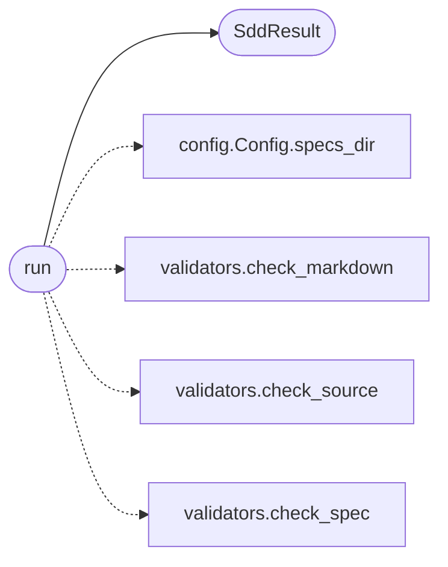

# `skills.claude_md_orchestrator.sdd_agent`

> Source: [skills/claude_md_orchestrator/sdd_agent.py:1](../../skills/claude_md_orchestrator/sdd_agent.py#L1) | language `py` | coverage 100.0% | [API index](../index.md)

Spec-Driven Development agent.

The agent lifts a Contract into a Spec. The agent is deterministic so
the orchestrator can replay the same contract and produce the same
spec. The agent uses the LazyOwn LLM factory when a backend identifier
is configured in payload.json. When the backend is missing or fails,
the agent falls back to a structured template that the operator can
review and amend.

The agent writes the spec as YAML. YAML is the lingua franca for the
infrastructure that consumes the spec, including the test agent and the
CI pipeline.

## Contents

- **Classes:** [`SddResult`](#sddresult)
- **Functions:** [`run`](#run)
- **Constants:** [`SAD_PATH_TEMPLATES`](#sad_path_templates)

## Call Graph

Solid arrows stay in this module, dashed arrows leave it.



## Classes

<a id="sddresult"></a>

### `SddResult`

`class` `dataclass` | [skills/claude_md_orchestrator/sdd_agent.py:40](../../skills/claude_md_orchestrator/sdd_agent.py#L40)

Decorators: `@dataclass`

```python
class SddResult
```

Outcome of running the spec agent.

**Attributes**

| Name | Type | Default | Description |
|---|---|---|---|
| [`spec`](#sddresult-spec) | `Spec` |  | The spec the agent produced. |
| [`path`](#sddresult-path) | `Path` |  | Absolute path of the YAML file the agent wrote. |
| [`findings`](#sddresult-findings) | `list[Finding]` |  | DoD findings the agent collected while it wrote the spec. The orchestrator halts when the list carries a blocker. |

---

## Functions

<a id="run"></a>

### `run`

`function` | [skills/claude_md_orchestrator/sdd_agent.py:204](../../skills/claude_md_orchestrator/sdd_agent.py#L204)

```python
def run(contract: Contract, config: Config) -> SddResult
```

Run the spec agent for one contract.

**Parameters**

| Name | Type | Default | Description |
|---|---|---|---|
| `contract` | `Contract` |  | The contract the spec implements. |
| `config` | `Config` |  | Active runtime configuration. |

**Returns:** `SddResult` - The result the orchestrator persists and validates.

*Calls:* [`Config.specs_dir`](skills.claude_md_orchestrator.config.py.md#config-specs_dir), [`SddResult`](#sddresult), [`check_markdown`](skills.claude_md_orchestrator.validators.py.md#check_markdown), [`check_source`](skills.claude_md_orchestrator.validators.py.md#check_source), [`check_spec`](skills.claude_md_orchestrator.validators.py.md#check_spec)

---

## Constants

<a id="sad_path_templates"></a>

### `SAD_PATH_TEMPLATES`

`constant` | [skills/claude_md_orchestrator/sdd_agent.py:29](../../skills/claude_md_orchestrator/sdd_agent.py#L29)

```python
SAD_PATH_TEMPLATES
```

---
