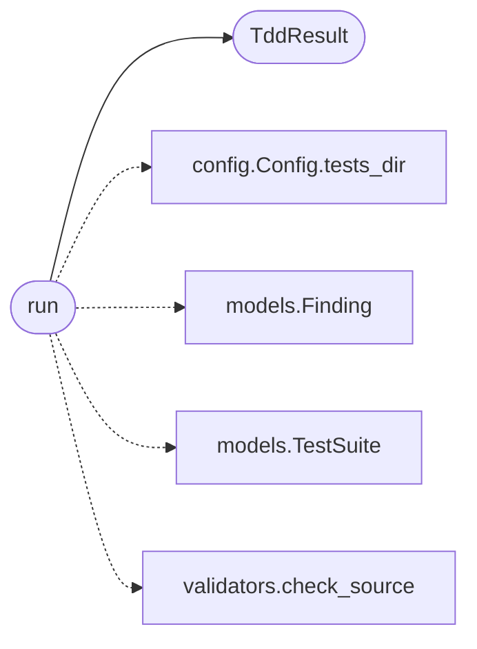

# `skills.claude_md_orchestrator.tdd_agent`

> Source: [skills/claude_md_orchestrator/tdd_agent.py:1](../../skills/claude_md_orchestrator/tdd_agent.py#L1) | language `py` | coverage 100.0% | [API index](../index.md)

Test-Driven Development agent.

The agent lifts a Spec into a pytest module. The cycle halts at red.
The agent will not advance to the next stage until pytest reports a
failure for the new tests. The agent never writes a passing test. The
agent uses the BDD Given When Then structure inside the test function
so the test name reads as a behaviour.

The agent writes the test file with a single public function per sad
path and one extra function for the happy path. The test functions
import the implementation module the bdd agent will produce. The
implementation module does not exist when the tdd agent runs. The
pytest collection step must fail with an ImportError or an
assertion. The orchestrator counts the ImportError as a red outcome.

## Contents

- **Classes:** [`TddResult`](#tddresult)
- **Functions:** [`run`](#run), [`read_test_source`](#read_test_source)
- **Constants:** [`TEST_TEMPLATE`](#test_template)

## Call Graph

Solid arrows stay in this module, dashed arrows leave it.



## Classes

<a id="tddresult"></a>

### `TddResult`

`class` `dataclass` | [skills/claude_md_orchestrator/tdd_agent.py:90](../../skills/claude_md_orchestrator/tdd_agent.py#L90)

Decorators: `@dataclass`

```python
class TddResult
```

Outcome of running the test agent.

**Attributes**

| Name | Type | Default | Description |
|---|---|---|---|
| [`suite`](#tddresult-suite) | `TestSuite` |  | The TestSuite the agent produced. |
| [`findings`](#tddresult-findings) | `list[Finding]` |  | DoD findings the agent collected. The orchestrator halts on a blocker. |
| [`red`](#tddresult-red) | `bool` |  | True when pytest reported a failure for the new tests. |

---

## Functions

<a id="run"></a>

### `run`

`function` | [skills/claude_md_orchestrator/tdd_agent.py:175](../../skills/claude_md_orchestrator/tdd_agent.py#L175)

```python
def run(contract: Contract, spec: Spec, config: Config) -> TddResult
```

Run the test agent for one contract.

**Parameters**

| Name | Type | Default | Description |
|---|---|---|---|
| `contract` | `Contract` |  | The contract the spec implements. |
| `spec` | `Spec` |  | The spec the tests cover. |
| `config` | `Config` |  | Active runtime configuration. |

**Returns:** `TddResult` - The result the orchestrator persists. The red flag is True
when pytest reported a failure for the new tests. The
orchestrator advances only when red is True.

*Calls:* [`Config.tests_dir`](skills.claude_md_orchestrator.config.py.md#config-tests_dir), [`Finding`](skills.claude_md_orchestrator.models.py.md#finding), [`TestSuite`](skills.claude_md_orchestrator.models.py.md#testsuite), [`TddResult`](#tddresult), [`check_source`](skills.claude_md_orchestrator.validators.py.md#check_source)

---

<a id="read_test_source"></a>

### `read_test_source`

`function` | [skills/claude_md_orchestrator/tdd_agent.py:228](../../skills/claude_md_orchestrator/tdd_agent.py#L228)

```python
def read_test_source(test_path: Path) -> str | None
```

Return the test source for inspection.

**Parameters**

| Name | Type | Default | Description |
|---|---|---|---|
| `test_path` | `Path` |  | Absolute path of the test module. |

**Returns:** `str | None` - The test source as a string. None when the file does not
exist.

*Called by:* [`run`](skills.claude_md_orchestrator.bdd_agent.py.md#run)

---

## Constants

<a id="test_template"></a>

### `TEST_TEMPLATE`

`constant` | [skills/claude_md_orchestrator/tdd_agent.py:29](../../skills/claude_md_orchestrator/tdd_agent.py#L29)

```python
TEST_TEMPLATE
```

---
