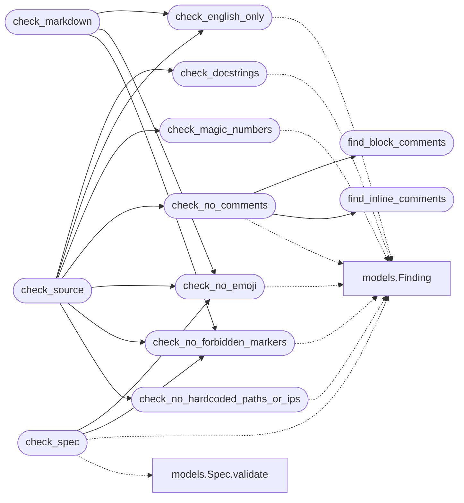

# `skills.claude_md_orchestrator.validators`

> Source: [skills/claude_md_orchestrator/validators.py:1](../../skills/claude_md_orchestrator/validators.py#L1) | language `py` | coverage 100.0% | [API index](../index.md)

DoD validators for every artifact the orchestrator produces.

The validators are the single source of truth for the Definition of
Done. Every agent calls them before it writes a result to disk. The
reviewer agent cross checks the same set so the cycle halts on a real
violation rather than on an opinion.

## Contents

- **Classes:** [`CheckResult`](#checkresult)
- **Functions:** [`find_block_comments`](#find_block_comments), [`find_inline_comments`](#find_inline_comments), [`check_no_comments`](#check_no_comments), [`check_no_emoji`](#check_no_emoji), [`check_no_forbidden_markers`](#check_no_forbidden_markers), [`check_english_only`](#check_english_only), [`check_docstrings`](#check_docstrings), [`check_no_hardcoded_paths_or_ips`](#check_no_hardcoded_paths_or_ips), [`check_magic_numbers`](#check_magic_numbers), [`check_source`](#check_source), [`check_markdown`](#check_markdown), [`check_spec`](#check_spec)
- **Constants:** [`SPANISH_HINTS`](#spanish_hints), [`FORBIDDEN_MARKERS`](#forbidden_markers), [`EMOJI_PATTERN`](#emoji_pattern), [`HARDCODED_IPV4`](#hardcoded_ipv4), [`HARDCODED_ABS_PATH`](#hardcoded_abs_path), [`MAGIC_NUMBER_PATTERN`](#magic_number_pattern)

## Call Graph

Solid arrows stay in this module, dashed arrows leave it.



## Classes

<a id="checkresult"></a>

### `CheckResult`

`class` `dataclass` | [skills/claude_md_orchestrator/validators.py:77](../../skills/claude_md_orchestrator/validators.py#L77)

Decorators: `@dataclass`

```python
class CheckResult
```

Outcome of running one validator over a piece of content.

**Attributes**

| Name | Type | Default | Description |
|---|---|---|---|
| [`findings`](#checkresult-findings) | `list[Finding]` |  | Findings the validator raised. Empty list means the artifact is compliant. |

**Members**

| Member | Kind | Summary |
|---|---|---|
| [`passed`](#checkresult-passed) | property | Return True when the result has no findings. |
| [`blocks`](#checkresult-blocks) | method | Return the blocker findings only. |

<a id="checkresult-passed"></a>

#### `CheckResult.passed`

`property` | [skills/claude_md_orchestrator/validators.py:88](../../skills/claude_md_orchestrator/validators.py#L88)

Decorators: `@property`

```python
def passed(self) -> bool
```

Return True when the result has no findings.

**Returns:** `bool`

<a id="checkresult-blocks"></a>

#### `CheckResult.blocks`

`method` | [skills/claude_md_orchestrator/validators.py:92](../../skills/claude_md_orchestrator/validators.py#L92)

```python
def blocks(self) -> list[Finding]
```

Return the blocker findings only.

**Returns:** `list[Finding]`

---

## Functions

<a id="find_block_comments"></a>

### `find_block_comments`

`function` | [skills/claude_md_orchestrator/validators.py:97](../../skills/claude_md_orchestrator/validators.py#L97)

```python
def find_block_comments(source: str) -> list[tuple[int, int]]
```

Return the start and end line of every block comment in source.

**Parameters**

| Name | Type | Default | Description |
|---|---|---|---|
| `source` | `str` |  | Python source code. |

**Returns:** `list[tuple[int, int]]` - A list of tuples. Each tuple carries the start line and the
end line of a block comment.

*Called by:* [`check_no_comments`](#check_no_comments)

---

<a id="find_inline_comments"></a>

### `find_inline_comments`

`function` | [skills/claude_md_orchestrator/validators.py:119](../../skills/claude_md_orchestrator/validators.py#L119)

```python
def find_inline_comments(source: str) -> list[int]
```

Return the line numbers of every inline comment in source.

Inline comments are tokens that start with the COMMENT token type.
The helper walks the token stream and ignores shebang lines.

**Parameters**

| Name | Type | Default | Description |
|---|---|---|---|
| `source` | `str` |  |  |

**Returns:** `list[int]`

*Called by:* [`check_no_comments`](#check_no_comments)

---

<a id="check_no_comments"></a>

### `check_no_comments`

`function` | [skills/claude_md_orchestrator/validators.py:136](../../skills/claude_md_orchestrator/validators.py#L136)

```python
def check_no_comments(source: str, path: str) -> list[Finding]
```

Return a finding for every comment in the source code.

**Parameters**

| Name | Type | Default | Description |
|---|---|---|---|
| `source` | `str` |  | Python source code. |
| `path` | `str` |  | Path the source belongs to. Used in the finding. |

**Returns:** `list[Finding]` - Findings. Empty list when the source has no comments.

*Calls:* [`Finding`](skills.claude_md_orchestrator.models.py.md#finding), [`find_block_comments`](#find_block_comments), [`find_inline_comments`](#find_inline_comments)

*Called by:* [`check_source`](#check_source)

---

<a id="check_no_emoji"></a>

### `check_no_emoji`

`function` | [skills/claude_md_orchestrator/validators.py:167](../../skills/claude_md_orchestrator/validators.py#L167)

```python
def check_no_emoji(content: str, path: str) -> list[Finding]
```

Return a finding for every emoji the content carries.

**Parameters**

| Name | Type | Default | Description |
|---|---|---|---|
| `content` | `str` |  | Text to inspect. |
| `path` | `str` |  | Path the content belongs to. Used in the finding. |

**Returns:** `list[Finding]` - Findings. Empty list when the content has no emoji.

*Calls:* [`Finding`](skills.claude_md_orchestrator.models.py.md#finding)

*Called by:* [`check_markdown`](#check_markdown), [`check_source`](#check_source), [`check_spec`](#check_spec)

---

<a id="check_no_forbidden_markers"></a>

### `check_no_forbidden_markers`

`function` | [skills/claude_md_orchestrator/validators.py:189](../../skills/claude_md_orchestrator/validators.py#L189)

```python
def check_no_forbidden_markers(content: str, path: str) -> list[Finding]
```

Return a finding for every TODO, FIXME, XXX, or HACK marker.

**Parameters**

| Name | Type | Default | Description |
|---|---|---|---|
| `content` | `str` |  |  |
| `path` | `str` |  |  |

**Returns:** `list[Finding]`

*Calls:* [`Finding`](skills.claude_md_orchestrator.models.py.md#finding)

*Called by:* [`check_markdown`](#check_markdown), [`check_source`](#check_source), [`check_spec`](#check_spec)

---

<a id="check_english_only"></a>

### `check_english_only`

`function` | [skills/claude_md_orchestrator/validators.py:206](../../skills/claude_md_orchestrator/validators.py#L206)

```python
def check_english_only(source: str, path: str) -> list[Finding]
```

Return a finding for every Spanish hint the source carries.

The validator is conservative. It scans identifiers, docstrings,
and string literals. False positives are possible. The reviewer
treats every hit as a warning and the operator can mark it as a
non blocker through the strict flag.

**Parameters**

| Name | Type | Default | Description |
|---|---|---|---|
| `source` | `str` |  |  |
| `path` | `str` |  |  |

**Returns:** `list[Finding]`

*Calls:* [`Finding`](skills.claude_md_orchestrator.models.py.md#finding)

*Called by:* [`check_markdown`](#check_markdown), [`check_source`](#check_source)

---

<a id="check_docstrings"></a>

### `check_docstrings`

`function` | [skills/claude_md_orchestrator/validators.py:230](../../skills/claude_md_orchestrator/validators.py#L230)

```python
def check_docstrings(source: str, path: str) -> list[Finding]
```

Return a finding for every public function or class without a docstring.

The validator parses the source with ast and walks the tree. A
public name is a name that does not start with an underscore. A
missing docstring is a blocker.

**Parameters**

| Name | Type | Default | Description |
|---|---|---|---|
| `source` | `str` |  |  |
| `path` | `str` |  |  |

**Returns:** `list[Finding]`

*Calls:* [`Finding`](skills.claude_md_orchestrator.models.py.md#finding)

*Called by:* [`check_source`](#check_source)

---

<a id="check_no_hardcoded_paths_or_ips"></a>

### `check_no_hardcoded_paths_or_ips`

`function` | [skills/claude_md_orchestrator/validators.py:271](../../skills/claude_md_orchestrator/validators.py#L271)

```python
def check_no_hardcoded_paths_or_ips(source: str, path: str) -> list[Finding]
```

Return a finding for every absolute path or IP literal.

**Parameters**

| Name | Type | Default | Description |
|---|---|---|---|
| `source` | `str` |  | Python source code. |
| `path` | `str` |  | Path the source belongs to. |

**Returns:** `list[Finding]` - Findings. Empty list when the source has no hardcoded literal.

*Calls:* [`Finding`](skills.claude_md_orchestrator.models.py.md#finding)

*Called by:* [`check_source`](#check_source)

---

<a id="check_magic_numbers"></a>

### `check_magic_numbers`

`function` | [skills/claude_md_orchestrator/validators.py:305](../../skills/claude_md_orchestrator/validators.py#L305)

```python
def check_magic_numbers(source: str, path: str, allow: Iterable[int] | None = None) -> list[Finding]
```

Return a finding for every numeric literal that is not in the allow list.

**Parameters**

| Name | Type | Default | Description |
|---|---|---|---|
| `source` | `str` |  | Python source code. |
| `path` | `str` |  | Path the source belongs to. |
| `allow` | `Iterable[int] \| None` | `None` | Iterable of literals that are explicitly allowed. |

**Returns:** `list[Finding]` - Findings. Empty list when the source has no magic number.

*Calls:* [`Finding`](skills.claude_md_orchestrator.models.py.md#finding)

*Called by:* [`check_source`](#check_source)

---

<a id="check_source"></a>

### `check_source`

`function` | [skills/claude_md_orchestrator/validators.py:340](../../skills/claude_md_orchestrator/validators.py#L340)

```python
def check_source(source: str, path: str, allow_numbers: Iterable[int] | None = None) -> list[Finding]
```

Run every source level DoD check and return the findings.

**Parameters**

| Name | Type | Default | Description |
|---|---|---|---|
| `source` | `str` |  |  |
| `path` | `str` |  |  |
| `allow_numbers` | `Iterable[int] \| None` | `None` |  |

**Returns:** `list[Finding]`

*Calls:* [`check_docstrings`](#check_docstrings), [`check_english_only`](#check_english_only), [`check_magic_numbers`](#check_magic_numbers), [`check_no_comments`](#check_no_comments), [`check_no_emoji`](#check_no_emoji), [`check_no_forbidden_markers`](#check_no_forbidden_markers), [`check_no_hardcoded_paths_or_ips`](#check_no_hardcoded_paths_or_ips)

*Called by:* [`run`](skills.claude_md_orchestrator.bdd_agent.py.md#run), [`run`](skills.claude_md_orchestrator.reviewer_agent.py.md#run), [`run`](skills.claude_md_orchestrator.sdd_agent.py.md#run), [`run`](skills.claude_md_orchestrator.tdd_agent.py.md#run)

---

<a id="check_markdown"></a>

### `check_markdown`

`function` | [skills/claude_md_orchestrator/validators.py:353](../../skills/claude_md_orchestrator/validators.py#L353)

```python
def check_markdown(content: str, path: str) -> list[Finding]
```

Run every markdown level DoD check and return the findings.

**Parameters**

| Name | Type | Default | Description |
|---|---|---|---|
| `content` | `str` |  |  |
| `path` | `str` |  |  |

**Returns:** `list[Finding]`

*Calls:* [`check_english_only`](#check_english_only), [`check_no_emoji`](#check_no_emoji), [`check_no_forbidden_markers`](#check_no_forbidden_markers)

*Called by:* [`run`](skills.claude_md_orchestrator.reviewer_agent.py.md#run), [`run`](skills.claude_md_orchestrator.sdd_agent.py.md#run)

---

<a id="check_spec"></a>

### `check_spec`

`function` | [skills/claude_md_orchestrator/validators.py:362](../../skills/claude_md_orchestrator/validators.py#L362)

```python
def check_spec(spec: Spec, min_sad_paths: int) -> list[Finding]
```

Run the spec level DoD check and return the findings.

**Parameters**

| Name | Type | Default | Description |
|---|---|---|---|
| `spec` | `Spec` |  |  |
| `min_sad_paths` | `int` |  |  |

**Returns:** `list[Finding]`

*Calls:* [`Finding`](skills.claude_md_orchestrator.models.py.md#finding), [`Spec.validate`](skills.claude_md_orchestrator.models.py.md#spec-validate), [`check_no_emoji`](#check_no_emoji), [`check_no_forbidden_markers`](#check_no_forbidden_markers)

*Called by:* [`run`](skills.claude_md_orchestrator.sdd_agent.py.md#run)

---

## Constants

<a id="spanish_hints"></a>

### `SPANISH_HINTS`

`constant` | [skills/claude_md_orchestrator/validators.py:20](../../skills/claude_md_orchestrator/validators.py#L20)

```python
SPANISH_HINTS
```

---

<a id="forbidden_markers"></a>

### `FORBIDDEN_MARKERS`

`constant` | [skills/claude_md_orchestrator/validators.py:54](../../skills/claude_md_orchestrator/validators.py#L54)

```python
FORBIDDEN_MARKERS = ('TODO', 'FIXME', 'XXX', 'HACK')
```

---

<a id="emoji_pattern"></a>

### `EMOJI_PATTERN`

`constant` | [skills/claude_md_orchestrator/validators.py:55](../../skills/claude_md_orchestrator/validators.py#L55)

```python
EMOJI_PATTERN
```

---

<a id="hardcoded_ipv4"></a>

### `HARDCODED_IPV4`

`constant` | [skills/claude_md_orchestrator/validators.py:71](../../skills/claude_md_orchestrator/validators.py#L71)

```python
HARDCODED_IPV4 = re.compile('\\b(?:\\d{1,3}\\.){3}\\d{1,3}\\b')
```

---

<a id="hardcoded_abs_path"></a>

### `HARDCODED_ABS_PATH`

`constant` | [skills/claude_md_orchestrator/validators.py:72](../../skills/claude_md_orchestrator/validators.py#L72)

```python
HARDCODED_ABS_PATH = re.compile('(/home/[A-Za-z0-9._-]+|/root/[^\\s\\"\']+)')
```

---

<a id="magic_number_pattern"></a>

### `MAGIC_NUMBER_PATTERN`

`constant` | [skills/claude_md_orchestrator/validators.py:73](../../skills/claude_md_orchestrator/validators.py#L73)

```python
MAGIC_NUMBER_PATTERN = re.compile('(?<![\\w.])\\b(\\d{2,})\\b')
```

---
