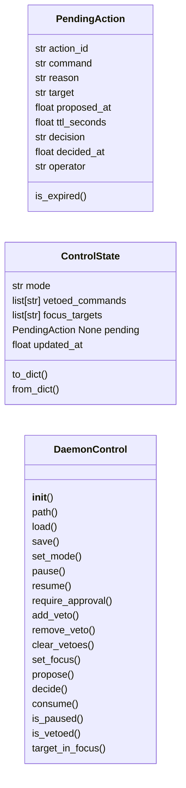
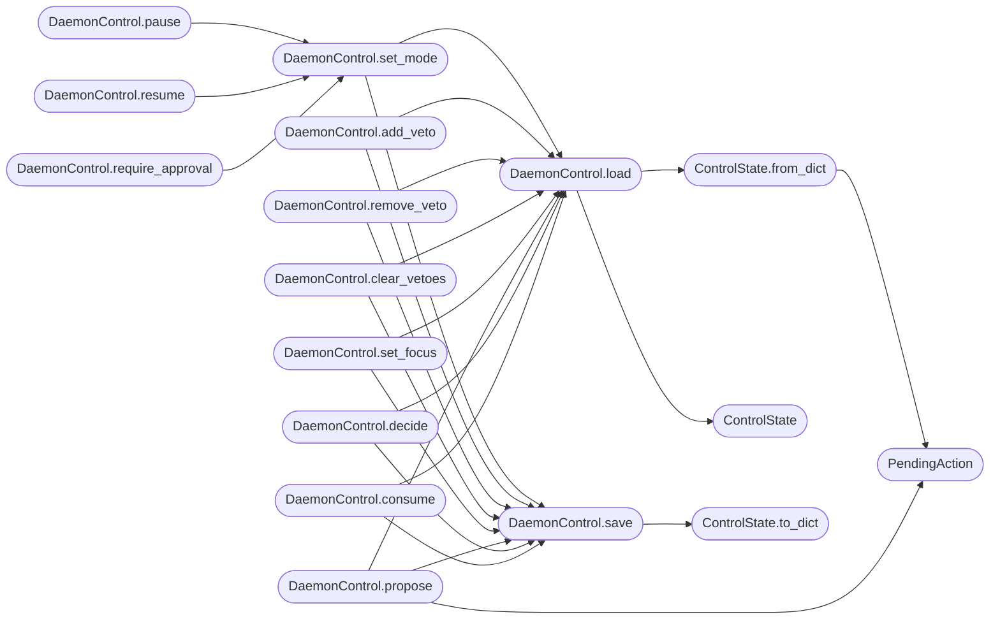

# `skills.daemon_control`

> Source: [skills/daemon_control.py:1](../../skills/daemon_control.py#L1) | language `py` | coverage 100.0% | [API index](../index.md)

Operator steering layer for the LazyOwn autonomous daemon.

The daemon (``skills/autonomous_daemon.py``) reads the control state
written here before every command execution. The CLI (``do_daemon_*``)
and MCP (``lazyown_daemon_*``) write the same state. This module owns:

* The data model ([`ControlState`](#controlstate), [`PendingAction`](#pendingaction)).
* Atomic persistence to ``sessions/daemon_control.json``.
* The approval-gate state machine and a blocking wait helper.

All public methods are safe for concurrent use across processes
because every write goes through ``tempfile`` + ``os.replace`` so
readers either see the previous file or the new one but never a
truncated file.

## Contents

- **Classes:** [`PendingAction`](#pendingaction), [`ControlState`](#controlstate), [`DaemonControl`](#daemoncontrol)
- **Functions:** [`wait_for_decision`](#wait_for_decision), [`wait_until_unpaused`](#wait_until_unpaused)
- **Constants:** [`CONTROL_FILE_NAME`](#control_file_name), [`PENDING_TTL_DEFAULT_S`](#pending_ttl_default_s), [`APPROVAL_POLL_INTERVAL_S`](#approval_poll_interval_s), [`PAUSE_POLL_INTERVAL_S`](#pause_poll_interval_s), [`MODE_AUTO`](#mode_auto), [`MODE_APPROVAL`](#mode_approval), [`MODE_PAUSED`](#mode_paused), [`VALID_MODES`](#valid_modes), [`DECISION_PENDING`](#decision_pending), [`DECISION_APPROVED`](#decision_approved), [`DECISION_VETOED`](#decision_vetoed), [`DECISION_EXPIRED`](#decision_expired), [`VALID_DECISIONS`](#valid_decisions)

## Type Diagram



## Call Graph

Solid arrows stay in this module, dashed arrows leave it.



## Classes

<a id="pendingaction"></a>

### `PendingAction`

`class` `dataclass` | [skills/daemon_control.py:49](../../skills/daemon_control.py#L49)

Decorators: `@dataclass`

```python
class PendingAction
```

A single command awaiting operator approval.

**Parameters**

| Name | Type | Default | Description |
|---|---|---|---|
| `action_id` | `str` | `''` | Unique identifier matched by the operator when approving or vetoing. |
| `command` | `str` | `''` | Shell command proposed by the daemon. |
| `reason` | `str` | `''` | Selector-supplied rationale forwarded to the operator. |
| `target` | `str` | `''` | Active target host the command will run against. |
| `proposed_at` | `float` | `0.0` | Epoch seconds when the action was registered. |
| `ttl_seconds` | `float` | `PENDING_TTL_DEFAULT_S` | How long the action waits before expiring. |
| `decision` | `str` | `DECISION_PENDING` | One of [`DECISION_PENDING`](#decision_pending), [`DECISION_APPROVED`](#decision_approved), [`DECISION_VETOED`](#decision_vetoed), [`DECISION_EXPIRED`](#decision_expired). |
| `decided_at` | `float` | `0.0` | Epoch seconds when the decision was recorded (``0.0`` while pending). |
| `operator` | `str` | `''` | Identifier of the operator who decided (empty when expired). |

**Attributes**

| Name | Type | Default | Description |
|---|---|---|---|
| [`action_id`](#pendingaction-action_id) | `str` | `''` |  |
| [`command`](#pendingaction-command) | `str` | `''` |  |
| [`reason`](#pendingaction-reason) | `str` | `''` |  |
| [`target`](#pendingaction-target) | `str` | `''` |  |
| [`proposed_at`](#pendingaction-proposed_at) | `float` | `0.0` |  |
| [`ttl_seconds`](#pendingaction-ttl_seconds) | `float` | `PENDING_TTL_DEFAULT_S` |  |
| [`decision`](#pendingaction-decision) | `str` | `DECISION_PENDING` |  |
| [`decided_at`](#pendingaction-decided_at) | `float` | `0.0` |  |
| [`operator`](#pendingaction-operator) | `str` | `''` |  |

**Members**

| Member | Kind | Summary |
|---|---|---|
| [`is_expired`](#pendingaction-is_expired) | method | Return ``True`` when a still-pending action has exceeded its TTL. |

<a id="pendingaction-is_expired"></a>

#### `PendingAction.is_expired`

`method` | [skills/daemon_control.py:79](../../skills/daemon_control.py#L79)

```python
def is_expired(self, now: float | None = None) -> bool
```

Return ``True`` when a still-pending action has exceeded its TTL.

**Parameters**

| Name | Type | Default | Description |
|---|---|---|---|
| `now` | `float \| None` | `None` |  |

**Returns:** `bool`

---

<a id="controlstate"></a>

### `ControlState`

`class` `dataclass` | [skills/daemon_control.py:88](../../skills/daemon_control.py#L88)

Decorators: `@dataclass`

```python
class ControlState
```

Steering state shared between operator surfaces and the daemon.

**Parameters**

| Name | Type | Default | Description |
|---|---|---|---|
| `mode` | `str` | `MODE_AUTO` | One of [`MODE_AUTO`](#mode_auto), [`MODE_APPROVAL`](#mode_approval), [`MODE_PAUSED`](#mode_paused). Default is auto, which preserves the historical daemon behaviour. |
| `vetoed_commands` | `list[str]` | `field(default_factory=list)` | First-token names the daemon must avoid. |
| `focus_targets` | `list[str]` | `field(default_factory=list)` | When non-empty, the daemon only executes objectives whose target appears in this list. |
| `pending` | `PendingAction \| None` | `None` | Active approval request, when ``mode == approval`` and the daemon has proposed a command. |
| `updated_at` | `float` | `0.0` | Epoch seconds of the last write — populated by [`DaemonControl.save`](#daemoncontrol-save). |

**Attributes**

| Name | Type | Default | Description |
|---|---|---|---|
| [`mode`](#controlstate-mode) | `str` | `MODE_AUTO` |  |
| [`vetoed_commands`](#controlstate-vetoed_commands) | `list[str]` | `field(default_factory=list)` |  |
| [`focus_targets`](#controlstate-focus_targets) | `list[str]` | `field(default_factory=list)` |  |
| [`pending`](#controlstate-pending) | `PendingAction \| None` | `None` |  |
| [`updated_at`](#controlstate-updated_at) | `float` | `0.0` |  |

**Members**

| Member | Kind | Summary |
|---|---|---|
| [`to_dict`](#controlstate-to_dict) | method | Serialise the state to a plain JSON-ready dict. |
| [`from_dict`](#controlstate-from_dict) | classmethod | Build a state from JSON data, sanitising malformed input. |

<a id="controlstate-to_dict"></a>

#### `ControlState.to_dict`

`method` | [skills/daemon_control.py:110](../../skills/daemon_control.py#L110)

```python
def to_dict(self) -> dict[str, Any]
```

Serialise the state to a plain JSON-ready dict.

**Returns:** `dict[str, Any]`

*Called by:* [`DaemonControl.save`](#daemoncontrol-save)

<a id="controlstate-from_dict"></a>

#### `ControlState.from_dict`

`classmethod` | [skills/daemon_control.py:121](../../skills/daemon_control.py#L121)

Decorators: `@classmethod`

```python
def from_dict(cls, data: dict[str, Any]) -> ControlState
```

Build a state from JSON data, sanitising malformed input.

**Parameters**

| Name | Type | Default | Description |
|---|---|---|---|
| `data` | `dict[str, Any]` |  |  |

**Returns:** `ControlState`

*Calls:* [`PendingAction`](#pendingaction)

*Called by:* [`DaemonControl.load`](#daemoncontrol-load)

---

<a id="daemoncontrol"></a>

### `DaemonControl`

`class` | [skills/daemon_control.py:162](../../skills/daemon_control.py#L162)

```python
class DaemonControl
```

Atomic read/write facade for ``sessions/daemon_control.json``.

All mutations write to a temp file then ``os.replace`` for
atomicity so concurrent readers (daemon + CLI + MCP) never observe
partial JSON. The instance is also safe to share inside one
process: every write is serialised by an internal lock.

**Members**

| Member | Kind | Summary |
|---|---|---|
| [`__init__`](#daemoncontrol-__init__) | constructor | Pin the control file to ``<sessions_dir>/daemon_control.json``. |
| [`path`](#daemoncontrol-path) | property | Absolute path of the control file on disk. |
| [`load`](#daemoncontrol-load) | method | Return the current state or defaults when the file is missing. |
| [`save`](#daemoncontrol-save) | method | Persist ``state`` atomically. |
| [`set_mode`](#daemoncontrol-set_mode) | method | Switch between [`MODE_AUTO`](#mode_auto), [`MODE_APPROVAL`](#mode_approval), [`MODE_PAUSED`](#mode_paused). |
| [`pause`](#daemoncontrol-pause) | method | Convenience wrapper for ``set_mode(MODE_PAUSED)``. |
| [`resume`](#daemoncontrol-resume) | method | Convenience wrapper for ``set_mode(MODE_AUTO)``. |
| [`require_approval`](#daemoncontrol-require_approval) | method | Convenience wrapper for ``set_mode(MODE_APPROVAL)``. |
| [`add_veto`](#daemoncontrol-add_veto) | method | Append a first-token name to the veto list. |
| [`remove_veto`](#daemoncontrol-remove_veto) | method | Remove a previously vetoed command from the list. |
| [`clear_vetoes`](#daemoncontrol-clear_vetoes) | method | Remove every entry from the veto list. |
| [`set_focus`](#daemoncontrol-set_focus) | method | Replace the focus-target list. |
| [`propose`](#daemoncontrol-propose) | method | Daemon-side: register a pending action awaiting approval. |
| [`decide`](#daemoncontrol-decide) | method | Operator-side: approve or veto the pending action. |
| [`consume`](#daemoncontrol-consume) | method | Daemon-side: read the final decision and clear the slot. |
| [`is_paused`](#daemoncontrol-is_paused) | method | Return ``True`` when the daemon must stop before executing. |
| [`is_vetoed`](#daemoncontrol-is_vetoed) | method | Return ``True`` when the command's first token is in the veto list. |
| [`target_in_focus`](#daemoncontrol-target_in_focus) | method | Return ``True`` when no focus is configured or `[`target`](#pendingaction-target)` is in focus. |

<a id="daemoncontrol-__init__"></a>

#### `DaemonControl.__init__`

`constructor` | [skills/daemon_control.py:171](../../skills/daemon_control.py#L171)

```python
def __init__(self, sessions_dir: Path | str) -> None
```

Pin the control file to ``<sessions_dir>/daemon_control.json``.

**Parameters**

| Name | Type | Default | Description |
|---|---|---|---|
| `sessions_dir` | `Path \| str` |  | Absolute or relative path to the LazyOwn ``sessions/`` directory. The directory is created on the first write if it does not yet exist. |

<a id="daemoncontrol-path"></a>

#### `DaemonControl.path`

`property` | [skills/daemon_control.py:184](../../skills/daemon_control.py#L184)

Decorators: `@property`

```python
def path(self) -> Path
```

Absolute path of the control file on disk.

**Returns:** `Path`

<a id="daemoncontrol-load"></a>

#### `DaemonControl.load`

`method` | [skills/daemon_control.py:188](../../skills/daemon_control.py#L188)

```python
def load(self) -> ControlState
```

Return the current state or defaults when the file is missing.

**Returns:** `ControlState`

*Calls:* [`ControlState`](#controlstate), [`ControlState.from_dict`](#controlstate-from_dict)

*Called by:* [`DaemonControl.add_veto`](#daemoncontrol-add_veto), [`DaemonControl.clear_vetoes`](#daemoncontrol-clear_vetoes), [`DaemonControl.consume`](#daemoncontrol-consume), [`DaemonControl.decide`](#daemoncontrol-decide), [`DaemonControl.is_paused`](#daemoncontrol-is_paused), [`DaemonControl.is_vetoed`](#daemoncontrol-is_vetoed), [`DaemonControl.propose`](#daemoncontrol-propose), [`DaemonControl.remove_veto`](#daemoncontrol-remove_veto), [`DaemonControl.set_focus`](#daemoncontrol-set_focus), [`DaemonControl.set_mode`](#daemoncontrol-set_mode), [`DaemonControl.target_in_focus`](#daemoncontrol-target_in_focus), [`wait_for_decision`](#wait_for_decision)

<a id="daemoncontrol-save"></a>

#### `DaemonControl.save`

`method` | [skills/daemon_control.py:201](../../skills/daemon_control.py#L201)

```python
def save(self, state: ControlState) -> None
```

Persist ``state`` atomically.

The `[`updated_at`](#controlstate-updated_at)` field is overwritten with the current epoch
so callers do not need to maintain it.

**Parameters**

| Name | Type | Default | Description |
|---|---|---|---|
| `state` | `ControlState` |  |  |

*Calls:* [`ControlState.to_dict`](#controlstate-to_dict)

*Called by:* [`DaemonControl.add_veto`](#daemoncontrol-add_veto), [`DaemonControl.clear_vetoes`](#daemoncontrol-clear_vetoes), [`DaemonControl.consume`](#daemoncontrol-consume), [`DaemonControl.decide`](#daemoncontrol-decide), [`DaemonControl.propose`](#daemoncontrol-propose), [`DaemonControl.remove_veto`](#daemoncontrol-remove_veto), [`DaemonControl.set_focus`](#daemoncontrol-set_focus), [`DaemonControl.set_mode`](#daemoncontrol-set_mode)

<a id="daemoncontrol-set_mode"></a>

#### `DaemonControl.set_mode`

`method` | [skills/daemon_control.py:231](../../skills/daemon_control.py#L231)

```python
def set_mode(self, mode: str) -> ControlState
```

Switch between [`MODE_AUTO`](#mode_auto), [`MODE_APPROVAL`](#mode_approval), [`MODE_PAUSED`](#mode_paused).

**Parameters**

| Name | Type | Default | Description |
|---|---|---|---|
| `mode` | `str` |  |  |

**Returns:** `ControlState`

**Raises**

- `ValueError`: (raised in the body, not documented)

*Calls:* [`DaemonControl.load`](#daemoncontrol-load), [`DaemonControl.save`](#daemoncontrol-save)

*Called by:* [`DaemonControl.pause`](#daemoncontrol-pause), [`DaemonControl.require_approval`](#daemoncontrol-require_approval), [`DaemonControl.resume`](#daemoncontrol-resume)

<a id="daemoncontrol-pause"></a>

#### `DaemonControl.pause`

`method` | [skills/daemon_control.py:240](../../skills/daemon_control.py#L240)

```python
def pause(self) -> ControlState
```

Convenience wrapper for ``set_mode(MODE_PAUSED)``.

**Returns:** `ControlState`

*Calls:* [`DaemonControl.set_mode`](#daemoncontrol-set_mode)

<a id="daemoncontrol-resume"></a>

#### `DaemonControl.resume`

`method` | [skills/daemon_control.py:244](../../skills/daemon_control.py#L244)

```python
def resume(self) -> ControlState
```

Convenience wrapper for ``set_mode(MODE_AUTO)``.

**Returns:** `ControlState`

*Calls:* [`DaemonControl.set_mode`](#daemoncontrol-set_mode)

<a id="daemoncontrol-require_approval"></a>

#### `DaemonControl.require_approval`

`method` | [skills/daemon_control.py:248](../../skills/daemon_control.py#L248)

```python
def require_approval(self) -> ControlState
```

Convenience wrapper for ``set_mode(MODE_APPROVAL)``.

**Returns:** `ControlState`

*Calls:* [`DaemonControl.set_mode`](#daemoncontrol-set_mode)

<a id="daemoncontrol-add_veto"></a>

#### `DaemonControl.add_veto`

`method` | [skills/daemon_control.py:252](../../skills/daemon_control.py#L252)

```python
def add_veto(self, command_token: str) -> ControlState
```

Append a first-token name to the veto list.

**Parameters**

| Name | Type | Default | Description |
|---|---|---|---|
| `command_token` | `str` |  |  |

**Returns:** `ControlState`

**Raises**

- `ValueError`: When ``command_token`` is empty.

*Calls:* [`DaemonControl.load`](#daemoncontrol-load), [`DaemonControl.save`](#daemoncontrol-save)

<a id="daemoncontrol-remove_veto"></a>

#### `DaemonControl.remove_veto`

`method` | [skills/daemon_control.py:267](../../skills/daemon_control.py#L267)

```python
def remove_veto(self, command_token: str) -> ControlState
```

Remove a previously vetoed command from the list.

**Parameters**

| Name | Type | Default | Description |
|---|---|---|---|
| `command_token` | `str` |  |  |

**Returns:** `ControlState`

*Calls:* [`DaemonControl.load`](#daemoncontrol-load), [`DaemonControl.save`](#daemoncontrol-save)

<a id="daemoncontrol-clear_vetoes"></a>

#### `DaemonControl.clear_vetoes`

`method` | [skills/daemon_control.py:275](../../skills/daemon_control.py#L275)

```python
def clear_vetoes(self) -> ControlState
```

Remove every entry from the veto list.

**Returns:** `ControlState`

*Calls:* [`DaemonControl.load`](#daemoncontrol-load), [`DaemonControl.save`](#daemoncontrol-save)

<a id="daemoncontrol-set_focus"></a>

#### `DaemonControl.set_focus`

`method` | [skills/daemon_control.py:282](../../skills/daemon_control.py#L282)

```python
def set_focus(self, targets: list[str]) -> ControlState
```

Replace the focus-target list.

An empty list disables focus.

**Parameters**

| Name | Type | Default | Description |
|---|---|---|---|
| `targets` | `list[str]` |  |  |

**Returns:** `ControlState`

*Calls:* [`DaemonControl.load`](#daemoncontrol-load), [`DaemonControl.save`](#daemoncontrol-save)

<a id="daemoncontrol-propose"></a>

#### `DaemonControl.propose`

`method` | [skills/daemon_control.py:290](../../skills/daemon_control.py#L290)

```python
def propose(self, command: str, *, reason: str = '', target: str = '', ttl_seconds: float | None = None) -> PendingAction
```

Daemon-side: register a pending action awaiting approval.

Returns the freshly created [`PendingAction`](#pendingaction) whose
`[`action_id`](#pendingaction-action_id)` the daemon will use when calling
[`wait_for_decision`](#wait_for_decision) and [`consume`](#daemoncontrol-consume).

**Parameters**

| Name | Type | Default | Description |
|---|---|---|---|
| `command` | `str` |  |  |
| `reason` | `str` | `''` |  |
| `target` | `str` | `''` |  |
| `ttl_seconds` | `float \| None` | `None` |  |

**Returns:** `PendingAction`

*Calls:* [`DaemonControl.load`](#daemoncontrol-load), [`DaemonControl.save`](#daemoncontrol-save), [`PendingAction`](#pendingaction)

<a id="daemoncontrol-decide"></a>

#### `DaemonControl.decide`

`method` | [skills/daemon_control.py:317](../../skills/daemon_control.py#L317)

```python
def decide(self, action_id: str, decision: str, *, operator: str = '') -> PendingAction | None
```

Operator-side: approve or veto the pending action.

Returns the updated [`PendingAction`](#pendingaction) or ``None`` when
there is no pending action with the supplied id.

**Parameters**

| Name | Type | Default | Description |
|---|---|---|---|
| `action_id` | `str` |  |  |
| `decision` | `str` |  |  |
| `operator` | `str` | `''` |  |

**Returns:** `PendingAction | None`

**Raises**

- `ValueError`: When `[`decision`](#pendingaction-decision)` is not approved or vetoed.

*Calls:* [`DaemonControl.load`](#daemoncontrol-load), [`DaemonControl.save`](#daemoncontrol-save)

<a id="daemoncontrol-consume"></a>

#### `DaemonControl.consume`

`method` | [skills/daemon_control.py:343](../../skills/daemon_control.py#L343)

```python
def consume(self, action_id: str, *, now: float | None = None) -> PendingAction | None
```

Daemon-side: read the final decision and clear the slot.

When the action is still pending but has exceeded its TTL the
returned [`PendingAction`](#pendingaction) carries ``decision =
DECISION_EXPIRED``. The pending slot is always cleared so the
daemon can propose a new action on the next step.

**Parameters**

| Name | Type | Default | Description |
|---|---|---|---|
| `action_id` | `str` |  | Identifier returned by [`propose`](#daemoncontrol-propose). |
| `now` | `float \| None` | `None` | Replaceable wall-clock value, in epoch seconds. When ``None`` (production default) ``time.time()`` is used. Tests pass an explicit value so expiry can be exercised deterministically. |

**Returns:** `PendingAction | None`

*Calls:* [`DaemonControl.load`](#daemoncontrol-load), [`DaemonControl.save`](#daemoncontrol-save)

*Called by:* [`wait_for_decision`](#wait_for_decision)

<a id="daemoncontrol-is_paused"></a>

#### `DaemonControl.is_paused`

`method` | [skills/daemon_control.py:375](../../skills/daemon_control.py#L375)

```python
def is_paused(self) -> bool
```

Return ``True`` when the daemon must stop before executing.

**Returns:** `bool`

*Calls:* [`DaemonControl.load`](#daemoncontrol-load)

*Called by:* [`wait_until_unpaused`](#wait_until_unpaused)

<a id="daemoncontrol-is_vetoed"></a>

#### `DaemonControl.is_vetoed`

`method` | [skills/daemon_control.py:379](../../skills/daemon_control.py#L379)

```python
def is_vetoed(self, command: str) -> bool
```

Return ``True`` when the command's first token is in the veto list.

**Parameters**

| Name | Type | Default | Description |
|---|---|---|---|
| `command` | `str` |  |  |

**Returns:** `bool`

*Calls:* [`DaemonControl.load`](#daemoncontrol-load)

<a id="daemoncontrol-target_in_focus"></a>

#### `DaemonControl.target_in_focus`

`method` | [skills/daemon_control.py:386](../../skills/daemon_control.py#L386)

```python
def target_in_focus(self, target: str) -> bool
```

Return ``True`` when no focus is configured or `[`target`](#pendingaction-target)` is in focus.

**Parameters**

| Name | Type | Default | Description |
|---|---|---|---|
| `target` | `str` |  |  |

**Returns:** `bool`

*Calls:* [`DaemonControl.load`](#daemoncontrol-load)

---

## Functions

<a id="wait_for_decision"></a>

### `wait_for_decision`

`function` | [skills/daemon_control.py:394](../../skills/daemon_control.py#L394)

```python
def wait_for_decision(control: DaemonControl, action: PendingAction, *, poll_interval: float = APPROVAL_POLL_INTERVAL_S, sleep_fn: Callable[[float], None] = time.sleep, now_fn: Callable[[], float] = time.time) -> PendingAction
```

Block until the operator decides or the TTL expires.

The poll interval and clock are injectable so unit tests can drive
the state machine deterministically without sleeping.

**Parameters**

| Name | Type | Default | Description |
|---|---|---|---|
| `control` | `DaemonControl` |  | [`DaemonControl`](#daemoncontrol) instance bound to the same ``sessions/`` directory the operator surfaces use. |
| `action` | `PendingAction` |  | The [`PendingAction`](#pendingaction) previously returned by [`DaemonControl.propose`](#daemoncontrol-propose). |
| `poll_interval` | `float` | `APPROVAL_POLL_INTERVAL_S` | Seconds between state polls. |
| `sleep_fn` | `Callable[[float], None]` | `time.sleep` | Replaceable ``time.sleep`` for tests. |
| `now_fn` | `Callable[[], float]` | `time.time` | Replaceable ``time.time`` for tests. |

**Returns:** `PendingAction` - The final [`PendingAction`](#pendingaction) with `[`decision`](#pendingaction-decision)` set to one
of [`DECISION_APPROVED`](#decision_approved), [`DECISION_VETOED`](#decision_vetoed), or
[`DECISION_EXPIRED`](#decision_expired).

*Calls:* [`DaemonControl.consume`](#daemoncontrol-consume), [`DaemonControl.load`](#daemoncontrol-load), [`PendingAction`](#pendingaction)

---

<a id="wait_until_unpaused"></a>

### `wait_until_unpaused`

`function` | [skills/daemon_control.py:445](../../skills/daemon_control.py#L445)

```python
def wait_until_unpaused(control: DaemonControl, *, poll_interval: float = PAUSE_POLL_INTERVAL_S, sleep_fn: Callable[[float], None] = time.sleep, max_wait_seconds: float | None = None, now_fn: Callable[[], float] = time.time) -> bool
```

Block while the daemon is paused, returning when it resumes.

**Parameters**

| Name | Type | Default | Description |
|---|---|---|---|
| `control` | `DaemonControl` |  | [`DaemonControl`](#daemoncontrol) instance. |
| `poll_interval` | `float` | `PAUSE_POLL_INTERVAL_S` | Seconds between mode checks. |
| `sleep_fn` | `Callable[[float], None]` | `time.sleep` | Replaceable ``time.sleep`` for tests. |
| `max_wait_seconds` | `float \| None` | `None` | Optional upper bound. ``None`` waits forever. |
| `now_fn` | `Callable[[], float]` | `time.time` | Replaceable ``time.time`` for tests. |

**Returns:** `bool` - ``True`` when the daemon resumed; ``False`` when
``max_wait_seconds`` elapsed without a resume signal.

*Calls:* [`DaemonControl.is_paused`](#daemoncontrol-is_paused)

---

## Constants

<a id="control_file_name"></a>

### `CONTROL_FILE_NAME`

`constant` | [skills/daemon_control.py:30](../../skills/daemon_control.py#L30)

```python
CONTROL_FILE_NAME: str = 'daemon_control.json'
```

---

<a id="pending_ttl_default_s"></a>

### `PENDING_TTL_DEFAULT_S`

`constant` | [skills/daemon_control.py:31](../../skills/daemon_control.py#L31)

```python
PENDING_TTL_DEFAULT_S: float = 30.0
```

---

<a id="approval_poll_interval_s"></a>

### `APPROVAL_POLL_INTERVAL_S`

`constant` | [skills/daemon_control.py:32](../../skills/daemon_control.py#L32)

```python
APPROVAL_POLL_INTERVAL_S: float = 0.5
```

---

<a id="pause_poll_interval_s"></a>

### `PAUSE_POLL_INTERVAL_S`

`constant` | [skills/daemon_control.py:33](../../skills/daemon_control.py#L33)

```python
PAUSE_POLL_INTERVAL_S: float = 1.0
```

---

<a id="mode_auto"></a>

### `MODE_AUTO`

`constant` | [skills/daemon_control.py:36](../../skills/daemon_control.py#L36)

```python
MODE_AUTO: str = 'auto'
```

---

<a id="mode_approval"></a>

### `MODE_APPROVAL`

`constant` | [skills/daemon_control.py:37](../../skills/daemon_control.py#L37)

```python
MODE_APPROVAL: str = 'approval'
```

---

<a id="mode_paused"></a>

### `MODE_PAUSED`

`constant` | [skills/daemon_control.py:38](../../skills/daemon_control.py#L38)

```python
MODE_PAUSED: str = 'paused'
```

---

<a id="valid_modes"></a>

### `VALID_MODES`

`constant` | [skills/daemon_control.py:39](../../skills/daemon_control.py#L39)

```python
VALID_MODES: frozenset[str] = frozenset({MODE_AUTO, MODE_APPROVAL, MODE_PAUSED})
```

---

<a id="decision_pending"></a>

### `DECISION_PENDING`

`constant` | [skills/daemon_control.py:41](../../skills/daemon_control.py#L41)

```python
DECISION_PENDING: str = 'pending'
```

---

<a id="decision_approved"></a>

### `DECISION_APPROVED`

`constant` | [skills/daemon_control.py:42](../../skills/daemon_control.py#L42)

```python
DECISION_APPROVED: str = 'approved'
```

---

<a id="decision_vetoed"></a>

### `DECISION_VETOED`

`constant` | [skills/daemon_control.py:43](../../skills/daemon_control.py#L43)

```python
DECISION_VETOED: str = 'vetoed'
```

---

<a id="decision_expired"></a>

### `DECISION_EXPIRED`

`constant` | [skills/daemon_control.py:44](../../skills/daemon_control.py#L44)

```python
DECISION_EXPIRED: str = 'expired'
```

---

<a id="valid_decisions"></a>

### `VALID_DECISIONS`

`constant` | [skills/daemon_control.py:45](../../skills/daemon_control.py#L45)

```python
VALID_DECISIONS: frozenset[str]
```

---
