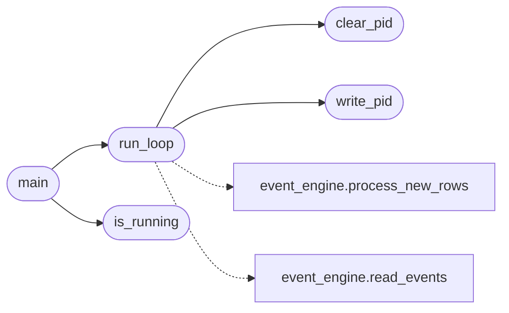

# `skills.heartbeat`

> Source: [skills/heartbeat.py:1](../../skills/heartbeat.py#L1) | language `py` | coverage 33.3% | [API index](../index.md)

LazyOwn Heartbeat ================= Lightweight background process that drives the event engine.

Runs the CSV-tail → rule-match → event-emit loop every N seconds.

Usage:
    python3 skills/heartbeat.py [--interval 5] [--once]

Options:
    --interval N   Poll interval in seconds (default: 5)
    --once         Run one pass and exit (useful for cron/testing)
    --daemon       Daemonize (write PID to sessions/heartbeat.pid)

## Contents

- **Functions:** [`write_pid`](#write_pid), [`clear_pid`](#clear_pid), [`is_running`](#is_running), [`run_loop`](#run_loop), [`main`](#main)
- **Constants:** [`SKILLS_DIR`](#skills_dir), [`LAZYOWN_DIR`](#lazyown_dir), [`PID_FILE`](#pid_file)

## Call Graph

Solid arrows stay in this module, dashed arrows leave it.



## Functions

<a id="write_pid"></a>

### `write_pid`

`function` | [skills/heartbeat.py:53](../../skills/heartbeat.py#L53)

```python
def write_pid()
```

*Called by:* [`run_loop`](#run_loop)

---

<a id="clear_pid"></a>

### `clear_pid`

`function` | [skills/heartbeat.py:57](../../skills/heartbeat.py#L57)

```python
def clear_pid()
```

*Called by:* [`run_loop`](#run_loop)

---

<a id="is_running"></a>

### `is_running`

`function` | [skills/heartbeat.py:62](../../skills/heartbeat.py#L62)

```python
def is_running() -> tuple[bool, int]
```

Return (is_running, pid).

Checks if stored PID is still alive.

**Returns:** `tuple[bool, int]`

*Called by:* [`main`](#main)

---

<a id="run_loop"></a>

### `run_loop`

`function` | [skills/heartbeat.py:74](../../skills/heartbeat.py#L74)

```python
def run_loop(interval: int, once: bool = False)
```

**Parameters**

| Name | Type | Default | Description |
|---|---|---|---|
| `interval` | `int` |  |  |
| `once` | `bool` | `False` |  |

*Calls:* [`process_new_rows`](modules.event_engine.py.md#process_new_rows), [`read_events`](modules.event_engine.py.md#read_events), [`clear_pid`](#clear_pid), [`write_pid`](#write_pid)

*Called by:* [`main`](#main)

---

<a id="main"></a>

### `main`

`function` | [skills/heartbeat.py:127](../../skills/heartbeat.py#L127)

```python
def main()
```

*Calls:* [`is_running`](#is_running), [`run_loop`](#run_loop)

---

## Constants

<a id="skills_dir"></a>

### `SKILLS_DIR`

`constant` | [skills/heartbeat.py:24](../../skills/heartbeat.py#L24)

```python
SKILLS_DIR = Path(__file__).parent
```

---

<a id="lazyown_dir"></a>

### `LAZYOWN_DIR`

`constant` | [skills/heartbeat.py:25](../../skills/heartbeat.py#L25)

```python
LAZYOWN_DIR = SKILLS_DIR.parent
```

---

<a id="pid_file"></a>

### `PID_FILE`

`constant` | [skills/heartbeat.py:50](../../skills/heartbeat.py#L50)

```python
PID_FILE = LAZYOWN_DIR / 'sessions' / 'heartbeat.pid'
```

---
