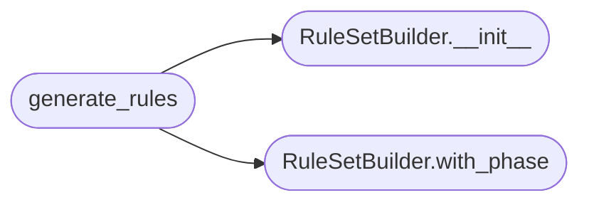

# `skills.hermes-lazyown.claudemd_rules`

> Source: [skills/hermes-lazyown/claudemd_rules.py:1](../../skills/hermes-lazyown/claudemd_rules.py#L1) | language `py` | coverage 90.0% | [API index](../index.md)

Dynamic Claude.md rule generator for the Hermes-LazyOwn integration.

Produces instruction snippets that Hermes injects into the system prompt
based on the current engagement phase, discovered services, and credentials.

Follows the Builder pattern: start from base rules, then layer phase-specific
and target-specific constraints.

## Contents

- **Classes:** [`RuleSetBuilder`](#rulesetbuilder)
- **Functions:** [`generate_rules`](#generate_rules)

## Call Graph

Solid arrows stay in this module, dashed arrows leave it.



## Classes

<a id="rulesetbuilder"></a>

### `RuleSetBuilder`

`class` | [skills/hermes-lazyown/claudemd_rules.py:14](../../skills/hermes-lazyown/claudemd_rules.py#L14)

```python
class RuleSetBuilder
```

Builds a dynamic rule set string suitable for Hermes system prompt injection.

Usage:
    builder = RuleSetBuilder()
    rules = builder.with_phase("recon").with_target("10.10.11.5").build()
    # rules is a markdown string that can be appended to the system prompt

**Members**

| Member | Kind | Summary |
|---|---|---|
| [`__init__`](#rulesetbuilder-__init__) | constructor |  |
| [`with_phase`](#rulesetbuilder-with_phase) | method | Set the current engagement phase. |
| [`with_target`](#rulesetbuilder-with_target) | method | Set the active target IP. |
| [`with_services`](#rulesetbuilder-with_services) | method | Set discovered services (e.g., ['http:80', 'smb:445']). |
| [`with_creds`](#rulesetbuilder-with_creds) | method | Set whether credentials have been discovered. |
| [`with_hermes`](#rulesetbuilder-with_hermes) | method | Set whether running inside a Hermes session. |
| [`build`](#rulesetbuilder-build) | method | Build and return the complete rule set markdown. |

<a id="rulesetbuilder-__init__"></a>

#### `RuleSetBuilder.__init__`

`constructor` | [skills/hermes-lazyown/claudemd_rules.py:24](../../skills/hermes-lazyown/claudemd_rules.py#L24)

```python
def __init__(self) -> None
```

*Called by:* [`generate_rules`](#generate_rules)

<a id="rulesetbuilder-with_phase"></a>

#### `RuleSetBuilder.with_phase`

`method` | [skills/hermes-lazyown/claudemd_rules.py:31](../../skills/hermes-lazyown/claudemd_rules.py#L31)

```python
def with_phase(self, phase: str) -> 'RuleSetBuilder'
```

Set the current engagement phase.

**Parameters**

| Name | Type | Default | Description |
|---|---|---|---|
| `phase` | `str` |  |  |

**Returns:** `'RuleSetBuilder'`

*Called by:* [`generate_rules`](#generate_rules)

<a id="rulesetbuilder-with_target"></a>

#### `RuleSetBuilder.with_target`

`method` | [skills/hermes-lazyown/claudemd_rules.py:36](../../skills/hermes-lazyown/claudemd_rules.py#L36)

```python
def with_target(self, rhost: str) -> 'RuleSetBuilder'
```

Set the active target IP.

**Parameters**

| Name | Type | Default | Description |
|---|---|---|---|
| `rhost` | `str` |  |  |

**Returns:** `'RuleSetBuilder'`

<a id="rulesetbuilder-with_services"></a>

#### `RuleSetBuilder.with_services`

`method` | [skills/hermes-lazyown/claudemd_rules.py:41](../../skills/hermes-lazyown/claudemd_rules.py#L41)

```python
def with_services(self, services: list[str]) -> 'RuleSetBuilder'
```

Set discovered services (e.g., ['http:80', 'smb:445']).

**Parameters**

| Name | Type | Default | Description |
|---|---|---|---|
| `services` | `list[str]` |  |  |

**Returns:** `'RuleSetBuilder'`

<a id="rulesetbuilder-with_creds"></a>

#### `RuleSetBuilder.with_creds`

`method` | [skills/hermes-lazyown/claudemd_rules.py:46](../../skills/hermes-lazyown/claudemd_rules.py#L46)

```python
def with_creds(self, found: bool) -> 'RuleSetBuilder'
```

Set whether credentials have been discovered.

**Parameters**

| Name | Type | Default | Description |
|---|---|---|---|
| `found` | `bool` |  |  |

**Returns:** `'RuleSetBuilder'`

<a id="rulesetbuilder-with_hermes"></a>

#### `RuleSetBuilder.with_hermes`

`method` | [skills/hermes-lazyown/claudemd_rules.py:51](../../skills/hermes-lazyown/claudemd_rules.py#L51)

```python
def with_hermes(self, is_hermes: bool) -> 'RuleSetBuilder'
```

Set whether running inside a Hermes session.

**Parameters**

| Name | Type | Default | Description |
|---|---|---|---|
| `is_hermes` | `bool` |  |  |

**Returns:** `'RuleSetBuilder'`

<a id="rulesetbuilder-build"></a>

#### `RuleSetBuilder.build`

`method` | [skills/hermes-lazyown/claudemd_rules.py:56](../../skills/hermes-lazyown/claudemd_rules.py#L56)

```python
def build(self) -> str
```

Build and return the complete rule set markdown.

**Returns:** `str`

---

## Functions

<a id="generate_rules"></a>

### `generate_rules`

`function` | [skills/hermes-lazyown/claudemd_rules.py:185](../../skills/hermes-lazyown/claudemd_rules.py#L185)

```python
def generate_rules(phase: str = '', rhost: str = '', services: list[str] | None = None, creds_found: bool = False, is_hermes: bool = False) -> str
```

Convenience function: build a rule set from parameters.

**Parameters**

| Name | Type | Default | Description |
|---|---|---|---|
| `phase` | `str` | `''` | Current kill-chain phase. |
| `rhost` | `str` | `''` | Active target IP. |
| `services` | `list[str] \| None` | `None` | Discovered services strings. |
| `creds_found` | `bool` | `False` | Whether credentials are known. |
| `is_hermes` | `bool` | `False` | Whether running inside Hermes. |

**Returns:** `str` - A markdown string ready for system prompt injection.

*Calls:* [`RuleSetBuilder.__init__`](#rulesetbuilder-__init__), [`RuleSetBuilder.with_phase`](#rulesetbuilder-with_phase)

---
