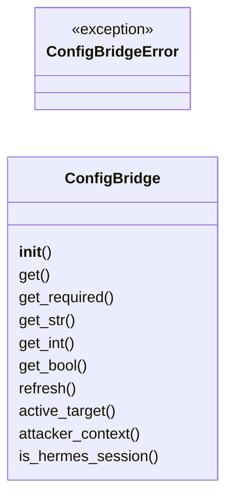
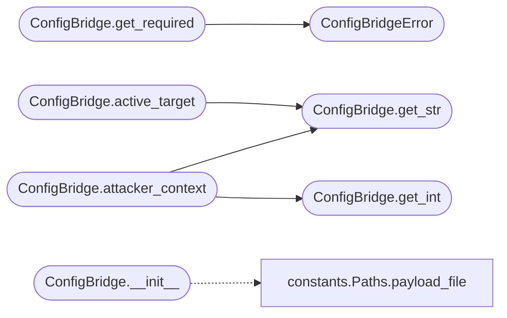

# `skills.hermes-lazyown.config_bridge`

> Source: [skills/hermes-lazyown/config_bridge.py:1](../../skills/hermes-lazyown/config_bridge.py#L1) | language `py` | coverage 92.3% | [API index](../index.md)

Configuration bridge: unifies LazyOwn payload.json, environment variables, and fallback defaults into a single read-only configuration source.

Follows the Adapter pattern: downstream code depends on this abstraction,
not on payload.json directly.

## Contents

- **Classes:** [`ConfigBridge`](#configbridge)
- **Exceptions:** [`ConfigBridgeError`](#configbridgeerror)

## Type Diagram



## Call Graph

Solid arrows stay in this module, dashed arrows leave it.



## Classes

<a id="configbridge"></a>

### `ConfigBridge`

`class` | [skills/hermes-lazyown/config_bridge.py:23](../../skills/hermes-lazyown/config_bridge.py#L23)

```python
class ConfigBridge
```

Unified configuration accessor for the Hermes-LazyOwn integration.

Reads from (highest priority first):
  1. Environment variables (HERMES_*, LAZYOWN_*)
  2. payload.json
  3. Module-level Defaults

All values are cached on first read. Call refresh() to invalidate cache.

**Members**

| Member | Kind | Summary |
|---|---|---|
| [`__init__`](#configbridge-__init__) | constructor |  |
| [`get`](#configbridge-get) | method | Return the value for *key*, or *default* if not found anywhere. |
| [`get_required`](#configbridge-get_required) | method | Return the value for *key*, raising ConfigBridgeError if missing. |
| [`get_str`](#configbridge-get_str) | method | Return the string value for *key*. |
| [`get_int`](#configbridge-get_int) | method | Return the integer value for *key*. |
| [`get_bool`](#configbridge-get_bool) | method | Return the boolean value for *key*. |
| [`refresh`](#configbridge-refresh) | method | Invalidate all caches so the next read reloads from disk. |
| [`active_target`](#configbridge-active_target) | method | Return a dict with the minimal target context (rhost, domain, os_id). |
| [`attacker_context`](#configbridge-attacker_context) | method | Return a dict with the attacker context (lhost, lport, etc.). |
| [`is_hermes_session`](#configbridge-is_hermes_session) | method | Return True if running inside a Hermes agent session. |

<a id="configbridge-__init__"></a>

#### `ConfigBridge.__init__`

`constructor` | [skills/hermes-lazyown/config_bridge.py:35](../../skills/hermes-lazyown/config_bridge.py#L35)

```python
def __init__(self, payload_path: Path | None = None) -> None
```

**Parameters**

| Name | Type | Default | Description |
|---|---|---|---|
| `payload_path` | `Path \| None` | `None` |  |

*Calls:* [`Paths.payload_file`](skills.hermes-lazyown.constants.py.md#paths-payload_file)

<a id="configbridge-get"></a>

#### `ConfigBridge.get`

`method` | [skills/hermes-lazyown/config_bridge.py:42](../../skills/hermes-lazyown/config_bridge.py#L42)

```python
def get(self, key: str, default: Any = None) -> Any
```

Return the value for *key*, or *default* if not found anywhere.

**Parameters**

| Name | Type | Default | Description |
|---|---|---|---|
| `key` | `str` |  |  |
| `default` | `Any` | `None` |  |

**Returns:** `Any`

<a id="configbridge-get_required"></a>

#### `ConfigBridge.get_required`

`method` | [skills/hermes-lazyown/config_bridge.py:46](../../skills/hermes-lazyown/config_bridge.py#L46)

```python
def get_required(self, key: str) -> Any
```

Return the value for *key*, raising ConfigBridgeError if missing.

**Parameters**

| Name | Type | Default | Description |
|---|---|---|---|
| `key` | `str` |  |  |

**Returns:** `Any`

**Raises**

- [`ConfigBridgeError`](#configbridgeerror): (raised in the body, not documented)

*Calls:* [`ConfigBridgeError`](#configbridgeerror)

<a id="configbridge-get_str"></a>

#### `ConfigBridge.get_str`

`method` | [skills/hermes-lazyown/config_bridge.py:53](../../skills/hermes-lazyown/config_bridge.py#L53)

```python
def get_str(self, key: str, default: str = '') -> str
```

Return the string value for *key*.

**Parameters**

| Name | Type | Default | Description |
|---|---|---|---|
| `key` | `str` |  |  |
| `default` | `str` | `''` |  |

**Returns:** `str`

*Called by:* [`ConfigBridge.active_target`](#configbridge-active_target), [`ConfigBridge.attacker_context`](#configbridge-attacker_context)

<a id="configbridge-get_int"></a>

#### `ConfigBridge.get_int`

`method` | [skills/hermes-lazyown/config_bridge.py:58](../../skills/hermes-lazyown/config_bridge.py#L58)

```python
def get_int(self, key: str, default: int = 0) -> int
```

Return the integer value for *key*.

**Parameters**

| Name | Type | Default | Description |
|---|---|---|---|
| `key` | `str` |  |  |
| `default` | `int` | `0` |  |

**Returns:** `int`

*Called by:* [`ConfigBridge.attacker_context`](#configbridge-attacker_context)

<a id="configbridge-get_bool"></a>

#### `ConfigBridge.get_bool`

`method` | [skills/hermes-lazyown/config_bridge.py:66](../../skills/hermes-lazyown/config_bridge.py#L66)

```python
def get_bool(self, key: str, default: bool = False) -> bool
```

Return the boolean value for *key*.

**Parameters**

| Name | Type | Default | Description |
|---|---|---|---|
| `key` | `str` |  |  |
| `default` | `bool` | `False` |  |

**Returns:** `bool`

<a id="configbridge-refresh"></a>

#### `ConfigBridge.refresh`

`method` | [skills/hermes-lazyown/config_bridge.py:75](../../skills/hermes-lazyown/config_bridge.py#L75)

```python
def refresh(self) -> None
```

Invalidate all caches so the next read reloads from disk.

<a id="configbridge-active_target"></a>

#### `ConfigBridge.active_target`

`method` | [skills/hermes-lazyown/config_bridge.py:80](../../skills/hermes-lazyown/config_bridge.py#L80)

```python
def active_target(self) -> dict[str, Any]
```

Return a dict with the minimal target context (rhost, domain, os_id).

**Returns:** `dict[str, Any]`

*Calls:* [`ConfigBridge.get_str`](#configbridge-get_str)

<a id="configbridge-attacker_context"></a>

#### `ConfigBridge.attacker_context`

`method` | [skills/hermes-lazyown/config_bridge.py:90](../../skills/hermes-lazyown/config_bridge.py#L90)

```python
def attacker_context(self) -> dict[str, Any]
```

Return a dict with the attacker context (lhost, lport, etc.).

**Returns:** `dict[str, Any]`

*Calls:* [`ConfigBridge.get_int`](#configbridge-get_int), [`ConfigBridge.get_str`](#configbridge-get_str)

<a id="configbridge-is_hermes_session"></a>

#### `ConfigBridge.is_hermes_session`

`method` | [skills/hermes-lazyown/config_bridge.py:99](../../skills/hermes-lazyown/config_bridge.py#L99)

```python
def is_hermes_session(self) -> bool
```

Return True if running inside a Hermes agent session.

**Returns:** `bool`

---

## Exceptions

<a id="configbridgeerror"></a>

### `ConfigBridgeError`

`exception` | [skills/hermes-lazyown/config_bridge.py:17](../../skills/hermes-lazyown/config_bridge.py#L17)

```python
class ConfigBridgeError(Exception)
```

Bases: `Exception`

Raised when the configuration bridge cannot resolve a required value.

---
