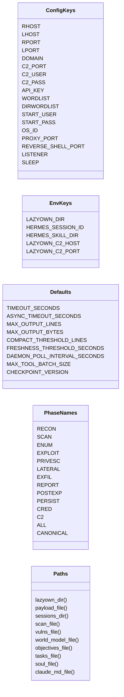
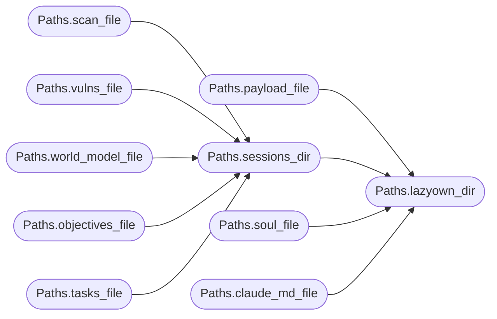

# `skills.hermes-lazyown.constants`

> Source: [skills/hermes-lazyown/constants.py:1](../../skills/hermes-lazyown/constants.py#L1) | language `py` | coverage 100.0% | [API index](../index.md)

Central constants for the Hermes-LazyOwn integration layer.

All paths, timeouts, and thresholds are derived from environment variables
or payload.json. No hardcoded hostnames, ports, or filesystem paths.

## Contents

- **Classes:** [`ConfigKeys`](#configkeys), [`EnvKeys`](#envkeys), [`Defaults`](#defaults), [`PhaseNames`](#phasenames), [`Paths`](#paths)

## Type Diagram



## Call Graph

Solid arrows stay in this module, dashed arrows leave it.



## Classes

<a id="configkeys"></a>

### `ConfigKeys`

`class` | [skills/hermes-lazyown/constants.py:12](../../skills/hermes-lazyown/constants.py#L12)

```python
class ConfigKeys
```

Payload.json keys referenced across the integration layer.

**Attributes**

| Name | Type | Default | Description |
|---|---|---|---|
| [`RHOST`](#configkeys-rhost) |  | `'rhost'` |  |
| [`LHOST`](#configkeys-lhost) |  | `'lhost'` |  |
| [`RPORT`](#configkeys-rport) |  | `'rport'` |  |
| [`LPORT`](#configkeys-lport) |  | `'lport'` |  |
| [`DOMAIN`](#configkeys-domain) |  | `'domain'` |  |
| [`C2_PORT`](#configkeys-c2_port) |  | `'c2_port'` |  |
| [`C2_USER`](#configkeys-c2_user) |  | `'c2_user'` |  |
| [`C2_PASS`](#configkeys-c2_pass) |  | `'c2_pass'` |  |
| [`API_KEY`](#configkeys-api_key) |  | `'api_key'` |  |
| [`WORDLIST`](#configkeys-wordlist) |  | `'wordlist'` |  |
| [`DIRWORDLIST`](#configkeys-dirwordlist) |  | `'dirwordlist'` |  |
| [`START_USER`](#configkeys-start_user) |  | `'start_user'` |  |
| [`START_PASS`](#configkeys-start_pass) |  | `'start_pass'` |  |
| [`OS_ID`](#configkeys-os_id) |  | `'os_id'` |  |
| [`PROXY_PORT`](#configkeys-proxy_port) |  | `'proxy_port'` |  |
| [`REVERSE_SHELL_PORT`](#configkeys-reverse_shell_port) |  | `'reverse_shell_port'` |  |
| [`LISTENER`](#configkeys-listener) |  | `'listener'` |  |
| [`SLEEP`](#configkeys-sleep) |  | `'sleep'` |  |

---

<a id="envkeys"></a>

### `EnvKeys`

`class` | [skills/hermes-lazyown/constants.py:35](../../skills/hermes-lazyown/constants.py#L35)

```python
class EnvKeys
```

Environment variables used for Hermes integration.

**Attributes**

| Name | Type | Default | Description |
|---|---|---|---|
| [`LAZYOWN_DIR`](#envkeys-lazyown_dir) |  | `'LAZYOWN_DIR'` |  |
| [`HERMES_SESSION_ID`](#envkeys-hermes_session_id) |  | `'HERMES_SESSION_ID'` |  |
| [`HERMES_SKILL_DIR`](#envkeys-hermes_skill_dir) |  | `'HERMES_SKILL_DIR'` |  |
| [`LAZYOWN_C2_HOST`](#envkeys-lazyown_c2_host) |  | `'LAZYOWN_C2_HOST'` |  |
| [`LAZYOWN_C2_PORT`](#envkeys-lazyown_c2_port) |  | `'LAZYOWN_C2_PORT'` |  |

---

<a id="defaults"></a>

### `Defaults`

`class` | [skills/hermes-lazyown/constants.py:45](../../skills/hermes-lazyown/constants.py#L45)

```python
class Defaults
```

Fallback defaults when neither payload.json nor env vars provide a value.

**Attributes**

| Name | Type | Default | Description |
|---|---|---|---|
| [`TIMEOUT_SECONDS`](#defaults-timeout_seconds) |  | `30` |  |
| [`ASYNC_TIMEOUT_SECONDS`](#defaults-async_timeout_seconds) |  | `1800` |  |
| [`MAX_OUTPUT_LINES`](#defaults-max_output_lines) |  | `2000` |  |
| [`MAX_OUTPUT_BYTES`](#defaults-max_output_bytes) |  | `50000` |  |
| [`COMPACT_THRESHOLD_LINES`](#defaults-compact_threshold_lines) |  | `100` |  |
| [`FRESHNESS_THRESHOLD_SECONDS`](#defaults-freshness_threshold_seconds) |  | `604800` |  |
| [`DAEMON_POLL_INTERVAL_SECONDS`](#defaults-daemon_poll_interval_seconds) |  | `5` |  |
| [`MAX_TOOL_BATCH_SIZE`](#defaults-max_tool_batch_size) |  | `5` |  |
| [`CHECKPOINT_VERSION`](#defaults-checkpoint_version) |  | `'1'` |  |

---

<a id="phasenames"></a>

### `PhaseNames`

`class` | [skills/hermes-lazyown/constants.py:59](../../skills/hermes-lazyown/constants.py#L59)

```python
class PhaseNames
```

Kill-chain phase identifiers.

Canonical phases are sourced from `[`modules.killchain.KillChain`](modules.killchain.py.md#killchain)`.
Hermes-specific extensions (postexp, persist, cred, c2) are added
for agent reasoning beyond the core engagement phases.

**Attributes**

| Name | Type | Default | Description |
|---|---|---|---|
| [`RECON`](#phasenames-recon) |  | `'recon'` |  |
| [`SCAN`](#phasenames-scan) |  | `'scan'` |  |
| [`ENUM`](#phasenames-enum) |  | `'enum'` |  |
| [`EXPLOIT`](#phasenames-exploit) |  | `'exploit'` |  |
| [`PRIVESC`](#phasenames-privesc) |  | `'privesc'` |  |
| [`LATERAL`](#phasenames-lateral) |  | `'lateral'` |  |
| [`EXFIL`](#phasenames-exfil) |  | `'exfil'` |  |
| [`REPORT`](#phasenames-report) |  | `'report'` |  |
| [`POSTEXP`](#phasenames-postexp) |  | `'postexp'` |  |
| [`PERSIST`](#phasenames-persist) |  | `'persist'` |  |
| [`CRED`](#phasenames-cred) |  | `'cred'` |  |
| [`C2`](#phasenames-c2) |  | `'c2'` |  |
| [`ALL`](#phasenames-all) |  | `[RECON, SCAN, ENUM, EXPLOIT, PRIVESC, LATERAL, EXFIL, REPORT, POSTEXP, PERSIST, CRED, C2]` |  |
| [`CANONICAL`](#phasenames-canonical) |  | `list(_CANONICAL)` |  |

---

<a id="paths"></a>

### `Paths`

`class` | [skills/hermes-lazyown/constants.py:102](../../skills/hermes-lazyown/constants.py#L102)

```python
class Paths
```

LazyOwn directory layout derived at runtime.

**Members**

| Member | Kind | Summary |
|---|---|---|
| [`lazyown_dir`](#paths-lazyown_dir) | staticmethod | Return the LazyOwn project root directory. |
| [`payload_file`](#paths-payload_file) | staticmethod | Return the path to payload.json. |
| [`sessions_dir`](#paths-sessions_dir) | staticmethod | Return the path to the sessions directory. |
| [`scan_file`](#paths-scan_file) | staticmethod | Return the expected nmap scan file for a target. |
| [`vulns_file`](#paths-vulns_file) | staticmethod | Return the expected vulnerability scan file for a target. |
| [`world_model_file`](#paths-world_model_file) | staticmethod | Return the path to world_model.json. |
| [`objectives_file`](#paths-objectives_file) | staticmethod | Return the path to objectives.jsonl. |
| [`tasks_file`](#paths-tasks_file) | staticmethod | Return the path to tasks.json. |
| [`soul_file`](#paths-soul_file) | staticmethod | Return the path to soul.md. |
| [`claude_md_file`](#paths-claude_md_file) | staticmethod | Return the path to CLAUDE.md. |

<a id="paths-lazyown_dir"></a>

#### `Paths.lazyown_dir`

`staticmethod` | [skills/hermes-lazyown/constants.py:106](../../skills/hermes-lazyown/constants.py#L106)

Decorators: `@staticmethod`

```python
def lazyown_dir() -> Path
```

Return the LazyOwn project root directory.

**Returns:** `Path`

*Called by:* [`Paths.claude_md_file`](#paths-claude_md_file), [`Paths.payload_file`](#paths-payload_file), [`Paths.sessions_dir`](#paths-sessions_dir), [`Paths.soul_file`](#paths-soul_file), [`LazyOwnExecutor.__init__`](skills.hermes-lazyown.executor.py.md#lazyownexecutor-__init__)

<a id="paths-payload_file"></a>

#### `Paths.payload_file`

`staticmethod` | [skills/hermes-lazyown/constants.py:115](../../skills/hermes-lazyown/constants.py#L115)

Decorators: `@staticmethod`

```python
def payload_file() -> Path
```

Return the path to payload.json.

**Returns:** `Path`

*Calls:* [`Paths.lazyown_dir`](#paths-lazyown_dir)

*Called by:* [`ConfigBridge.__init__`](skills.hermes-lazyown.config_bridge.py.md#configbridge-__init__)

<a id="paths-sessions_dir"></a>

#### `Paths.sessions_dir`

`staticmethod` | [skills/hermes-lazyown/constants.py:120](../../skills/hermes-lazyown/constants.py#L120)

Decorators: `@staticmethod`

```python
def sessions_dir() -> Path
```

Return the path to the sessions directory.

**Returns:** `Path`

*Calls:* [`Paths.lazyown_dir`](#paths-lazyown_dir)

*Called by:* [`Paths.objectives_file`](#paths-objectives_file), [`Paths.scan_file`](#paths-scan_file), [`Paths.tasks_file`](#paths-tasks_file), [`Paths.vulns_file`](#paths-vulns_file), [`Paths.world_model_file`](#paths-world_model_file), [`CheckpointSerializer.__init__`](skills.hermes-lazyown.hermes_sync.py.md#checkpointserializer-__init__)

<a id="paths-scan_file"></a>

#### `Paths.scan_file`

`staticmethod` | [skills/hermes-lazyown/constants.py:125](../../skills/hermes-lazyown/constants.py#L125)

Decorators: `@staticmethod`

```python
def scan_file(rhost: str) -> Path
```

Return the expected nmap scan file for a target.

**Parameters**

| Name | Type | Default | Description |
|---|---|---|---|
| `rhost` | `str` |  |  |

**Returns:** `Path`

*Calls:* [`Paths.sessions_dir`](#paths-sessions_dir)

<a id="paths-vulns_file"></a>

#### `Paths.vulns_file`

`staticmethod` | [skills/hermes-lazyown/constants.py:130](../../skills/hermes-lazyown/constants.py#L130)

Decorators: `@staticmethod`

```python
def vulns_file(rhost: str) -> Path
```

Return the expected vulnerability scan file for a target.

**Parameters**

| Name | Type | Default | Description |
|---|---|---|---|
| `rhost` | `str` |  |  |

**Returns:** `Path`

*Calls:* [`Paths.sessions_dir`](#paths-sessions_dir)

<a id="paths-world_model_file"></a>

#### `Paths.world_model_file`

`staticmethod` | [skills/hermes-lazyown/constants.py:135](../../skills/hermes-lazyown/constants.py#L135)

Decorators: `@staticmethod`

```python
def world_model_file() -> Path
```

Return the path to world_model.json.

**Returns:** `Path`

*Calls:* [`Paths.sessions_dir`](#paths-sessions_dir)

<a id="paths-objectives_file"></a>

#### `Paths.objectives_file`

`staticmethod` | [skills/hermes-lazyown/constants.py:140](../../skills/hermes-lazyown/constants.py#L140)

Decorators: `@staticmethod`

```python
def objectives_file() -> Path
```

Return the path to objectives.jsonl.

**Returns:** `Path`

*Calls:* [`Paths.sessions_dir`](#paths-sessions_dir)

*Called by:* [`ObjectiveTodoSync.__init__`](skills.hermes-lazyown.hermes_sync.py.md#objectivetodosync-__init__)

<a id="paths-tasks_file"></a>

#### `Paths.tasks_file`

`staticmethod` | [skills/hermes-lazyown/constants.py:145](../../skills/hermes-lazyown/constants.py#L145)

Decorators: `@staticmethod`

```python
def tasks_file() -> Path
```

Return the path to tasks.json.

**Returns:** `Path`

*Calls:* [`Paths.sessions_dir`](#paths-sessions_dir)

<a id="paths-soul_file"></a>

#### `Paths.soul_file`

`staticmethod` | [skills/hermes-lazyown/constants.py:150](../../skills/hermes-lazyown/constants.py#L150)

Decorators: `@staticmethod`

```python
def soul_file() -> Path
```

Return the path to soul.md.

**Returns:** `Path`

*Calls:* [`Paths.lazyown_dir`](#paths-lazyown_dir)

<a id="paths-claude_md_file"></a>

#### `Paths.claude_md_file`

`staticmethod` | [skills/hermes-lazyown/constants.py:155](../../skills/hermes-lazyown/constants.py#L155)

Decorators: `@staticmethod`

```python
def claude_md_file() -> Path
```

Return the path to CLAUDE.md.

**Returns:** `Path`

*Calls:* [`Paths.lazyown_dir`](#paths-lazyown_dir)

---
