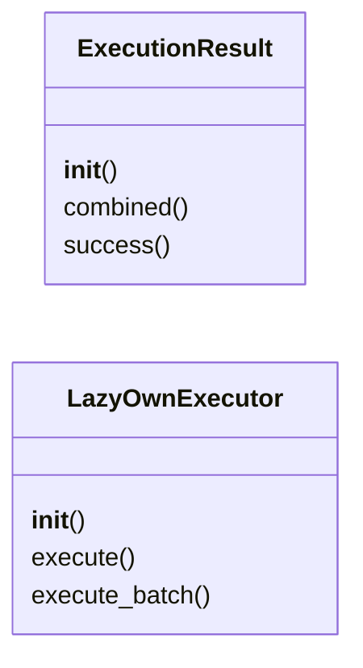
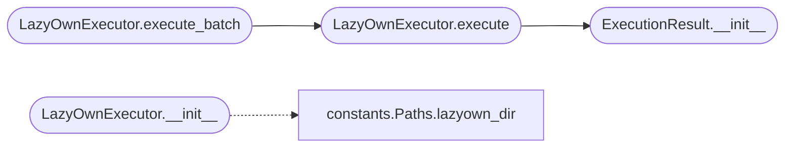

# `skills.hermes-lazyown.executor`

> Source: [skills/hermes-lazyown/executor.py:1](../../skills/hermes-lazyown/executor.py#L1) | language `py` | coverage 77.8% | [API index](../index.md)

LazyOwn command executor for the Hermes-LazyOwn integration.

Wraps subprocess interaction with the LazyOwn CLI in a robust,
timeout-aware, output-sanitizing layer.

Follows the Command pattern: each execution is encapsulated in an
ExecutionResult with metadata.

## Contents

- **Classes:** [`ExecutionResult`](#executionresult), [`LazyOwnExecutor`](#lazyownexecutor)

## Type Diagram



## Call Graph

Solid arrows stay in this module, dashed arrows leave it.



## Classes

<a id="executionresult"></a>

### `ExecutionResult`

`class` | [skills/hermes-lazyown/executor.py:21](../../skills/hermes-lazyown/executor.py#L21)

```python
class ExecutionResult
```

Immutable result of a LazyOwn command execution.

**Members**

| Member | Kind | Summary |
|---|---|---|
| [`__init__`](#executionresult-__init__) | constructor |  |
| [`combined`](#executionresult-combined) | property | Return stdout and stderr combined. |
| [`success`](#executionresult-success) | property | Return True if the command exited cleanly and did not time out. |

<a id="executionresult-__init__"></a>

#### `ExecutionResult.__init__`

`constructor` | [skills/hermes-lazyown/executor.py:24](../../skills/hermes-lazyown/executor.py#L24)

```python
def __init__(self, stdout: str, stderr: str, returncode: int | None, timed_out: bool = False, duration_ms: float = 0.0) -> None
```

**Parameters**

| Name | Type | Default | Description |
|---|---|---|---|
| `stdout` | `str` |  |  |
| `stderr` | `str` |  |  |
| `returncode` | `int \| None` |  |  |
| `timed_out` | `bool` | `False` |  |
| `duration_ms` | `float` | `0.0` |  |

*Called by:* [`LazyOwnExecutor.execute`](#lazyownexecutor-execute)

<a id="executionresult-combined"></a>

#### `ExecutionResult.combined`

`property` | [skills/hermes-lazyown/executor.py:39](../../skills/hermes-lazyown/executor.py#L39)

Decorators: `@property`

```python
def combined(self) -> str
```

Return stdout and stderr combined.

**Returns:** `str`

<a id="executionresult-success"></a>

#### `ExecutionResult.success`

`property` | [skills/hermes-lazyown/executor.py:47](../../skills/hermes-lazyown/executor.py#L47)

Decorators: `@property`

```python
def success(self) -> bool
```

Return True if the command exited cleanly and did not time out.

**Returns:** `bool`

---

<a id="lazyownexecutor"></a>

### `LazyOwnExecutor`

`class` | [skills/hermes-lazyown/executor.py:58](../../skills/hermes-lazyown/executor.py#L58)

```python
class LazyOwnExecutor
```

Executes commands against the LazyOwn CLI via subprocess.

Uses a pseudo-terminal when available so that cmd2-based prompts
and ANSI output are handled correctly.

**Members**

| Member | Kind | Summary |
|---|---|---|
| [`__init__`](#lazyownexecutor-__init__) | constructor |  |
| [`execute`](#lazyownexecutor-execute) | method | Execute a single LazyOwn command string. |
| [`execute_batch`](#lazyownexecutor-execute_batch) | method | Execute multiple commands in a single LazyOwn session. |

<a id="lazyownexecutor-__init__"></a>

#### `LazyOwnExecutor.__init__`

`constructor` | [skills/hermes-lazyown/executor.py:66](../../skills/hermes-lazyown/executor.py#L66)

```python
def __init__(self, lazyown_dir: Path | None = None, timeout: int = Defaults.TIMEOUT_SECONDS) -> None
```

**Parameters**

| Name | Type | Default | Description |
|---|---|---|---|
| `lazyown_dir` | `Path \| None` | `None` |  |
| `timeout` | `int` | `Defaults.TIMEOUT_SECONDS` |  |

*Calls:* [`Paths.lazyown_dir`](skills.hermes-lazyown.constants.py.md#paths-lazyown_dir)

<a id="lazyownexecutor-execute"></a>

#### `LazyOwnExecutor.execute`

`method` | [skills/hermes-lazyown/executor.py:77](../../skills/hermes-lazyown/executor.py#L77)

```python
def execute(self, command: str, timeout: int | None = None) -> ExecutionResult
```

Execute a single LazyOwn command string.

**Parameters**

| Name | Type | Default | Description |
|---|---|---|---|
| `command` | `str` |  | The command to run (e.g., "lazynmap" or "set rhost 10.10.11.5"). |
| `timeout` | `int \| None` | `None` | Seconds before killing the process. Defaults to constructor value. |

**Returns:** `ExecutionResult` - An ExecutionResult with stdout, stderr, and metadata.

*Calls:* [`ExecutionResult.__init__`](#executionresult-__init__)

*Called by:* [`LazyOwnExecutor.execute_batch`](#lazyownexecutor-execute_batch)

<a id="lazyownexecutor-execute_batch"></a>

#### `LazyOwnExecutor.execute_batch`

`method` | [skills/hermes-lazyown/executor.py:98](../../skills/hermes-lazyown/executor.py#L98)

```python
def execute_batch(self, commands: list[str], timeout: int | None = None) -> ExecutionResult
```

Execute multiple commands in a single LazyOwn session.

**Parameters**

| Name | Type | Default | Description |
|---|---|---|---|
| `commands` | `list[str]` |  | List of command strings. |
| `timeout` | `int \| None` | `None` | Total timeout for the entire batch. |

**Returns:** `ExecutionResult` - An ExecutionResult with combined output.

*Calls:* [`LazyOwnExecutor.execute`](#lazyownexecutor-execute)

---
