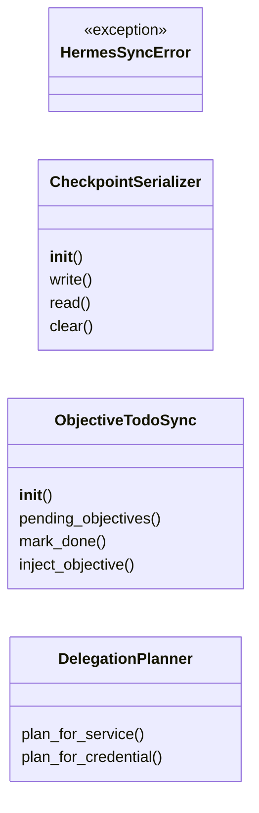
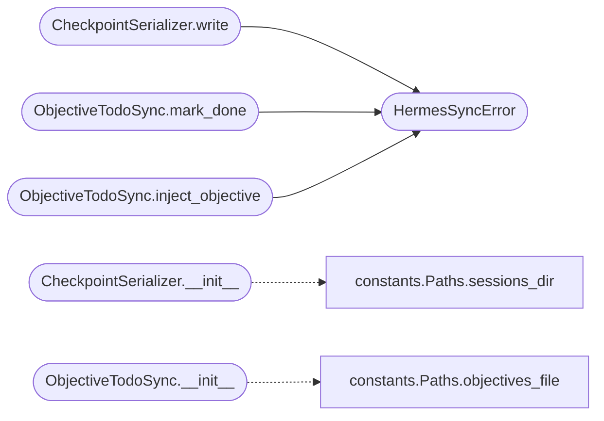

# `skills.hermes-lazyown.hermes_sync`

> Source: [skills/hermes-lazyown/hermes_sync.py:1](../../skills/hermes-lazyown/hermes_sync.py#L1) | language `py` | coverage 86.7% | [API index](../index.md)

Hermes-native synchronization layer.

Bridges LazyOwn session state with Hermes agent primitives:
  - todo list sync (Hermes todo tool <-> objectives.jsonl)
  - checkpoint serialization for resume across turns
  - delegation hints for parallel intel gathering

Follows the Observer pattern: LazyOwn state changes are observed and
reflected into Hermes-native constructs.

## Contents

- **Classes:** [`CheckpointSerializer`](#checkpointserializer), [`ObjectiveTodoSync`](#objectivetodosync), [`DelegationPlanner`](#delegationplanner)
- **Exceptions:** [`HermesSyncError`](#hermessyncerror)

## Type Diagram



## Call Graph

Solid arrows stay in this module, dashed arrows leave it.



## Classes

<a id="checkpointserializer"></a>

### `CheckpointSerializer`

`class` | [skills/hermes-lazyown/hermes_sync.py:27](../../skills/hermes-lazyown/hermes_sync.py#L27)

```python
class CheckpointSerializer
```

Serialize the current engagement state into a compact checkpoint that Hermes can inject at the start of a new turn.

**Members**

| Member | Kind | Summary |
|---|---|---|
| [`__init__`](#checkpointserializer-__init__) | constructor |  |
| [`write`](#checkpointserializer-write) | method | Write a checkpoint to disk. |
| [`read`](#checkpointserializer-read) | method | Read the latest checkpoint, or None if absent / stale. |
| [`clear`](#checkpointserializer-clear) | method | Remove the checkpoint file. |

<a id="checkpointserializer-__init__"></a>

#### `CheckpointSerializer.__init__`

`constructor` | [skills/hermes-lazyown/hermes_sync.py:33](../../skills/hermes-lazyown/hermes_sync.py#L33)

```python
def __init__(self, sessions_dir: Path | None = None) -> None
```

**Parameters**

| Name | Type | Default | Description |
|---|---|---|---|
| `sessions_dir` | `Path \| None` | `None` |  |

*Calls:* [`Paths.sessions_dir`](skills.hermes-lazyown.constants.py.md#paths-sessions_dir)

<a id="checkpointserializer-write"></a>

#### `CheckpointSerializer.write`

`method` | [skills/hermes-lazyown/hermes_sync.py:37](../../skills/hermes-lazyown/hermes_sync.py#L37)

```python
def write(self, state: dict[str, Any]) -> None
```

Write a checkpoint to disk.

**Parameters**

| Name | Type | Default | Description |
|---|---|---|---|
| `state` | `dict[str, Any]` |  |  |

**Raises**

- [`HermesSyncError`](#hermessyncerror): (raised in the body, not documented)

*Calls:* [`HermesSyncError`](#hermessyncerror)

<a id="checkpointserializer-read"></a>

#### `CheckpointSerializer.read`

`method` | [skills/hermes-lazyown/hermes_sync.py:49](../../skills/hermes-lazyown/hermes_sync.py#L49)

```python
def read(self) -> dict[str, Any] | None
```

Read the latest checkpoint, or None if absent / stale.

**Returns:** `dict[str, Any] | None`

<a id="checkpointserializer-clear"></a>

#### `CheckpointSerializer.clear`

`method` | [skills/hermes-lazyown/hermes_sync.py:64](../../skills/hermes-lazyown/hermes_sync.py#L64)

```python
def clear(self) -> None
```

Remove the checkpoint file.

---

<a id="objectivetodosync"></a>

### `ObjectiveTodoSync`

`class` | [skills/hermes-lazyown/hermes_sync.py:73](../../skills/hermes-lazyown/hermes_sync.py#L73)

```python
class ObjectiveTodoSync
```

Bidirectional sync between LazyOwn objectives and Hermes todo items.

LazyOwn objectives are stored in objectives.jsonl (append-only JSON lines).
Hermes todo items are ephemeral per-turn. This bridge allows the agent
to surface LazyOwn objectives as Hermes todos and ack them back.

**Members**

| Member | Kind | Summary |
|---|---|---|
| [`__init__`](#objectivetodosync-__init__) | constructor |  |
| [`pending_objectives`](#objectivetodosync-pending_objectives) | method | Return all pending objectives from objectives.jsonl. |
| [`mark_done`](#objectivetodosync-mark_done) | method | Mark an objective as done by appending a completion record. |
| [`inject_objective`](#objectivetodosync-inject_objective) | method | Inject a new objective into the LazyOwn queue. |

<a id="objectivetodosync-__init__"></a>

#### `ObjectiveTodoSync.__init__`

`constructor` | [skills/hermes-lazyown/hermes_sync.py:82](../../skills/hermes-lazyown/hermes_sync.py#L82)

```python
def __init__(self, objectives_path: Path | None = None) -> None
```

**Parameters**

| Name | Type | Default | Description |
|---|---|---|---|
| `objectives_path` | `Path \| None` | `None` |  |

*Calls:* [`Paths.objectives_file`](skills.hermes-lazyown.constants.py.md#paths-objectives_file)

<a id="objectivetodosync-pending_objectives"></a>

#### `ObjectiveTodoSync.pending_objectives`

`method` | [skills/hermes-lazyown/hermes_sync.py:85](../../skills/hermes-lazyown/hermes_sync.py#L85)

```python
def pending_objectives(self) -> list[dict[str, Any]]
```

Return all pending objectives from objectives.jsonl.

**Returns:** `list[dict[str, Any]]`

<a id="objectivetodosync-mark_done"></a>

#### `ObjectiveTodoSync.mark_done`

`method` | [skills/hermes-lazyown/hermes_sync.py:106](../../skills/hermes-lazyown/hermes_sync.py#L106)

```python
def mark_done(self, objective_text: str) -> bool
```

Mark an objective as done by appending a completion record.

LazyOwn objectives.jsonl is append-only; we do not mutate existing
lines. Instead we append a new line with status=done referencing
the original text.

**Parameters**

| Name | Type | Default | Description |
|---|---|---|---|
| `objective_text` | `str` |  |  |

**Returns:** `bool`

**Raises**

- [`HermesSyncError`](#hermessyncerror): (raised in the body, not documented)

*Calls:* [`HermesSyncError`](#hermessyncerror)

<a id="objectivetodosync-inject_objective"></a>

#### `ObjectiveTodoSync.inject_objective`

`method` | [skills/hermes-lazyown/hermes_sync.py:127](../../skills/hermes-lazyown/hermes_sync.py#L127)

```python
def inject_objective(self, text: str, priority: str = 'high', notes: str = '') -> bool
```

Inject a new objective into the LazyOwn queue.

**Parameters**

| Name | Type | Default | Description |
|---|---|---|---|
| `text` | `str` |  |  |
| `priority` | `str` | `'high'` |  |
| `notes` | `str` | `''` |  |

**Returns:** `bool`

**Raises**

- [`HermesSyncError`](#hermessyncerror): (raised in the body, not documented)

*Calls:* [`HermesSyncError`](#hermessyncerror)

---

<a id="delegationplanner"></a>

### `DelegationPlanner`

`class` | [skills/hermes-lazyown/hermes_sync.py:145](../../skills/hermes-lazyown/hermes_sync.py#L145)

```python
class DelegationPlanner
```

Produces structured delegation plans that Hermes can execute via delegate_task or cronjob.

Given a discovery (e.g., new service found), returns a list of
parallel subtasks suitable for Hermes-native delegation.

**Members**

| Member | Kind | Summary |
|---|---|---|
| [`plan_for_service`](#delegationplanner-plan_for_service) | method | Return a list of delegation task descriptors for a discovered service. |
| [`plan_for_credential`](#delegationplanner-plan_for_credential) | method | Return delegation tasks triggered by a newly found credential. |

<a id="delegationplanner-plan_for_service"></a>

#### `DelegationPlanner.plan_for_service`

`method` | [skills/hermes-lazyown/hermes_sync.py:154](../../skills/hermes-lazyown/hermes_sync.py#L154)

```python
def plan_for_service(self, service: str, port: int, rhost: str) -> list[dict[str, Any]]
```

Return a list of delegation task descriptors for a discovered service.

Each descriptor has keys: goal, context, toolsets.

**Parameters**

| Name | Type | Default | Description |
|---|---|---|---|
| `service` | `str` |  |  |
| `port` | `int` |  |  |
| `rhost` | `str` |  |  |

**Returns:** `list[dict[str, Any]]`

<a id="delegationplanner-plan_for_credential"></a>

#### `DelegationPlanner.plan_for_credential`

`method` | [skills/hermes-lazyown/hermes_sync.py:233](../../skills/hermes-lazyown/hermes_sync.py#L233)

```python
def plan_for_credential(self, cred_type: str, value: str, rhost: str) -> list[dict[str, Any]]
```

Return delegation tasks triggered by a newly found credential.

**Parameters**

| Name | Type | Default | Description |
|---|---|---|---|
| `cred_type` | `str` |  |  |
| `value` | `str` |  |  |
| `rhost` | `str` |  |  |

**Returns:** `list[dict[str, Any]]`

---

## Exceptions

<a id="hermessyncerror"></a>

### `HermesSyncError`

`exception` | [skills/hermes-lazyown/hermes_sync.py:21](../../skills/hermes-lazyown/hermes_sync.py#L21)

```python
class HermesSyncError(Exception)
```

Bases: `Exception`

Raised when a sync operation cannot complete.

---
