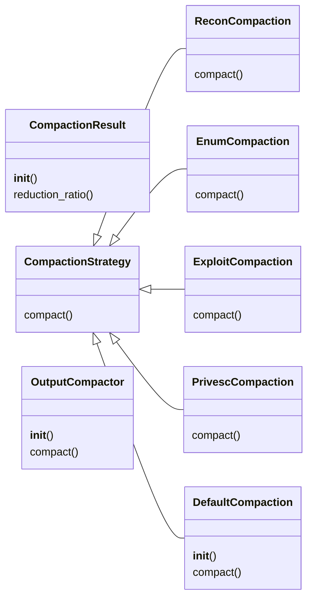
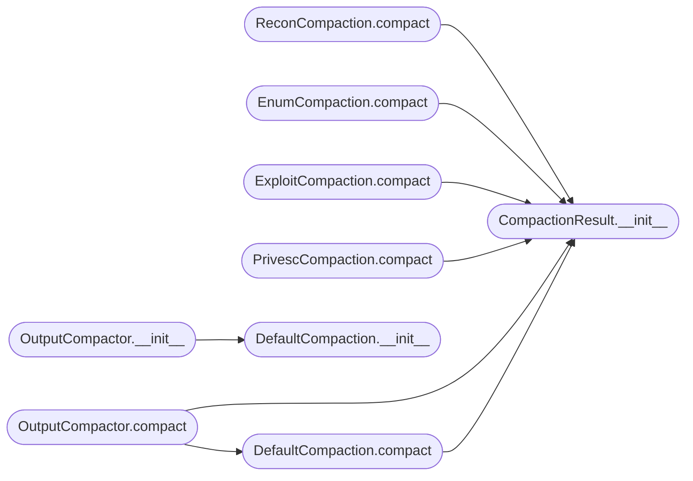

# `skills.hermes-lazyown.output_compactor`

> Source: [skills/hermes-lazyown/output_compactor.py:1](../../skills/hermes-lazyown/output_compactor.py#L1) | language `py` | coverage 85.0% | [API index](../index.md)

Phase-aware output compaction for the Hermes-LazyOwn integration.

Security tools produce verbose output. Hermes context windows are finite.
This module compacts tool output based on the current engagement phase,
preserving only the signal and discarding noise.

Follows the Strategy pattern: each phase implements a CompactionStrategy.

## Contents

- **Classes:** [`CompactionResult`](#compactionresult), [`CompactionStrategy`](#compactionstrategy), [`ReconCompaction`](#reconcompaction), [`EnumCompaction`](#enumcompaction), [`ExploitCompaction`](#exploitcompaction), [`PrivescCompaction`](#privesccompaction), [`DefaultCompaction`](#defaultcompaction), [`OutputCompactor`](#outputcompactor)

## Type Diagram



## Call Graph

Solid arrows stay in this module, dashed arrows leave it.



## Classes

<a id="compactionresult"></a>

### `CompactionResult`

`class` | [skills/hermes-lazyown/output_compactor.py:17](../../skills/hermes-lazyown/output_compactor.py#L17)

```python
class CompactionResult
```

Immutable result of a compaction operation.

**Members**

| Member | Kind | Summary |
|---|---|---|
| [`__init__`](#compactionresult-__init__) | constructor |  |
| [`reduction_ratio`](#compactionresult-reduction_ratio) | property | Return the ratio of lines removed (0.0 to 1.0). |

<a id="compactionresult-__init__"></a>

#### `CompactionResult.__init__`

`constructor` | [skills/hermes-lazyown/output_compactor.py:20](../../skills/hermes-lazyown/output_compactor.py#L20)

```python
def __init__(self, compacted: str, original_lines: int, compacted_lines: int) -> None
```

**Parameters**

| Name | Type | Default | Description |
|---|---|---|---|
| `compacted` | `str` |  |  |
| `original_lines` | `int` |  |  |
| `compacted_lines` | `int` |  |  |

*Called by:* [`DefaultCompaction.compact`](#defaultcompaction-compact), [`EnumCompaction.compact`](#enumcompaction-compact), [`ExploitCompaction.compact`](#exploitcompaction-compact), [`OutputCompactor.compact`](#outputcompactor-compact), [`PrivescCompaction.compact`](#privesccompaction-compact), [`ReconCompaction.compact`](#reconcompaction-compact)

<a id="compactionresult-reduction_ratio"></a>

#### `CompactionResult.reduction_ratio`

`property` | [skills/hermes-lazyown/output_compactor.py:26](../../skills/hermes-lazyown/output_compactor.py#L26)

Decorators: `@property`

```python
def reduction_ratio(self) -> float
```

Return the ratio of lines removed (0.0 to 1.0).

**Returns:** `float`

---

<a id="compactionstrategy"></a>

### `CompactionStrategy`

`class` `abstract` | [skills/hermes-lazyown/output_compactor.py:36](../../skills/hermes-lazyown/output_compactor.py#L36)

```python
class CompactionStrategy(ABC)
```

Bases: `ABC`

Subclasses: [`DefaultCompaction`](#defaultcompaction), [`EnumCompaction`](#enumcompaction), [`ExploitCompaction`](#exploitcompaction), [`PrivescCompaction`](#privesccompaction), [`ReconCompaction`](#reconcompaction)

Base class for phase-specific compaction strategies.

**Members**

| Member | Kind | Summary |
|---|---|---|
| [`compact`](#compactionstrategy-compact) | method | Compact *raw_output* and return a CompactionResult. |

<a id="compactionstrategy-compact"></a>

#### `CompactionStrategy.compact`

`method` `abstract` | [skills/hermes-lazyown/output_compactor.py:40](../../skills/hermes-lazyown/output_compactor.py#L40)

Decorators: `@abstractmethod`

```python
def compact(self, raw_output: str, tool_name: str = '') -> CompactionResult
```

Compact *raw_output* and return a CompactionResult.

**Parameters**

| Name | Type | Default | Description |
|---|---|---|---|
| `raw_output` | `str` |  |  |
| `tool_name` | `str` | `''` |  |

**Returns:** `CompactionResult`

**Raises**

- `NotImplementedError`: (raised in the body, not documented)

---

<a id="reconcompaction"></a>

### `ReconCompaction`

`class` | [skills/hermes-lazyown/output_compactor.py:45](../../skills/hermes-lazyown/output_compactor.py#L45)

```python
class ReconCompaction(CompactionStrategy)
```

Bases: [`CompactionStrategy`](#compactionstrategy)

Recon phase: preserve only open ports, services, and OS guesses.

Strip script output, traceroute, and timing details.

**Members**

| Member | Kind | Summary |
|---|---|---|
| [`compact`](#reconcompaction-compact) | method | Compact *raw_output* and return a CompactionResult. |

<a id="reconcompaction-compact"></a>

#### `ReconCompaction.compact`

`method` | [skills/hermes-lazyown/output_compactor.py:55](../../skills/hermes-lazyown/output_compactor.py#L55)

```python
def compact(self, raw_output: str, tool_name: str = '') -> CompactionResult
```

Compact *raw_output* and return a CompactionResult.

**Parameters**

| Name | Type | Default | Description |
|---|---|---|---|
| `raw_output` | `str` |  |  |
| `tool_name` | `str` | `''` |  |

**Returns:** `CompactionResult`

> **Inherited:** Documentation from [`CompactionStrategy.compact`](#compactionstrategy-compact) (skills/hermes-lazyown/output_compactor.py:40).

*Calls:* [`CompactionResult.__init__`](#compactionresult-__init__)

---

<a id="enumcompaction"></a>

### `EnumCompaction`

`class` | [skills/hermes-lazyown/output_compactor.py:80](../../skills/hermes-lazyown/output_compactor.py#L80)

```python
class EnumCompaction(CompactionStrategy)
```

Bases: [`CompactionStrategy`](#compactionstrategy)

Enumeration phase: preserve findings that are new compared to a snapshot.

Deduplicate against known services and only highlight changes.

**Members**

| Member | Kind | Summary |
|---|---|---|
| [`compact`](#enumcompaction-compact) | method | Compact *raw_output* and return a CompactionResult. |

<a id="enumcompaction-compact"></a>

#### `EnumCompaction.compact`

`method` | [skills/hermes-lazyown/output_compactor.py:93](../../skills/hermes-lazyown/output_compactor.py#L93)

```python
def compact(self, raw_output: str, tool_name: str = '') -> CompactionResult
```

Compact *raw_output* and return a CompactionResult.

**Parameters**

| Name | Type | Default | Description |
|---|---|---|---|
| `raw_output` | `str` |  |  |
| `tool_name` | `str` | `''` |  |

**Returns:** `CompactionResult`

> **Inherited:** Documentation from [`CompactionStrategy.compact`](#compactionstrategy-compact) (skills/hermes-lazyown/output_compactor.py:40).

*Calls:* [`CompactionResult.__init__`](#compactionresult-__init__)

---

<a id="exploitcompaction"></a>

### `ExploitCompaction`

`class` | [skills/hermes-lazyown/output_compactor.py:111](../../skills/hermes-lazyown/output_compactor.py#L111)

```python
class ExploitCompaction(CompactionStrategy)
```

Bases: [`CompactionStrategy`](#compactionstrategy)

Exploitation phase: preserve only success/failure and access level gained.

Discard exploit noise, shell banners, and download progress.

**Members**

| Member | Kind | Summary |
|---|---|---|
| [`compact`](#exploitcompaction-compact) | method | Compact *raw_output* and return a CompactionResult. |

<a id="exploitcompaction-compact"></a>

#### `ExploitCompaction.compact`

`method` | [skills/hermes-lazyown/output_compactor.py:124](../../skills/hermes-lazyown/output_compactor.py#L124)

```python
def compact(self, raw_output: str, tool_name: str = '') -> CompactionResult
```

Compact *raw_output* and return a CompactionResult.

**Parameters**

| Name | Type | Default | Description |
|---|---|---|---|
| `raw_output` | `str` |  |  |
| `tool_name` | `str` | `''` |  |

**Returns:** `CompactionResult`

> **Inherited:** Documentation from [`CompactionStrategy.compact`](#compactionstrategy-compact) (skills/hermes-lazyown/output_compactor.py:40).

*Calls:* [`CompactionResult.__init__`](#compactionresult-__init__)

---

<a id="privesccompaction"></a>

### `PrivescCompaction`

`class` | [skills/hermes-lazyown/output_compactor.py:140](../../skills/hermes-lazyown/output_compactor.py#L140)

```python
class PrivescCompaction(CompactionStrategy)
```

Bases: [`CompactionStrategy`](#compactionstrategy)

Privilege escalation phase: preserve vectors found and commands executed.

**Members**

| Member | Kind | Summary |
|---|---|---|
| [`compact`](#privesccompaction-compact) | method | Compact *raw_output* and return a CompactionResult. |

<a id="privesccompaction-compact"></a>

#### `PrivescCompaction.compact`

`method` | [skills/hermes-lazyown/output_compactor.py:151](../../skills/hermes-lazyown/output_compactor.py#L151)

```python
def compact(self, raw_output: str, tool_name: str = '') -> CompactionResult
```

Compact *raw_output* and return a CompactionResult.

**Parameters**

| Name | Type | Default | Description |
|---|---|---|---|
| `raw_output` | `str` |  |  |
| `tool_name` | `str` | `''` |  |

**Returns:** `CompactionResult`

> **Inherited:** Documentation from [`CompactionStrategy.compact`](#compactionstrategy-compact) (skills/hermes-lazyown/output_compactor.py:40).

*Calls:* [`CompactionResult.__init__`](#compactionresult-__init__)

---

<a id="defaultcompaction"></a>

### `DefaultCompaction`

`class` | [skills/hermes-lazyown/output_compactor.py:162](../../skills/hermes-lazyown/output_compactor.py#L162)

```python
class DefaultCompaction(CompactionStrategy)
```

Bases: [`CompactionStrategy`](#compactionstrategy)

Default pass-through with line-cap enforcement.

**Members**

| Member | Kind | Summary |
|---|---|---|
| [`__init__`](#defaultcompaction-__init__) | constructor |  |
| [`compact`](#defaultcompaction-compact) | method | Compact *raw_output* and return a CompactionResult. |

<a id="defaultcompaction-__init__"></a>

#### `DefaultCompaction.__init__`

`constructor` | [skills/hermes-lazyown/output_compactor.py:165](../../skills/hermes-lazyown/output_compactor.py#L165)

```python
def __init__(self, max_lines: int = Defaults.MAX_OUTPUT_LINES) -> None
```

**Parameters**

| Name | Type | Default | Description |
|---|---|---|---|
| `max_lines` | `int` | `Defaults.MAX_OUTPUT_LINES` |  |

*Called by:* [`OutputCompactor.__init__`](#outputcompactor-__init__)

<a id="defaultcompaction-compact"></a>

#### `DefaultCompaction.compact`

`method` | [skills/hermes-lazyown/output_compactor.py:168](../../skills/hermes-lazyown/output_compactor.py#L168)

```python
def compact(self, raw_output: str, tool_name: str = '') -> CompactionResult
```

Compact *raw_output* and return a CompactionResult.

**Parameters**

| Name | Type | Default | Description |
|---|---|---|---|
| `raw_output` | `str` |  |  |
| `tool_name` | `str` | `''` |  |

**Returns:** `CompactionResult`

> **Inherited:** Documentation from [`CompactionStrategy.compact`](#compactionstrategy-compact) (skills/hermes-lazyown/output_compactor.py:40).

*Calls:* [`CompactionResult.__init__`](#compactionresult-__init__)

*Called by:* [`OutputCompactor.compact`](#outputcompactor-compact)

---

<a id="outputcompactor"></a>

### `OutputCompactor`

`class` | [skills/hermes-lazyown/output_compactor.py:179](../../skills/hermes-lazyown/output_compactor.py#L179)

```python
class OutputCompactor
```

Phase-aware output compactor.

Usage:
    compactor = OutputCompactor()
    result = compactor.compact(raw_nmap_output, phase="recon", tool_name="lazynmap")
    print(result.comparted)

**Members**

| Member | Kind | Summary |
|---|---|---|
| [`__init__`](#outputcompactor-__init__) | constructor |  |
| [`compact`](#outputcompactor-compact) | method | Compact *raw_output* according to *phase*. |

<a id="outputcompactor-__init__"></a>

#### `OutputCompactor.__init__`

`constructor` | [skills/hermes-lazyown/output_compactor.py:196](../../skills/hermes-lazyown/output_compactor.py#L196)

```python
def __init__(self, default_max_lines: int = Defaults.MAX_OUTPUT_LINES) -> None
```

**Parameters**

| Name | Type | Default | Description |
|---|---|---|---|
| `default_max_lines` | `int` | `Defaults.MAX_OUTPUT_LINES` |  |

*Calls:* [`DefaultCompaction.__init__`](#defaultcompaction-__init__)

<a id="outputcompactor-compact"></a>

#### `OutputCompactor.compact`

`method` | [skills/hermes-lazyown/output_compactor.py:200](../../skills/hermes-lazyown/output_compactor.py#L200)

```python
def compact(self, raw_output: str, phase: str = '', tool_name: str = '') -> CompactionResult
```

Compact *raw_output* according to *phase*.

**Parameters**

| Name | Type | Default | Description |
|---|---|---|---|
| `raw_output` | `str` |  | The raw tool output string. |
| `phase` | `str` | `''` | One of the PhaseNames values. |
| `tool_name` | `str` | `''` | Optional tool name for context in the summary. |

**Returns:** `CompactionResult` - A CompactionResult with the compacted output and metadata.

*Calls:* [`CompactionResult.__init__`](#compactionresult-__init__), [`DefaultCompaction.compact`](#defaultcompaction-compact)

---
