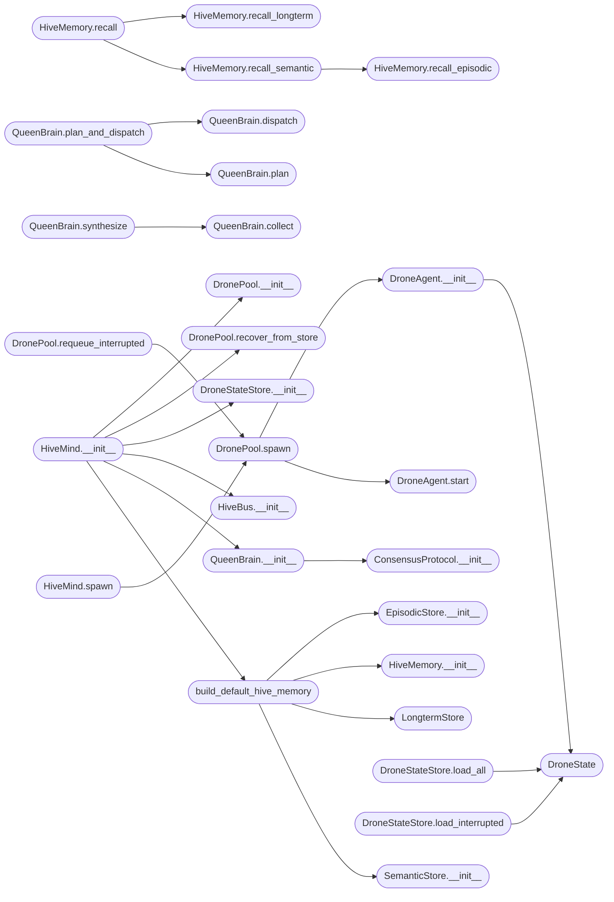

# `skills.hive_mind`

> Source: [skills/hive_mind.py:1](../../skills/hive_mind.py#L1) | language `py` | coverage 89.0% | [API index](../index.md)

skills/hive_mind.py — LazyOwn Borg Hive Mind ============================================== Multi-agent cognitive architecture where Claude (MCP) is the Queen/Mainframe and Groq/Ollama agents are satellite drones executing in parallel.

Architecture
------------
  HiveMemory      — Unified ChromaDB (semantic) + SQLite (episodic) + Parquet (long-term)
  QueenBrain      — Orchestrator: plan -> delegate -> synthesize (Claude is here via MCP)
  DronePool       — Parallel Groq/Ollama agents with specialised roles
  HiveBus         — In-memory message bus between queen and drones
  HiveMind        — Top-level coordinator, exposed as MCP tools

Memory layers
-------------
  working    — current task context (dict in memory, shared via bus)
  episodic   — SQLite FTS5: events, commands, outcomes per session
  semantic   — ChromaDB vectors: similarity search across all agents
  longterm   — Parquet: compressed historical knowledge

Drone roles
-----------
  recon      — host/port/service discovery
  exploit    — vulnerability analysis and exploitation
  analyze    — log/output analysis, pattern detection
  cred       — credential hunting and cracking
  lateral    — lateral movement and pivoting
  report     — synthesis and documentation
  generic    — any goal (default)

MCP tools added to lazyown_mcp.py
----------------------------------
  lazyown_hive_spawn     — spawn N drones for a goal (parallel)
  lazyown_hive_status    — hive-wide status + memory stats
  lazyown_hive_recall    — semantic recall from ChromaDB
  lazyown_hive_plan      — queen generates task decomposition
  lazyown_hive_result    — get aggregated drone results
  lazyown_hive_forget    — prune hive memory by topic/age

Usage
-----
  from hive_mind import get_hive
  hive = get_hive()
  run_ids = hive.queen.plan_and_dispatch("Enumerate AD on 10.10.11.78")
  status  = hive.status()
  result  = hive.collect(run_ids)

  python3 skills/hive_mind.py spawn "Enumerate SMB" --drones 3 --wait
  python3 skills/hive_mind.py status
  python3 skills/hive_mind.py recall "kerberos hash"

## Contents

- **Classes:** [`IReadableMemory`](#ireadablememory), [`IWritableMemory`](#iwritablememory), [`IMemoryStore`](#imemorystore), [`ICommandRunner`](#icommandrunner), [`EpisodicStore`](#episodicstore), [`SemanticStore`](#semanticstore), [`LongtermStore`](#longtermstore), [`HiveMemory`](#hivememory), [`HiveMessage`](#hivemessage), [`HiveBus`](#hivebus), [`ConsensusVote`](#consensusvote), [`ConsensusProtocol`](#consensusprotocol), [`DroneState`](#dronestate), [`DroneAgent`](#droneagent), [`QueenBrain`](#queenbrain), [`DroneStateStore`](#dronestatestore), [`DronePool`](#dronepool), [`HiveMind`](#hivemind)
- **Functions:** [`build_default_hive_memory`](#build_default_hive_memory), [`get_hive`](#get_hive), [`mcp_hive_spawn`](#mcp_hive_spawn), [`mcp_hive_status`](#mcp_hive_status), [`mcp_hive_recall`](#mcp_hive_recall), [`mcp_hive_plan`](#mcp_hive_plan), [`mcp_hive_result`](#mcp_hive_result), [`mcp_hive_collect`](#mcp_hive_collect), [`mcp_hive_forget`](#mcp_hive_forget), [`mcp_hive_recover`](#mcp_hive_recover)
- **Constants:** [`SKILLS_DIR`](#skills_dir), [`LAZYOWN_DIR`](#lazyown_dir), [`SESSIONS_DIR`](#sessions_dir), [`PARQUETS_DIR`](#parquets_dir), [`HIVE_DIR`](#hive_dir)

## Type Diagram

```mermaid
classDiagram
    direction LR
    class IReadableMemory
    IReadableMemory : recall()
    class IWritableMemory
    IWritableMemory : store()
    class IMemoryStore
    class ICommandRunner
    ICommandRunner : run()
    ICommandRunner : name()
    class EpisodicStore
    EpisodicStore : __init__()
    EpisodicStore : store()
    EpisodicStore : recall()
    EpisodicStore : stats()
    EpisodicStore : forget()
    class SemanticStore
    SemanticStore : __init__()
    SemanticStore : available()
    SemanticStore : store()
    SemanticStore : recall()
    SemanticStore : count()
    class LongtermStore
    LongtermStore : store()
    LongtermStore : recall()
    class HiveMemory
    HiveMemory : __init__()
    HiveMemory : store()
    HiveMemory : recall_episodic()
    HiveMemory : recall_semantic()
    HiveMemory : recall_longterm()
    HiveMemory : recall()
    HiveMemory : stats()
    HiveMemory : forget()
    class HiveMessage
    HiveMessage : str msg_id
    HiveMessage : str sender
    HiveMessage : str recipient
    HiveMessage : str kind
    HiveMessage : dict payload
    HiveMessage : float ts
    class HiveBus
    HiveBus : __init__()
    HiveBus : publish()
    HiveBus : receive()
    HiveBus : ack_broadcast()
    HiveBus : pending_count()
    class ConsensusVote
    ConsensusVote : str voter_role
    ConsensusVote : bool approved
    ConsensusVote : float risk_score
    ConsensusVote : str rationale
    class ConsensusProtocol
    ConsensusProtocol : __init__()
    ConsensusProtocol : evaluate()
    class DroneState
    DroneState : str drone_id
    DroneState : str role
    DroneState : str goal
    DroneState : str backend
    DroneState : str status
    DroneState : str result
    DroneState : str error
    DroneState : float started
    DroneState : float finished
    DroneState : int iterations
    DroneState : int tokens_in
    DroneState : int tokens_out
    class DroneAgent
    DroneAgent : __init__()
    DroneAgent : start()
    DroneAgent : join()
    class QueenBrain
    QueenBrain : __init__()
    QueenBrain : plan()
    QueenBrain : dispatch()
    QueenBrain : plan_and_dispatch()
    QueenBrain : collect()
    QueenBrain : synthesize()
    QueenBrain : read_bus()
    class DroneStateStore
    DroneStateStore : __init__()
    DroneStateStore : upsert()
    DroneStateStore : load_all()
    DroneStateStore : mark_interrupted()
    DroneStateStore : load_interrupted()
    DroneStateStore : delete_older_than()
    class DronePool
    DronePool : __init__()
    DronePool : recover_from_store()
    DronePool : spawn()
    DronePool : requeue_interrupted()
    DronePool : get_state()
    DronePool : list_all()
    DronePool : active_count()
    class HiveMind
    HiveMind : __init__()
    HiveMind : spawn()
    HiveMind : spawn_hive()
    HiveMind : status()
    HiveMind : recall()
    HiveMind : drone_result()
    HiveMind : collect_and_synthesize()
    HiveMind : forget()
    IReadableMemory <|-- IMemoryStore
    IWritableMemory <|-- IMemoryStore
    IMemoryStore <|-- EpisodicStore
    IMemoryStore <|-- SemanticStore
    IMemoryStore <|-- LongtermStore
```



## Call Graph

Solid arrows stay in this module, dashed arrows leave it.



## Classes

<a id="ireadablememory"></a>

### `IReadableMemory`

`class` `abstract` | [skills/hive_mind.py:145](../../skills/hive_mind.py#L145)

```python
class IReadableMemory(ABC)
```

Bases: `ABC`

Subclasses: [`IMemoryStore`](#imemorystore)

Read-only contract for memory stores.

**Members**

| Member | Kind | Summary |
|---|---|---|
| [`recall`](#ireadablememory-recall) | method | Return top_k items matching query. |

<a id="ireadablememory-recall"></a>

#### `IReadableMemory.recall`

`method` `abstract` | [skills/hive_mind.py:149](../../skills/hive_mind.py#L149)

Decorators: `@abstractmethod`

```python
def recall(self, query: str, top_k: int = 10) -> list[dict]
```

Return top_k items matching query.

**Parameters**

| Name | Type | Default | Description |
|---|---|---|---|
| `query` | `str` |  |  |
| `top_k` | `int` | `10` |  |

**Returns:** `list[dict]`

---

<a id="iwritablememory"></a>

### `IWritableMemory`

`class` `abstract` | [skills/hive_mind.py:153](../../skills/hive_mind.py#L153)

```python
class IWritableMemory(ABC)
```

Bases: `ABC`

Subclasses: [`IMemoryStore`](#imemorystore)

Write-only contract for memory stores.

**Members**

| Member | Kind | Summary |
|---|---|---|
| [`store`](#iwritablememory-store) | method | Persist content and return an opaque event_id. |

<a id="iwritablememory-store"></a>

#### `IWritableMemory.store`

`method` `abstract` | [skills/hive_mind.py:157](../../skills/hive_mind.py#L157)

Decorators: `@abstractmethod`

```python
def store(self, content: str, **meta: Any) -> str
```

Persist content and return an opaque event_id.

**Parameters**

| Name | Type | Default | Description |
|---|---|---|---|
| `content` | `str` |  |  |
| `**meta` | `Any` |  |  |

**Returns:** `str`

---

<a id="imemorystore"></a>

### `IMemoryStore`

`class` | [skills/hive_mind.py:161](../../skills/hive_mind.py#L161)

```python
class IMemoryStore(IReadableMemory, IWritableMemory)
```

Bases: [`IReadableMemory`](#ireadablememory), [`IWritableMemory`](#iwritablememory)

Subclasses: [`EpisodicStore`](#episodicstore), [`LongtermStore`](#longtermstore), [`SemanticStore`](#semanticstore)

Combined readable + writable memory store.

Concrete subclasses (EpisodicStore, SemanticStore, LongtermStore) all
satisfy the Liskov Substitution Principle — they can replace each other
in any context that expects IMemoryStore.

---

<a id="icommandrunner"></a>

### `ICommandRunner`

`class` `abstract` | [skills/hive_mind.py:171](../../skills/hive_mind.py#L171)

```python
class ICommandRunner(ABC)
```

Bases: `ABC`

Contract for executing a LazyOwn shell command and returning its output.

**Members**

| Member | Kind | Summary |
|---|---|---|
| [`run`](#icommandrunner-run) | method | Execute command within timeout seconds and return text output. |
| [`name`](#icommandrunner-name) | property | Human-readable identifier for this runner. |

<a id="icommandrunner-run"></a>

#### `ICommandRunner.run`

`method` `abstract` | [skills/hive_mind.py:175](../../skills/hive_mind.py#L175)

Decorators: `@abstractmethod`

```python
def run(self, command: str, timeout: int) -> str
```

Execute command within timeout seconds and return text output.

**Parameters**

| Name | Type | Default | Description |
|---|---|---|---|
| `command` | `str` |  |  |
| `timeout` | `int` |  |  |

**Returns:** `str`

<a id="icommandrunner-name"></a>

#### `ICommandRunner.name`

`property` `abstract` | [skills/hive_mind.py:180](../../skills/hive_mind.py#L180)

Decorators: `@property`, `@abstractmethod`

```python
def name(self) -> str
```

Human-readable identifier for this runner.

**Returns:** `str`

---

<a id="episodicstore"></a>

### `EpisodicStore`

`class` | [skills/hive_mind.py:189](../../skills/hive_mind.py#L189)

```python
class EpisodicStore(IMemoryStore)
```

Bases: [`IMemoryStore`](#imemorystore)

SQLite-backed episodic memory with FTS5 full-text search.

Responsible for: schema creation, insert, FTS keyword recall, forget.
Nothing else.

**Members**

| Member | Kind | Summary |
|---|---|---|
| [`__init__`](#episodicstore-__init__) | constructor |  |
| [`store`](#episodicstore-store) | method | Insert a row into hive_events and return event_id. |
| [`recall`](#episodicstore-recall) | method | Keyword search via FTS5. |
| [`stats`](#episodicstore-stats) | method | Return row counts for status reporting. |
| [`forget`](#episodicstore-forget) | method | Delete old or topic-matching rows. |

<a id="episodicstore-__init__"></a>

#### `EpisodicStore.__init__`

`constructor` | [skills/hive_mind.py:215](../../skills/hive_mind.py#L215)

```python
def __init__(self, db_path: Path | None = None) -> None
```

**Parameters**

| Name | Type | Default | Description |
|---|---|---|---|
| `db_path` | `Path \| None` | `None` |  |

*Called by:* [`build_default_hive_memory`](#build_default_hive_memory)

<a id="episodicstore-store"></a>

#### `EpisodicStore.store`

`method` | [skills/hive_mind.py:235](../../skills/hive_mind.py#L235)

```python
def store(self, content: str, agent_id: str = 'queen', role: str = 'generic', event_type: str = 'observation', meta: dict | None = None, session_tag: str = '', **_ignored: Any) -> str
```

Insert a row into hive_events and return event_id.

**Parameters**

| Name | Type | Default | Description |
|---|---|---|---|
| `content` | `str` |  |  |
| `agent_id` | `str` | `'queen'` |  |
| `role` | `str` | `'generic'` |  |
| `event_type` | `str` | `'observation'` |  |
| `meta` | `dict \| None` | `None` |  |
| `session_tag` | `str` | `''` |  |
| `**_ignored` | `Any` |  |  |

**Returns:** `str`

<a id="episodicstore-recall"></a>

#### `EpisodicStore.recall`

`method` | [skills/hive_mind.py:274](../../skills/hive_mind.py#L274)

```python
def recall(self, query: str, top_k: int = 10, role: str | None = None, event_type: str | None = None) -> list[dict]
```

Keyword search via FTS5.

Optionally filter by role or event_type.

**Parameters**

| Name | Type | Default | Description |
|---|---|---|---|
| `query` | `str` |  |  |
| `top_k` | `int` | `10` |  |
| `role` | `str \| None` | `None` |  |
| `event_type` | `str \| None` | `None` |  |

**Returns:** `list[dict]`

<a id="episodicstore-stats"></a>

#### `EpisodicStore.stats`

`method` | [skills/hive_mind.py:322](../../skills/hive_mind.py#L322)

```python
def stats(self) -> dict[str, Any]
```

Return row counts for status reporting.

**Returns:** `dict[str, Any]`

<a id="episodicstore-forget"></a>

#### `EpisodicStore.forget`

`method` | [skills/hive_mind.py:329](../../skills/hive_mind.py#L329)

```python
def forget(self, older_than_hours: float = 24.0, topic: str = '') -> int
```

Delete old or topic-matching rows.

Returns rows deleted.

**Parameters**

| Name | Type | Default | Description |
|---|---|---|---|
| `older_than_hours` | `float` | `24.0` |  |
| `topic` | `str` | `''` |  |

**Returns:** `int`

---

<a id="semanticstore"></a>

### `SemanticStore`

`class` | [skills/hive_mind.py:349](../../skills/hive_mind.py#L349)

```python
class SemanticStore(IMemoryStore)
```

Bases: [`IMemoryStore`](#imemorystore)

ChromaDB-backed vector similarity store.

Falls back to the provided episodic_fallback when ChromaDB is unavailable.
Responsible for: embedding, upsert into ChromaDB, similarity recall.
Nothing else.

**Members**

| Member | Kind | Summary |
|---|---|---|
| [`__init__`](#semanticstore-__init__) | constructor |  |
| [`available`](#semanticstore-available) | property | True when ChromaDB is operational. |
| [`store`](#semanticstore-store) | method | Add a document to ChromaDB. |
| [`recall`](#semanticstore-recall) | method | Vector similarity search. |
| [`count`](#semanticstore-count) | method | Return number of vectors stored. |

<a id="semanticstore-__init__"></a>

#### `SemanticStore.__init__`

`constructor` | [skills/hive_mind.py:358](../../skills/hive_mind.py#L358)

```python
def __init__(self, chroma_dir: Path | None = None, episodic_fallback: EpisodicStore | None = None) -> None
```

**Parameters**

| Name | Type | Default | Description |
|---|---|---|---|
| `chroma_dir` | `Path \| None` | `None` |  |
| `episodic_fallback` | `EpisodicStore \| None` | `None` |  |

*Called by:* [`build_default_hive_memory`](#build_default_hive_memory)

<a id="semanticstore-available"></a>

#### `SemanticStore.available`

`property` | [skills/hive_mind.py:380](../../skills/hive_mind.py#L380)

Decorators: `@property`

```python
def available(self) -> bool
```

True when ChromaDB is operational.

**Returns:** `bool`

<a id="semanticstore-store"></a>

#### `SemanticStore.store`

`method` | [skills/hive_mind.py:386](../../skills/hive_mind.py#L386)

```python
def store(self, content: str, agent_id: str = 'queen', role: str = 'generic', event_type: str = 'observation', meta: dict | None = None, session_tag: str = '', event_id: str | None = None, **_ignored: Any) -> str
```

Add a document to ChromaDB.

Returns the event_id used.

**Parameters**

| Name | Type | Default | Description |
|---|---|---|---|
| `content` | `str` |  |  |
| `agent_id` | `str` | `'queen'` |  |
| `role` | `str` | `'generic'` |  |
| `event_type` | `str` | `'observation'` |  |
| `meta` | `dict \| None` | `None` |  |
| `session_tag` | `str` | `''` |  |
| `event_id` | `str \| None` | `None` |  |
| `**_ignored` | `Any` |  |  |

**Returns:** `str`

<a id="semanticstore-recall"></a>

#### `SemanticStore.recall`

`method` | [skills/hive_mind.py:434](../../skills/hive_mind.py#L434)

```python
def recall(self, query: str, top_k: int = 8, where: dict | None = None) -> list[dict]
```

Vector similarity search.

Falls back to episodic FTS if unavailable.

**Parameters**

| Name | Type | Default | Description |
|---|---|---|---|
| `query` | `str` |  |  |
| `top_k` | `int` | `8` |  |
| `where` | `dict \| None` | `None` |  |

**Returns:** `list[dict]`

<a id="semanticstore-count"></a>

#### `SemanticStore.count`

`method` | [skills/hive_mind.py:477](../../skills/hive_mind.py#L477)

```python
def count(self) -> int
```

Return number of vectors stored.

**Returns:** `int`

---

<a id="longtermstore"></a>

### `LongtermStore`

`class` | [skills/hive_mind.py:506](../../skills/hive_mind.py#L506)

```python
class LongtermStore(IMemoryStore)
```

Bases: [`IMemoryStore`](#imemorystore)

Read-only keyword recall from Parquet knowledge files.

store() is a no-op (Parquet files are managed by lazyown_parquet_db).
Responsible for: delegating keyword search to lazyown_parquet_db.
Nothing else.

**Members**

| Member | Kind | Summary |
|---|---|---|
| [`store`](#longtermstore-store) | method | Parquet store is read-only from here. |
| [`recall`](#longtermstore-recall) | method | Keyword search across Parquet knowledge files. |

<a id="longtermstore-store"></a>

#### `LongtermStore.store`

`method` | [skills/hive_mind.py:515](../../skills/hive_mind.py#L515)

```python
def store(self, content: str, **_meta: Any) -> str
```

Parquet store is read-only from here.

Returns empty string.

**Parameters**

| Name | Type | Default | Description |
|---|---|---|---|
| `content` | `str` |  |  |
| `**_meta` | `Any` |  |  |

**Returns:** `str`

<a id="longtermstore-recall"></a>

#### `LongtermStore.recall`

`method` | [skills/hive_mind.py:519](../../skills/hive_mind.py#L519)

```python
def recall(self, query: str, top_k: int = 10) -> list[dict]
```

Keyword search across Parquet knowledge files.

**Parameters**

| Name | Type | Default | Description |
|---|---|---|---|
| `query` | `str` |  |  |
| `top_k` | `int` | `10` |  |

**Returns:** `list[dict]`

*Calls:* [`get_pdb`](skills.lazyown_parquet_db.py.md#get_pdb)

---

<a id="hivememory"></a>

### `HiveMemory`

`class` | [skills/hive_mind.py:571](../../skills/hive_mind.py#L571)

```python
class HiveMemory
```

Unified three-layer memory shared across all hive agents.

Composes EpisodicStore, SemanticStore, and LongtermStore.
Handles cross-layer deduplication in recall().

Dependency Inversion: concrete backends are injected via __init__.
Open/Closed: add new backends by passing extra IMemoryStore instances.

**Members**

| Member | Kind | Summary |
|---|---|---|
| [`__init__`](#hivememory-__init__) | constructor |  |
| [`store`](#hivememory-store) | method | Store content in all writable layers. |
| [`recall_episodic`](#hivememory-recall_episodic) | method | Keyword search across hive episodic memory. |
| [`recall_semantic`](#hivememory-recall_semantic) | method | Vector similarity search in ChromaDB. |
| [`recall_longterm`](#hivememory-recall_longterm) | method | Keyword search across Parquet knowledge files. |
| [`recall`](#hivememory-recall) | method | Unified recall: semantic (ChromaDB) + episodic (SQLite) + longterm (Parquet). |
| [`stats`](#hivememory-stats) | method | Return combined statistics from all layers. |
| [`forget`](#hivememory-forget) | method | Prune old or topic-matched entries. |

<a id="hivememory-__init__"></a>

#### `HiveMemory.__init__`

`constructor` | [skills/hive_mind.py:582](../../skills/hive_mind.py#L582)

```python
def __init__(self, stores: list[IMemoryStore], episodic: EpisodicStore | None = None, semantic: SemanticStore | None = None, longterm: LongtermStore | None = None) -> None
```

**Parameters**

| Name | Type | Default | Description |
|---|---|---|---|
| `stores` | `list[IMemoryStore]` |  |  |
| `episodic` | `EpisodicStore \| None` | `None` |  |
| `semantic` | `SemanticStore \| None` | `None` |  |
| `longterm` | `LongtermStore \| None` | `None` |  |

*Called by:* [`build_default_hive_memory`](#build_default_hive_memory)

<a id="hivememory-store"></a>

#### `HiveMemory.store`

`method` | [skills/hive_mind.py:596](../../skills/hive_mind.py#L596)

```python
def store(self, content: str, agent_id: str = 'queen', role: str = 'generic', event_type: str = 'observation', meta: dict | None = None, session_tag: str = '') -> str
```

Store content in all writable layers.

Returns the event_id from the first store (episodic).
The same id is forwarded to semantic so ChromaDB and SQLite stay aligned.

**Parameters**

| Name | Type | Default | Description |
|---|---|---|---|
| `content` | `str` |  |  |
| `agent_id` | `str` | `'queen'` |  |
| `role` | `str` | `'generic'` |  |
| `event_type` | `str` | `'observation'` |  |
| `meta` | `dict \| None` | `None` |  |
| `session_tag` | `str` | `''` |  |

**Returns:** `str`

<a id="hivememory-recall_episodic"></a>

#### `HiveMemory.recall_episodic`

`method` | [skills/hive_mind.py:633](../../skills/hive_mind.py#L633)

```python
def recall_episodic(self, query: str, top_k: int = 10, role: str | None = None, event_type: str | None = None) -> list[dict]
```

Keyword search across hive episodic memory.

**Parameters**

| Name | Type | Default | Description |
|---|---|---|---|
| `query` | `str` |  |  |
| `top_k` | `int` | `10` |  |
| `role` | `str \| None` | `None` |  |
| `event_type` | `str \| None` | `None` |  |

**Returns:** `list[dict]`

*Called by:* [`HiveMemory.recall_semantic`](#hivememory-recall_semantic)

<a id="hivememory-recall_semantic"></a>

#### `HiveMemory.recall_semantic`

`method` | [skills/hive_mind.py:647](../../skills/hive_mind.py#L647)

```python
def recall_semantic(self, query: str, top_k: int = 8, where: dict | None = None) -> list[dict]
```

Vector similarity search in ChromaDB.

**Parameters**

| Name | Type | Default | Description |
|---|---|---|---|
| `query` | `str` |  |  |
| `top_k` | `int` | `8` |  |
| `where` | `dict \| None` | `None` |  |

**Returns:** `list[dict]`

*Calls:* [`HiveMemory.recall_episodic`](#hivememory-recall_episodic)

*Called by:* [`HiveMemory.recall`](#hivememory-recall)

<a id="hivememory-recall_longterm"></a>

#### `HiveMemory.recall_longterm`

`method` | [skills/hive_mind.py:660](../../skills/hive_mind.py#L660)

```python
def recall_longterm(self, query: str, top_k: int = 10) -> list[dict]
```

Keyword search across Parquet knowledge files.

**Parameters**

| Name | Type | Default | Description |
|---|---|---|---|
| `query` | `str` |  |  |
| `top_k` | `int` | `10` |  |

**Returns:** `list[dict]`

*Called by:* [`HiveMemory.recall`](#hivememory-recall)

<a id="hivememory-recall"></a>

#### `HiveMemory.recall`

`method` | [skills/hive_mind.py:668](../../skills/hive_mind.py#L668)

```python
def recall(self, query: str, top_k: int = 10) -> list[dict]
```

Unified recall: semantic (ChromaDB) + episodic (SQLite) + longterm (Parquet).

Deduplicates by content hash.

**Parameters**

| Name | Type | Default | Description |
|---|---|---|---|
| `query` | `str` |  |  |
| `top_k` | `int` | `10` |  |

**Returns:** `list[dict]`

*Calls:* [`HiveMemory.recall_longterm`](#hivememory-recall_longterm), [`HiveMemory.recall_semantic`](#hivememory-recall_semantic)

<a id="hivememory-stats"></a>

#### `HiveMemory.stats`

`method` | [skills/hive_mind.py:694](../../skills/hive_mind.py#L694)

```python
def stats(self) -> dict[str, Any]
```

Return combined statistics from all layers.

**Returns:** `dict[str, Any]`

<a id="hivememory-forget"></a>

#### `HiveMemory.forget`

`method` | [skills/hive_mind.py:704](../../skills/hive_mind.py#L704)

```python
def forget(self, older_than_hours: float = 24.0, topic: str = '') -> int
```

Prune old or topic-matched entries.

Returns number pruned.

**Parameters**

| Name | Type | Default | Description |
|---|---|---|---|
| `older_than_hours` | `float` | `24.0` |  |
| `topic` | `str` | `''` |  |

**Returns:** `int`

---

<a id="hivemessage"></a>

### `HiveMessage`

`class` `dataclass` | [skills/hive_mind.py:717](../../skills/hive_mind.py#L717)

Decorators: `@dataclass`

```python
class HiveMessage
```

A message on the hive bus.

**Attributes**

| Name | Type | Default | Description |
|---|---|---|---|
| [`msg_id`](#hivemessage-msg_id) | `str` | `field(default_factory=lambda: uuid.uuid4().hex[:8])` |  |
| [`sender`](#hivemessage-sender) | `str` | `'queen'` |  |
| [`recipient`](#hivemessage-recipient) | `str` | `'*'` |  |
| [`kind`](#hivemessage-kind) | `str` | `'task'` |  |
| [`payload`](#hivemessage-payload) | `dict` | `field(default_factory=dict)` |  |
| [`ts`](#hivemessage-ts) | `float` | `field(default_factory=time.time)` |  |

---

<a id="hivebus"></a>

### `HiveBus`

`class` | [skills/hive_mind.py:728](../../skills/hive_mind.py#L728)

```python
class HiveBus
```

Simple thread-safe in-process message bus.

Agents subscribe to their own mailbox (recipient == agent_id or "*").

Single Responsibility: only message passing.

**Members**

| Member | Kind | Summary |
|---|---|---|
| [`__init__`](#hivebus-__init__) | constructor |  |
| [`publish`](#hivebus-publish) | method | Deliver msg to recipient mailbox (and to "*" broadcast). |
| [`receive`](#hivebus-receive) | method | Drain mailbox for agent_id (includes broadcast). |
| [`ack_broadcast`](#hivebus-ack_broadcast) | method | Mark a broadcast message as seen by agent_id (minimal bus — no-op). |
| [`pending_count`](#hivebus-pending_count) | method | Count messages waiting for agent_id. |

<a id="hivebus-__init__"></a>

#### `HiveBus.__init__`

`constructor` | [skills/hive_mind.py:736](../../skills/hive_mind.py#L736)

```python
def __init__(self) -> None
```

*Called by:* [`HiveMind.__init__`](#hivemind-__init__)

<a id="hivebus-publish"></a>

#### `HiveBus.publish`

`method` | [skills/hive_mind.py:740](../../skills/hive_mind.py#L740)

```python
def publish(self, msg: HiveMessage) -> None
```

Deliver msg to recipient mailbox (and to "*" broadcast).

**Parameters**

| Name | Type | Default | Description |
|---|---|---|---|
| `msg` | `HiveMessage` |  |  |

<a id="hivebus-receive"></a>

#### `HiveBus.receive`

`method` | [skills/hive_mind.py:746](../../skills/hive_mind.py#L746)

```python
def receive(self, agent_id: str, max_msgs: int = 10) -> list[HiveMessage]
```

Drain mailbox for agent_id (includes broadcast).

**Parameters**

| Name | Type | Default | Description |
|---|---|---|---|
| `agent_id` | `str` |  |  |
| `max_msgs` | `int` | `10` |  |

**Returns:** `list[HiveMessage]`

<a id="hivebus-ack_broadcast"></a>

#### `HiveBus.ack_broadcast`

`method` | [skills/hive_mind.py:754](../../skills/hive_mind.py#L754)

```python
def ack_broadcast(self, agent_id: str, msg_id: str) -> None
```

Mark a broadcast message as seen by agent_id (minimal bus — no-op).

**Parameters**

| Name | Type | Default | Description |
|---|---|---|---|
| `agent_id` | `str` |  |  |
| `msg_id` | `str` |  |  |

<a id="hivebus-pending_count"></a>

#### `HiveBus.pending_count`

`method` | [skills/hive_mind.py:758](../../skills/hive_mind.py#L758)

```python
def pending_count(self, agent_id: str) -> int
```

Count messages waiting for agent_id.

**Parameters**

| Name | Type | Default | Description |
|---|---|---|---|
| `agent_id` | `str` |  |  |

**Returns:** `int`

*Called by:* [`HiveMind.status`](#hivemind-status)

---

<a id="consensusvote"></a>

### `ConsensusVote`

`class` `dataclass` | [skills/hive_mind.py:902](../../skills/hive_mind.py#L902)

Decorators: `@dataclass`

```python
class ConsensusVote
```

A single vote cast by a drone role during consensus evaluation.

**Attributes**

| Name | Type | Default | Description |
|---|---|---|---|
| [`voter_role`](#consensusvote-voter_role) | `str` |  |  |
| [`approved`](#consensusvote-approved) | `bool` |  |  |
| [`risk_score`](#consensusvote-risk_score) | `float` |  |  |
| [`rationale`](#consensusvote-rationale) | `str` |  |  |

---

<a id="consensusprotocol"></a>

### `ConsensusProtocol`

`class` | [skills/hive_mind.py:911](../../skills/hive_mind.py#L911)

```python
class ConsensusProtocol
```

Multi-drone voting gate for high-risk actions.

Before a high-risk task (exploit, lateral, credential dump) is dispatched,
the queen polls a panel of virtual voters — one per specialised role — and
only proceeds when the weighted approval meets the required quorum.

Voting model
------------
- stealth_specialist : votes based on detection risk (approves if risk < threshold)
- privesc_hunter     : votes based on whether current access level justifies the move
- architect          : votes based on strategic alignment with current phase

The detection risk estimate uses DetectionRiskAssessor when available,
falling back to a static heuristic table.

Design
------
- Single Responsibility : voting logic only; no drone spawning
- Open/Closed           : new voter roles added without modifying existing code
- Dependency Inversion  : DetectionRiskAssessor injected, not constructed here

**Members**

| Member | Kind | Summary |
|---|---|---|
| [`__init__`](#consensusprotocol-__init__) | constructor |  |
| [`evaluate`](#consensusprotocol-evaluate) | method | Run the consensus vote for the given (role, goal) pair. |

<a id="consensusprotocol-__init__"></a>

#### `ConsensusProtocol.__init__`

`constructor` | [skills/hive_mind.py:943](../../skills/hive_mind.py#L943)

```python
def __init__(self, risk_assessor: Any | None = None) -> None
```

**Parameters**

| Name | Type | Default | Description |
|---|---|---|---|
| `risk_assessor` | `Any \| None` | `None` |  |

*Called by:* [`QueenBrain.__init__`](#queenbrain-__init__)

<a id="consensusprotocol-evaluate"></a>

#### `ConsensusProtocol.evaluate`

`method` | [skills/hive_mind.py:946](../../skills/hive_mind.py#L946)

```python
def evaluate(self, role: str, goal: str) -> tuple[bool, list[ConsensusVote], str]
```

Run the consensus vote for the given (role, goal) pair.

**Parameters**

| Name | Type | Default | Description |
|---|---|---|---|
| `role` | `str` |  |  |
| `goal` | `str` |  |  |

**Returns:** `bool, votes: List[ConsensusVote], summary: str)`

---

<a id="dronestate"></a>

### `DroneState`

`class` `dataclass` | [skills/hive_mind.py:1066](../../skills/hive_mind.py#L1066)

Decorators: `@dataclass`

```python
class DroneState
```

Mutable state record for a single drone instance.

**Attributes**

| Name | Type | Default | Description |
|---|---|---|---|
| [`drone_id`](#dronestate-drone_id) | `str` |  |  |
| [`role`](#dronestate-role) | `str` |  |  |
| [`goal`](#dronestate-goal) | `str` |  |  |
| [`backend`](#dronestate-backend) | `str` |  |  |
| [`status`](#dronestate-status) | `str` | `'queued'` |  |
| [`result`](#dronestate-result) | `str` | `''` |  |
| [`error`](#dronestate-error) | `str` | `''` |  |
| [`started`](#dronestate-started) | `float` | `0.0` |  |
| [`finished`](#dronestate-finished) | `float` | `0.0` |  |
| [`iterations`](#dronestate-iterations) | `int` | `0` |  |
| [`tokens_in`](#dronestate-tokens_in) | `int` | `0` |  |
| [`tokens_out`](#dronestate-tokens_out) | `int` | `0` |  |

---

<a id="droneagent"></a>

### `DroneAgent`

`class` | [skills/hive_mind.py:1083](../../skills/hive_mind.py#L1083)

```python
class DroneAgent
```

A satellite agent running on Groq or Ollama.

Reports back to hive memory on completion.

Dependency Inversion: accepts an optional ICommandRunner for testability.

**Members**

| Member | Kind | Summary |
|---|---|---|
| [`__init__`](#droneagent-__init__) | constructor |  |
| [`start`](#droneagent-start) | method | Spawn the drone thread. |
| [`join`](#droneagent-join) | method | Block until the drone thread finishes. |

<a id="droneagent-__init__"></a>

#### `DroneAgent.__init__`

`constructor` | [skills/hive_mind.py:1091](../../skills/hive_mind.py#L1091)

```python
def __init__(self, drone_id: str, role: str, goal: str, backend: str, memory: HiveMemory, bus: HiveBus, max_iterations: int = 10, api_key: str | None = None, model: str | None = None, runner: ICommandRunner | None = None, on_state_change: Callable[[DroneState], None] | None = None) -> None
```

**Parameters**

| Name | Type | Default | Description |
|---|---|---|---|
| `drone_id` | `str` |  |  |
| `role` | `str` |  |  |
| `goal` | `str` |  |  |
| `backend` | `str` |  |  |
| `memory` | `HiveMemory` |  |  |
| `bus` | `HiveBus` |  |  |
| `max_iterations` | `int` | `10` |  |
| `api_key` | `str \| None` | `None` |  |
| `model` | `str \| None` | `None` |  |
| `runner` | `ICommandRunner \| None` | `None` |  |
| `on_state_change` | `Callable[[DroneState], None] \| None` | `None` |  |

*Calls:* [`DroneState`](#dronestate)

*Called by:* [`DronePool.spawn`](#dronepool-spawn)

<a id="droneagent-start"></a>

#### `DroneAgent.start`

`method` | [skills/hive_mind.py:1128](../../skills/hive_mind.py#L1128)

```python
def start(self) -> None
```

Spawn the drone thread.

*Called by:* [`DronePool.spawn`](#dronepool-spawn)

<a id="droneagent-join"></a>

#### `DroneAgent.join`

`method` | [skills/hive_mind.py:1137](../../skills/hive_mind.py#L1137)

```python
def join(self, timeout: float | None = None) -> None
```

Block until the drone thread finishes.

**Parameters**

| Name | Type | Default | Description |
|---|---|---|---|
| `timeout` | `float \| None` | `None` |  |

---

<a id="queenbrain"></a>

### `QueenBrain`

`class` | [skills/hive_mind.py:1289](../../skills/hive_mind.py#L1289)

```python
class QueenBrain
```

The queen orchestrates the hive: 1. plan(goal)          — decompose into drone tasks 2. dispatch(tasks)     — spawn drones in parallel 3. collect(ids)        — wait and aggregate results 4. synthesize(results) — final summary written to hive memory

Single Responsibility: orchestration only.
Dependency Inversion: memory, bus, pool all injected.

**Members**

| Member | Kind | Summary |
|---|---|---|
| [`__init__`](#queenbrain-__init__) | constructor |  |
| [`plan`](#queenbrain-plan) | method | Decompose a high-level goal into per-drone task specs. |
| [`dispatch`](#queenbrain-dispatch) | method | Spawn one drone per task in parallel. |
| [`plan_and_dispatch`](#queenbrain-plan_and_dispatch) | method | Convenience: plan + dispatch in one call. |
| [`collect`](#queenbrain-collect) | method | Wait for all drones to finish (up to timeout seconds). |
| [`synthesize`](#queenbrain-synthesize) | method | Read hive memory results for these drones and produce a synthesis summary. |
| [`read_bus`](#queenbrain-read_bus) | method | Drain queen's mailbox from drone result messages. |

<a id="queenbrain-__init__"></a>

#### `QueenBrain.__init__`

`constructor` | [skills/hive_mind.py:1301](../../skills/hive_mind.py#L1301)

```python
def __init__(self, memory: HiveMemory, bus: HiveBus, pool: DronePool, consensus: ConsensusProtocol | None = None) -> None
```

**Parameters**

| Name | Type | Default | Description |
|---|---|---|---|
| `memory` | `HiveMemory` |  |  |
| `bus` | `HiveBus` |  |  |
| `pool` | `DronePool` |  |  |
| `consensus` | `ConsensusProtocol \| None` | `None` |  |

*Calls:* [`ConsensusProtocol.__init__`](#consensusprotocol-__init__)

*Called by:* [`HiveMind.__init__`](#hivemind-__init__)

<a id="queenbrain-plan"></a>

#### `QueenBrain.plan`

`method` | [skills/hive_mind.py:1313](../../skills/hive_mind.py#L1313)

```python
def plan(self, goal: str, n_drones: int = 0) -> list[dict]
```

Decompose a high-level goal into per-drone task specs.

Returns list of {role, goal} dicts.

**Parameters**

| Name | Type | Default | Description |
|---|---|---|---|
| `goal` | `str` |  |  |
| `n_drones` | `int` | `0` |  |

**Returns:** `list[dict]`

*Called by:* [`QueenBrain.plan_and_dispatch`](#queenbrain-plan_and_dispatch)

<a id="queenbrain-dispatch"></a>

#### `QueenBrain.dispatch`

`method` | [skills/hive_mind.py:1332](../../skills/hive_mind.py#L1332)

```python
def dispatch(self, tasks: list[dict], backend: str = 'groq', api_key: str | None = None, max_iterations: int = 10) -> list[str]
```

Spawn one drone per task in parallel.

High-risk roles (exploit, lateral, cred, privesc_hunter) are gated
through the ConsensusProtocol before dispatch.  Tasks that fail
consensus are recorded in hive memory but not spawned.

Returns list of drone_ids for approved and spawned drones.

**Parameters**

| Name | Type | Default | Description |
|---|---|---|---|
| `tasks` | `list[dict]` |  |  |
| `backend` | `str` | `'groq'` |  |
| `api_key` | `str \| None` | `None` |  |
| `max_iterations` | `int` | `10` |  |

**Returns:** `list[str]`

*Called by:* [`QueenBrain.plan_and_dispatch`](#queenbrain-plan_and_dispatch)

<a id="queenbrain-plan_and_dispatch"></a>

#### `QueenBrain.plan_and_dispatch`

`method` | [skills/hive_mind.py:1405](../../skills/hive_mind.py#L1405)

```python
def plan_and_dispatch(self, goal: str, n_drones: int = 0, backend: str = 'groq', api_key: str | None = None, max_iterations: int = 10) -> list[str]
```

Convenience: plan + dispatch in one call.

**Parameters**

| Name | Type | Default | Description |
|---|---|---|---|
| `goal` | `str` |  |  |
| `n_drones` | `int` | `0` |  |
| `backend` | `str` | `'groq'` |  |
| `api_key` | `str \| None` | `None` |  |
| `max_iterations` | `int` | `10` |  |

**Returns:** `list[str]`

*Calls:* [`QueenBrain.dispatch`](#queenbrain-dispatch), [`QueenBrain.plan`](#queenbrain-plan)

*Called by:* [`HiveMind.spawn_hive`](#hivemind-spawn_hive)

<a id="queenbrain-collect"></a>

#### `QueenBrain.collect`

`method` | [skills/hive_mind.py:1417](../../skills/hive_mind.py#L1417)

```python
def collect(self, drone_ids: list[str], timeout: float = 300.0, poll_interval: float = 2.0) -> dict[str, Any]
```

Wait for all drones to finish (up to timeout seconds).

Returns aggregated results dict.

**Parameters**

| Name | Type | Default | Description |
|---|---|---|---|
| `drone_ids` | `list[str]` |  |  |
| `timeout` | `float` | `300.0` |  |
| `poll_interval` | `float` | `2.0` |  |

**Returns:** `dict[str, Any]`

*Called by:* [`QueenBrain.synthesize`](#queenbrain-synthesize)

<a id="queenbrain-synthesize"></a>

#### `QueenBrain.synthesize`

`method` | [skills/hive_mind.py:1447](../../skills/hive_mind.py#L1447)

```python
def synthesize(self, drone_ids: list[str], original_goal: str) -> str
```

Read hive memory results for these drones and produce a synthesis summary.

Written back to hive memory by the queen.

**Parameters**

| Name | Type | Default | Description |
|---|---|---|---|
| `drone_ids` | `list[str]` |  |  |
| `original_goal` | `str` |  |  |

**Returns:** `str`

*Calls:* [`QueenBrain.collect`](#queenbrain-collect)

*Called by:* [`HiveMind.collect_and_synthesize`](#hivemind-collect_and_synthesize)

<a id="queenbrain-read_bus"></a>

#### `QueenBrain.read_bus`

`method` | [skills/hive_mind.py:1471](../../skills/hive_mind.py#L1471)

```python
def read_bus(self) -> list[HiveMessage]
```

Drain queen's mailbox from drone result messages.

**Returns:** `list[HiveMessage]`

---

<a id="dronestatestore"></a>

### `DroneStateStore`

`class` | [skills/hive_mind.py:1481](../../skills/hive_mind.py#L1481)

```python
class DroneStateStore
```

SQLite persistence layer for DroneState records.

Responsible for: creating the drone_states table, upsert, load, and
marking interrupted states on restart. Nothing else.

Uses the same hive_memory.db as EpisodicStore but opens its own
connection to avoid lock contention.

On process restart, any drone whose status was 'queued' or 'running'
is marked 'interrupted' so callers can re-queue them explicitly.

**Members**

| Member | Kind | Summary |
|---|---|---|
| [`__init__`](#dronestatestore-__init__) | constructor |  |
| [`upsert`](#dronestatestore-upsert) | method | Insert or replace a drone state record. |
| [`load_all`](#dronestatestore-load_all) | method | Load all persisted drone states ordered by most recently updated. |
| [`mark_interrupted`](#dronestatestore-mark_interrupted) | method | Called on daemon startup: any drone that was queued/running when the process died is now in an unknown state. |
| [`load_interrupted`](#dronestatestore-load_interrupted) | method | Return all drones currently in 'interrupted' state. |
| [`delete_older_than`](#dronestatestore-delete_older_than) | method | Prune records older than N days. |

<a id="dronestatestore-__init__"></a>

#### `DroneStateStore.__init__`

`constructor` | [skills/hive_mind.py:1513](../../skills/hive_mind.py#L1513)

```python
def __init__(self, db_path: Path | None = None) -> None
```

**Parameters**

| Name | Type | Default | Description |
|---|---|---|---|
| `db_path` | `Path \| None` | `None` |  |

*Called by:* [`HiveMind.__init__`](#hivemind-__init__)

<a id="dronestatestore-upsert"></a>

#### `DroneStateStore.upsert`

`method` | [skills/hive_mind.py:1523](../../skills/hive_mind.py#L1523)

```python
def upsert(self, state: DroneState) -> None
```

Insert or replace a drone state record.

Called on every state change.

**Parameters**

| Name | Type | Default | Description |
|---|---|---|---|
| `state` | `DroneState` |  |  |

<a id="dronestatestore-load_all"></a>

#### `DroneStateStore.load_all`

`method` | [skills/hive_mind.py:1553](../../skills/hive_mind.py#L1553)

```python
def load_all(self, limit: int = 500) -> list[DroneState]
```

Load all persisted drone states ordered by most recently updated.

**Parameters**

| Name | Type | Default | Description |
|---|---|---|---|
| `limit` | `int` | `500` |  |

**Returns:** `list[DroneState]`

*Calls:* [`DroneState`](#dronestate)

<a id="dronestatestore-mark_interrupted"></a>

#### `DroneStateStore.mark_interrupted`

`method` | [skills/hive_mind.py:1588](../../skills/hive_mind.py#L1588)

```python
def mark_interrupted(self) -> int
```

Called on daemon startup: any drone that was queued/running when the process died is now in an unknown state.

Mark them 'interrupted' so they are visible in status and can be re-queued explicitly. Returns number of records updated.

**Returns:** `int`

<a id="dronestatestore-load_interrupted"></a>

#### `DroneStateStore.load_interrupted`

`method` | [skills/hive_mind.py:1609](../../skills/hive_mind.py#L1609)

```python
def load_interrupted(self) -> list[DroneState]
```

Return all drones currently in 'interrupted' state.

**Returns:** `list[DroneState]`

*Calls:* [`DroneState`](#dronestate)

<a id="dronestatestore-delete_older_than"></a>

#### `DroneStateStore.delete_older_than`

`method` | [skills/hive_mind.py:1643](../../skills/hive_mind.py#L1643)

```python
def delete_older_than(self, days: float = 7.0) -> int
```

Prune records older than N days.

Returns count deleted.

**Parameters**

| Name | Type | Default | Description |
|---|---|---|---|
| `days` | `float` | `7.0` |  |

**Returns:** `int`

---

<a id="dronepool"></a>

### `DronePool`

`class` | [skills/hive_mind.py:1661](../../skills/hive_mind.py#L1661)

```python
class DronePool
```

Registry of all spawned drones with their state and threads.

Single Responsibility: spawn, track, and query drones.
Dependency Inversion: accepts optional DroneStateStore for persistence.

On construction, calls state_store.mark_interrupted() so any in-flight
drones from a previous process are cleanly labelled. Then loads the full
history into _history for status queries without re-running them.

**Members**

| Member | Kind | Summary |
|---|---|---|
| [`__init__`](#dronepool-__init__) | constructor |  |
| [`recover_from_store`](#dronepool-recover_from_store) | method | Load persisted drone states from a previous run. |
| [`spawn`](#dronepool-spawn) | method | Create and start a DroneAgent. |
| [`requeue_interrupted`](#dronepool-requeue_interrupted) | method | Re-spawn all drones previously marked 'interrupted'. |
| [`get_state`](#dronepool-get_state) | method | Return the current state snapshot for a drone, or None if unknown. |
| [`list_all`](#dronepool-list_all) | method | Return a sorted list of drone summary dicts (most recent first). |
| [`active_count`](#dronepool-active_count) | method | Return number of live drones currently in queued or running state. |

<a id="dronepool-__init__"></a>

#### `DronePool.__init__`

`constructor` | [skills/hive_mind.py:1673](../../skills/hive_mind.py#L1673)

```python
def __init__(self, memory: HiveMemory, bus: HiveBus, state_store: DroneStateStore | None = None) -> None
```

**Parameters**

| Name | Type | Default | Description |
|---|---|---|---|
| `memory` | `HiveMemory` |  |  |
| `bus` | `HiveBus` |  |  |
| `state_store` | `DroneStateStore \| None` | `None` |  |

*Called by:* [`HiveMind.__init__`](#hivemind-__init__)

<a id="dronepool-recover_from_store"></a>

#### `DronePool.recover_from_store`

`method` | [skills/hive_mind.py:1687](../../skills/hive_mind.py#L1687)

```python
def recover_from_store(self) -> int
```

Load persisted drone states from a previous run.

In-flight drones (queued/running) are marked 'interrupted'. Returns the number of interrupted drones found.

**Returns:** `int`

*Called by:* [`HiveMind.__init__`](#hivemind-__init__)

<a id="dronepool-spawn"></a>

#### `DronePool.spawn`

`method` | [skills/hive_mind.py:1708](../../skills/hive_mind.py#L1708)

```python
def spawn(self, role: str, goal: str, backend: str = 'groq', api_key: str | None = None, model: str | None = None, max_iterations: int = 10, runner: ICommandRunner | None = None) -> str
```

Create and start a DroneAgent.

Returns drone_id.

**Parameters**

| Name | Type | Default | Description |
|---|---|---|---|
| `role` | `str` |  |  |
| `goal` | `str` |  |  |
| `backend` | `str` | `'groq'` |  |
| `api_key` | `str \| None` | `None` |  |
| `model` | `str \| None` | `None` |  |
| `max_iterations` | `int` | `10` |  |
| `runner` | `ICommandRunner \| None` | `None` |  |

**Returns:** `str`

*Calls:* [`DroneAgent.__init__`](#droneagent-__init__), [`DroneAgent.start`](#droneagent-start)

*Called by:* [`DronePool.requeue_interrupted`](#dronepool-requeue_interrupted), [`HiveMind.spawn`](#hivemind-spawn)

<a id="dronepool-requeue_interrupted"></a>

#### `DronePool.requeue_interrupted`

`method` | [skills/hive_mind.py:1741](../../skills/hive_mind.py#L1741)

```python
def requeue_interrupted(self, backend: str = 'groq', api_key: str | None = None, max_iterations: int = 10) -> list[str]
```

Re-spawn all drones previously marked 'interrupted'.

Returns list of new drone_ids.

**Parameters**

| Name | Type | Default | Description |
|---|---|---|---|
| `backend` | `str` | `'groq'` |  |
| `api_key` | `str \| None` | `None` |  |
| `max_iterations` | `int` | `10` |  |

**Returns:** `list[str]`

*Calls:* [`DronePool.spawn`](#dronepool-spawn)

<a id="dronepool-get_state"></a>

#### `DronePool.get_state`

`method` | [skills/hive_mind.py:1767](../../skills/hive_mind.py#L1767)

```python
def get_state(self, drone_id: str) -> DroneState | None
```

Return the current state snapshot for a drone, or None if unknown.

**Parameters**

| Name | Type | Default | Description |
|---|---|---|---|
| `drone_id` | `str` |  |  |

**Returns:** `DroneState | None`

*Called by:* [`HiveMind.drone_result`](#hivemind-drone_result)

<a id="dronepool-list_all"></a>

#### `DronePool.list_all`

`method` | [skills/hive_mind.py:1776](../../skills/hive_mind.py#L1776)

```python
def list_all(self, limit: int = 30) -> list[dict]
```

Return a sorted list of drone summary dicts (most recent first).

Includes live drones and recovered history from previous runs.

**Parameters**

| Name | Type | Default | Description |
|---|---|---|---|
| `limit` | `int` | `30` |  |

**Returns:** `list[dict]`

*Called by:* [`HiveMind.status`](#hivemind-status)

<a id="dronepool-active_count"></a>

#### `DronePool.active_count`

`method` | [skills/hive_mind.py:1801](../../skills/hive_mind.py#L1801)

```python
def active_count(self) -> int
```

Return number of live drones currently in queued or running state.

**Returns:** `int`

*Called by:* [`HiveMind.status`](#hivemind-status)

---

<a id="hivemind"></a>

### `HiveMind`

`class` | [skills/hive_mind.py:1812](../../skills/hive_mind.py#L1812)

```python
class HiveMind
```

Top-level hive coordinator.

Singleton — use get_hive() to obtain the instance.

**Members**

| Member | Kind | Summary |
|---|---|---|
| [`__init__`](#hivemind-__init__) | constructor |  |
| [`spawn`](#hivemind-spawn) | method | Spawn a single drone. |
| [`spawn_hive`](#hivemind-spawn_hive) | method | Queen plans and dispatches multiple drones in parallel. |
| [`status`](#hivemind-status) | method | Return hive-wide status dict including historical drones from previous runs. |
| [`recall`](#hivemind-recall) | method | Unified recall from all memory layers. |
| [`drone_result`](#hivemind-drone_result) | method | Return result dict for a specific drone. |
| [`collect_and_synthesize`](#hivemind-collect_and_synthesize) | method | Synthesize results from multiple drones. |
| [`forget`](#hivemind-forget) | method | Prune hive memory. |

<a id="hivemind-__init__"></a>

#### `HiveMind.__init__`

`constructor` | [skills/hive_mind.py:1818](../../skills/hive_mind.py#L1818)

```python
def __init__(self) -> None
```

*Calls:* [`DronePool.__init__`](#dronepool-__init__), [`DronePool.recover_from_store`](#dronepool-recover_from_store), [`DroneStateStore.__init__`](#dronestatestore-__init__), [`HiveBus.__init__`](#hivebus-__init__), [`QueenBrain.__init__`](#queenbrain-__init__), [`build_default_hive_memory`](#build_default_hive_memory)

*Called by:* [`get_hive`](#get_hive)

<a id="hivemind-spawn"></a>

#### `HiveMind.spawn`

`method` | [skills/hive_mind.py:1829](../../skills/hive_mind.py#L1829)

```python
def spawn(self, goal: str, role: str = 'generic', backend: str = 'groq', api_key: str | None = None, max_iterations: int = 10) -> str
```

Spawn a single drone.

Returns drone_id.

**Parameters**

| Name | Type | Default | Description |
|---|---|---|---|
| `goal` | `str` |  |  |
| `role` | `str` | `'generic'` |  |
| `backend` | `str` | `'groq'` |  |
| `api_key` | `str \| None` | `None` |  |
| `max_iterations` | `int` | `10` |  |

**Returns:** `str`

*Calls:* [`DronePool.spawn`](#dronepool-spawn)

<a id="hivemind-spawn_hive"></a>

#### `HiveMind.spawn_hive`

`method` | [skills/hive_mind.py:1846](../../skills/hive_mind.py#L1846)

```python
def spawn_hive(self, goal: str, n_drones: int = 0, backend: str = 'groq', api_key: str | None = None, max_iterations: int = 10) -> list[str]
```

Queen plans and dispatches multiple drones in parallel.

**Parameters**

| Name | Type | Default | Description |
|---|---|---|---|
| `goal` | `str` |  |  |
| `n_drones` | `int` | `0` |  |
| `backend` | `str` | `'groq'` |  |
| `api_key` | `str \| None` | `None` |  |
| `max_iterations` | `int` | `10` |  |

**Returns:** `list[str]`

*Calls:* [`QueenBrain.plan_and_dispatch`](#queenbrain-plan_and_dispatch)

<a id="hivemind-status"></a>

#### `HiveMind.status`

`method` | [skills/hive_mind.py:1863](../../skills/hive_mind.py#L1863)

```python
def status(self) -> dict[str, Any]
```

Return hive-wide status dict including historical drones from previous runs.

**Returns:** `dict[str, Any]`

*Calls:* [`DronePool.active_count`](#dronepool-active_count), [`DronePool.list_all`](#dronepool-list_all), [`HiveBus.pending_count`](#hivebus-pending_count)

<a id="hivemind-recall"></a>

#### `HiveMind.recall`

`method` | [skills/hive_mind.py:1878](../../skills/hive_mind.py#L1878)

```python
def recall(self, query: str, top_k: int = 10) -> list[dict]
```

Unified recall from all memory layers.

**Parameters**

| Name | Type | Default | Description |
|---|---|---|---|
| `query` | `str` |  |  |
| `top_k` | `int` | `10` |  |

**Returns:** `list[dict]`

<a id="hivemind-drone_result"></a>

#### `HiveMind.drone_result`

`method` | [skills/hive_mind.py:1882](../../skills/hive_mind.py#L1882)

```python
def drone_result(self, drone_id: str) -> dict[str, Any]
```

Return result dict for a specific drone.

**Parameters**

| Name | Type | Default | Description |
|---|---|---|---|
| `drone_id` | `str` |  |  |

**Returns:** `dict[str, Any]`

*Calls:* [`DronePool.get_state`](#dronepool-get_state)

<a id="hivemind-collect_and_synthesize"></a>

#### `HiveMind.collect_and_synthesize`

`method` | [skills/hive_mind.py:1896](../../skills/hive_mind.py#L1896)

```python
def collect_and_synthesize(self, drone_ids: list[str], goal: str) -> str
```

Synthesize results from multiple drones.

**Parameters**

| Name | Type | Default | Description |
|---|---|---|---|
| `drone_ids` | `list[str]` |  |  |
| `goal` | `str` |  |  |

**Returns:** `str`

*Calls:* [`QueenBrain.synthesize`](#queenbrain-synthesize)

<a id="hivemind-forget"></a>

#### `HiveMind.forget`

`method` | [skills/hive_mind.py:1900](../../skills/hive_mind.py#L1900)

```python
def forget(self, older_than_hours: float = 24.0, topic: str = '') -> int
```

Prune hive memory.

**Parameters**

| Name | Type | Default | Description |
|---|---|---|---|
| `older_than_hours` | `float` | `24.0` |  |
| `topic` | `str` | `''` |  |

**Returns:** `int`

---

## Functions

<a id="build_default_hive_memory"></a>

### `build_default_hive_memory`

`function` | [skills/hive_mind.py:558](../../skills/hive_mind.py#L558)

```python
def build_default_hive_memory(db_path: Path | None = None) -> HiveMemory
```

Factory that creates HiveMemory with the default three-layer backend.

Callers that need a custom configuration can construct each store
explicitly and pass them to HiveMemory directly.

**Parameters**

| Name | Type | Default | Description |
|---|---|---|---|
| `db_path` | `Path \| None` | `None` |  |

**Returns:** `HiveMemory`

*Calls:* [`EpisodicStore.__init__`](#episodicstore-__init__), [`HiveMemory.__init__`](#hivememory-__init__), [`LongtermStore`](#longtermstore), [`SemanticStore.__init__`](#semanticstore-__init__)

*Called by:* [`HiveMind.__init__`](#hivemind-__init__)

---

<a id="get_hive"></a>

### `get_hive`

`function` | [skills/hive_mind.py:1911](../../skills/hive_mind.py#L1911)

```python
def get_hive() -> HiveMind
```

Return the process-wide HiveMind singleton, creating it if necessary.

**Returns:** `HiveMind`

*Calls:* [`HiveMind.__init__`](#hivemind-__init__)

*Called by:* [`mcp_hive_collect`](#mcp_hive_collect), [`mcp_hive_forget`](#mcp_hive_forget), [`mcp_hive_plan`](#mcp_hive_plan), [`mcp_hive_recall`](#mcp_hive_recall), [`mcp_hive_recover`](#mcp_hive_recover), [`mcp_hive_result`](#mcp_hive_result), [`mcp_hive_spawn`](#mcp_hive_spawn), [`mcp_hive_status`](#mcp_hive_status)

---

<a id="mcp_hive_spawn"></a>

### `mcp_hive_spawn`

`function` | [skills/hive_mind.py:1926](../../skills/hive_mind.py#L1926)

```python
def mcp_hive_spawn(goal: str, role: str = 'generic', n_drones: int = 1, backend: str = 'groq', max_iterations: int = 10, api_key: str = '') -> str
```

Spawn one or more hive drones for a goal.

If n_drones > 1 or role == 'auto', queen plans and dispatches a full squad.

**Parameters**

| Name | Type | Default | Description |
|---|---|---|---|
| `goal` | `str` |  |  |
| `role` | `str` | `'generic'` |  |
| `n_drones` | `int` | `1` |  |
| `backend` | `str` | `'groq'` |  |
| `max_iterations` | `int` | `10` |  |
| `api_key` | `str` | `''` |  |

**Returns:** `str`

*Calls:* [`get_hive`](#get_hive)

---

<a id="mcp_hive_status"></a>

### `mcp_hive_status`

`function` | [skills/hive_mind.py:1976](../../skills/hive_mind.py#L1976)

```python
def mcp_hive_status() -> str
```

Return full hive status: active drones, memory stats, queen mailbox.

**Returns:** `str`

*Calls:* [`get_hive`](#get_hive)

---

<a id="mcp_hive_recall"></a>

### `mcp_hive_recall`

`function` | [skills/hive_mind.py:1981](../../skills/hive_mind.py#L1981)

```python
def mcp_hive_recall(query: str, top_k: int = 10) -> str
```

Semantic + episodic + longterm recall from hive memory.

**Parameters**

| Name | Type | Default | Description |
|---|---|---|---|
| `query` | `str` |  |  |
| `top_k` | `int` | `10` |  |

**Returns:** `str`

*Calls:* [`get_hive`](#get_hive)

---

<a id="mcp_hive_plan"></a>

### `mcp_hive_plan`

`function` | [skills/hive_mind.py:1995](../../skills/hive_mind.py#L1995)

```python
def mcp_hive_plan(goal: str, n_drones: int = 0) -> str
```

Queen generates task decomposition without spawning drones.

**Parameters**

| Name | Type | Default | Description |
|---|---|---|---|
| `goal` | `str` |  |  |
| `n_drones` | `int` | `0` |  |

**Returns:** `str`

*Calls:* [`get_hive`](#get_hive)

---

<a id="mcp_hive_result"></a>

### `mcp_hive_result`

`function` | [skills/hive_mind.py:2004](../../skills/hive_mind.py#L2004)

```python
def mcp_hive_result(drone_id: str) -> str
```

Get result from a specific drone.

**Parameters**

| Name | Type | Default | Description |
|---|---|---|---|
| `drone_id` | `str` |  |  |

**Returns:** `str`

*Calls:* [`get_hive`](#get_hive)

---

<a id="mcp_hive_collect"></a>

### `mcp_hive_collect`

`function` | [skills/hive_mind.py:2010](../../skills/hive_mind.py#L2010)

```python
def mcp_hive_collect(drone_ids_csv: str, goal: str = '') -> str
```

Wait for drones to finish and return synthesized result. drone_ids_csv: comma-separated drone IDs.

**Parameters**

| Name | Type | Default | Description |
|---|---|---|---|
| `drone_ids_csv` | `str` |  |  |
| `goal` | `str` | `''` |  |

**Returns:** `str`

*Calls:* [`get_hive`](#get_hive)

---

<a id="mcp_hive_forget"></a>

### `mcp_hive_forget`

`function` | [skills/hive_mind.py:2021](../../skills/hive_mind.py#L2021)

```python
def mcp_hive_forget(older_than_hours: float = 24.0, topic: str = '') -> str
```

Prune hive memory.

Removes entries older than N hours, optionally filtered by topic.

**Parameters**

| Name | Type | Default | Description |
|---|---|---|---|
| `older_than_hours` | `float` | `24.0` |  |
| `topic` | `str` | `''` |  |

**Returns:** `str`

*Calls:* [`get_hive`](#get_hive)

---

<a id="mcp_hive_recover"></a>

### `mcp_hive_recover`

`function` | [skills/hive_mind.py:2027](../../skills/hive_mind.py#L2027)

```python
def mcp_hive_recover(backend: str = 'groq', api_key: str = '', max_iterations: int = 10) -> str
```

Re-queue all drones that were interrupted by a previous process crash/restart.

Returns the list of new drone_ids that were re-spawned.

**Parameters**

| Name | Type | Default | Description |
|---|---|---|---|
| `backend` | `str` | `'groq'` |  |
| `api_key` | `str` | `''` |  |
| `max_iterations` | `int` | `10` |  |

**Returns:** `str`

*Calls:* [`get_hive`](#get_hive)

---

## Constants

<a id="skills_dir"></a>

### `SKILLS_DIR`

`constant` | [skills/hive_mind.py:74](../../skills/hive_mind.py#L74)

```python
SKILLS_DIR = Path(__file__).parent
```

---

<a id="lazyown_dir"></a>

### `LAZYOWN_DIR`

`constant` | [skills/hive_mind.py:75](../../skills/hive_mind.py#L75)

```python
LAZYOWN_DIR = Path(os.environ.get('LAZYOWN_DIR', str(SKILLS_DIR.parent)))
```

---

<a id="sessions_dir"></a>

### `SESSIONS_DIR`

`constant` | [skills/hive_mind.py:76](../../skills/hive_mind.py#L76)

```python
SESSIONS_DIR = LAZYOWN_DIR / 'sessions'
```

---

<a id="parquets_dir"></a>

### `PARQUETS_DIR`

`constant` | [skills/hive_mind.py:77](../../skills/hive_mind.py#L77)

```python
PARQUETS_DIR = LAZYOWN_DIR / 'parquets'
```

---

<a id="hive_dir"></a>

### `HIVE_DIR`

`constant` | [skills/hive_mind.py:78](../../skills/hive_mind.py#L78)

```python
HIVE_DIR = SESSIONS_DIR / 'hive'
```

---
