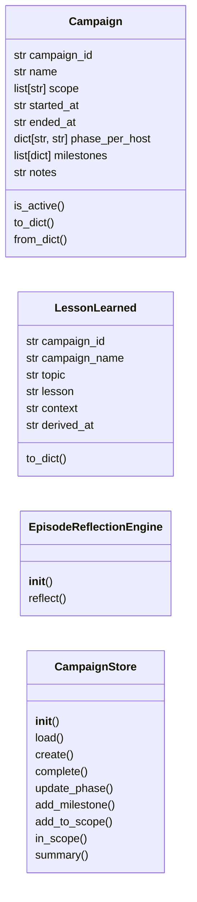
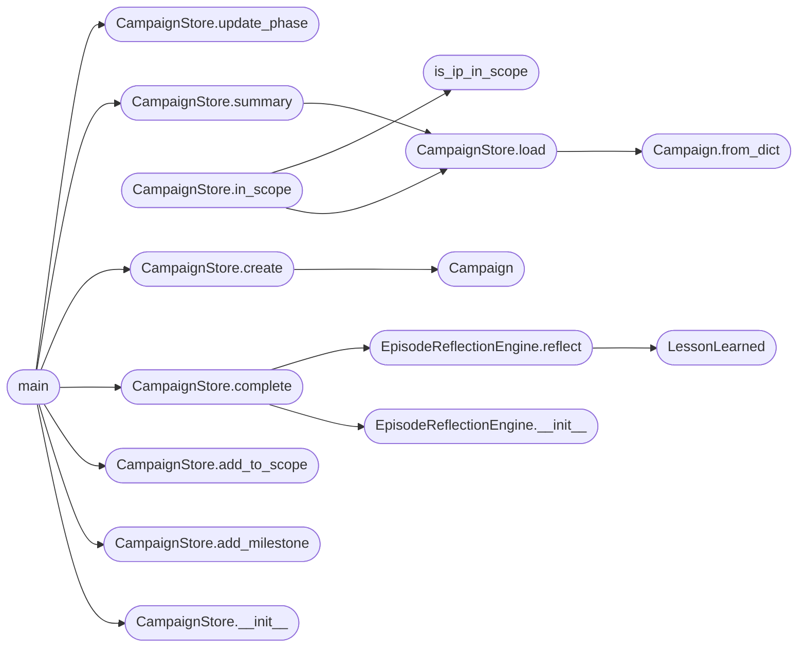

# `skills.lazyown_campaign`

> Source: [skills/lazyown_campaign.py:1](../../skills/lazyown_campaign.py#L1) | language `py` | coverage 86.4% | [API index](../index.md)

LazyOwn CampaignStore ===================== Groups multiple targets under a single named penetration-test engagement.

A *campaign* tracks:
  - A human-readable engagement name  (e.g. "HTB-Mirage", "Client-ACME-2026")
  - Scope: CIDR ranges / individual IPs that are authorised for testing
  - Per-host attack phase  (recon → scan → exploit → post-exploit → complete)
  - Milestones achieved during the engagement  (initial_foothold, priv_esc, …)
  - Start / end timestamps  and freeform notes

Persistence: sessions/campaign.json  (one active campaign at a time)

Usage
-----
  python3 skills/lazyown_campaign.py new "HTB-Mirage" --scope 10.10.11.0/24
  python3 skills/lazyown_campaign.py status
  python3 skills/lazyown_campaign.py phase 10.10.11.78 exploit
  python3 skills/lazyown_campaign.py milestone 10.10.11.78 initial_foothold --notes "via evil-winrm"
  python3 skills/lazyown_campaign.py complete
  python3 skills/lazyown_campaign.py add-scope 10.10.10.5

## Contents

- **Classes:** [`Campaign`](#campaign), [`LessonLearned`](#lessonlearned), [`EpisodeReflectionEngine`](#episodereflectionengine), [`CampaignStore`](#campaignstore)
- **Functions:** [`is_ip_in_scope`](#is_ip_in_scope), [`main`](#main)
- **Constants:** [`BASE_DIR`](#base_dir), [`SESSIONS_DIR`](#sessions_dir), [`CAMPAIGN_FILE`](#campaign_file)

## Type Diagram



## Call Graph

Solid arrows stay in this module, dashed arrows leave it.



## Classes

<a id="campaign"></a>

### `Campaign`

`class` `dataclass` | [skills/lazyown_campaign.py:105](../../skills/lazyown_campaign.py#L105)

Decorators: `@dataclass`

```python
class Campaign
```

Represents a single penetration-test engagement.

**Attributes**

| Name | Type | Default | Description |
|---|---|---|---|
| [`campaign_id`](#campaign-campaign_id) | `str` |  | 8-character lowercase hex identifier generated at creation time. |
| [`name`](#campaign-name) | `str` |  | Human-readable engagement label (e.g. ``"HTB-Mirage"``). |
| [`scope`](#campaign-scope) | `list[str]` |  | List of CIDR ranges or individual IPs / hostnames in scope. |
| [`started_at`](#campaign-started_at) | `str` |  | ISO-8601 timestamp (UTC) of when the campaign was created. |
| [`ended_at`](#campaign-ended_at) | `str` |  | ISO-8601 timestamp when the campaign was completed, or ``""`` if still active. |
| [`phase_per_host`](#campaign-phase_per_host) | `dict[str, str]` |  | Mapping of ``ip → phase``. Known phases (not enforced): ``recon``, ``scan``, ``exploit``, ``post-exploit``, `[`complete`](modules.llm_factory.py.md#complete)`. |
| [`milestones`](#campaign-milestones) | `list[dict]` |  | Ordered list of milestone dicts:: { "host": "10.10.11.78", "type": "initial_foothold", "timestamp": "2026-03-19T14:00:00Z", "notes": "via evil-winrm" } |
| [`notes`](#campaign-notes) | `str` |  | Freeform engagement notes (operator journal). |

**Members**

| Member | Kind | Summary |
|---|---|---|
| [`is_active`](#campaign-is_active) | method | Return True when the campaign has not been completed yet. |
| [`to_dict`](#campaign-to_dict) | method | Serialise to a plain dict suitable for JSON persistence. |
| [`from_dict`](#campaign-from_dict) | classmethod | Deserialise from a dict loaded out of JSON. |

<a id="campaign-is_active"></a>

#### `Campaign.is_active`

`method` | [skills/lazyown_campaign.py:148](../../skills/lazyown_campaign.py#L148)

```python
def is_active(self) -> bool
```

Return True when the campaign has not been completed yet.

**Returns:** `bool`

<a id="campaign-to_dict"></a>

#### `Campaign.to_dict`

`method` | [skills/lazyown_campaign.py:152](../../skills/lazyown_campaign.py#L152)

```python
def to_dict(self) -> dict
```

Serialise to a plain dict suitable for JSON persistence.

**Returns:** `dict`

<a id="campaign-from_dict"></a>

#### `Campaign.from_dict`

`classmethod` | [skills/lazyown_campaign.py:157](../../skills/lazyown_campaign.py#L157)

Decorators: `@classmethod`

```python
def from_dict(cls, data: dict) -> Campaign
```

Deserialise from a dict loaded out of JSON.

**Parameters**

| Name | Type | Default | Description |
|---|---|---|---|
| `data` | `dict` |  |  |

**Returns:** `Campaign`

*Called by:* [`CampaignStore.load`](#campaignstore-load)

---

<a id="lessonlearned"></a>

### `LessonLearned`

`class` `dataclass` | [skills/lazyown_campaign.py:175](../../skills/lazyown_campaign.py#L175)

Decorators: `@dataclass`

```python
class LessonLearned
```

A single distilled lesson extracted from a completed campaign.

Stored in hive memory (ChromaDB) so future campaigns can retrieve
relevant lessons via semantic search.

**Attributes**

| Name | Type | Default | Description |
|---|---|---|---|
| [`campaign_id`](#lessonlearned-campaign_id) | `str` |  |  |
| [`campaign_name`](#lessonlearned-campaign_name) | `str` |  |  |
| [`topic`](#lessonlearned-topic) | `str` |  |  |
| [`lesson`](#lessonlearned-lesson) | `str` |  |  |
| [`context`](#lessonlearned-context) | `str` |  |  |
| [`derived_at`](#lessonlearned-derived_at) | `str` | `field(default_factory=_now_iso)` |  |

**Members**

| Member | Kind | Summary |
|---|---|---|
| [`to_dict`](#lessonlearned-to_dict) | method |  |

<a id="lessonlearned-to_dict"></a>

#### `LessonLearned.to_dict`

`method` | [skills/lazyown_campaign.py:189](../../skills/lazyown_campaign.py#L189)

```python
def to_dict(self) -> dict
```

**Returns:** `dict`

---

<a id="episodereflectionengine"></a>

### `EpisodeReflectionEngine`

`class` | [skills/lazyown_campaign.py:193](../../skills/lazyown_campaign.py#L193)

```python
class EpisodeReflectionEngine
```

Post-campaign reflection engine.

After a campaign completes, analyses milestones and notes to produce
a set of LessonLearned records and persists them to:
  1. sessions/campaign_lessons.jsonl  — local flat file for offline review
  2. hive_memory (ChromaDB / SQLite)  — for semantic retrieval in future campaigns

Design
------
- Single Responsibility : reflection + lesson extraction only
- Open/Closed           : lesson extractors added as _EXTRACTORS entries
- Dependency Inversion  : hive memory injected (or None for offline mode)

The lesson extraction is intentionally heuristic and conservative — it
only produces lessons from concrete observed milestones, not from
speculative reasoning.

**Members**

| Member | Kind | Summary |
|---|---|---|
| [`__init__`](#episodereflectionengine-__init__) | constructor |  |
| [`reflect`](#episodereflectionengine-reflect) | method | Extract lessons from *campaign* and persist them. |

<a id="episodereflectionengine-__init__"></a>

#### `EpisodeReflectionEngine.__init__`

`constructor` | [skills/lazyown_campaign.py:256](../../skills/lazyown_campaign.py#L256)

```python
def __init__(self, hive_memory: Any | None = None) -> None
```

**Parameters**

| Name | Type | Default | Description |
|---|---|---|---|
| `hive_memory` | `Any \| None` | `None` | Optional HiveMemory instance for semantic storage. When None, lessons are only written to the flat JSONL file. |

*Called by:* [`CampaignStore.complete`](#campaignstore-complete)

<a id="episodereflectionengine-reflect"></a>

#### `EpisodeReflectionEngine.reflect`

`method` | [skills/lazyown_campaign.py:268](../../skills/lazyown_campaign.py#L268)

```python
def reflect(self, campaign: Campaign) -> list[LessonLearned]
```

Extract lessons from *campaign* and persist them.

Returns the list of LessonLearned records produced.

**Parameters**

| Name | Type | Default | Description |
|---|---|---|---|
| `campaign` | `Campaign` |  |  |

**Returns:** `list[LessonLearned]`

*Calls:* [`LessonLearned`](#lessonlearned)

*Called by:* [`CampaignStore.complete`](#campaignstore-complete)

---

<a id="campaignstore"></a>

### `CampaignStore`

`class` | [skills/lazyown_campaign.py:375](../../skills/lazyown_campaign.py#L375)

```python
class CampaignStore
```

Thin persistence layer around [`Campaign`](#campaign).

All mutating methods immediately flush changes to
``sessions/campaign.json``.

**Members**

| Member | Kind | Summary |
|---|---|---|
| [`__init__`](#campaignstore-__init__) | constructor |  |
| [`load`](#campaignstore-load) | method | Load the current campaign from disk. |
| [`create`](#campaignstore-create) | method | Create and persist a brand-new campaign. |
| [`complete`](#campaignstore-complete) | method | Mark the active campaign as completed and optionally run reflection. |
| [`update_phase`](#campaignstore-update_phase) | method | Set (or update) the attack phase for *host*. |
| [`add_milestone`](#campaignstore-add_milestone) | method | Record a milestone achievement for *host*. |
| [`add_to_scope`](#campaignstore-add_to_scope) | method | Append *ip_or_cidr* to the campaign scope (idempotent). |
| [`in_scope`](#campaignstore-in_scope) | method | Return True if *ip* falls within the campaign scope. |
| [`summary`](#campaignstore-summary) | method | Return a human-readable multi-line summary of the campaign. |

<a id="campaignstore-__init__"></a>

#### `CampaignStore.__init__`

`constructor` | [skills/lazyown_campaign.py:382](../../skills/lazyown_campaign.py#L382)

```python
def __init__(self, campaign_file: Path = CAMPAIGN_FILE) -> None
```

**Parameters**

| Name | Type | Default | Description |
|---|---|---|---|
| `campaign_file` | `Path` | `CAMPAIGN_FILE` |  |

*Called by:* [`main`](#main)

<a id="campaignstore-load"></a>

#### `CampaignStore.load`

`method` | [skills/lazyown_campaign.py:395](../../skills/lazyown_campaign.py#L395)

```python
def load(self) -> Campaign | None
```

Load the current campaign from disk.

**Returns:** `Campaign | None` - The campaign if the file exists and is valid JSON, else ``None``.

*Calls:* [`Campaign.from_dict`](#campaign-from_dict)

*Called by:* [`CampaignStore.in_scope`](#campaignstore-in_scope), [`CampaignStore.summary`](#campaignstore-summary)

<a id="campaignstore-create"></a>

#### `CampaignStore.create`

`method` | [skills/lazyown_campaign.py:414](../../skills/lazyown_campaign.py#L414)

```python
def create(self, name: str, scope: list[str], notes: str = '') -> Campaign
```

Create and persist a brand-new campaign.

**Parameters**

| Name | Type | Default | Description |
|---|---|---|---|
| `name` | `str` |  | Human-readable engagement label. |
| `scope` | `list[str]` |  | Initial list of CIDR ranges / IPs / hostnames. |
| `notes` | `str` | `''` | Optional freeform notes to attach at creation time. |

**Returns:** `Campaign` - The newly created (and saved) campaign.

*Calls:* [`Campaign`](#campaign)

*Called by:* [`main`](#main)

<a id="campaignstore-complete"></a>

#### `CampaignStore.complete`

`method` | [skills/lazyown_campaign.py:445](../../skills/lazyown_campaign.py#L445)

```python
def complete(self, notes: str = '', run_reflection: bool = True, hive_memory: Any | None = None) -> list[LessonLearned]
```

Mark the active campaign as completed and optionally run reflection.

**Parameters**

| Name | Type | Default | Description |
|---|---|---|---|
| `notes` | `str` | `''` | Optional closing notes to append to the campaign's notes field. |
| `run_reflection` | `bool` | `True` | When True (default), run EpisodeReflectionEngine after marking completion to extract and persist lessons learned. |
| `hive_memory` | `Any \| None` | `None` | Optional HiveMemory instance for semantic lesson storage. Only used when run_reflection=True. |

**Returns:** `List[LessonLearned]` - The lessons extracted (empty list when run_reflection=False).

**Raises**

- `FileNotFoundError`: If no campaign file exists.
- `ValueError`: If the campaign was already completed.

*Calls:* [`EpisodeReflectionEngine.__init__`](#episodereflectionengine-__init__), [`EpisodeReflectionEngine.reflect`](#episodereflectionengine-reflect)

*Called by:* [`main`](#main)

<a id="campaignstore-update_phase"></a>

#### `CampaignStore.update_phase`

`method` | [skills/lazyown_campaign.py:500](../../skills/lazyown_campaign.py#L500)

```python
def update_phase(self, host: str, phase: str) -> None
```

Set (or update) the attack phase for *host*.

**Parameters**

| Name | Type | Default | Description |
|---|---|---|---|
| `host` | `str` |  | Target IP address or hostname. |
| `phase` | `str` |  | Phase label (e.g. ``"recon"``, ``"exploit"``). |

*Called by:* [`main`](#main)

<a id="campaignstore-add_milestone"></a>

#### `CampaignStore.add_milestone`

`method` | [skills/lazyown_campaign.py:516](../../skills/lazyown_campaign.py#L516)

```python
def add_milestone(self, host: str, milestone_type: str, notes: str = '') -> None
```

Record a milestone achievement for *host*.

**Parameters**

| Name | Type | Default | Description |
|---|---|---|---|
| `host` | `str` |  | Target IP / hostname this milestone applies to. |
| `milestone_type` | `str` |  | Short label such as ``"initial_foothold"``, ``"priv_esc"``, ``"data_exfil"``, ``"lateral_movement"``. |
| `notes` | `str` | `''` | Optional freeform description of how the milestone was reached. |

*Called by:* [`main`](#main)

<a id="campaignstore-add_to_scope"></a>

#### `CampaignStore.add_to_scope`

`method` | [skills/lazyown_campaign.py:540](../../skills/lazyown_campaign.py#L540)

```python
def add_to_scope(self, ip_or_cidr: str) -> None
```

Append *ip_or_cidr* to the campaign scope (idempotent).

**Parameters**

| Name | Type | Default | Description |
|---|---|---|---|
| `ip_or_cidr` | `str` |  | A CIDR range (``10.10.10.0/24``) or individual address / hostname to add. |

*Called by:* [`main`](#main)

<a id="campaignstore-in_scope"></a>

#### `CampaignStore.in_scope`

`method` | [skills/lazyown_campaign.py:559](../../skills/lazyown_campaign.py#L559)

```python
def in_scope(self, ip: str) -> bool
```

Return True if *ip* falls within the campaign scope.

**Parameters**

| Name | Type | Default | Description |
|---|---|---|---|
| `ip` | `str` |  |  |

**Returns:** `bool`

*Calls:* [`CampaignStore.load`](#campaignstore-load), [`is_ip_in_scope`](#is_ip_in_scope)

<a id="campaignstore-summary"></a>

#### `CampaignStore.summary`

`method` | [skills/lazyown_campaign.py:566](../../skills/lazyown_campaign.py#L566)

```python
def summary(self) -> str
```

Return a human-readable multi-line summary of the campaign.

**Returns:** `str`

*Calls:* [`CampaignStore.load`](#campaignstore-load)

*Called by:* [`main`](#main)

---

## Functions

<a id="is_ip_in_scope"></a>

### `is_ip_in_scope`

`function` | [skills/lazyown_campaign.py:64](../../skills/lazyown_campaign.py#L64)

```python
def is_ip_in_scope(ip: str, scope: list[str]) -> bool
```

Return True if *ip* belongs to any entry in *scope*.

Each scope entry is tried as an ipaddress network first; if that fails
the function falls back to a simple string-prefix comparison so that
hostnames stored as plain strings (e.g. "api.acme.com") also match.

**Parameters**

| Name | Type | Default | Description |
|---|---|---|---|
| `ip` | `str` |  | The IP address (or hostname) to test. |
| `scope` | `list[str]` |  | A list of CIDR strings (``10.10.11.0/24``) or individual addresses / hostnames (``10.10.10.5``, ``api.acme.com``). |

**Returns:** `bool`

*Called by:* [`CampaignStore.in_scope`](#campaignstore-in_scope)

---

<a id="main"></a>

### `main`

`function` | [skills/lazyown_campaign.py:667](../../skills/lazyown_campaign.py#L667)

```python
def main(argv: list[str] | None = None) -> int
```

**Parameters**

| Name | Type | Default | Description |
|---|---|---|---|
| `argv` | `list[str] \| None` | `None` |  |

**Returns:** `int`

*Calls:* [`CampaignStore.__init__`](#campaignstore-__init__), [`CampaignStore.add_milestone`](#campaignstore-add_milestone), [`CampaignStore.add_to_scope`](#campaignstore-add_to_scope), [`CampaignStore.complete`](#campaignstore-complete), [`CampaignStore.create`](#campaignstore-create), [`CampaignStore.summary`](#campaignstore-summary), [`CampaignStore.update_phase`](#campaignstore-update_phase)

---

## Constants

<a id="base_dir"></a>

### `BASE_DIR`

`constant` | [skills/lazyown_campaign.py:51](../../skills/lazyown_campaign.py#L51)

```python
BASE_DIR = Path(__file__).resolve().parent.parent
```

---

<a id="sessions_dir"></a>

### `SESSIONS_DIR`

`constant` | [skills/lazyown_campaign.py:52](../../skills/lazyown_campaign.py#L52)

```python
SESSIONS_DIR = BASE_DIR / 'sessions'
```

---

<a id="campaign_file"></a>

### `CAMPAIGN_FILE`

`constant` | [skills/lazyown_campaign.py:53](../../skills/lazyown_campaign.py#L53)

```python
CAMPAIGN_FILE = SESSIONS_DIR / 'campaign.json'
```

---
