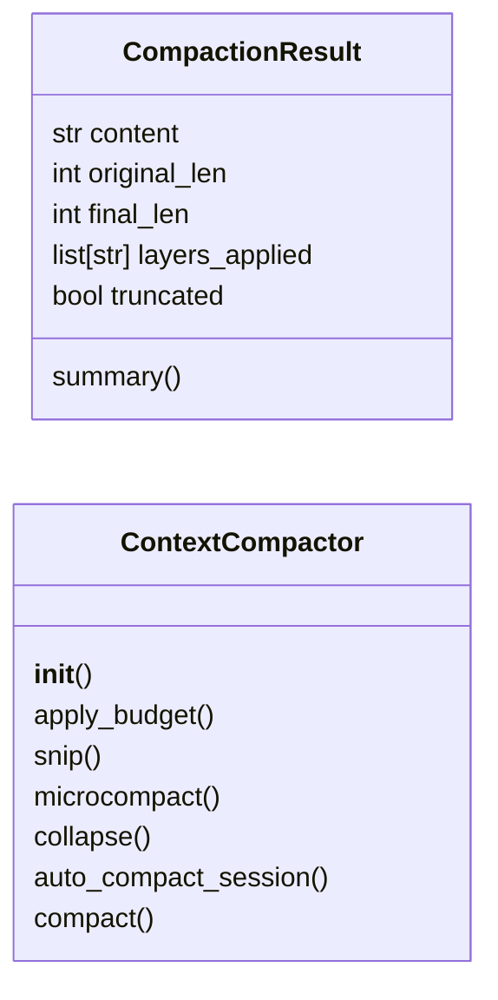
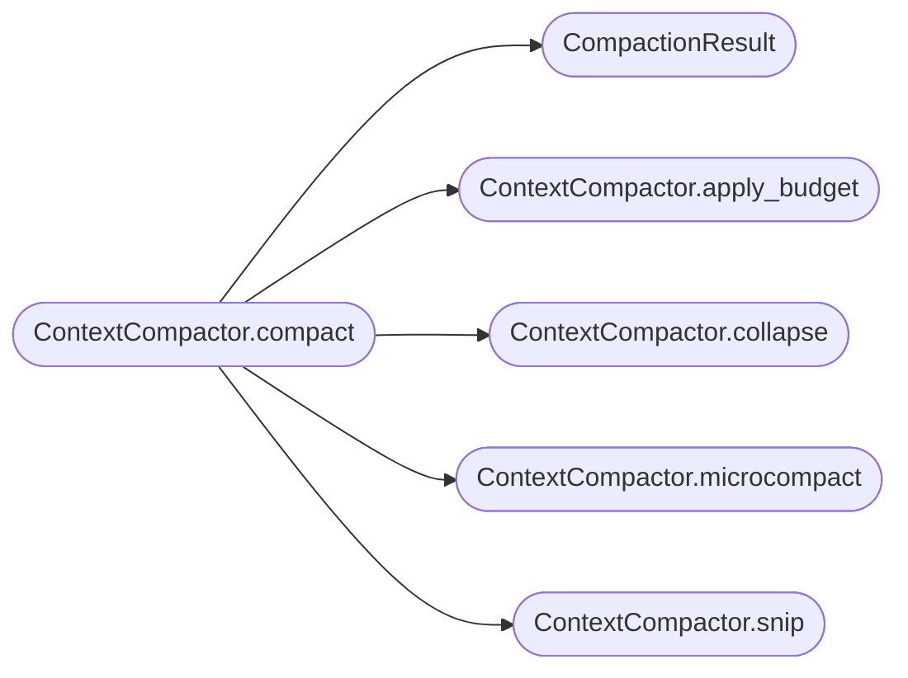

# `skills.lazyown_context`

> Source: [skills/lazyown_context.py:1](../../skills/lazyown_context.py#L1) | language `py` | coverage 75.0% | [API index](../index.md)

LazyOwn Context Compaction Pipeline — 5-layer graduated compression (Claude Code style)

Layers:
  1. Budget reduction   — hard cap on individual tool output size
  2. Snip              — trim older history entries
  3. Microcompact      — remove redundant/boilerplate sections
  4. Context collapse  — read-time projection (structural summary)
  5. Auto-compact      — template-based session summary (last resort)

## Contents

- **Classes:** [`CompactionResult`](#compactionresult), [`ContextCompactor`](#contextcompactor)
- **Functions:** [`compact_output`](#compact_output)

## Type Diagram



## Call Graph

Solid arrows stay in this module, dashed arrows leave it.



## Classes

<a id="compactionresult"></a>

### `CompactionResult`

`class` `dataclass` | [skills/lazyown_context.py:50](../../skills/lazyown_context.py#L50)

Decorators: `@dataclass`

```python
class CompactionResult
```

**Attributes**

| Name | Type | Default | Description |
|---|---|---|---|
| [`content`](#compactionresult-content) | `str` |  |  |
| [`original_len`](#compactionresult-original_len) | `int` |  |  |
| [`final_len`](#compactionresult-final_len) | `int` |  |  |
| [`layers_applied`](#compactionresult-layers_applied) | `list[str]` |  |  |
| [`truncated`](#compactionresult-truncated) | `bool` | `False` |  |

**Members**

| Member | Kind | Summary |
|---|---|---|
| [`summary`](#compactionresult-summary) | method |  |

<a id="compactionresult-summary"></a>

#### `CompactionResult.summary`

`method` | [skills/lazyown_context.py:57](../../skills/lazyown_context.py#L57)

```python
def summary(self) -> str
```

**Returns:** `str`

---

<a id="contextcompactor"></a>

### `ContextCompactor`

`class` | [skills/lazyown_context.py:62](../../skills/lazyown_context.py#L62)

```python
class ContextCompactor
```

Apply layered compaction to tool output strings.

Usage:
    compactor = ContextCompactor()
    result = compactor.compact(content, tool_name="lazyown_run_command")
    return result.content

**Members**

| Member | Kind | Summary |
|---|---|---|
| [`__init__`](#contextcompactor-__init__) | constructor |  |
| [`apply_budget`](#contextcompactor-apply_budget) | method | Hard-cap output. |
| [`snip`](#contextcompactor-snip) | method | Remove duplicate consecutive lines (log noise). |
| [`microcompact`](#contextcompactor-microcompact) | method | Strip known low-signal patterns. |
| [`collapse`](#contextcompactor-collapse) | method | Replace repetitive sections with a structural summary. |
| [`auto_compact_session`](#contextcompactor-auto_compact_session) | staticmethod | Template-based session summary when full pipeline is insufficient. entries: list of {"type": str, "data": dict} from SessionTranscript. |
| [`compact`](#contextcompactor-compact) | method | Apply all applicable layers in order. |

<a id="contextcompactor-__init__"></a>

#### `ContextCompactor.__init__`

`constructor` | [skills/lazyown_context.py:72](../../skills/lazyown_context.py#L72)

```python
def __init__(self, budget_override: dict[str, int] | None = None, snip_threshold: int = 6000, collapse_threshold: int = 9000)
```

**Parameters**

| Name | Type | Default | Description |
|---|---|---|---|
| `budget_override` | `dict[str, int] \| None` | `None` |  |
| `snip_threshold` | `int` | `6000` |  |
| `collapse_threshold` | `int` | `9000` |  |

<a id="contextcompactor-apply_budget"></a>

#### `ContextCompactor.apply_budget`

`method` | [skills/lazyown_context.py:84](../../skills/lazyown_context.py#L84)

```python
def apply_budget(self, content: str, tool_name: str) -> tuple[str, bool]
```

Hard-cap output.

Keeps head + tail for readability.

**Parameters**

| Name | Type | Default | Description |
|---|---|---|---|
| `content` | `str` |  |  |
| `tool_name` | `str` |  |  |

**Returns:** `tuple[str, bool]`

*Called by:* [`ContextCompactor.compact`](#contextcompactor-compact)

<a id="contextcompactor-snip"></a>

#### `ContextCompactor.snip`

`method` | [skills/lazyown_context.py:99](../../skills/lazyown_context.py#L99)

```python
def snip(self, content: str) -> tuple[str, bool]
```

Remove duplicate consecutive lines (log noise).

**Parameters**

| Name | Type | Default | Description |
|---|---|---|---|
| `content` | `str` |  |  |

**Returns:** `tuple[str, bool]`

*Called by:* [`ContextCompactor.compact`](#contextcompactor-compact)

<a id="contextcompactor-microcompact"></a>

#### `ContextCompactor.microcompact`

`method` | [skills/lazyown_context.py:120](../../skills/lazyown_context.py#L120)

```python
def microcompact(self, content: str) -> tuple[str, bool]
```

Strip known low-signal patterns.

Cheap, always run on >500 chars.

**Parameters**

| Name | Type | Default | Description |
|---|---|---|---|
| `content` | `str` |  |  |

**Returns:** `tuple[str, bool]`

*Called by:* [`ContextCompactor.compact`](#contextcompactor-compact)

<a id="contextcompactor-collapse"></a>

#### `ContextCompactor.collapse`

`method` | [skills/lazyown_context.py:136](../../skills/lazyown_context.py#L136)

```python
def collapse(self, content: str, tool_name: str) -> tuple[str, bool]
```

Replace repetitive sections with a structural summary.

**Parameters**

| Name | Type | Default | Description |
|---|---|---|---|
| `content` | `str` |  |  |
| `tool_name` | `str` |  |  |

**Returns:** `tuple[str, bool]`

*Called by:* [`ContextCompactor.compact`](#contextcompactor-compact)

<a id="contextcompactor-auto_compact_session"></a>

#### `ContextCompactor.auto_compact_session`

`staticmethod` | [skills/lazyown_context.py:159](../../skills/lazyown_context.py#L159)

Decorators: `@staticmethod`

```python
def auto_compact_session(entries: list[dict]) -> str
```

Template-based session summary when full pipeline is insufficient. entries: list of {"type": str, "data": dict} from SessionTranscript.

**Parameters**

| Name | Type | Default | Description |
|---|---|---|---|
| `entries` | `list[dict]` |  |  |

**Returns:** `str`

*Called by:* [`SessionTranscript.maybe_auto_compact`](skills.lazyown_session.py.md#sessiontranscript-maybe_auto_compact)

<a id="contextcompactor-compact"></a>

#### `ContextCompactor.compact`

`method` | [skills/lazyown_context.py:203](../../skills/lazyown_context.py#L203)

```python
def compact(self, content: str, tool_name: str = '_default') -> CompactionResult
```

Apply all applicable layers in order.

**Parameters**

| Name | Type | Default | Description |
|---|---|---|---|
| `content` | `str` |  |  |
| `tool_name` | `str` | `'_default'` |  |

**Returns:** `CompactionResult`

*Calls:* [`CompactionResult`](#compactionresult), [`ContextCompactor.apply_budget`](#contextcompactor-apply_budget), [`ContextCompactor.collapse`](#contextcompactor-collapse), [`ContextCompactor.microcompact`](#contextcompactor-microcompact), [`ContextCompactor.snip`](#contextcompactor-snip)

---

## Functions

<a id="compact_output"></a>

### `compact_output`

`function` | [skills/lazyown_context.py:237](../../skills/lazyown_context.py#L237)

```python
def compact_output(content: str, tool_name: str = '_default') -> str
```

Convenience wrapper: compact and return string.

**Parameters**

| Name | Type | Default | Description |
|---|---|---|---|
| `content` | `str` |  |  |
| `tool_name` | `str` | `'_default'` |  |

**Returns:** `str`

---
