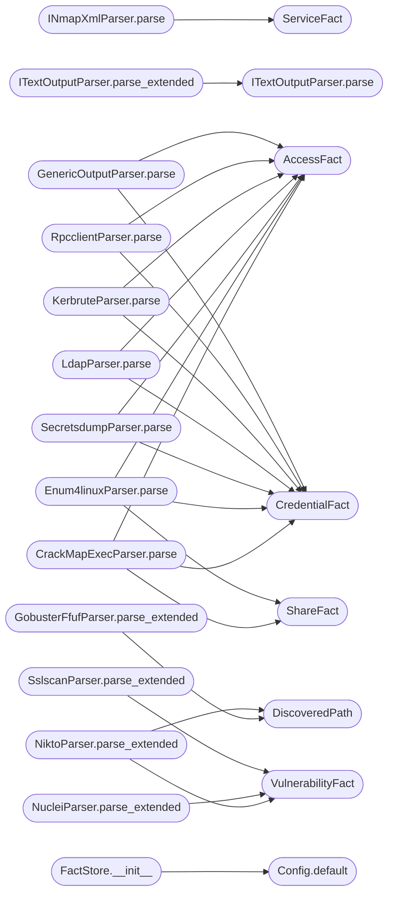

# `skills.lazyown_facts`

> Source: [skills/lazyown_facts.py:1](../../skills/lazyown_facts.py#L1) | language `py` | coverage 50.7% | [API index](../index.md)

LazyOwn FactStore ================= Structured fact extraction from nmap XML files and pwntomate tool output.

Reads  sessions/scan_*.nmap.xml   → host/port/service facts
Reads  sessions/*.txt              → credentials, shares, access-level hints
Writes sessions/policy_facts.json  → single merged fact store

Consumed by lazyown_mcp.py auto_loop to parameterise commands with
real discovered data instead of generic category defaults.

Usage:
    python3 skills/lazyown_facts.py parse [--target TARGET]
    python3 skills/lazyown_facts.py show  [--target TARGET]
    python3 skills/lazyown_facts.py clean

## Contents

- **Classes:** [`Config`](#config), [`ServiceFact`](#servicefact), [`CredentialFact`](#credentialfact), [`ShareFact`](#sharefact), [`AccessFact`](#accessfact), [`VulnerabilityFact`](#vulnerabilityfact), [`DiscoveredPath`](#discoveredpath), [`HostFacts`](#hostfacts), [`INmapXmlParser`](#inmapxmlparser), [`ITextOutputParser`](#itextoutputparser), [`CrackMapExecParser`](#crackmapexecparser), [`Enum4linuxParser`](#enum4linuxparser), [`SecretsdumpParser`](#secretsdumpparser), [`LdapParser`](#ldapparser), [`KerbruteParser`](#kerbruteparser), [`RpcclientParser`](#rpcclientparser), [`GobusterFfufParser`](#gobusterffufparser), [`NiktoParser`](#niktoparser), [`NucleiParser`](#nucleiparser), [`SslscanParser`](#sslscanparser), [`GenericOutputParser`](#genericoutputparser), [`FactStore`](#factstore), [`ToolDefinition`](#tooldefinition)
- **Functions:** [`create_tool_file`](#create_tool_file), [`main`](#main)

## Type Diagram

```mermaid
classDiagram
    direction LR
    class Config
    Config : Path base_dir
    Config : Path sessions_dir
    Config : Path facts_file
    Config : str xml_glob
    Config : str txt_glob
    Config : str log_level
    Config : default()
    class ServiceFact
    ServiceFact : str host
    ServiceFact : int port
    ServiceFact : str protocol
    ServiceFact : str service
    ServiceFact : str product
    ServiceFact : str version
    ServiceFact : str state
    class CredentialFact
    CredentialFact : str host
    CredentialFact : str username
    CredentialFact : str password
    CredentialFact : str source_file
    CredentialFact : str hash_value
    CredentialFact : str hash_type
    class ShareFact
    ShareFact : str host
    ShareFact : str share_name
    ShareFact : str access
    ShareFact : str source_file
    class AccessFact
    AccessFact : str host
    AccessFact : str level
    AccessFact : str method
    AccessFact : str source_file
    class VulnerabilityFact
    VulnerabilityFact : str host
    VulnerabilityFact : str vuln_id
    VulnerabilityFact : str severity
    VulnerabilityFact : str title
    VulnerabilityFact : str url
    VulnerabilityFact : str source_tool
    VulnerabilityFact : str source_file
    class DiscoveredPath
    DiscoveredPath : str host
    DiscoveredPath : int port
    DiscoveredPath : str path
    DiscoveredPath : int status_code
    DiscoveredPath : int size
    DiscoveredPath : str source_file
    class HostFacts
    HostFacts : str host
    HostFacts : list[ServiceFact] services
    HostFacts : list[CredentialFact] credentials
    HostFacts : list[ShareFact] shares
    HostFacts : list[AccessFact] access
    HostFacts : list[str] raw_files
    HostFacts : list[VulnerabilityFact] vulnerabilities
    HostFacts : list[DiscoveredPath] paths
    HostFacts : str os_hint
    HostFacts : highest_access()
    HostFacts : open_ports()
    HostFacts : services_by_name()
    class INmapXmlParser
    INmapXmlParser : parse()
    class ITextOutputParser
    ITextOutputParser : str TOOL_NAME
    ITextOutputParser : can_parse()
    ITextOutputParser : parse()
    ITextOutputParser : parse_extended()
    class CrackMapExecParser
    CrackMapExecParser : TOOL_NAME
    CrackMapExecParser : can_parse()
    CrackMapExecParser : parse()
    class Enum4linuxParser
    Enum4linuxParser : TOOL_NAME
    Enum4linuxParser : can_parse()
    Enum4linuxParser : parse()
    class SecretsdumpParser
    SecretsdumpParser : TOOL_NAME
    SecretsdumpParser : can_parse()
    SecretsdumpParser : parse()
    class LdapParser
    LdapParser : TOOL_NAME
    LdapParser : can_parse()
    LdapParser : parse()
    class KerbruteParser
    KerbruteParser : TOOL_NAME
    KerbruteParser : can_parse()
    KerbruteParser : parse()
    class RpcclientParser
    RpcclientParser : TOOL_NAME
    RpcclientParser : can_parse()
    RpcclientParser : parse()
    class GobusterFfufParser
    GobusterFfufParser : TOOL_NAME
    GobusterFfufParser : can_parse()
    GobusterFfufParser : parse()
    GobusterFfufParser : parse_extended()
    class NiktoParser
    NiktoParser : TOOL_NAME
    NiktoParser : can_parse()
    NiktoParser : parse()
    NiktoParser : parse_extended()
    class NucleiParser
    NucleiParser : TOOL_NAME
    NucleiParser : can_parse()
    NucleiParser : parse()
    NucleiParser : parse_extended()
    class SslscanParser
    SslscanParser : TOOL_NAME
    SslscanParser : can_parse()
    SslscanParser : parse()
    SslscanParser : parse_extended()
    class GenericOutputParser
    GenericOutputParser : TOOL_NAME
    GenericOutputParser : can_parse()
    GenericOutputParser : parse()
    class FactStore
    FactStore : __init__()
    FactStore : save()
    FactStore : ingest_xml()
    FactStore : ingest_text()
    FactStore : parse_all()
    FactStore : get_host()
    FactStore : all_hosts()
    FactStore : context_for_command()
    FactStore : summary()
    class ToolDefinition
    ToolDefinition : str toolname
    ToolDefinition : str command
    ToolDefinition : list[str] trigger
    ToolDefinition : bool active
    ITextOutputParser <|-- CrackMapExecParser
    ITextOutputParser <|-- Enum4linuxParser
    ITextOutputParser <|-- SecretsdumpParser
    ITextOutputParser <|-- LdapParser
    ITextOutputParser <|-- KerbruteParser
    ITextOutputParser <|-- RpcclientParser
    ITextOutputParser <|-- GobusterFfufParser
    ITextOutputParser <|-- NiktoParser
    ITextOutputParser <|-- NucleiParser
    ITextOutputParser <|-- SslscanParser
    ITextOutputParser <|-- GenericOutputParser
```



## Call Graph

Solid arrows stay in this module, dashed arrows leave it.



## Classes

<a id="config"></a>

### `Config`

`class` `dataclass` | [skills/lazyown_facts.py:34](../../skills/lazyown_facts.py#L34)

Decorators: `@dataclass(frozen=True)`

```python
class Config
```

All file paths and constants for the FactStore.

**Attributes**

| Name | Type | Default | Description |
|---|---|---|---|
| [`base_dir`](#config-base_dir) | `Path` |  |  |
| [`sessions_dir`](#config-sessions_dir) | `Path` |  |  |
| [`facts_file`](#config-facts_file) | `Path` |  |  |
| [`xml_glob`](#config-xml_glob) | `str` |  |  |
| [`txt_glob`](#config-txt_glob) | `str` |  |  |
| [`log_level`](#config-log_level) | `str` |  |  |

**Members**

| Member | Kind | Summary |
|---|---|---|
| [`default`](#config-default) | classmethod |  |

<a id="config-default"></a>

#### `Config.default`

`classmethod` | [skills/lazyown_facts.py:45](../../skills/lazyown_facts.py#L45)

Decorators: `@classmethod`

```python
def default(cls) -> Config
```

**Returns:** `Config`

*Called by:* [`FactStore.__init__`](#factstore-__init__), [`LazyOwnPolicyIntegration.__init__`](skills.lazyown_policy.py.md#lazyownpolicyintegration-__init__), [`main`](skills.lazyown_policy.py.md#main)

---

<a id="servicefact"></a>

### `ServiceFact`

`class` `dataclass` | [skills/lazyown_facts.py:62](../../skills/lazyown_facts.py#L62)

Decorators: `@dataclass`

```python
class ServiceFact
```

A single open port on a host.

**Attributes**

| Name | Type | Default | Description |
|---|---|---|---|
| [`host`](#servicefact-host) | `str` |  |  |
| [`port`](#servicefact-port) | `int` |  |  |
| [`protocol`](#servicefact-protocol) | `str` |  |  |
| [`service`](#servicefact-service) | `str` |  |  |
| [`product`](#servicefact-product) | `str` |  |  |
| [`version`](#servicefact-version) | `str` |  |  |
| [`state`](#servicefact-state) | `str` |  |  |

---

<a id="credentialfact"></a>

### `CredentialFact`

`class` `dataclass` | [skills/lazyown_facts.py:75](../../skills/lazyown_facts.py#L75)

Decorators: `@dataclass`

```python
class CredentialFact
```

A credential pair discovered by any tool.

**Attributes**

| Name | Type | Default | Description |
|---|---|---|---|
| [`host`](#credentialfact-host) | `str` |  |  |
| [`username`](#credentialfact-username) | `str` |  |  |
| [`password`](#credentialfact-password) | `str` |  |  |
| [`source_file`](#credentialfact-source_file) | `str` |  |  |
| [`hash_value`](#credentialfact-hash_value) | `str` | `''` |  |
| [`hash_type`](#credentialfact-hash_type) | `str` | `''` |  |

---

<a id="sharefact"></a>

### `ShareFact`

`class` `dataclass` | [skills/lazyown_facts.py:87](../../skills/lazyown_facts.py#L87)

Decorators: `@dataclass`

```python
class ShareFact
```

A network share.

**Attributes**

| Name | Type | Default | Description |
|---|---|---|---|
| [`host`](#sharefact-host) | `str` |  |  |
| [`share_name`](#sharefact-share_name) | `str` |  |  |
| [`access`](#sharefact-access) | `str` |  |  |
| [`source_file`](#sharefact-source_file) | `str` |  |  |

---

<a id="accessfact"></a>

### `AccessFact`

`class` `dataclass` | [skills/lazyown_facts.py:97](../../skills/lazyown_facts.py#L97)

Decorators: `@dataclass`

```python
class AccessFact
```

Evidence of access to a host.

**Attributes**

| Name | Type | Default | Description |
|---|---|---|---|
| [`host`](#accessfact-host) | `str` |  |  |
| [`level`](#accessfact-level) | `str` |  |  |
| [`method`](#accessfact-method) | `str` |  |  |
| [`source_file`](#accessfact-source_file) | `str` |  |  |

---

<a id="vulnerabilityfact"></a>

### `VulnerabilityFact`

`class` `dataclass` | [skills/lazyown_facts.py:107](../../skills/lazyown_facts.py#L107)

Decorators: `@dataclass`

```python
class VulnerabilityFact
```

A vulnerability or weakness found on a host.

**Attributes**

| Name | Type | Default | Description |
|---|---|---|---|
| [`host`](#vulnerabilityfact-host) | `str` |  |  |
| [`vuln_id`](#vulnerabilityfact-vuln_id) | `str` |  |  |
| [`severity`](#vulnerabilityfact-severity) | `str` |  |  |
| [`title`](#vulnerabilityfact-title) | `str` |  |  |
| [`url`](#vulnerabilityfact-url) | `str` |  |  |
| [`source_tool`](#vulnerabilityfact-source_tool) | `str` |  |  |
| [`source_file`](#vulnerabilityfact-source_file) | `str` |  |  |

---

<a id="discoveredpath"></a>

### `DiscoveredPath`

`class` `dataclass` | [skills/lazyown_facts.py:120](../../skills/lazyown_facts.py#L120)

Decorators: `@dataclass`

```python
class DiscoveredPath
```

A web path found by directory enumeration.

**Attributes**

| Name | Type | Default | Description |
|---|---|---|---|
| [`host`](#discoveredpath-host) | `str` |  |  |
| [`port`](#discoveredpath-port) | `int` |  |  |
| [`path`](#discoveredpath-path) | `str` |  |  |
| [`status_code`](#discoveredpath-status_code) | `int` |  |  |
| [`size`](#discoveredpath-size) | `int` |  |  |
| [`source_file`](#discoveredpath-source_file) | `str` |  |  |

---

<a id="hostfacts"></a>

### `HostFacts`

`class` `dataclass` | [skills/lazyown_facts.py:132](../../skills/lazyown_facts.py#L132)

Decorators: `@dataclass`

```python
class HostFacts
```

All known facts for a single target IP.

**Attributes**

| Name | Type | Default | Description |
|---|---|---|---|
| [`host`](#hostfacts-host) | `str` |  |  |
| [`services`](#hostfacts-services) | `list[ServiceFact]` | `field(default_factory=list)` |  |
| [`credentials`](#hostfacts-credentials) | `list[CredentialFact]` | `field(default_factory=list)` |  |
| [`shares`](#hostfacts-shares) | `list[ShareFact]` | `field(default_factory=list)` |  |
| [`access`](#hostfacts-access) | `list[AccessFact]` | `field(default_factory=list)` |  |
| [`raw_files`](#hostfacts-raw_files) | `list[str]` | `field(default_factory=list)` |  |
| [`vulnerabilities`](#hostfacts-vulnerabilities) | `list[VulnerabilityFact]` | `field(default_factory=list)` |  |
| [`paths`](#hostfacts-paths) | `list[DiscoveredPath]` | `field(default_factory=list)` |  |
| [`os_hint`](#hostfacts-os_hint) | `str` | `''` |  |

**Members**

| Member | Kind | Summary |
|---|---|---|
| [`highest_access`](#hostfacts-highest_access) | method |  |
| [`open_ports`](#hostfacts-open_ports) | method |  |
| [`services_by_name`](#hostfacts-services_by_name) | method |  |

<a id="hostfacts-highest_access"></a>

#### `HostFacts.highest_access`

`method` | [skills/lazyown_facts.py:145](../../skills/lazyown_facts.py#L145)

```python
def highest_access(self) -> str
```

**Returns:** `str`

<a id="hostfacts-open_ports"></a>

#### `HostFacts.open_ports`

`method` | [skills/lazyown_facts.py:156](../../skills/lazyown_facts.py#L156)

```python
def open_ports(self) -> list[int]
```

**Returns:** `list[int]`

<a id="hostfacts-services_by_name"></a>

#### `HostFacts.services_by_name`

`method` | [skills/lazyown_facts.py:159](../../skills/lazyown_facts.py#L159)

```python
def services_by_name(self, name: str) -> list[ServiceFact]
```

**Parameters**

| Name | Type | Default | Description |
|---|---|---|---|
| `name` | `str` |  |  |

**Returns:** `list[ServiceFact]`

---

<a id="inmapxmlparser"></a>

### `INmapXmlParser`

`class` | [skills/lazyown_facts.py:166](../../skills/lazyown_facts.py#L166)

```python
class INmapXmlParser
```

Parse a single nmap XML file into ServiceFact objects.

**Members**

| Member | Kind | Summary |
|---|---|---|
| [`parse`](#inmapxmlparser-parse) | method |  |

<a id="inmapxmlparser-parse"></a>

#### `INmapXmlParser.parse`

`method` | [skills/lazyown_facts.py:169](../../skills/lazyown_facts.py#L169)

```python
def parse(self, xml_path: Path) -> list[ServiceFact]
```

**Parameters**

| Name | Type | Default | Description |
|---|---|---|---|
| `xml_path` | `Path` |  |  |

**Returns:** `list[ServiceFact]`

*Calls:* [`ServiceFact`](#servicefact)

*Called by:* [`FactStore.ingest_xml`](#factstore-ingest_xml)

---

<a id="itextoutputparser"></a>

### `ITextOutputParser`

`class` | [skills/lazyown_facts.py:212](../../skills/lazyown_facts.py#L212)

```python
class ITextOutputParser
```

Subclasses: [`CrackMapExecParser`](#crackmapexecparser), [`Enum4linuxParser`](#enum4linuxparser), [`GenericOutputParser`](#genericoutputparser), [`GobusterFfufParser`](#gobusterffufparser), [`KerbruteParser`](#kerbruteparser), [`LdapParser`](#ldapparser), [`NiktoParser`](#niktoparser), [`NucleiParser`](#nucleiparser), [`RpcclientParser`](#rpcclientparser), [`SecretsdumpParser`](#secretsdumpparser), [`SslscanParser`](#sslscanparser)

Base class for tool-output text parsers.

**Attributes**

| Name | Type | Default | Description |
|---|---|---|---|
| [`TOOL_NAME`](#itextoutputparser-tool_name) | `str` | `''` |  |

**Members**

| Member | Kind | Summary |
|---|---|---|
| [`can_parse`](#itextoutputparser-can_parse) | method |  |
| [`parse`](#itextoutputparser-parse) | method |  |
| [`parse_extended`](#itextoutputparser-parse_extended) | method | Extended parse including vulnerabilities and web paths. |

<a id="itextoutputparser-can_parse"></a>

#### `ITextOutputParser.can_parse`

`method` | [skills/lazyown_facts.py:217](../../skills/lazyown_facts.py#L217)

```python
def can_parse(self, filename: str, content: str) -> bool
```

**Parameters**

| Name | Type | Default | Description |
|---|---|---|---|
| `filename` | `str` |  |  |
| `content` | `str` |  |  |

**Returns:** `bool`

**Raises**

- `NotImplementedError`: (raised in the body, not documented)

<a id="itextoutputparser-parse"></a>

#### `ITextOutputParser.parse`

`method` | [skills/lazyown_facts.py:220](../../skills/lazyown_facts.py#L220)

```python
def parse(self, host: str, content: str, source_file: str) -> tuple[list[CredentialFact], list[ShareFact], list[AccessFact]]
```

**Parameters**

| Name | Type | Default | Description |
|---|---|---|---|
| `host` | `str` |  |  |
| `content` | `str` |  |  |
| `source_file` | `str` |  |  |

**Returns:** `tuple[list[CredentialFact], list[ShareFact], list[AccessFact]]`

**Raises**

- `NotImplementedError`: (raised in the body, not documented)

*Called by:* [`ITextOutputParser.parse_extended`](#itextoutputparser-parse_extended)

<a id="itextoutputparser-parse_extended"></a>

#### `ITextOutputParser.parse_extended`

`method` | [skills/lazyown_facts.py:228](../../skills/lazyown_facts.py#L228)

```python
def parse_extended(self, host: str, content: str, source_file: str, port: int = 80) -> tuple[list[CredentialFact], list[ShareFact], list[AccessFact], list[VulnerabilityFact], list[DiscoveredPath]]
```

Extended parse including vulnerabilities and web paths.

Override in subclasses.

**Parameters**

| Name | Type | Default | Description |
|---|---|---|---|
| `host` | `str` |  |  |
| `content` | `str` |  |  |
| `source_file` | `str` |  |  |
| `port` | `int` | `80` |  |

**Returns:** `tuple[list[CredentialFact], list[ShareFact], list[AccessFact], list[VulnerabilityFact], list[DiscoveredPath]]`

*Calls:* [`ITextOutputParser.parse`](#itextoutputparser-parse)

---

<a id="crackmapexecparser"></a>

### `CrackMapExecParser`

`class` | [skills/lazyown_facts.py:240](../../skills/lazyown_facts.py#L240)

```python
class CrackMapExecParser(ITextOutputParser)
```

Bases: [`ITextOutputParser`](#itextoutputparser)

Parse crackmapexec / nxc output.

**Attributes**

| Name | Type | Default | Description |
|---|---|---|---|
| [`TOOL_NAME`](#crackmapexecparser-tool_name) |  | `'crackmapexec'` |  |

**Members**

| Member | Kind | Summary |
|---|---|---|
| [`can_parse`](#crackmapexecparser-can_parse) | method |  |
| [`parse`](#crackmapexecparser-parse) | method |  |

<a id="crackmapexecparser-can_parse"></a>

#### `CrackMapExecParser.can_parse`

`method` | [skills/lazyown_facts.py:250](../../skills/lazyown_facts.py#L250)

```python
def can_parse(self, filename: str, content: str) -> bool
```

**Parameters**

| Name | Type | Default | Description |
|---|---|---|---|
| `filename` | `str` |  |  |
| `content` | `str` |  |  |

**Returns:** `bool`

<a id="crackmapexecparser-parse"></a>

#### `CrackMapExecParser.parse`

`method` | [skills/lazyown_facts.py:257](../../skills/lazyown_facts.py#L257)

```python
def parse(self, host: str, content: str, source_file: str)
```

**Parameters**

| Name | Type | Default | Description |
|---|---|---|---|
| `host` | `str` |  |  |
| `content` | `str` |  |  |
| `source_file` | `str` |  |  |

*Calls:* [`AccessFact`](#accessfact), [`CredentialFact`](#credentialfact), [`ShareFact`](#sharefact)

---

<a id="enum4linuxparser"></a>

### `Enum4linuxParser`

`class` | [skills/lazyown_facts.py:292](../../skills/lazyown_facts.py#L292)

```python
class Enum4linuxParser(ITextOutputParser)
```

Bases: [`ITextOutputParser`](#itextoutputparser)

Parse enum4linux / enum4linux-ng output.

**Attributes**

| Name | Type | Default | Description |
|---|---|---|---|
| [`TOOL_NAME`](#enum4linuxparser-tool_name) |  | `'enum4linux'` |  |

**Members**

| Member | Kind | Summary |
|---|---|---|
| [`can_parse`](#enum4linuxparser-can_parse) | method |  |
| [`parse`](#enum4linuxparser-parse) | method |  |

<a id="enum4linuxparser-can_parse"></a>

#### `Enum4linuxParser.can_parse`

`method` | [skills/lazyown_facts.py:301](../../skills/lazyown_facts.py#L301)

```python
def can_parse(self, filename: str, content: str) -> bool
```

**Parameters**

| Name | Type | Default | Description |
|---|---|---|---|
| `filename` | `str` |  |  |
| `content` | `str` |  |  |

**Returns:** `bool`

<a id="enum4linuxparser-parse"></a>

#### `Enum4linuxParser.parse`

`method` | [skills/lazyown_facts.py:304](../../skills/lazyown_facts.py#L304)

```python
def parse(self, host: str, content: str, source_file: str)
```

**Parameters**

| Name | Type | Default | Description |
|---|---|---|---|
| `host` | `str` |  |  |
| `content` | `str` |  |  |
| `source_file` | `str` |  |  |

*Calls:* [`AccessFact`](#accessfact), [`CredentialFact`](#credentialfact), [`ShareFact`](#sharefact)

---

<a id="secretsdumpparser"></a>

### `SecretsdumpParser`

`class` | [skills/lazyown_facts.py:331](../../skills/lazyown_facts.py#L331)

```python
class SecretsdumpParser(ITextOutputParser)
```

Bases: [`ITextOutputParser`](#itextoutputparser)

Parse impacket secretsdump output.

**Attributes**

| Name | Type | Default | Description |
|---|---|---|---|
| [`TOOL_NAME`](#secretsdumpparser-tool_name) |  | `'secretsdump'` |  |

**Members**

| Member | Kind | Summary |
|---|---|---|
| [`can_parse`](#secretsdumpparser-can_parse) | method |  |
| [`parse`](#secretsdumpparser-parse) | method |  |

<a id="secretsdumpparser-can_parse"></a>

#### `SecretsdumpParser.can_parse`

`method` | [skills/lazyown_facts.py:341](../../skills/lazyown_facts.py#L341)

```python
def can_parse(self, filename: str, content: str) -> bool
```

**Parameters**

| Name | Type | Default | Description |
|---|---|---|---|
| `filename` | `str` |  |  |
| `content` | `str` |  |  |

**Returns:** `bool`

<a id="secretsdumpparser-parse"></a>

#### `SecretsdumpParser.parse`

`method` | [skills/lazyown_facts.py:346](../../skills/lazyown_facts.py#L346)

```python
def parse(self, host: str, content: str, source_file: str)
```

**Parameters**

| Name | Type | Default | Description |
|---|---|---|---|
| `host` | `str` |  |  |
| `content` | `str` |  |  |
| `source_file` | `str` |  |  |

*Calls:* [`AccessFact`](#accessfact), [`CredentialFact`](#credentialfact)

---

<a id="ldapparser"></a>

### `LdapParser`

`class` | [skills/lazyown_facts.py:366](../../skills/lazyown_facts.py#L366)

```python
class LdapParser(ITextOutputParser)
```

Bases: [`ITextOutputParser`](#itextoutputparser)

Parse ldapsearch / ldapdomaindump output.

**Attributes**

| Name | Type | Default | Description |
|---|---|---|---|
| [`TOOL_NAME`](#ldapparser-tool_name) |  | `'ldap'` |  |

**Members**

| Member | Kind | Summary |
|---|---|---|
| [`can_parse`](#ldapparser-can_parse) | method |  |
| [`parse`](#ldapparser-parse) | method |  |

<a id="ldapparser-can_parse"></a>

#### `LdapParser.can_parse`

`method` | [skills/lazyown_facts.py:374](../../skills/lazyown_facts.py#L374)

```python
def can_parse(self, filename: str, content: str) -> bool
```

**Parameters**

| Name | Type | Default | Description |
|---|---|---|---|
| `filename` | `str` |  |  |
| `content` | `str` |  |  |

**Returns:** `bool`

<a id="ldapparser-parse"></a>

#### `LdapParser.parse`

`method` | [skills/lazyown_facts.py:377](../../skills/lazyown_facts.py#L377)

```python
def parse(self, host: str, content: str, source_file: str)
```

**Parameters**

| Name | Type | Default | Description |
|---|---|---|---|
| `host` | `str` |  |  |
| `content` | `str` |  |  |
| `source_file` | `str` |  |  |

*Calls:* [`AccessFact`](#accessfact), [`CredentialFact`](#credentialfact)

---

<a id="kerbruteparser"></a>

### `KerbruteParser`

`class` | [skills/lazyown_facts.py:395](../../skills/lazyown_facts.py#L395)

```python
class KerbruteParser(ITextOutputParser)
```

Bases: [`ITextOutputParser`](#itextoutputparser)

Parse kerbrute user enumeration output.

**Attributes**

| Name | Type | Default | Description |
|---|---|---|---|
| [`TOOL_NAME`](#kerbruteparser-tool_name) |  | `'kerbrute'` |  |

**Members**

| Member | Kind | Summary |
|---|---|---|
| [`can_parse`](#kerbruteparser-can_parse) | method |  |
| [`parse`](#kerbruteparser-parse) | method |  |

<a id="kerbruteparser-can_parse"></a>

#### `KerbruteParser.can_parse`

`method` | [skills/lazyown_facts.py:403](../../skills/lazyown_facts.py#L403)

```python
def can_parse(self, filename: str, content: str) -> bool
```

**Parameters**

| Name | Type | Default | Description |
|---|---|---|---|
| `filename` | `str` |  |  |
| `content` | `str` |  |  |

**Returns:** `bool`

<a id="kerbruteparser-parse"></a>

#### `KerbruteParser.parse`

`method` | [skills/lazyown_facts.py:406](../../skills/lazyown_facts.py#L406)

```python
def parse(self, host: str, content: str, source_file: str)
```

**Parameters**

| Name | Type | Default | Description |
|---|---|---|---|
| `host` | `str` |  |  |
| `content` | `str` |  |  |
| `source_file` | `str` |  |  |

*Calls:* [`AccessFact`](#accessfact), [`CredentialFact`](#credentialfact)

---

<a id="rpcclientparser"></a>

### `RpcclientParser`

`class` | [skills/lazyown_facts.py:416](../../skills/lazyown_facts.py#L416)

```python
class RpcclientParser(ITextOutputParser)
```

Bases: [`ITextOutputParser`](#itextoutputparser)

Parse rpcclient / enum_rpcbind output.

**Attributes**

| Name | Type | Default | Description |
|---|---|---|---|
| [`TOOL_NAME`](#rpcclientparser-tool_name) |  | `'rpcclient'` |  |

**Members**

| Member | Kind | Summary |
|---|---|---|
| [`can_parse`](#rpcclientparser-can_parse) | method |  |
| [`parse`](#rpcclientparser-parse) | method |  |

<a id="rpcclientparser-can_parse"></a>

#### `RpcclientParser.can_parse`

`method` | [skills/lazyown_facts.py:424](../../skills/lazyown_facts.py#L424)

```python
def can_parse(self, filename: str, content: str) -> bool
```

**Parameters**

| Name | Type | Default | Description |
|---|---|---|---|
| `filename` | `str` |  |  |
| `content` | `str` |  |  |

**Returns:** `bool`

<a id="rpcclientparser-parse"></a>

#### `RpcclientParser.parse`

`method` | [skills/lazyown_facts.py:427](../../skills/lazyown_facts.py#L427)

```python
def parse(self, host: str, content: str, source_file: str)
```

**Parameters**

| Name | Type | Default | Description |
|---|---|---|---|
| `host` | `str` |  |  |
| `content` | `str` |  |  |
| `source_file` | `str` |  |  |

*Calls:* [`AccessFact`](#accessfact), [`CredentialFact`](#credentialfact)

---

<a id="gobusterffufparser"></a>

### `GobusterFfufParser`

`class` | [skills/lazyown_facts.py:435](../../skills/lazyown_facts.py#L435)

```python
class GobusterFfufParser(ITextOutputParser)
```

Bases: [`ITextOutputParser`](#itextoutputparser)

Parse gobuster / ffuf / dirb / dirsearch web directory scan output.

**Attributes**

| Name | Type | Default | Description |
|---|---|---|---|
| [`TOOL_NAME`](#gobusterffufparser-tool_name) |  | `'gobuster'` |  |

**Members**

| Member | Kind | Summary |
|---|---|---|
| [`can_parse`](#gobusterffufparser-can_parse) | method |  |
| [`parse`](#gobusterffufparser-parse) | method |  |
| [`parse_extended`](#gobusterffufparser-parse_extended) | method | Extended parse including vulnerabilities and web paths. |

<a id="gobusterffufparser-can_parse"></a>

#### `GobusterFfufParser.can_parse`

`method` | [skills/lazyown_facts.py:447](../../skills/lazyown_facts.py#L447)

```python
def can_parse(self, filename: str, content: str) -> bool
```

**Parameters**

| Name | Type | Default | Description |
|---|---|---|---|
| `filename` | `str` |  |  |
| `content` | `str` |  |  |

**Returns:** `bool`

<a id="gobusterffufparser-parse"></a>

#### `GobusterFfufParser.parse`

`method` | [skills/lazyown_facts.py:450](../../skills/lazyown_facts.py#L450)

```python
def parse(self, host: str, content: str, source_file: str)
```

**Parameters**

| Name | Type | Default | Description |
|---|---|---|---|
| `host` | `str` |  |  |
| `content` | `str` |  |  |
| `source_file` | `str` |  |  |

<a id="gobusterffufparser-parse_extended"></a>

#### `GobusterFfufParser.parse_extended`

`method` | [skills/lazyown_facts.py:453](../../skills/lazyown_facts.py#L453)

```python
def parse_extended(self, host: str, content: str, source_file: str, port: int = 80)
```

Extended parse including vulnerabilities and web paths.

Override in subclasses.

**Parameters**

| Name | Type | Default | Description |
|---|---|---|---|
| `host` | `str` |  |  |
| `content` | `str` |  |  |
| `source_file` | `str` |  |  |
| `port` | `int` | `80` |  |

> **Inherited:** Documentation from [`ITextOutputParser.parse_extended`](#itextoutputparser-parse_extended) (skills/lazyown_facts.py:228).

*Calls:* [`DiscoveredPath`](#discoveredpath)

---

<a id="niktoparser"></a>

### `NiktoParser`

`class` | [skills/lazyown_facts.py:494](../../skills/lazyown_facts.py#L494)

```python
class NiktoParser(ITextOutputParser)
```

Bases: [`ITextOutputParser`](#itextoutputparser)

Parse nikto web scanner output.

**Attributes**

| Name | Type | Default | Description |
|---|---|---|---|
| [`TOOL_NAME`](#niktoparser-tool_name) |  | `'nikto'` |  |

**Members**

| Member | Kind | Summary |
|---|---|---|
| [`can_parse`](#niktoparser-can_parse) | method |  |
| [`parse`](#niktoparser-parse) | method |  |
| [`parse_extended`](#niktoparser-parse_extended) | method | Extended parse including vulnerabilities and web paths. |

<a id="niktoparser-can_parse"></a>

#### `NiktoParser.can_parse`

`method` | [skills/lazyown_facts.py:502](../../skills/lazyown_facts.py#L502)

```python
def can_parse(self, filename: str, content: str) -> bool
```

**Parameters**

| Name | Type | Default | Description |
|---|---|---|---|
| `filename` | `str` |  |  |
| `content` | `str` |  |  |

**Returns:** `bool`

<a id="niktoparser-parse"></a>

#### `NiktoParser.parse`

`method` | [skills/lazyown_facts.py:505](../../skills/lazyown_facts.py#L505)

```python
def parse(self, host: str, content: str, source_file: str)
```

**Parameters**

| Name | Type | Default | Description |
|---|---|---|---|
| `host` | `str` |  |  |
| `content` | `str` |  |  |
| `source_file` | `str` |  |  |

<a id="niktoparser-parse_extended"></a>

#### `NiktoParser.parse_extended`

`method` | [skills/lazyown_facts.py:508](../../skills/lazyown_facts.py#L508)

```python
def parse_extended(self, host: str, content: str, source_file: str, port: int = 80)
```

Extended parse including vulnerabilities and web paths.

Override in subclasses.

**Parameters**

| Name | Type | Default | Description |
|---|---|---|---|
| `host` | `str` |  |  |
| `content` | `str` |  |  |
| `source_file` | `str` |  |  |
| `port` | `int` | `80` |  |

> **Inherited:** Documentation from [`ITextOutputParser.parse_extended`](#itextoutputparser-parse_extended) (skills/lazyown_facts.py:228).

*Calls:* [`DiscoveredPath`](#discoveredpath), [`VulnerabilityFact`](#vulnerabilityfact)

---

<a id="nucleiparser"></a>

### `NucleiParser`

`class` | [skills/lazyown_facts.py:537](../../skills/lazyown_facts.py#L537)

```python
class NucleiParser(ITextOutputParser)
```

Bases: [`ITextOutputParser`](#itextoutputparser)

Parse nuclei scanner output.

**Attributes**

| Name | Type | Default | Description |
|---|---|---|---|
| [`TOOL_NAME`](#nucleiparser-tool_name) |  | `'nuclei'` |  |

**Members**

| Member | Kind | Summary |
|---|---|---|
| [`can_parse`](#nucleiparser-can_parse) | method |  |
| [`parse`](#nucleiparser-parse) | method |  |
| [`parse_extended`](#nucleiparser-parse_extended) | method | Extended parse including vulnerabilities and web paths. |

<a id="nucleiparser-can_parse"></a>

#### `NucleiParser.can_parse`

`method` | [skills/lazyown_facts.py:545](../../skills/lazyown_facts.py#L545)

```python
def can_parse(self, filename: str, content: str) -> bool
```

**Parameters**

| Name | Type | Default | Description |
|---|---|---|---|
| `filename` | `str` |  |  |
| `content` | `str` |  |  |

**Returns:** `bool`

<a id="nucleiparser-parse"></a>

#### `NucleiParser.parse`

`method` | [skills/lazyown_facts.py:548](../../skills/lazyown_facts.py#L548)

```python
def parse(self, host: str, content: str, source_file: str)
```

**Parameters**

| Name | Type | Default | Description |
|---|---|---|---|
| `host` | `str` |  |  |
| `content` | `str` |  |  |
| `source_file` | `str` |  |  |

*Called by:* [`IntelligenceEngine.collect_from_nuclei`](modules.intelligence_engine.py.md#intelligenceengine-collect_from_nuclei)

<a id="nucleiparser-parse_extended"></a>

#### `NucleiParser.parse_extended`

`method` | [skills/lazyown_facts.py:551](../../skills/lazyown_facts.py#L551)

```python
def parse_extended(self, host: str, content: str, source_file: str, port: int = 80)
```

Extended parse including vulnerabilities and web paths.

Override in subclasses.

**Parameters**

| Name | Type | Default | Description |
|---|---|---|---|
| `host` | `str` |  |  |
| `content` | `str` |  |  |
| `source_file` | `str` |  |  |
| `port` | `int` | `80` |  |

> **Inherited:** Documentation from [`ITextOutputParser.parse_extended`](#itextoutputparser-parse_extended) (skills/lazyown_facts.py:228).

*Calls:* [`VulnerabilityFact`](#vulnerabilityfact)

---

<a id="sslscanparser"></a>

### `SslscanParser`

`class` | [skills/lazyown_facts.py:573](../../skills/lazyown_facts.py#L573)

```python
class SslscanParser(ITextOutputParser)
```

Bases: [`ITextOutputParser`](#itextoutputparser)

Parse sslscan / sslyze SSL/TLS analysis output.

**Attributes**

| Name | Type | Default | Description |
|---|---|---|---|
| [`TOOL_NAME`](#sslscanparser-tool_name) |  | `'sslscan'` |  |

**Members**

| Member | Kind | Summary |
|---|---|---|
| [`can_parse`](#sslscanparser-can_parse) | method |  |
| [`parse`](#sslscanparser-parse) | method |  |
| [`parse_extended`](#sslscanparser-parse_extended) | method | Extended parse including vulnerabilities and web paths. |

<a id="sslscanparser-can_parse"></a>

#### `SslscanParser.can_parse`

`method` | [skills/lazyown_facts.py:581](../../skills/lazyown_facts.py#L581)

```python
def can_parse(self, filename: str, content: str) -> bool
```

**Parameters**

| Name | Type | Default | Description |
|---|---|---|---|
| `filename` | `str` |  |  |
| `content` | `str` |  |  |

**Returns:** `bool`

<a id="sslscanparser-parse"></a>

#### `SslscanParser.parse`

`method` | [skills/lazyown_facts.py:584](../../skills/lazyown_facts.py#L584)

```python
def parse(self, host: str, content: str, source_file: str)
```

**Parameters**

| Name | Type | Default | Description |
|---|---|---|---|
| `host` | `str` |  |  |
| `content` | `str` |  |  |
| `source_file` | `str` |  |  |

<a id="sslscanparser-parse_extended"></a>

#### `SslscanParser.parse_extended`

`method` | [skills/lazyown_facts.py:587](../../skills/lazyown_facts.py#L587)

```python
def parse_extended(self, host: str, content: str, source_file: str, port: int = 443)
```

Extended parse including vulnerabilities and web paths.

Override in subclasses.

**Parameters**

| Name | Type | Default | Description |
|---|---|---|---|
| `host` | `str` |  |  |
| `content` | `str` |  |  |
| `source_file` | `str` |  |  |
| `port` | `int` | `443` |  |

> **Inherited:** Documentation from [`ITextOutputParser.parse_extended`](#itextoutputparser-parse_extended) (skills/lazyown_facts.py:228).

*Calls:* [`VulnerabilityFact`](#vulnerabilityfact)

---

<a id="genericoutputparser"></a>

### `GenericOutputParser`

`class` | [skills/lazyown_facts.py:625](../../skills/lazyown_facts.py#L625)

```python
class GenericOutputParser(ITextOutputParser)
```

Bases: [`ITextOutputParser`](#itextoutputparser)

Catch-all: mine any text for credential-like patterns.

**Attributes**

| Name | Type | Default | Description |
|---|---|---|---|
| [`TOOL_NAME`](#genericoutputparser-tool_name) |  | `'generic'` |  |

**Members**

| Member | Kind | Summary |
|---|---|---|
| [`can_parse`](#genericoutputparser-can_parse) | method |  |
| [`parse`](#genericoutputparser-parse) | method |  |

<a id="genericoutputparser-can_parse"></a>

#### `GenericOutputParser.can_parse`

`method` | [skills/lazyown_facts.py:635](../../skills/lazyown_facts.py#L635)

```python
def can_parse(self, filename: str, content: str) -> bool
```

**Parameters**

| Name | Type | Default | Description |
|---|---|---|---|
| `filename` | `str` |  |  |
| `content` | `str` |  |  |

**Returns:** `bool`

<a id="genericoutputparser-parse"></a>

#### `GenericOutputParser.parse`

`method` | [skills/lazyown_facts.py:638](../../skills/lazyown_facts.py#L638)

```python
def parse(self, host: str, content: str, source_file: str)
```

**Parameters**

| Name | Type | Default | Description |
|---|---|---|---|
| `host` | `str` |  |  |
| `content` | `str` |  |  |
| `source_file` | `str` |  |  |

*Calls:* [`AccessFact`](#accessfact), [`CredentialFact`](#credentialfact)

---

<a id="factstore"></a>

### `FactStore`

`class` | [skills/lazyown_facts.py:667](../../skills/lazyown_facts.py#L667)

```python
class FactStore
```

Central structured fact repository.

Parses nmap XML and tool output files, merges them into a per-host
data model, and persists everything to sessions/policy_facts.json.

The file is keyed by host IP: { "10.10.11.78": { ... } }

**Members**

| Member | Kind | Summary |
|---|---|---|
| [`__init__`](#factstore-__init__) | constructor |  |
| [`save`](#factstore-save) | method |  |
| [`ingest_xml`](#factstore-ingest_xml) | method | Parse one nmap XML file, merge results, return count of new facts. |
| [`ingest_text`](#factstore-ingest_text) | method | Parse one tool output file, merge credential/share/access facts. |
| [`parse_all`](#factstore-parse_all) | method | Scan sessions/ for all nmap XML and txt files. |
| [`get_host`](#factstore-get_host) | method |  |
| [`all_hosts`](#factstore-all_hosts) | method |  |
| [`context_for_command`](#factstore-context_for_command) | method | Return a dict of substitution parameters for a command in the given attack category. |
| [`summary`](#factstore-summary) | method | Return a human-readable summary of stored facts. |

<a id="factstore-__init__"></a>

#### `FactStore.__init__`

`constructor` | [skills/lazyown_facts.py:677](../../skills/lazyown_facts.py#L677)

```python
def __init__(self, cfg: Config | None = None) -> None
```

**Parameters**

| Name | Type | Default | Description |
|---|---|---|---|
| `cfg` | `Config \| None` | `None` |  |

*Calls:* [`get_logger`](core.logging.py.md#get_logger), [`configure`](modules.logging_config.py.md#configure), [`Config.default`](#config-default), [`CrackMapExecParser`](#crackmapexecparser), [`Enum4linuxParser`](#enum4linuxparser), [`GenericOutputParser`](#genericoutputparser), [`GobusterFfufParser`](#gobusterffufparser), [`INmapXmlParser`](#inmapxmlparser), [`KerbruteParser`](#kerbruteparser), [`LdapParser`](#ldapparser), [`NiktoParser`](#niktoparser), [`NucleiParser`](#nucleiparser) and 3 more

*Called by:* [`McpBridgeCommandSet.do_facts_show`](cli.commands.mcp_bridge.py.md#mcpbridgecommandset-do_facts_show)

<a id="factstore-save"></a>

#### `FactStore.save`

`method` | [skills/lazyown_facts.py:727](../../skills/lazyown_facts.py#L727)

```python
def save(self) -> None
```

*Called by:* [`FactStore.parse_all`](#factstore-parse_all)

<a id="factstore-ingest_xml"></a>

#### `FactStore.ingest_xml`

`method` | [skills/lazyown_facts.py:791](../../skills/lazyown_facts.py#L791)

```python
def ingest_xml(self, xml_path: Path) -> int
```

Parse one nmap XML file, merge results, return count of new facts.

**Parameters**

| Name | Type | Default | Description |
|---|---|---|---|
| `xml_path` | `Path` |  |  |

**Returns:** `int`

*Calls:* [`INmapXmlParser.parse`](#inmapxmlparser-parse)

*Called by:* [`FactStore.parse_all`](#factstore-parse_all)

<a id="factstore-ingest_text"></a>

#### `FactStore.ingest_text`

`method` | [skills/lazyown_facts.py:803](../../skills/lazyown_facts.py#L803)

```python
def ingest_text(self, txt_path: Path, host_hint: str = '') -> int
```

Parse one tool output file, merge credential/share/access facts.

**Parameters**

| Name | Type | Default | Description |
|---|---|---|---|
| `txt_path` | `Path` |  |  |
| `host_hint` | `str` | `''` |  |

**Returns:** `int`

*Called by:* [`FactStore.parse_all`](#factstore-parse_all)

<a id="factstore-parse_all"></a>

#### `FactStore.parse_all`

`method` | [skills/lazyown_facts.py:859](../../skills/lazyown_facts.py#L859)

```python
def parse_all(self, target: str | None = None) -> dict[str, int]
```

Scan sessions/ for all nmap XML and txt files.

If target is given only process files that appear to belong to that IP.
Returns a dict of {host: new_facts_count}.

**Parameters**

| Name | Type | Default | Description |
|---|---|---|---|
| `target` | `str \| None` | `None` |  |

**Returns:** `dict[str, int]`

*Calls:* [`FactStore.ingest_text`](#factstore-ingest_text), [`FactStore.ingest_xml`](#factstore-ingest_xml), [`FactStore.save`](#factstore-save)

*Called by:* [`McpBridgeCommandSet.do_facts_show`](cli.commands.mcp_bridge.py.md#mcpbridgecommandset-do_facts_show)

<a id="factstore-get_host"></a>

#### `FactStore.get_host`

`method` | [skills/lazyown_facts.py:890](../../skills/lazyown_facts.py#L890)

```python
def get_host(self, host: str) -> HostFacts | None
```

**Parameters**

| Name | Type | Default | Description |
|---|---|---|---|
| `host` | `str` |  |  |

**Returns:** `HostFacts | None`

<a id="factstore-all_hosts"></a>

#### `FactStore.all_hosts`

`method` | [skills/lazyown_facts.py:893](../../skills/lazyown_facts.py#L893)

```python
def all_hosts(self) -> list[str]
```

**Returns:** `list[str]`

*Called by:* [`FactStore.summary`](#factstore-summary)

<a id="factstore-context_for_command"></a>

#### `FactStore.context_for_command`

`method` | [skills/lazyown_facts.py:896](../../skills/lazyown_facts.py#L896)

```python
def context_for_command(self, host: str, category: str) -> dict[str, object]
```

Return a dict of substitution parameters for a command in the given attack category.

The auto_loop uses these to build concrete commands.

Returned keys (may be empty strings if unknown):
    port, service, username, password, hash, shares, domain

**Parameters**

| Name | Type | Default | Description |
|---|---|---|---|
| `host` | `str` |  |  |
| `category` | `str` |  |  |

**Returns:** `dict[str, object]`

<a id="factstore-summary"></a>

#### `FactStore.summary`

`method` | [skills/lazyown_facts.py:986](../../skills/lazyown_facts.py#L986)

```python
def summary(self, host: str | None = None) -> str
```

Return a human-readable summary of stored facts.

**Parameters**

| Name | Type | Default | Description |
|---|---|---|---|
| `host` | `str \| None` | `None` |  |

**Returns:** `str`

*Calls:* [`FactStore.all_hosts`](#factstore-all_hosts)

*Called by:* [`McpBridgeCommandSet.do_facts_show`](cli.commands.mcp_bridge.py.md#mcpbridgecommandset-do_facts_show)

---

<a id="tooldefinition"></a>

### `ToolDefinition`

`class` `dataclass` | [skills/lazyown_facts.py:1016](../../skills/lazyown_facts.py#L1016)

Decorators: `@dataclass`

```python
class ToolDefinition
```

A pwntomate .tool file definition.

**Attributes**

| Name | Type | Default | Description |
|---|---|---|---|
| [`toolname`](#tooldefinition-toolname) | `str` |  |  |
| [`command`](#tooldefinition-command) | `str` |  |  |
| [`trigger`](#tooldefinition-trigger) | `list[str]` |  |  |
| [`active`](#tooldefinition-active) | `bool` | `True` |  |

---

## Functions

<a id="create_tool_file"></a>

### `create_tool_file`

`function` | [skills/lazyown_facts.py:1025](../../skills/lazyown_facts.py#L1025)

```python
def create_tool_file(toolname: str, command: str, trigger: list[str], active: bool = True, tools_dir: Path | None = None) -> Path
```

Write a new pwntomate .tool JSON file.

Sanitises the toolname for the filesystem (spaces → underscores).
Returns the path written.

**Parameters**

| Name | Type | Default | Description |
|---|---|---|---|
| `toolname` | `str` |  |  |
| `command` | `str` |  |  |
| `trigger` | `list[str]` |  |  |
| `active` | `bool` | `True` |  |
| `tools_dir` | `Path \| None` | `None` |  |

**Returns:** `Path`

*Calls:* [`ToolDefinition`](#tooldefinition)

---

<a id="main"></a>

### `main`

`function` | [skills/lazyown_facts.py:1074](../../skills/lazyown_facts.py#L1074)

```python
def main() -> None
```

---
