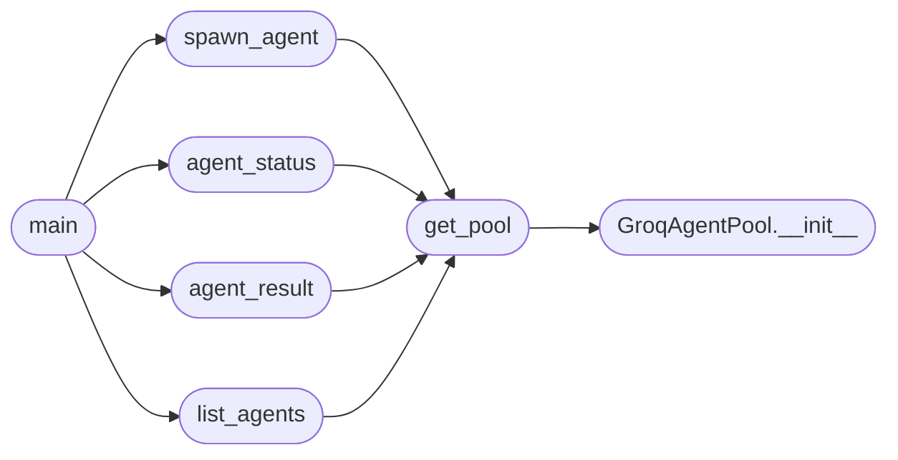

# `skills.lazyown_groq_agents`

> Source: [skills/lazyown_groq_agents.py:1](../../skills/lazyown_groq_agents.py#L1) | language `py` | coverage 30.8% | [API index](../index.md)

skills/lazyown_groq_agents.py ============================== Translates LazyOwn MCP tools into Groq-native tool-calling format and provides a multi-agent pool for parallel autonomous operation.

Three layers:
  GroqToolRegistry  -- 18 LazyOwn-aware sync callables with Groq-compatible schemas
  GroqAgentPool     -- thread pool that runs LLMBridge agents concurrently
  Public API        -- spawn_agent / agent_status / agent_result / list_agents

Each agent has access to: run_command, bridge_suggest, bridge_catalog,
parquet_context, facts_show, cve_lookup, memory_search, session_status,
read_session_file, list_sessions, c2_status, c2_command, task_list, task_add,
inject_objective, reactive_suggest, searchsploit, command_help.

Usage from MCP:
  lazyown_groq_agent(goal="Enumerate AD on 10.10.11.78")
  lazyown_groq_agent(goal="Kerberoast and crack hashes", backend="groq", async_mode=True)

Usage standalone:
  python3 skills/lazyown_groq_agents.py spawn "Enumerate SMB on 10.0.0.5" --wait
  python3 skills/lazyown_groq_agents.py tools
  python3 skills/lazyown_groq_agents.py list

## Contents

- **Classes:** [`GroqAgentPool`](#groqagentpool)
- **Functions:** [`get_pool`](#get_pool), [`spawn_agent`](#spawn_agent), [`agent_status`](#agent_status), [`agent_result`](#agent_result), [`list_agents`](#list_agents), [`main`](#main)
- **Constants:** [`SKILLS_DIR`](#skills_dir), [`LAZYOWN_DIR`](#lazyown_dir), [`SESSIONS_DIR`](#sessions_dir), [`PAYLOAD_FILE`](#payload_file), [`REGISTRY`](#registry)

## Call Graph

Solid arrows stay in this module, dashed arrows leave it.



## Classes

<a id="groqagentpool"></a>

### `GroqAgentPool`

`class` | [skills/lazyown_groq_agents.py:699](../../skills/lazyown_groq_agents.py#L699)

```python
class GroqAgentPool
```

Thread-pool-based manager for concurrent Groq/Ollama agents.

**Members**

| Member | Kind | Summary |
|---|---|---|
| [`__init__`](#groqagentpool-__init__) | constructor |  |
| [`spawn`](#groqagentpool-spawn) | method | Spawn a new agent. |
| [`status`](#groqagentpool-status) | method |  |
| [`result`](#groqagentpool-result) | method |  |
| [`list_all`](#groqagentpool-list_all) | method |  |

<a id="groqagentpool-__init__"></a>

#### `GroqAgentPool.__init__`

`constructor` | [skills/lazyown_groq_agents.py:702](../../skills/lazyown_groq_agents.py#L702)

```python
def __init__(self) -> None
```

*Called by:* [`get_pool`](#get_pool)

<a id="groqagentpool-spawn"></a>

#### `GroqAgentPool.spawn`

`method` | [skills/lazyown_groq_agents.py:706](../../skills/lazyown_groq_agents.py#L706)

```python
def spawn(self, goal: str, tools_filter: list[str] | None = None, api_key: str | None = None, backend: str = 'groq', max_iterations: int = 8, system_prompt: str = '', block: bool = False) -> str
```

Spawn a new agent.

Returns agent_id immediately. If block=True, waits for completion before returning.

**Parameters**

| Name | Type | Default | Description |
|---|---|---|---|
| `goal` | `str` |  |  |
| `tools_filter` | `list[str] \| None` | `None` |  |
| `api_key` | `str \| None` | `None` |  |
| `backend` | `str` | `'groq'` |  |
| `max_iterations` | `int` | `8` |  |
| `system_prompt` | `str` | `''` |  |
| `block` | `bool` | `False` |  |

**Returns:** `str`

<a id="groqagentpool-status"></a>

#### `GroqAgentPool.status`

`method` | [skills/lazyown_groq_agents.py:778](../../skills/lazyown_groq_agents.py#L778)

```python
def status(self, agent_id: str) -> dict[str, Any]
```

**Parameters**

| Name | Type | Default | Description |
|---|---|---|---|
| `agent_id` | `str` |  |  |

**Returns:** `dict[str, Any]`

<a id="groqagentpool-result"></a>

#### `GroqAgentPool.result`

`method` | [skills/lazyown_groq_agents.py:794](../../skills/lazyown_groq_agents.py#L794)

```python
def result(self, agent_id: str) -> str
```

**Parameters**

| Name | Type | Default | Description |
|---|---|---|---|
| `agent_id` | `str` |  |  |

**Returns:** `str`

<a id="groqagentpool-list_all"></a>

#### `GroqAgentPool.list_all`

`method` | [skills/lazyown_groq_agents.py:807](../../skills/lazyown_groq_agents.py#L807)

```python
def list_all(self, limit: int = 20) -> list[dict[str, Any]]
```

**Parameters**

| Name | Type | Default | Description |
|---|---|---|---|
| `limit` | `int` | `20` |  |

**Returns:** `list[dict[str, Any]]`

---

## Functions

<a id="get_pool"></a>

### `get_pool`

`function` | [skills/lazyown_groq_agents.py:829](../../skills/lazyown_groq_agents.py#L829)

```python
def get_pool() -> GroqAgentPool
```

**Returns:** `GroqAgentPool`

*Calls:* [`GroqAgentPool.__init__`](#groqagentpool-__init__)

*Called by:* [`agent_result`](#agent_result), [`agent_status`](#agent_status), [`list_agents`](#list_agents), [`spawn_agent`](#spawn_agent)

---

<a id="spawn_agent"></a>

### `spawn_agent`

`function` | [skills/lazyown_groq_agents.py:838](../../skills/lazyown_groq_agents.py#L838)

```python
def spawn_agent(goal: str, tools_filter: list[str] | None = None, api_key: str | None = None, backend: str = 'groq', max_iterations: int = 8, block: bool = False) -> str
```

Spawn a new Groq/Ollama agent.

Returns agent_id.

**Parameters**

| Name | Type | Default | Description |
|---|---|---|---|
| `goal` | `str` |  |  |
| `tools_filter` | `list[str] \| None` | `None` |  |
| `api_key` | `str \| None` | `None` |  |
| `backend` | `str` | `'groq'` |  |
| `max_iterations` | `int` | `8` |  |
| `block` | `bool` | `False` |  |

**Returns:** `str`

*Calls:* [`get_pool`](#get_pool)

*Called by:* [`main`](#main)

---

<a id="agent_status"></a>

### `agent_status`

`function` | [skills/lazyown_groq_agents.py:857](../../skills/lazyown_groq_agents.py#L857)

```python
def agent_status(agent_id: str) -> dict[str, Any]
```

**Parameters**

| Name | Type | Default | Description |
|---|---|---|---|
| `agent_id` | `str` |  |  |

**Returns:** `dict[str, Any]`

*Calls:* [`get_pool`](#get_pool)

*Called by:* [`main`](#main)

---

<a id="agent_result"></a>

### `agent_result`

`function` | [skills/lazyown_groq_agents.py:861](../../skills/lazyown_groq_agents.py#L861)

```python
def agent_result(agent_id: str) -> str
```

**Parameters**

| Name | Type | Default | Description |
|---|---|---|---|
| `agent_id` | `str` |  |  |

**Returns:** `str`

*Calls:* [`get_pool`](#get_pool)

*Called by:* [`main`](#main)

---

<a id="list_agents"></a>

### `list_agents`

`function` | [skills/lazyown_groq_agents.py:865](../../skills/lazyown_groq_agents.py#L865)

```python
def list_agents(limit: int = 20) -> list[dict[str, Any]]
```

**Parameters**

| Name | Type | Default | Description |
|---|---|---|---|
| `limit` | `int` | `20` |  |

**Returns:** `list[dict[str, Any]]`

*Calls:* [`get_pool`](#get_pool)

*Called by:* [`main`](#main)

---

<a id="main"></a>

### `main`

`function` | [skills/lazyown_groq_agents.py:872](../../skills/lazyown_groq_agents.py#L872)

```python
def main() -> None
```

*Calls:* [`agent_result`](#agent_result), [`agent_status`](#agent_status), [`list_agents`](#list_agents), [`spawn_agent`](#spawn_agent)

---

## Constants

<a id="skills_dir"></a>

### `SKILLS_DIR`

`constant` | [skills/lazyown_groq_agents.py:44](../../skills/lazyown_groq_agents.py#L44)

```python
SKILLS_DIR = Path(__file__).parent
```

---

<a id="lazyown_dir"></a>

### `LAZYOWN_DIR`

`constant` | [skills/lazyown_groq_agents.py:45](../../skills/lazyown_groq_agents.py#L45)

```python
LAZYOWN_DIR = SKILLS_DIR.parent
```

---

<a id="sessions_dir"></a>

### `SESSIONS_DIR`

`constant` | [skills/lazyown_groq_agents.py:46](../../skills/lazyown_groq_agents.py#L46)

```python
SESSIONS_DIR = LAZYOWN_DIR / 'sessions'
```

---

<a id="payload_file"></a>

### `PAYLOAD_FILE`

`constant` | [skills/lazyown_groq_agents.py:47](../../skills/lazyown_groq_agents.py#L47)

```python
PAYLOAD_FILE = LAZYOWN_DIR / 'payload.json'
```

---

<a id="registry"></a>

### `REGISTRY`

`constant` | [skills/lazyown_groq_agents.py:490](../../skills/lazyown_groq_agents.py#L490)

```python
REGISTRY: dict[str, tuple[str, dict[str, Any], Callable]]
```

---
