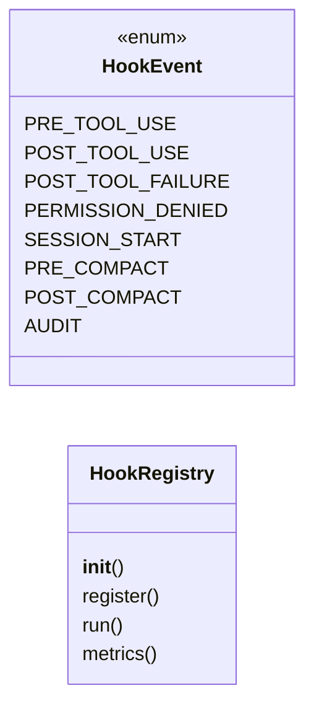
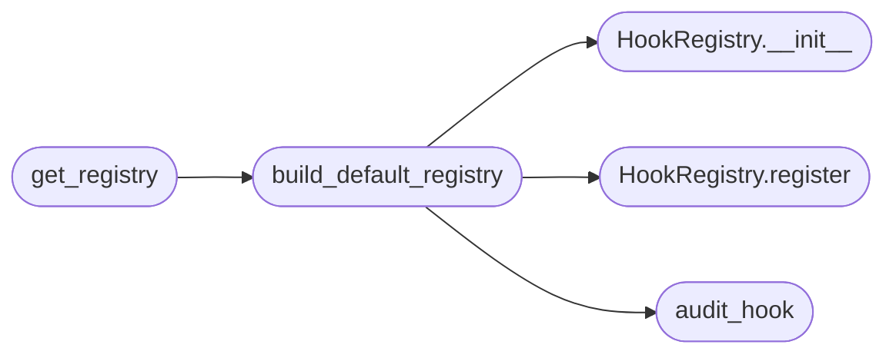

# `skills.lazyown_hooks`

> Source: [skills/lazyown_hooks.py:1](../../skills/lazyown_hooks.py#L1) | language `py` | coverage 71.4% | [API index](../index.md)

LazyOwn Hook Pipeline (Claude Code style)

8 lifecycle events with chainable handlers.
Hooks can block execution (return "deny" context) or enrich results.

Events:
  pre_tool_use       → can deny/modify before dispatch
  post_tool_use      → can enrich/log after success
  post_tool_failure  → runs after exception
  permission_denied  → runs when permission gate blocks a tool
  session_start      → runs once on MCP init
  pre_compact        → runs before context compaction
  post_compact       → runs after compaction
  audit              → runs on every tool call (logging only)

## Contents

- **Classes:** [`HookRegistry`](#hookregistry)
- **Enums:** [`HookEvent`](#hookevent)
- **Functions:** [`sandbox_hook`](#sandbox_hook), [`rate_limit_hook`](#rate_limit_hook), [`audit_hook`](#audit_hook), [`timing_hook`](#timing_hook), [`start_timer_hook`](#start_timer_hook), [`build_default_registry`](#build_default_registry), [`get_registry`](#get_registry)

## Type Diagram



## Call Graph

Solid arrows stay in this module, dashed arrows leave it.



## Classes

<a id="hookregistry"></a>

### `HookRegistry`

`class` | [skills/lazyown_hooks.py:38](../../skills/lazyown_hooks.py#L38)

```python
class HookRegistry
```

Chainable hook system.

Each handler receives a context dict and returns an (optionally modified)
context dict. Returning None leaves the context unchanged.
Setting context["_block"] = True in a pre_tool_use hook denies execution.

**Members**

| Member | Kind | Summary |
|---|---|---|
| [`__init__`](#hookregistry-__init__) | constructor |  |
| [`register`](#hookregistry-register) | method |  |
| [`run`](#hookregistry-run) | method | Run all handlers for event, chaining modified contexts. |
| [`metrics`](#hookregistry-metrics) | method | Return aggregate hook execution counts. |

<a id="hookregistry-__init__"></a>

#### `HookRegistry.__init__`

`constructor` | [skills/lazyown_hooks.py:47](../../skills/lazyown_hooks.py#L47)

```python
def __init__(self)
```

*Called by:* [`build_default_registry`](#build_default_registry)

<a id="hookregistry-register"></a>

#### `HookRegistry.register`

`method` | [skills/lazyown_hooks.py:56](../../skills/lazyown_hooks.py#L56)

```python
def register(self, event: HookEvent, handler: Callable) -> None
```

**Parameters**

| Name | Type | Default | Description |
|---|---|---|---|
| `event` | `HookEvent` |  |  |
| `handler` | `Callable` |  |  |

*Called by:* [`build_default_registry`](#build_default_registry)

<a id="hookregistry-run"></a>

#### `HookRegistry.run`

`method` | [skills/lazyown_hooks.py:59](../../skills/lazyown_hooks.py#L59)

```python
def run(self, event: HookEvent, context: dict) -> dict
```

Run all handlers for event, chaining modified contexts.

**Parameters**

| Name | Type | Default | Description |
|---|---|---|---|
| `event` | `HookEvent` |  |  |
| `context` | `dict` |  |  |

**Returns:** `dict`

<a id="hookregistry-metrics"></a>

#### `HookRegistry.metrics`

`method` | [skills/lazyown_hooks.py:79](../../skills/lazyown_hooks.py#L79)

```python
def metrics(self) -> dict
```

Return aggregate hook execution counts.

**Returns:** `dict`

---

## Enums

<a id="hookevent"></a>

### `HookEvent`

`enum` | [skills/lazyown_hooks.py:27](../../skills/lazyown_hooks.py#L27)

```python
class HookEvent(Enum)
```

Bases: `Enum`

**Attributes**

| Name | Type | Default | Description |
|---|---|---|---|
| [`PRE_TOOL_USE`](#hookevent-pre_tool_use) |  | `'pre_tool_use'` |  |
| [`POST_TOOL_USE`](#hookevent-post_tool_use) |  | `'post_tool_use'` |  |
| [`POST_TOOL_FAILURE`](#hookevent-post_tool_failure) |  | `'post_tool_failure'` |  |
| [`PERMISSION_DENIED`](#hookevent-permission_denied) |  | `'permission_denied'` |  |
| [`SESSION_START`](#hookevent-session_start) |  | `'session_start'` |  |
| [`PRE_COMPACT`](#hookevent-pre_compact) |  | `'pre_compact'` |  |
| [`POST_COMPACT`](#hookevent-post_compact) |  | `'post_compact'` |  |
| [`AUDIT`](#hookevent-audit) |  | `'audit'` |  |

---

## Functions

<a id="sandbox_hook"></a>

### `sandbox_hook`

`function` | [skills/lazyown_hooks.py:101](../../skills/lazyown_hooks.py#L101)

```python
def sandbox_hook(context: dict) -> dict
```

PRE_TOOL_USE: block catastrophic shell commands before permission evaluation.

Acts as a last-resort safety net independent of the permission system.

**Parameters**

| Name | Type | Default | Description |
|---|---|---|---|
| `context` | `dict` |  |  |

**Returns:** `dict`

---

<a id="rate_limit_hook"></a>

### `rate_limit_hook`

`function` | [skills/lazyown_hooks.py:116](../../skills/lazyown_hooks.py#L116)

```python
def rate_limit_hook(context: dict, window: float = 2.0, limit: int = 5) -> dict
```

PRE_TOOL_USE: prevent rapid-fire C2 commands (>5 per 2s).

Protects against runaway agent loops.

**Parameters**

| Name | Type | Default | Description |
|---|---|---|---|
| `context` | `dict` |  |  |
| `window` | `float` | `2.0` |  |
| `limit` | `int` | `5` |  |

**Returns:** `dict`

---

<a id="audit_hook"></a>

### `audit_hook`

`function` | [skills/lazyown_hooks.py:139](../../skills/lazyown_hooks.py#L139)

```python
def audit_hook(context: dict, audit_path: Path | None = None) -> dict
```

AUDIT: append a one-line JSON record of every tool call to the audit log.

Non-blocking — errors are silently swallowed.

**Parameters**

| Name | Type | Default | Description |
|---|---|---|---|
| `context` | `dict` |  |  |
| `audit_path` | `Path \| None` | `None` |  |

**Returns:** `dict`

*Called by:* [`build_default_registry`](#build_default_registry)

---

<a id="timing_hook"></a>

### `timing_hook`

`function` | [skills/lazyown_hooks.py:161](../../skills/lazyown_hooks.py#L161)

```python
def timing_hook(context: dict) -> dict
```

POST_TOOL_USE: annotate result with wall-clock execution time.

Reads _start_time set by pre_tool_use in the same call.

**Parameters**

| Name | Type | Default | Description |
|---|---|---|---|
| `context` | `dict` |  |  |

**Returns:** `dict`

---

<a id="start_timer_hook"></a>

### `start_timer_hook`

`function` | [skills/lazyown_hooks.py:176](../../skills/lazyown_hooks.py#L176)

```python
def start_timer_hook(context: dict) -> dict
```

PRE_TOOL_USE: record start time for timing_hook.

**Parameters**

| Name | Type | Default | Description |
|---|---|---|---|
| `context` | `dict` |  |  |

**Returns:** `dict`

---

<a id="build_default_registry"></a>

### `build_default_registry`

`function` | [skills/lazyown_hooks.py:187](../../skills/lazyown_hooks.py#L187)

```python
def build_default_registry(sessions_dir: Path | None = None) -> HookRegistry
```

Create a HookRegistry with the built-in safety hooks wired up.

Call this once and keep the singleton.

**Parameters**

| Name | Type | Default | Description |
|---|---|---|---|
| `sessions_dir` | `Path \| None` | `None` |  |

**Returns:** `HookRegistry`

*Calls:* [`HookRegistry.__init__`](#hookregistry-__init__), [`HookRegistry.register`](#hookregistry-register), [`audit_hook`](#audit_hook)

*Called by:* [`get_registry`](#get_registry)

---

<a id="get_registry"></a>

### `get_registry`

`function` | [skills/lazyown_hooks.py:224](../../skills/lazyown_hooks.py#L224)

```python
def get_registry(sessions_dir: Path | None = None) -> HookRegistry
```

**Parameters**

| Name | Type | Default | Description |
|---|---|---|---|
| `sessions_dir` | `Path \| None` | `None` |  |

**Returns:** `HookRegistry`

*Calls:* [`build_default_registry`](#build_default_registry)

---
