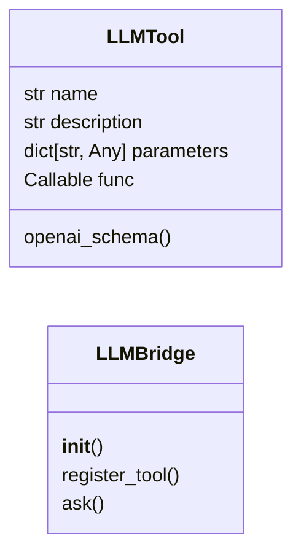
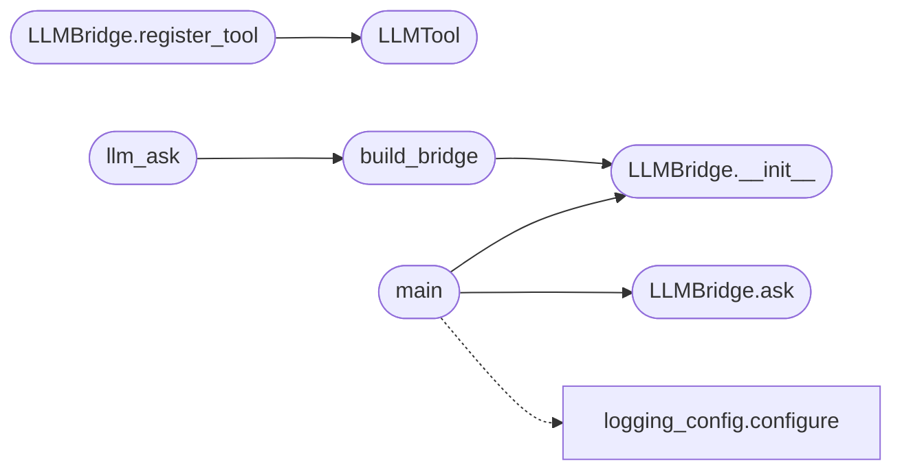

# `skills.lazyown_llm`

> Source: [skills/lazyown_llm.py:1](../../skills/lazyown_llm.py#L1) | language `py` | coverage 50.0% | [API index](../index.md)

LazyOwn LLM Bridge — MCP Edition ================================= Unified satellite-model interface for lazyown_mcp.py.

Backends:
  groq    — Groq API (llama-3.3-70b / llama-3.1-8b).
            Native tool calling via OpenAI-compatible API.
  ollama  — Local Ollama.  deepseek-r1:1.5b has NO native tool calling.
            Bridge implements ReAct (Reason + Act) via prompt engineering:
            the model emits Thought/Action/Action Input/Observation turns
            that are parsed and executed here, then fed back.

Design:
  - Zero Flask dependency — pure stdlib + optional groq SDK + requests
  - Single LLMBridge class owns the tool registry
  - Both backends share the same tool registry (name → callable)
  - Groq path: native tool_calls JSON from API → execute → assistant turn
  - Ollama path: ReAct text loop → regex parse → execute → inject Observation
  - deepseek-r1 wraps reasoning in <think>…</think>; those are stripped before
    parsing so the Action line is always visible to the parser
  - All tool outputs are truncated to MAX_TOOL_OUTPUT chars (context safety)

MCP usage:
  lazyown_llm_ask(goal="…", backend="groq", max_iterations=6)
  lazyown_llm_ask(goal="…", backend="ollama")

CLI usage:
  python3 skills/lazyown_llm.py ask "Enumerate SMB on 127.0.0.1" --backend groq
  python3 skills/lazyown_llm.py ask "What ports are open on 127.0.0.1?" --backend ollama

## Contents

- **Classes:** [`LLMTool`](#llmtool), [`LLMBridge`](#llmbridge)
- **Functions:** [`build_bridge`](#build_bridge), [`llm_ask`](#llm_ask), [`main`](#main)
- **Constants:** [`GROQ_API_URL`](#groq_api_url), [`GROQ_DEFAULT_MODEL`](#groq_default_model), [`GROQ_FAST_MODEL`](#groq_fast_model), [`OLLAMA_HOST`](#ollama_host), [`OLLAMA_PORT`](#ollama_port), [`OLLAMA_DEFAULT_MODEL`](#ollama_default_model), [`MAX_TOOL_OUTPUT`](#max_tool_output), [`MAX_ITERATIONS`](#max_iterations), [`HTTP_TIMEOUT`](#http_timeout), [`BASE_DIR`](#base_dir), [`SESSIONS_DIR`](#sessions_dir)

## Type Diagram



## Call Graph

Solid arrows stay in this module, dashed arrows leave it.



## Classes

<a id="llmtool"></a>

### `LLMTool`

`class` `dataclass` | [skills/lazyown_llm.py:71](../../skills/lazyown_llm.py#L71)

Decorators: `@dataclass`

```python
class LLMTool
```

A callable tool available to the satellite model.

**Attributes**

| Name | Type | Default | Description |
|---|---|---|---|
| [`name`](#llmtool-name) | `str` |  |  |
| [`description`](#llmtool-description) | `str` |  |  |
| [`parameters`](#llmtool-parameters) | `dict[str, Any]` |  |  |
| [`func`](#llmtool-func) | `Callable` |  |  |

**Members**

| Member | Kind | Summary |
|---|---|---|
| [`openai_schema`](#llmtool-openai_schema) | method |  |

<a id="llmtool-openai_schema"></a>

#### `LLMTool.openai_schema`

`method` | [skills/lazyown_llm.py:79](../../skills/lazyown_llm.py#L79)

```python
def openai_schema(self) -> dict
```

**Returns:** `dict`

---

<a id="llmbridge"></a>

### `LLMBridge`

`class` | [skills/lazyown_llm.py:97](../../skills/lazyown_llm.py#L97)

```python
class LLMBridge
```

Unified bridge to Groq (native tool calling) and local Ollama (ReAct).

Register tools once, then call ask().  Both backends execute the same tools.

**Members**

| Member | Kind | Summary |
|---|---|---|
| [`__init__`](#llmbridge-__init__) | constructor |  |
| [`register_tool`](#llmbridge-register_tool) | method |  |
| [`ask`](#llmbridge-ask) | method |  |

<a id="llmbridge-__init__"></a>

#### `LLMBridge.__init__`

`constructor` | [skills/lazyown_llm.py:104](../../skills/lazyown_llm.py#L104)

```python
def __init__(self, backend: str = 'groq', model: str | None = None, api_key: str | None = None) -> None
```

**Parameters**

| Name | Type | Default | Description |
|---|---|---|---|
| `backend` | `str` | `'groq'` |  |
| `model` | `str \| None` | `None` |  |
| `api_key` | `str \| None` | `None` |  |

*Called by:* [`build_bridge`](#build_bridge), [`main`](#main)

<a id="llmbridge-register_tool"></a>

#### `LLMBridge.register_tool`

`method` | [skills/lazyown_llm.py:118](../../skills/lazyown_llm.py#L118)

```python
def register_tool(self, name: str, description: str, parameters: dict[str, Any], func: Callable) -> None
```

**Parameters**

| Name | Type | Default | Description |
|---|---|---|---|
| `name` | `str` |  |  |
| `description` | `str` |  |  |
| `parameters` | `dict[str, Any]` |  |  |
| `func` | `Callable` |  |  |

*Calls:* [`LLMTool`](#llmtool)

<a id="llmbridge-ask"></a>

#### `LLMBridge.ask`

`method` | [skills/lazyown_llm.py:127](../../skills/lazyown_llm.py#L127)

```python
def ask(self, goal: str, context: str = '', max_iterations: int = MAX_ITERATIONS, system_prompt: str = '') -> str
```

**Parameters**

| Name | Type | Default | Description |
|---|---|---|---|
| `goal` | `str` |  |  |
| `context` | `str` | `''` |  |
| `max_iterations` | `int` | `MAX_ITERATIONS` |  |
| `system_prompt` | `str` | `''` |  |

**Returns:** `str`

*Called by:* [`main`](#main)

---

## Functions

<a id="build_bridge"></a>

### `build_bridge`

`function` | [skills/lazyown_llm.py:438](../../skills/lazyown_llm.py#L438)

```python
def build_bridge(backend: str = 'groq', model: str | None = None, api_key: str | None = None, with_default_tools: bool = True) -> LLMBridge
```

Create a ready-to-use LLMBridge with optional default LazyOwn tools.

Called by lazyown_mcp.py for the lazyown_llm_ask handler.

**Parameters**

| Name | Type | Default | Description |
|---|---|---|---|
| `backend` | `str` | `'groq'` |  |
| `model` | `str \| None` | `None` |  |
| `api_key` | `str \| None` | `None` |  |
| `with_default_tools` | `bool` | `True` |  |

**Returns:** `LLMBridge`

*Calls:* [`LLMBridge.__init__`](#llmbridge-__init__)

*Called by:* [`llm_ask`](#llm_ask)

---

<a id="llm_ask"></a>

### `llm_ask`

`function` | [skills/lazyown_llm.py:468](../../skills/lazyown_llm.py#L468)

```python
def llm_ask(goal: str, context: str = '', backend: str = 'groq', model: str | None = None, api_key: str | None = None, max_iterations: int = MAX_ITERATIONS, system_prompt: str = '', extra_tools: dict[str, Callable] | None = None) -> str
```

Single-call entry point for lazyown_mcp.py.

extra_tools: {name: (description, parameters_dict, callable)}

**Parameters**

| Name | Type | Default | Description |
|---|---|---|---|
| `goal` | `str` |  |  |
| `context` | `str` | `''` |  |
| `backend` | `str` | `'groq'` |  |
| `model` | `str \| None` | `None` |  |
| `api_key` | `str \| None` | `None` |  |
| `max_iterations` | `int` | `MAX_ITERATIONS` |  |
| `system_prompt` | `str` | `''` |  |
| `extra_tools` | `dict[str, Callable] \| None` | `None` |  |

**Returns:** `str`

*Calls:* [`build_bridge`](#build_bridge)

---

<a id="main"></a>

### `main`

`function` | [skills/lazyown_llm.py:493](../../skills/lazyown_llm.py#L493)

```python
def main() -> None
```

*Calls:* [`configure`](modules.logging_config.py.md#configure), [`LLMBridge.__init__`](#llmbridge-__init__), [`LLMBridge.ask`](#llmbridge-ask)

---

## Constants

<a id="groq_api_url"></a>

### `GROQ_API_URL`

`constant` | [skills/lazyown_llm.py:50](../../skills/lazyown_llm.py#L50)

```python
GROQ_API_URL = 'https://api.groq.com/openai/v1/chat/completions'
```

---

<a id="groq_default_model"></a>

### `GROQ_DEFAULT_MODEL`

`constant` | [skills/lazyown_llm.py:51](../../skills/lazyown_llm.py#L51)

```python
GROQ_DEFAULT_MODEL = 'llama-3.3-70b-versatile'
```

---

<a id="groq_fast_model"></a>

### `GROQ_FAST_MODEL`

`constant` | [skills/lazyown_llm.py:52](../../skills/lazyown_llm.py#L52)

```python
GROQ_FAST_MODEL = 'llama-3.1-8b-instant'
```

---

<a id="ollama_host"></a>

### `OLLAMA_HOST`

`constant` | [skills/lazyown_llm.py:54](../../skills/lazyown_llm.py#L54)

```python
OLLAMA_HOST = os.environ.get('OLLAMA_HOST', '127.0.0.1')
```

---

<a id="ollama_port"></a>

### `OLLAMA_PORT`

`constant` | [skills/lazyown_llm.py:55](../../skills/lazyown_llm.py#L55)

```python
OLLAMA_PORT = int(os.environ.get('OLLAMA_PORT', '11434'))
```

---

<a id="ollama_default_model"></a>

### `OLLAMA_DEFAULT_MODEL`

`constant` | [skills/lazyown_llm.py:56](../../skills/lazyown_llm.py#L56)

```python
OLLAMA_DEFAULT_MODEL = os.environ.get('OLLAMA_DEFAULT_MODEL', 'deepseek-r1:1.5b')
```

---

<a id="max_tool_output"></a>

### `MAX_TOOL_OUTPUT`

`constant` | [skills/lazyown_llm.py:58](../../skills/lazyown_llm.py#L58)

```python
MAX_TOOL_OUTPUT = int(os.environ.get('LLM_MAX_TOOL_OUTPUT', '3000'))
```

---

<a id="max_iterations"></a>

### `MAX_ITERATIONS`

`constant` | [skills/lazyown_llm.py:59](../../skills/lazyown_llm.py#L59)

```python
MAX_ITERATIONS = int(os.environ.get('LLM_MAX_ITERATIONS', '8'))
```

---

<a id="http_timeout"></a>

### `HTTP_TIMEOUT`

`constant` | [skills/lazyown_llm.py:60](../../skills/lazyown_llm.py#L60)

```python
HTTP_TIMEOUT = int(os.environ.get('LLM_HTTP_TIMEOUT', '90'))
```

---

<a id="base_dir"></a>

### `BASE_DIR`

`constant` | [skills/lazyown_llm.py:62](../../skills/lazyown_llm.py#L62)

```python
BASE_DIR = Path(__file__).parent.parent
```

---

<a id="sessions_dir"></a>

### `SESSIONS_DIR`

`constant` | [skills/lazyown_llm.py:63](../../skills/lazyown_llm.py#L63)

```python
SESSIONS_DIR = BASE_DIR / 'sessions'
```

---
