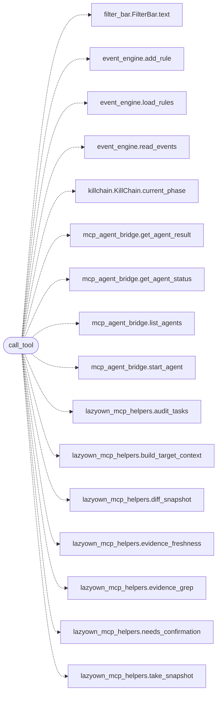

# `skills.lazyown_mcp`

> Source: [skills/lazyown_mcp.py:1](../../skills/lazyown_mcp.py#L1) | language `py` | coverage 50.0% | [API index](../index.md)

LazyOwn MCP Server Exposes LazyOwn framework capabilities as MCP tools for Claude Code and Claude web.

Usage:
    python3 skills/lazyown_mcp.py

Configuration via environment variables:
    LAZYOWN_DIR      - Path to LazyOwn directory (default: parent of this file)
    LAZYOWN_C2_HOST  - C2 server host (default: from payload.json)
    LAZYOWN_C2_PORT  - C2 server port (default: from payload.json)
    LAZYOWN_C2_USER  - C2 username (default: from payload.json)
    LAZYOWN_C2_PASS  - C2 password (default: from payload.json)

## Contents

- **Functions:** [`register_handler`](#register_handler), [`list_tools`](#list_tools), [`substitute_playbook_target`](#substitute_playbook_target), [`call_tool`](#call_tool), [`main`](#main)
- **Constants:** [`SKILLS_DIR`](#skills_dir), [`LAZYOWN_DIR`](#lazyown_dir), [`PAYLOAD_FILE`](#payload_file), [`SESSIONS_DIR`](#sessions_dir), [`BASE_DIR`](#base_dir), [`MODULES_DIR`](#modules_dir), [`REA_BINARY`](#rea_binary), [`REA_TIMEOUT_DEFAULT`](#rea_timeout_default), [`REA_TIMEOUT_MAX`](#rea_timeout_max), [`REA_OUTPUT_LIMIT`](#rea_output_limit), [`REA_SUPPORTED_ACTIONS`](#rea_supported_actions), [`REA_TARGET_ACTIONS`](#rea_target_actions), [`REA_ADDRESS_ACTIONS`](#rea_address_actions), [`REA_QUERY_ACTIONS`](#rea_query_actions), [`REA_PROVIDERS`](#rea_providers)

## Call Graph

Solid arrows stay in this module, dashed arrows leave it.



## Functions

<a id="register_handler"></a>

### `register_handler`

`function` | [skills/lazyown_mcp.py:578](../../skills/lazyown_mcp.py#L578)

```python
def register_handler(tool_name: str)
```

Decorator that registers an async handler for *tool_name*.

The decorated function receives ``(arguments: dict, tool_name: str)``
and must return ``list[types.TextContent]``.

**Parameters**

| Name | Type | Default | Description |
|---|---|---|---|
| `tool_name` | `str` |  |  |

---

<a id="list_tools"></a>

### `list_tools`

`function` `async` | [skills/lazyown_mcp.py:1994](../../skills/lazyown_mcp.py#L1994)

Decorators: `@server.list_tools()`

```python
async def list_tools() -> list[types.Tool]
```

**Returns:** `list[types.Tool]`

---

<a id="substitute_playbook_target"></a>

### `substitute_playbook_target`

`function` | [skills/lazyown_mcp.py:6075](../../skills/lazyown_mcp.py#L6075)

```python
def substitute_playbook_target(command: str, target: str) -> str
```

Substitute the {target} token in a playbook step command.

The value is shell-quoted so metacharacters in the target cannot break
out of the step command. Step template syntax (pipes, redirects) is
preserved because only the substituted value is quoted.

**Parameters**

| Name | Type | Default | Description |
|---|---|---|---|
| `command` | `str` |  | Step command template containing {target}. |
| `target` | `str` |  | Target value to substitute. |

**Returns:** `str` - Command with the quoted target in place of the token.

---

<a id="call_tool"></a>

### `call_tool`

`function` `async` | [skills/lazyown_mcp.py:6093](../../skills/lazyown_mcp.py#L6093)

Decorators: `@server.call_tool()`

```python
async def call_tool(name: str, arguments: dict[str, Any]) -> list[types.TextContent]
```

**Parameters**

| Name | Type | Default | Description |
|---|---|---|---|
| `name` | `str` |  |  |
| `arguments` | `dict[str, Any]` |  |  |

**Returns:** `list[types.TextContent]`

*Calls:* [`FilterBar.text`](lazygui.widgets.filter_bar.py.md#filterbar-text), [`add_rule`](modules.event_engine.py.md#add_rule), [`load_rules`](modules.event_engine.py.md#load_rules), [`read_events`](modules.event_engine.py.md#read_events), [`KillChain.current_phase`](modules.killchain.py.md#killchain-current_phase), [`get_agent_result`](modules.mcp_agent_bridge.py.md#get_agent_result), [`get_agent_status`](modules.mcp_agent_bridge.py.md#get_agent_status), [`list_agents`](modules.mcp_agent_bridge.py.md#list_agents), [`start_agent`](modules.mcp_agent_bridge.py.md#start_agent), [`audit_tasks`](skills.lazyown_mcp_helpers.py.md#audit_tasks), [`build_target_context`](skills.lazyown_mcp_helpers.py.md#build_target_context), [`diff_snapshot`](skills.lazyown_mcp_helpers.py.md#diff_snapshot) and 4 more

---

<a id="main"></a>

### `main`

`function` `async` | [skills/lazyown_mcp.py:12272](../../skills/lazyown_mcp.py#L12272)

```python
async def main()
```

---

## Constants

<a id="skills_dir"></a>

### `SKILLS_DIR`

`constant` | [skills/lazyown_mcp.py:421](../../skills/lazyown_mcp.py#L421)

```python
SKILLS_DIR = Path(__file__).parent
```

---

<a id="lazyown_dir"></a>

### `LAZYOWN_DIR`

`constant` | [skills/lazyown_mcp.py:422](../../skills/lazyown_mcp.py#L422)

```python
LAZYOWN_DIR = Path(os.environ.get('LAZYOWN_DIR', str(SKILLS_DIR.parent)))
```

---

<a id="payload_file"></a>

### `PAYLOAD_FILE`

`constant` | [skills/lazyown_mcp.py:423](../../skills/lazyown_mcp.py#L423)

```python
PAYLOAD_FILE = LAZYOWN_DIR / 'payload.json'
```

---

<a id="sessions_dir"></a>

### `SESSIONS_DIR`

`constant` | [skills/lazyown_mcp.py:424](../../skills/lazyown_mcp.py#L424)

```python
SESSIONS_DIR = LAZYOWN_DIR / 'sessions'
```

---

<a id="base_dir"></a>

### `BASE_DIR`

`constant` | [skills/lazyown_mcp.py:425](../../skills/lazyown_mcp.py#L425)

```python
BASE_DIR = LAZYOWN_DIR
```

---

<a id="modules_dir"></a>

### `MODULES_DIR`

`constant` | [skills/lazyown_mcp.py:426](../../skills/lazyown_mcp.py#L426)

```python
MODULES_DIR = LAZYOWN_DIR / 'modules'
```

---

<a id="rea_binary"></a>

### `REA_BINARY`

`constant` | [skills/lazyown_mcp.py:946](../../skills/lazyown_mcp.py#L946)

```python
REA_BINARY = 'rea'
```

---

<a id="rea_timeout_default"></a>

### `REA_TIMEOUT_DEFAULT`

`constant` | [skills/lazyown_mcp.py:947](../../skills/lazyown_mcp.py#L947)

```python
REA_TIMEOUT_DEFAULT = 120
```

---

<a id="rea_timeout_max"></a>

### `REA_TIMEOUT_MAX`

`constant` | [skills/lazyown_mcp.py:948](../../skills/lazyown_mcp.py#L948)

```python
REA_TIMEOUT_MAX = 600
```

---

<a id="rea_output_limit"></a>

### `REA_OUTPUT_LIMIT`

`constant` | [skills/lazyown_mcp.py:949](../../skills/lazyown_mcp.py#L949)

```python
REA_OUTPUT_LIMIT = 8000
```

---

<a id="rea_supported_actions"></a>

### `REA_SUPPORTED_ACTIONS`

`constant` | [skills/lazyown_mcp.py:950](../../skills/lazyown_mcp.py#L950)

```python
REA_SUPPORTED_ACTIONS
```

---

<a id="rea_target_actions"></a>

### `REA_TARGET_ACTIONS`

`constant` | [skills/lazyown_mcp.py:965](../../skills/lazyown_mcp.py#L965)

```python
REA_TARGET_ACTIONS
```

---

<a id="rea_address_actions"></a>

### `REA_ADDRESS_ACTIONS`

`constant` | [skills/lazyown_mcp.py:977](../../skills/lazyown_mcp.py#L977)

```python
REA_ADDRESS_ACTIONS = frozenset({'function', 'xrefs', 'decompile'})
```

---

<a id="rea_query_actions"></a>

### `REA_QUERY_ACTIONS`

`constant` | [skills/lazyown_mcp.py:978](../../skills/lazyown_mcp.py#L978)

```python
REA_QUERY_ACTIONS = frozenset({'search', 'trace'})
```

---

<a id="rea_providers"></a>

### `REA_PROVIDERS`

`constant` | [skills/lazyown_mcp.py:979](../../skills/lazyown_mcp.py#L979)

```python
REA_PROVIDERS = frozenset({'auto', 'hopper', 'ghidra'})
```

---
