# `skills.lazyown_mcp`

> Source: [skills/lazyown_mcp.py:1](../../skills/lazyown_mcp.py#L1) | language `py` | coverage 50.0% | [API index](../index.md)

LazyOwn MCP Server Exposes LazyOwn framework capabilities as MCP tools for Claude Code and Claude web.

Usage:
    python3 skills/lazyown_mcp.py

Configuration via environment variables:
    LAZYOWN_DIR      - Path to LazyOwn directory (default: parent of this file)
    LAZYOWN_C2_HOST  - C2 server host (default: from payload.json)
    LAZYOWN_C2_PORT  - C2 server port (default: from payload.json)
    LAZYOWN_C2_USER  - C2 username (default: from payload.json)
    LAZYOWN_C2_PASS  - C2 password (default: from payload.json)

## Contents

- **Functions:** [`register_handler`](#register_handler), [`list_tools`](#list_tools), [`substitute_playbook_target`](#substitute_playbook_target), [`call_tool`](#call_tool), [`main`](#main)
- **Constants:** [`SKILLS_DIR`](#skills_dir), [`LAZYOWN_DIR`](#lazyown_dir), [`PAYLOAD_FILE`](#payload_file), [`SESSIONS_DIR`](#sessions_dir), [`BASE_DIR`](#base_dir), [`MODULES_DIR`](#modules_dir)

## Call Graph

Solid arrows stay in this module, dashed arrows leave it.

```mermaid
flowchart LR
    n_skills_lazyown_mcp_py__call_tool(["call_tool"])
    n_skills_lazyown_mcp_py__list_tools(["list_tools"])
    n_skills_lazyown_mcp_py__substitute_playbook_target(["substitute_playbook_target"])
    n_cli_recommendation_signals_py__build_context["recommendation_signals.build_context"]
    n_cli_recommendation_signals_py__build_default_engine["recommendation_signals.build_default_engine"]
    n_lazygui_widgets_filter_bar_py__FilterBar_text["filter_bar.FilterBar.text"]
    n_modules_killchain_py__KillChain_current_phase["killchain.KillChain.current_phase"]
    n_modules_mcp_agent_bridge_py__start_agent["mcp_agent_bridge.start_agent"]
    n_modules_playbook_engine_py__PlaybookEngine___init__["playbook_engine.PlaybookEngine.__init__"]
    n_modules_playbook_engine_py__PlaybookEngine_execute["playbook_engine.PlaybookEngine.execute"]
    n_modules_playbook_engine_py__PlaybookEngine_load["playbook_engine.PlaybookEngine.load"]
    n_modules_playbook_engine_py__PlaybookEngine_result_summary["playbook_engine.PlaybookEngine.result_summary"]
    n_skills_lazyown_mcp_helpers_py__evidence_freshness["lazyown_mcp_helpers.evidence_freshness"]
    n_skills_lazyown_mcp_helpers_py__needs_confirmation["lazyown_mcp_helpers.needs_confirmation"]
    n_skills_lazyown_mcp_helpers_py__take_snapshot["lazyown_mcp_helpers.take_snapshot"]
    n_skills_lazyown_session_py__SessionTranscript___init__["lazyown_session.SessionTranscript.__init__"]
    n_skills_lazyown_session_py__SessionTranscript_append["lazyown_session.SessionTranscript.append"]
    n_skills_lazyown_session_py__SessionTranscript_count["lazyown_session.SessionTranscript.count"]
    n_skills_lazyown_session_py__SessionTranscript_get_recent["lazyown_session.SessionTranscript.get_recent"]
    n_skills_lazyown_mcp_py__call_tool --> n_skills_lazyown_mcp_py__list_tools
    n_skills_lazyown_mcp_py__call_tool --> n_skills_lazyown_mcp_py__substitute_playbook_target
    n_skills_lazyown_mcp_py__call_tool -.-> n_cli_recommendation_signals_py__build_context
    n_skills_lazyown_mcp_py__call_tool -.-> n_cli_recommendation_signals_py__build_default_engine
    n_skills_lazyown_mcp_py__call_tool -.-> n_lazygui_widgets_filter_bar_py__FilterBar_text
    n_skills_lazyown_mcp_py__call_tool -.-> n_modules_killchain_py__KillChain_current_phase
    n_skills_lazyown_mcp_py__call_tool -.-> n_modules_mcp_agent_bridge_py__start_agent
    n_skills_lazyown_mcp_py__call_tool -.-> n_modules_playbook_engine_py__PlaybookEngine___init__
    n_skills_lazyown_mcp_py__call_tool -.-> n_modules_playbook_engine_py__PlaybookEngine_execute
    n_skills_lazyown_mcp_py__call_tool -.-> n_modules_playbook_engine_py__PlaybookEngine_load
    n_skills_lazyown_mcp_py__call_tool -.-> n_modules_playbook_engine_py__PlaybookEngine_result_summary
    n_skills_lazyown_mcp_py__call_tool -.-> n_skills_lazyown_mcp_helpers_py__evidence_freshness
    n_skills_lazyown_mcp_py__call_tool -.-> n_skills_lazyown_mcp_helpers_py__needs_confirmation
    n_skills_lazyown_mcp_py__call_tool -.-> n_skills_lazyown_mcp_helpers_py__take_snapshot
    n_skills_lazyown_mcp_py__call_tool -.-> n_skills_lazyown_session_py__SessionTranscript___init__
    n_skills_lazyown_mcp_py__call_tool -.-> n_skills_lazyown_session_py__SessionTranscript_append
    n_skills_lazyown_mcp_py__call_tool -.-> n_skills_lazyown_session_py__SessionTranscript_count
    n_skills_lazyown_mcp_py__call_tool -.-> n_skills_lazyown_session_py__SessionTranscript_get_recent
```



## Functions

<a id="register_handler"></a>

### `register_handler`

`function` | [skills/lazyown_mcp.py:604](../../skills/lazyown_mcp.py#L604)

```python
def register_handler(tool_name: str)
```

Decorator that registers an async handler for *tool_name*.

The decorated function receives ``(arguments: dict, tool_name: str)``
and must return ``list[types.TextContent]``.

**Parameters**

| Name | Type | Default | Description |
|---|---|---|---|
| `tool_name` | `str` |  |  |

---

<a id="list_tools"></a>

### `list_tools`

`function` `async` | [skills/lazyown_mcp.py:897](../../skills/lazyown_mcp.py#L897)

Decorators: `@server.list_tools()`

```python
async def list_tools() -> list[types.Tool]
```

**Returns:** `list[types.Tool]`

*Called by:* [`call_tool`](#call_tool)

---

<a id="substitute_playbook_target"></a>

### `substitute_playbook_target`

`function` | [skills/lazyown_mcp.py:1308](../../skills/lazyown_mcp.py#L1308)

```python
def substitute_playbook_target(command: str, target: str) -> str
```

Substitute the {target} token in a playbook step command.

The value is shell-quoted so metacharacters in the target cannot break
out of the step command. Step template syntax (pipes, redirects) is
preserved because only the substituted value is quoted.

**Parameters**

| Name | Type | Default | Description |
|---|---|---|---|
| `command` | `str` |  | Step command template containing {target}. |
| `target` | `str` |  | Target value to substitute. |

**Returns:** `str` - Command with the quoted target in place of the token.

*Called by:* [`call_tool`](#call_tool)

---

<a id="call_tool"></a>

### `call_tool`

`function` `async` | [skills/lazyown_mcp.py:1326](../../skills/lazyown_mcp.py#L1326)

Decorators: `@server.call_tool()`

```python
async def call_tool(name: str, arguments: dict[str, Any]) -> list[types.TextContent]
```

**Parameters**

| Name | Type | Default | Description |
|---|---|---|---|
| `name` | `str` |  |  |
| `arguments` | `dict[str, Any]` |  |  |

**Returns:** `list[types.TextContent]`

*Calls:* [`build_context`](cli.recommendation_signals.py.md#build_context), [`build_default_engine`](cli.recommendation_signals.py.md#build_default_engine), [`FilterBar.text`](lazygui.widgets.filter_bar.py.md#filterbar-text), [`KillChain.current_phase`](modules.killchain.py.md#killchain-current_phase), [`start_agent`](modules.mcp_agent_bridge.py.md#start_agent), [`PlaybookEngine.__init__`](modules.playbook_engine.py.md#playbookengine-__init__), [`PlaybookEngine.execute`](modules.playbook_engine.py.md#playbookengine-execute), [`PlaybookEngine.load`](modules.playbook_engine.py.md#playbookengine-load), [`PlaybookEngine.result_summary`](modules.playbook_engine.py.md#playbookengine-result_summary), [`list_tools`](#list_tools), [`substitute_playbook_target`](#substitute_playbook_target), [`evidence_freshness`](skills.lazyown_mcp_helpers.py.md#evidence_freshness) and 6 more

---

<a id="main"></a>

### `main`

`function` `async` | [skills/lazyown_mcp.py:2477](../../skills/lazyown_mcp.py#L2477)

```python
async def main()
```

---

## Constants

<a id="skills_dir"></a>

### `SKILLS_DIR`

`constant` | [skills/lazyown_mcp.py:428](../../skills/lazyown_mcp.py#L428)

```python
SKILLS_DIR = Path(__file__).parent
```

---

<a id="lazyown_dir"></a>

### `LAZYOWN_DIR`

`constant` | [skills/lazyown_mcp.py:429](../../skills/lazyown_mcp.py#L429)

```python
LAZYOWN_DIR = Path(os.environ.get('LAZYOWN_DIR', str(SKILLS_DIR.parent)))
```

---

<a id="payload_file"></a>

### `PAYLOAD_FILE`

`constant` | [skills/lazyown_mcp.py:430](../../skills/lazyown_mcp.py#L430)

```python
PAYLOAD_FILE = LAZYOWN_DIR / 'payload.json'
```

---

<a id="sessions_dir"></a>

### `SESSIONS_DIR`

`constant` | [skills/lazyown_mcp.py:431](../../skills/lazyown_mcp.py#L431)

```python
SESSIONS_DIR = LAZYOWN_DIR / 'sessions'
```

---

<a id="base_dir"></a>

### `BASE_DIR`

`constant` | [skills/lazyown_mcp.py:432](../../skills/lazyown_mcp.py#L432)

```python
BASE_DIR = LAZYOWN_DIR
```

---

<a id="modules_dir"></a>

### `MODULES_DIR`

`constant` | [skills/lazyown_mcp.py:433](../../skills/lazyown_mcp.py#L433)

```python
MODULES_DIR = LAZYOWN_DIR / 'modules'
```

---
