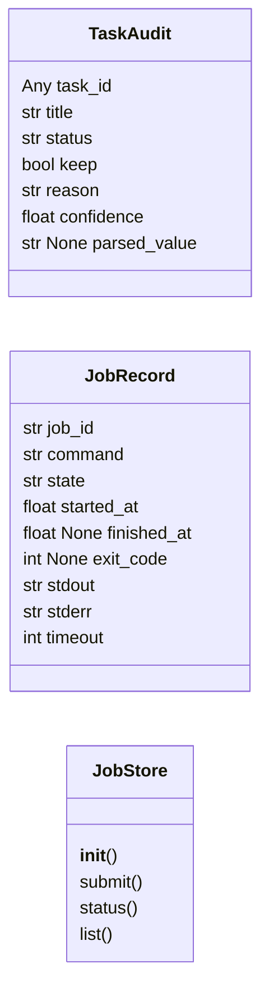
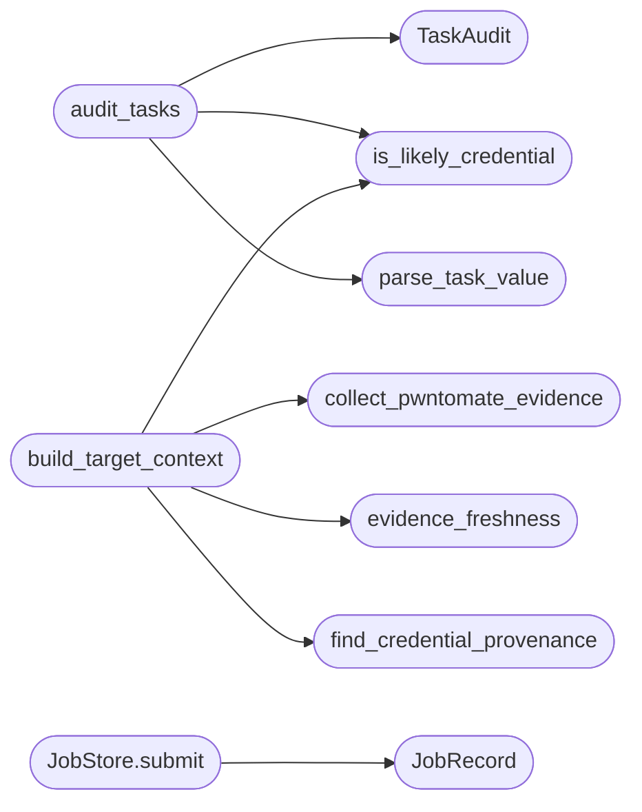

# `skills.lazyown_mcp_helpers`

> Source: [skills/lazyown_mcp_helpers.py:1](../../skills/lazyown_mcp_helpers.py#L1) | language `py` | coverage 85.0% | [API index](../index.md)

LazyOwn MCP helper functions — pure logic, no MCP server imports.

This module hosts the analytical / file-system primitives used by the MCP
high-impact tools (target_context, tasks_cleanup, evidence_grep, session_diff,
freshness reporting, dry-run pre-flight, async jobs). Keeping them here makes
the MCP server thin and the logic unit-testable in isolation.

## Contents

- **Classes:** [`TaskAudit`](#taskaudit), [`JobRecord`](#jobrecord), [`JobStore`](#jobstore)
- **Functions:** [`is_likely_credential`](#is_likely_credential), [`evidence_freshness`](#evidence_freshness), [`parse_task_value`](#parse_task_value), [`audit_tasks`](#audit_tasks), [`find_credential_provenance`](#find_credential_provenance), [`evidence_grep`](#evidence_grep), [`collect_pwntomate_evidence`](#collect_pwntomate_evidence), [`build_target_context`](#build_target_context), [`preflight_command`](#preflight_command), [`take_snapshot`](#take_snapshot), [`diff_snapshot`](#diff_snapshot), [`needs_confirmation`](#needs_confirmation)
- **Constants:** [`DEFAULT_FRESHNESS_THRESHOLD_SECONDS`](#default_freshness_threshold_seconds), [`OS_ID_LINUX`](#os_id_linux), [`OS_ID_WINDOWS`](#os_id_windows), [`SNAPSHOT_FILE_NAME`](#snapshot_file_name), [`DESTRUCTIVE_TOOLS`](#destructive_tools)

## Type Diagram



## Call Graph

Solid arrows stay in this module, dashed arrows leave it.



## Classes

<a id="taskaudit"></a>

### `TaskAudit`

`class` `dataclass` | [skills/lazyown_mcp_helpers.py:153](../../skills/lazyown_mcp_helpers.py#L153)

Decorators: `@dataclass`

```python
class TaskAudit
```

Outcome of evaluating a single task entry.

**Attributes**

| Name | Type | Default | Description |
|---|---|---|---|
| [`task_id`](#taskaudit-task_id) | `Any` |  |  |
| [`title`](#taskaudit-title) | `str` |  |  |
| [`status`](#taskaudit-status) | `str` |  |  |
| [`keep`](#taskaudit-keep) | `bool` |  |  |
| [`reason`](#taskaudit-reason) | `str` |  |  |
| [`confidence`](#taskaudit-confidence) | `float` |  |  |
| [`parsed_value`](#taskaudit-parsed_value) | `str \| None` | `None` |  |

---

<a id="jobrecord"></a>

### `JobRecord`

`class` `dataclass` | [skills/lazyown_mcp_helpers.py:672](../../skills/lazyown_mcp_helpers.py#L672)

Decorators: `@dataclass`

```python
class JobRecord
```

In-memory record for a backgrounded shell job.

**Attributes**

| Name | Type | Default | Description |
|---|---|---|---|
| [`job_id`](#jobrecord-job_id) | `str` |  |  |
| [`command`](#jobrecord-command) | `str` |  |  |
| [`state`](#jobrecord-state) | `str` | `'running'` |  |
| [`started_at`](#jobrecord-started_at) | `float` | `field(default_factory=time.time)` |  |
| [`finished_at`](#jobrecord-finished_at) | `float \| None` | `None` |  |
| [`exit_code`](#jobrecord-exit_code) | `int \| None` | `None` |  |
| [`stdout`](#jobrecord-stdout) | `str` | `''` |  |
| [`stderr`](#jobrecord-stderr) | `str` | `''` |  |
| [`timeout`](#jobrecord-timeout) | `int` | `0` |  |

---

<a id="jobstore"></a>

### `JobStore`

`class` | [skills/lazyown_mcp_helpers.py:686](../../skills/lazyown_mcp_helpers.py#L686)

```python
class JobStore
```

Thread-safe in-memory store for run_command_async jobs.

**Members**

| Member | Kind | Summary |
|---|---|---|
| [`__init__`](#jobstore-__init__) | constructor |  |
| [`submit`](#jobstore-submit) | method | Start a runner(command, timeout) in a background thread. |
| [`status`](#jobstore-status) | method |  |
| [`list`](#jobstore-list) | method |  |

<a id="jobstore-__init__"></a>

#### `JobStore.__init__`

`constructor` | [skills/lazyown_mcp_helpers.py:689](../../skills/lazyown_mcp_helpers.py#L689)

```python
def __init__(self, max_jobs: int = 64) -> None
```

**Parameters**

| Name | Type | Default | Description |
|---|---|---|---|
| `max_jobs` | `int` | `64` |  |

<a id="jobstore-submit"></a>

#### `JobStore.submit`

`method` | [skills/lazyown_mcp_helpers.py:694](../../skills/lazyown_mcp_helpers.py#L694)

```python
def submit(self, command: str, runner, timeout: int = 300) -> str
```

Start a runner(command, timeout) in a background thread.

**Parameters**

| Name | Type | Default | Description |
|---|---|---|---|
| `command` | `str` |  |  |
| `runner` |  |  |  |
| `timeout` | `int` | `300` |  |

**Returns:** `str`

*Calls:* [`JobRecord`](#jobrecord)

<a id="jobstore-status"></a>

#### `JobStore.status`

`method` | [skills/lazyown_mcp_helpers.py:727](../../skills/lazyown_mcp_helpers.py#L727)

```python
def status(self, job_id: str) -> dict[str, Any] | None
```

**Parameters**

| Name | Type | Default | Description |
|---|---|---|---|
| `job_id` | `str` |  |  |

**Returns:** `dict[str, Any] | None`

<a id="jobstore-list"></a>

#### `JobStore.list`

`method` | [skills/lazyown_mcp_helpers.py:732](../../skills/lazyown_mcp_helpers.py#L732)

```python
def list(self, limit: int = 20) -> list[dict[str, Any]]
```

**Parameters**

| Name | Type | Default | Description |
|---|---|---|---|
| `limit` | `int` | `20` |  |

**Returns:** `list[dict[str, Any]]`

---

## Functions

<a id="is_likely_credential"></a>

### `is_likely_credential`

`function` | [skills/lazyown_mcp_helpers.py:37](../../skills/lazyown_mcp_helpers.py#L37)

```python
def is_likely_credential(value: str) -> tuple[bool, float, str]
```

Score whether a string is plausibly a real credential.

**Parameters**

| Name | Type | Default | Description |
|---|---|---|---|
| `value` | `str` |  |  |

**Returns:** `tuple[bool, float, str]` - (is_likely, confidence_in_[0,1], reason).
- timestamps, URLs, bare IPs, and empty values score 0.
- user:pass and NTLM hash pairs score >=0.85.
- hex strings of hash length score 0.6 (could be hash).
- everything else scores 0.3 (unknown).

*Called by:* [`audit_tasks`](#audit_tasks), [`build_target_context`](#build_target_context)

---

<a id="evidence_freshness"></a>

### `evidence_freshness`

`function` | [skills/lazyown_mcp_helpers.py:67](../../skills/lazyown_mcp_helpers.py#L67)

```python
def evidence_freshness(path: Path | str, threshold_seconds: int = DEFAULT_FRESHNESS_THRESHOLD_SECONDS, now: float | None = None) -> dict[str, Any]
```

Return age + stale flag for an evidence file.

**Parameters**

| Name | Type | Default | Description |
|---|---|---|---|
| `path` | `Path \| str` |  | Path to a session artefact. |
| `threshold_seconds` | `int` | `DEFAULT_FRESHNESS_THRESHOLD_SECONDS` | Anything older than this is marked stale. |
| `now` | `float \| None` | `None` | Override current time (for tests). |

**Returns:** `dict[str, Any]` - {exists, size, mtime, age_seconds, age_human, stale, threshold_seconds}.
If the file does not exist all numeric fields are 0 and exists=False.

*Called by:* [`call_tool`](skills.lazyown_mcp.py.md#call_tool), [`build_target_context`](#build_target_context)

---

<a id="parse_task_value"></a>

### `parse_task_value`

`function` | [skills/lazyown_mcp_helpers.py:125](../../skills/lazyown_mcp_helpers.py#L125)

```python
def parse_task_value(title: str) -> dict[str, Any] | None
```

Extract the embedded JSON-ish payload from a task title.

Tasks created by the WorldModelWatcher have titles like:
  'Leverage new credential: {"value": "...", "host": "...", ...}'
The string can be truncated. This helper returns whatever fields it can
parse (best-effort), or None if nothing structured is found.

**Parameters**

| Name | Type | Default | Description |
|---|---|---|---|
| `title` | `str` |  |  |

**Returns:** `dict[str, Any] | None`

*Called by:* [`audit_tasks`](#audit_tasks)

---

<a id="audit_tasks"></a>

### `audit_tasks`

`function` | [skills/lazyown_mcp_helpers.py:165](../../skills/lazyown_mcp_helpers.py#L165)

```python
def audit_tasks(tasks: list[dict[str, Any]], min_confidence: float = 0.5) -> list[TaskAudit]
```

Classify each task as keep/drop with a reason.

Tasks whose embedded credential value parses as a timestamp / URL / IP
are flagged drop. Generic recon and objective tasks are kept.

**Parameters**

| Name | Type | Default | Description |
|---|---|---|---|
| `tasks` | `list[dict[str, Any]]` |  |  |
| `min_confidence` | `float` | `0.5` |  |

**Returns:** `list[TaskAudit]`

*Calls:* [`TaskAudit`](#taskaudit), [`is_likely_credential`](#is_likely_credential), [`parse_task_value`](#parse_task_value)

*Called by:* [`call_tool`](skills.lazyown_mcp.py.md#call_tool)

---

<a id="find_credential_provenance"></a>

### `find_credential_provenance`

`function` | [skills/lazyown_mcp_helpers.py:196](../../skills/lazyown_mcp_helpers.py#L196)

```python
def find_credential_provenance(value: str, sessions_dir: Path | str, csv_name: str = 'LazyOwn_session_report.csv') -> dict[str, Any] | None
```

Locate where a credential was first observed.

Searches sessions/credentials*.txt and the session CSV log for the
value. Returns {source_file, line_no, captured_at, command} or None.

**Parameters**

| Name | Type | Default | Description |
|---|---|---|---|
| `value` | `str` |  |  |
| `sessions_dir` | `Path \| str` |  |  |
| `csv_name` | `str` | `'LazyOwn_session_report.csv'` |  |

**Returns:** `dict[str, Any] | None`

*Called by:* [`build_target_context`](#build_target_context)

---

<a id="evidence_grep"></a>

### `evidence_grep`

`function` | [skills/lazyown_mcp_helpers.py:297](../../skills/lazyown_mcp_helpers.py#L297)

```python
def evidence_grep(pattern: str, sessions_dir: Path | str, scope: str = 'all', max_matches: int = 200, max_file_bytes: int = 5 * 1024 * 1024, case_insensitive: bool = True) -> dict[str, Any]
```

Grep through session artefacts.

**Parameters**

| Name | Type | Default | Description |
|---|---|---|---|
| `pattern` | `str` |  | Regex pattern to search for. |
| `sessions_dir` | `Path \| str` |  | Root sessions directory. |
| `scope` | `str` | `'all'` | 'all' \| 'loot' \| 'nmap' \| 'http' \| 'logs'. |
| `max_matches` | `int` | `200` | Cap on returned matches. |
| `max_file_bytes` | `int` | `5 * 1024 * 1024` | Skip files larger than this to avoid OOM on dumps. |
| `case_insensitive` | `bool` | `True` | Default True. |

**Returns:** `dict[str, Any]` - {pattern, scope, scanned, truncated, matches: [{path, line_no, line}]}.

*Called by:* [`call_tool`](skills.lazyown_mcp.py.md#call_tool)

---

<a id="collect_pwntomate_evidence"></a>

### `collect_pwntomate_evidence`

`function` | [skills/lazyown_mcp_helpers.py:376](../../skills/lazyown_mcp_helpers.py#L376)

```python
def collect_pwntomate_evidence(rhost: str, sessions_dir: Path | str) -> list[dict[str, Any]]
```

List pwntomate output dirs for a target with per-dir freshness.

Returns one entry per discovered tool directory:
  {host, port, tool, files, age_seconds, stale}.

**Parameters**

| Name | Type | Default | Description |
|---|---|---|---|
| `rhost` | `str` |  |  |
| `sessions_dir` | `Path \| str` |  |  |

**Returns:** `list[dict[str, Any]]`

*Called by:* [`build_target_context`](#build_target_context)

---

<a id="build_target_context"></a>

### `build_target_context`

`function` | [skills/lazyown_mcp_helpers.py:414](../../skills/lazyown_mcp_helpers.py#L414)

```python
def build_target_context(host: str, port: int | None, sessions_dir: Path | str, payload: dict[str, Any] | None = None, world_model: dict[str, Any] | None = None) -> dict[str, Any]
```

Aggregate everything known about (host, port) into one structure.

Reads from sessions/, world_model.json, scan_<host>.nmap, pwntomate
outputs, credentials*.txt. Designed to replace 4-5 separate lookups
when an LLM is deciding on next steps for a target.

**Parameters**

| Name | Type | Default | Description |
|---|---|---|---|
| `host` | `str` |  |  |
| `port` | `int \| None` |  |  |
| `sessions_dir` | `Path \| str` |  |  |
| `payload` | `dict[str, Any] \| None` | `None` |  |
| `world_model` | `dict[str, Any] \| None` | `None` |  |

**Returns:** `dict[str, Any]`

*Calls:* [`collect_pwntomate_evidence`](#collect_pwntomate_evidence), [`evidence_freshness`](#evidence_freshness), [`find_credential_provenance`](#find_credential_provenance), [`is_likely_credential`](#is_likely_credential)

*Called by:* [`call_tool`](skills.lazyown_mcp.py.md#call_tool)

---

<a id="preflight_command"></a>

### `preflight_command`

`function` | [skills/lazyown_mcp_helpers.py:575](../../skills/lazyown_mcp_helpers.py#L575)

```python
def preflight_command(command: str, payload: dict[str, Any], sessions_dir: Path | str) -> dict[str, Any]
```

Pre-flight a LazyOwn command without executing it.

Returns a structured assessment:
  {command, base_command, binary, binary_present, os_required, os_match,
   would_duplicate, duplicate_artifacts, missing_payload_keys, ok}.
Used by lazyown_run_command(dry_run=True) and the CLI dry-run alias.

**Parameters**

| Name | Type | Default | Description |
|---|---|---|---|
| `command` | `str` |  |  |
| `payload` | `dict[str, Any]` |  |  |
| `sessions_dir` | `Path \| str` |  |  |

**Returns:** `dict[str, Any]`

---

<a id="take_snapshot"></a>

### `take_snapshot`

`function` | [skills/lazyown_mcp_helpers.py:747](../../skills/lazyown_mcp_helpers.py#L747)

```python
def take_snapshot(sessions_dir: Path | str, payload: dict[str, Any] | None = None, world_model: dict[str, Any] | None = None, tasks: list[dict[str, Any]] | None = None) -> dict[str, Any]
```

Capture a lightweight snapshot of the campaign state.

Stored at sessions/_mcp_session_snapshot.json. Includes file inventory
plus credential/task counts so a later diff can show what changed.

**Parameters**

| Name | Type | Default | Description |
|---|---|---|---|
| `sessions_dir` | `Path \| str` |  |  |
| `payload` | `dict[str, Any] \| None` | `None` |  |
| `world_model` | `dict[str, Any] \| None` | `None` |  |
| `tasks` | `list[dict[str, Any]] \| None` | `None` |  |

**Returns:** `dict[str, Any]`

*Called by:* [`call_tool`](skills.lazyown_mcp.py.md#call_tool)

---

<a id="diff_snapshot"></a>

### `diff_snapshot`

`function` | [skills/lazyown_mcp_helpers.py:792](../../skills/lazyown_mcp_helpers.py#L792)

```python
def diff_snapshot(sessions_dir: Path | str, payload: dict[str, Any] | None = None, world_model: dict[str, Any] | None = None, tasks: list[dict[str, Any]] | None = None) -> dict[str, Any]
```

Return what changed since the last snapshot.

If no prior snapshot exists, returns {first_run: True, ...} so callers
can choose whether to take one and report nothing.

**Parameters**

| Name | Type | Default | Description |
|---|---|---|---|
| `sessions_dir` | `Path \| str` |  |  |
| `payload` | `dict[str, Any] \| None` | `None` |  |
| `world_model` | `dict[str, Any] \| None` | `None` |  |
| `tasks` | `list[dict[str, Any]] \| None` | `None` |  |

**Returns:** `dict[str, Any]`

*Called by:* [`call_tool`](skills.lazyown_mcp.py.md#call_tool)

---

<a id="needs_confirmation"></a>

### `needs_confirmation`

`function` | [skills/lazyown_mcp_helpers.py:875](../../skills/lazyown_mcp_helpers.py#L875)

```python
def needs_confirmation(tool_name: str, arguments: dict[str, Any]) -> bool
```

Return True if tool should require an explicit confirm=True flag.

**Parameters**

| Name | Type | Default | Description |
|---|---|---|---|
| `tool_name` | `str` |  |  |
| `arguments` | `dict[str, Any]` |  |  |

**Returns:** `bool`

*Called by:* [`call_tool`](skills.lazyown_mcp.py.md#call_tool)

---

## Constants

<a id="default_freshness_threshold_seconds"></a>

### `DEFAULT_FRESHNESS_THRESHOLD_SECONDS`

`constant` | [skills/lazyown_mcp_helpers.py:24](../../skills/lazyown_mcp_helpers.py#L24)

```python
DEFAULT_FRESHNESS_THRESHOLD_SECONDS = 7 * 24 * 3600
```

---

<a id="os_id_linux"></a>

### `OS_ID_LINUX`

`constant` | [skills/lazyown_mcp_helpers.py:26](../../skills/lazyown_mcp_helpers.py#L26)

```python
OS_ID_LINUX = 1
```

---

<a id="os_id_windows"></a>

### `OS_ID_WINDOWS`

`constant` | [skills/lazyown_mcp_helpers.py:27](../../skills/lazyown_mcp_helpers.py#L27)

```python
OS_ID_WINDOWS = 2
```

---

<a id="snapshot_file_name"></a>

### `SNAPSHOT_FILE_NAME`

`constant` | [skills/lazyown_mcp_helpers.py:744](../../skills/lazyown_mcp_helpers.py#L744)

```python
SNAPSHOT_FILE_NAME = '_mcp_session_snapshot.json'
```

---

<a id="destructive_tools"></a>

### `DESTRUCTIVE_TOOLS`

`constant` | [skills/lazyown_mcp_helpers.py:868](../../skills/lazyown_mcp_helpers.py#L868)

```python
DESTRUCTIVE_TOOLS: set[str] = {'lazyown_c2_command', 'lazyown_c2_redop', 'lazyown_c2_adversary'}
```

---
