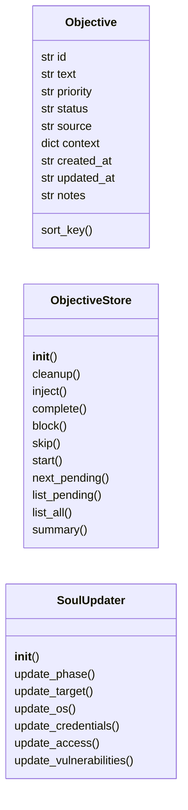
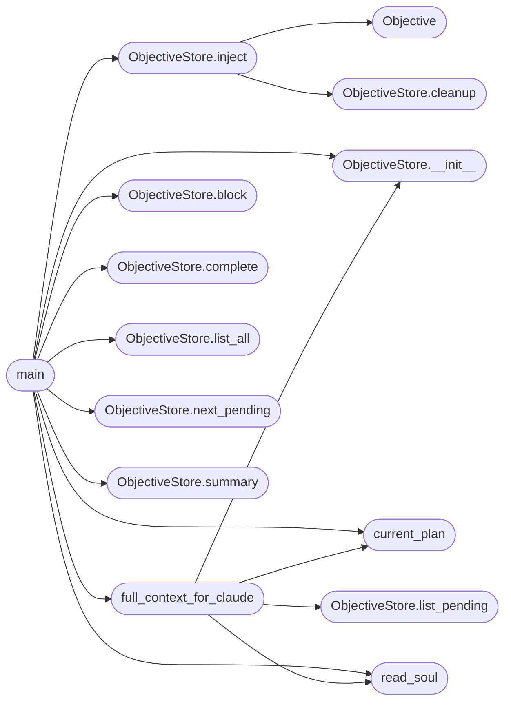

# `skills.lazyown_objective`

> Source: [skills/lazyown_objective.py:1](../../skills/lazyown_objective.py#L1) | language `py` | coverage 41.4% | [API index](../index.md)

LazyOwn Objective Store ======================= Priority-queue for high-level attack objectives.

Claude Code (the frontier model operating the MCP) is the primary writer and
reader of this store.  Sub-systems (sessions_watcher, event_engine, auto_loop)
may inject objectives automatically when they detect new context.

File format  — sessions/objectives.jsonl
Each line    — one JSON object:
    {
        "id":         "<8-char hex>",
        "text":       "Enumerate SMB shares on 10.10.11.78 (port 445 confirmed open)",
        "priority":   "high",        # critical / high / medium / low
        "status":     "pending",     # pending / in_progress / done / blocked / skipped
        "source":     "claude",      # claude / watcher / event_engine / user
        "context":    { ... },       # arbitrary dict — facts, event ids, etc.
        "created_at": "<iso>",
        "updated_at": "<iso>",
        "notes":      ""
    }

Priority order for next_pending():  critical > high > medium > low
Within same priority: FIFO (oldest first).

Usage:
    python3 skills/lazyown_objective.py inject "Enumerate SMB" --priority high
    python3 skills/lazyown_objective.py next
    python3 skills/lazyown_objective.py list
    python3 skills/lazyown_objective.py complete <id>
    python3 skills/lazyown_objective.py block   <id> "reason"
    python3 skills/lazyown_objective.py report

## Contents

- **Classes:** [`Objective`](#objective), [`ObjectiveStore`](#objectivestore), [`SoulUpdater`](#soulupdater)
- **Functions:** [`decompose_goal`](#decompose_goal), [`read_soul`](#read_soul), [`write_soul`](#write_soul), [`current_plan`](#current_plan), [`full_context_for_claude`](#full_context_for_claude), [`main`](#main)
- **Constants:** [`BASE_DIR`](#base_dir), [`SESSIONS_DIR`](#sessions_dir), [`OBJECTIVES_FILE`](#objectives_file), [`PLAN_FILE`](#plan_file), [`SOUL_FILE`](#soul_file), [`PRIORITY_ORDER`](#priority_order), [`VALID_STATUSES`](#valid_statuses), [`VALID_PRIORITIES`](#valid_priorities), [`OBJECTIVE_TTL_HOURS`](#objective_ttl_hours), [`DEFAULT_SOUL`](#default_soul)

## Type Diagram



## Call Graph

Solid arrows stay in this module, dashed arrows leave it.



## Classes

<a id="objective"></a>

### `Objective`

`class` `dataclass` | [skills/lazyown_objective.py:105](../../skills/lazyown_objective.py#L105)

Decorators: `@dataclass`

```python
class Objective
```

**Attributes**

| Name | Type | Default | Description |
|---|---|---|---|
| [`id`](#objective-id) | `str` |  |  |
| [`text`](#objective-text) | `str` |  |  |
| [`priority`](#objective-priority) | `str` |  |  |
| [`status`](#objective-status) | `str` |  |  |
| [`source`](#objective-source) | `str` |  |  |
| [`context`](#objective-context) | `dict` |  |  |
| [`created_at`](#objective-created_at) | `str` |  |  |
| [`updated_at`](#objective-updated_at) | `str` |  |  |
| [`notes`](#objective-notes) | `str` | `''` |  |

**Members**

| Member | Kind | Summary |
|---|---|---|
| [`sort_key`](#objective-sort_key) | method |  |

<a id="objective-sort_key"></a>

#### `Objective.sort_key`

`method` | [skills/lazyown_objective.py:116](../../skills/lazyown_objective.py#L116)

```python
def sort_key(self) -> tuple
```

**Returns:** `tuple`

---

<a id="objectivestore"></a>

### `ObjectiveStore`

`class` | [skills/lazyown_objective.py:123](../../skills/lazyown_objective.py#L123)

```python
class ObjectiveStore
```

Append-only JSONL store with full rewrite on status changes.

The file stays small (pentest campaigns rarely exceed a few hundred
objectives).  Thread safety is handled by atomic rename on write.

**Members**

| Member | Kind | Summary |
|---|---|---|
| [`__init__`](#objectivestore-__init__) | constructor |  |
| [`cleanup`](#objectivestore-cleanup) | method | Expire pending objectives whose TTL has passed. |
| [`inject`](#objectivestore-inject) | method |  |
| [`complete`](#objectivestore-complete) | method |  |
| [`block`](#objectivestore-block) | method |  |
| [`skip`](#objectivestore-skip) | method |  |
| [`start`](#objectivestore-start) | method |  |
| [`next_pending`](#objectivestore-next_pending) | method |  |
| [`list_pending`](#objectivestore-list_pending) | method |  |
| [`list_all`](#objectivestore-list_all) | method |  |
| [`summary`](#objectivestore-summary) | method |  |

<a id="objectivestore-__init__"></a>

#### `ObjectiveStore.__init__`

`constructor` | [skills/lazyown_objective.py:131](../../skills/lazyown_objective.py#L131)

```python
def __init__(self, path: Path | None = None) -> None
```

**Parameters**

| Name | Type | Default | Description |
|---|---|---|---|
| `path` | `Path \| None` | `None` |  |

*Called by:* [`full_context_for_claude`](#full_context_for_claude), [`main`](#main)

<a id="objectivestore-cleanup"></a>

#### `ObjectiveStore.cleanup`

`method` | [skills/lazyown_objective.py:163](../../skills/lazyown_objective.py#L163)

```python
def cleanup(self) -> int
```

Expire pending objectives whose TTL has passed.

Returns the number of objectives marked skipped.

**Returns:** `int`

*Called by:* [`ObjectiveStore.inject`](#objectivestore-inject)

<a id="objectivestore-inject"></a>

#### `ObjectiveStore.inject`

`method` | [skills/lazyown_objective.py:193](../../skills/lazyown_objective.py#L193)

```python
def inject(self, text: str, priority: str = 'medium', source: str = 'claude', context: dict | None = None, notes: str = '') -> Objective
```

**Parameters**

| Name | Type | Default | Description |
|---|---|---|---|
| `text` | `str` |  |  |
| `priority` | `str` | `'medium'` |  |
| `source` | `str` | `'claude'` |  |
| `context` | `dict \| None` | `None` |  |
| `notes` | `str` | `''` |  |

**Returns:** `Objective`

*Calls:* [`Objective`](#objective), [`ObjectiveStore.cleanup`](#objectivestore-cleanup)

*Called by:* [`main`](#main)

<a id="objectivestore-complete"></a>

#### `ObjectiveStore.complete`

`method` | [skills/lazyown_objective.py:243](../../skills/lazyown_objective.py#L243)

```python
def complete(self, obj_id: str, notes: str = '') -> bool
```

**Parameters**

| Name | Type | Default | Description |
|---|---|---|---|
| `obj_id` | `str` |  |  |
| `notes` | `str` | `''` |  |

**Returns:** `bool`

*Called by:* [`main`](#main)

<a id="objectivestore-block"></a>

#### `ObjectiveStore.block`

`method` | [skills/lazyown_objective.py:246](../../skills/lazyown_objective.py#L246)

```python
def block(self, obj_id: str, reason: str = '') -> bool
```

**Parameters**

| Name | Type | Default | Description |
|---|---|---|---|
| `obj_id` | `str` |  |  |
| `reason` | `str` | `''` |  |

**Returns:** `bool`

*Called by:* [`main`](#main)

<a id="objectivestore-skip"></a>

#### `ObjectiveStore.skip`

`method` | [skills/lazyown_objective.py:249](../../skills/lazyown_objective.py#L249)

```python
def skip(self, obj_id: str, reason: str = '') -> bool
```

**Parameters**

| Name | Type | Default | Description |
|---|---|---|---|
| `obj_id` | `str` |  |  |
| `reason` | `str` | `''` |  |

**Returns:** `bool`

<a id="objectivestore-start"></a>

#### `ObjectiveStore.start`

`method` | [skills/lazyown_objective.py:252](../../skills/lazyown_objective.py#L252)

```python
def start(self, obj_id: str) -> bool
```

**Parameters**

| Name | Type | Default | Description |
|---|---|---|---|
| `obj_id` | `str` |  |  |

**Returns:** `bool`

<a id="objectivestore-next_pending"></a>

#### `ObjectiveStore.next_pending`

`method` | [skills/lazyown_objective.py:255](../../skills/lazyown_objective.py#L255)

```python
def next_pending(self) -> Objective | None
```

**Returns:** `Objective | None`

*Called by:* [`main`](#main)

<a id="objectivestore-list_pending"></a>

#### `ObjectiveStore.list_pending`

`method` | [skills/lazyown_objective.py:261](../../skills/lazyown_objective.py#L261)

```python
def list_pending(self, limit: int = 10) -> list[Objective]
```

**Parameters**

| Name | Type | Default | Description |
|---|---|---|---|
| `limit` | `int` | `10` |  |

**Returns:** `list[Objective]`

*Called by:* [`full_context_for_claude`](#full_context_for_claude)

<a id="objectivestore-list_all"></a>

#### `ObjectiveStore.list_all`

`method` | [skills/lazyown_objective.py:265](../../skills/lazyown_objective.py#L265)

```python
def list_all(self, status: str = 'all', limit: int = 20) -> list[Objective]
```

**Parameters**

| Name | Type | Default | Description |
|---|---|---|---|
| `status` | `str` | `'all'` |  |
| `limit` | `int` | `20` |  |

**Returns:** `list[Objective]`

*Called by:* [`main`](#main)

<a id="objectivestore-summary"></a>

#### `ObjectiveStore.summary`

`method` | [skills/lazyown_objective.py:271](../../skills/lazyown_objective.py#L271)

```python
def summary(self) -> str
```

**Returns:** `str`

*Called by:* [`main`](#main)

---

<a id="soulupdater"></a>

### `SoulUpdater`

`class` | [skills/lazyown_objective.py:359](../../skills/lazyown_objective.py#L359)

```python
class SoulUpdater
```

Smart section-level patcher for sessions/soul.md.

Instead of rewriting the whole file, it patches only the relevant
## section when new intelligence arrives (new credential, OS detected,
access level achieved, vulnerability found).

Each ## section is delimited by the next ## header or end-of-file.
If a section doesn't exist yet it is appended.

Usage (called by sessions_watcher after parsing):
    su = SoulUpdater()
    su.update_credentials([{"username": "admin", "password": "P@ss"}])
    su.update_phase("exploit")
    su.update_os("Windows Server 2019", "10.10.11.78")
    su.update_access("admin", "10.10.11.78", method="evil-winrm")
    su.update_vulnerabilities([{"vuln_id": "CVE-2021-34527", "severity": "critical", ...}])

**Members**

| Member | Kind | Summary |
|---|---|---|
| [`__init__`](#soulupdater-__init__) | constructor |  |
| [`update_phase`](#soulupdater-update_phase) | method | Update the `Phase:` line inside ## Current Focus. |
| [`update_target`](#soulupdater-update_target) | method | Update the `Target:` line inside ## Current Focus. |
| [`update_os`](#soulupdater-update_os) | method | Record detected operating system for a target. |
| [`update_credentials`](#soulupdater-update_credentials) | method | Replace the ## Known Credentials section with discovered credentials. |
| [`update_access`](#soulupdater-update_access) | method | Update achieved access level for a target. |
| [`update_vulnerabilities`](#soulupdater-update_vulnerabilities) | method | Replace ## Key Vulnerabilities with the most severe findings. |

<a id="soulupdater-__init__"></a>

#### `SoulUpdater.__init__`

`constructor` | [skills/lazyown_objective.py:379](../../skills/lazyown_objective.py#L379)

```python
def __init__(self) -> None
```

<a id="soulupdater-update_phase"></a>

#### `SoulUpdater.update_phase`

`method` | [skills/lazyown_objective.py:417](../../skills/lazyown_objective.py#L417)

```python
def update_phase(self, phase: str) -> None
```

Update the `Phase:` line inside ## Current Focus.

**Parameters**

| Name | Type | Default | Description |
|---|---|---|---|
| `phase` | `str` |  |  |

<a id="soulupdater-update_target"></a>

#### `SoulUpdater.update_target`

`method` | [skills/lazyown_objective.py:421](../../skills/lazyown_objective.py#L421)

```python
def update_target(self, target: str) -> None
```

Update the `Target:` line inside ## Current Focus.

**Parameters**

| Name | Type | Default | Description |
|---|---|---|---|
| `target` | `str` |  |  |

<a id="soulupdater-update_os"></a>

#### `SoulUpdater.update_os`

`method` | [skills/lazyown_objective.py:425](../../skills/lazyown_objective.py#L425)

```python
def update_os(self, os_name: str, target: str) -> None
```

Record detected operating system for a target.

**Parameters**

| Name | Type | Default | Description |
|---|---|---|---|
| `os_name` | `str` |  |  |
| `target` | `str` |  |  |

<a id="soulupdater-update_credentials"></a>

#### `SoulUpdater.update_credentials`

`method` | [skills/lazyown_objective.py:432](../../skills/lazyown_objective.py#L432)

```python
def update_credentials(self, creds: list[dict]) -> None
```

Replace the ## Known Credentials section with discovered credentials.

Accepts list of dicts with keys: username, password, hash_value (optional).

**Parameters**

| Name | Type | Default | Description |
|---|---|---|---|
| `creds` | `list[dict]` |  |  |

<a id="soulupdater-update_access"></a>

#### `SoulUpdater.update_access`

`method` | [skills/lazyown_objective.py:459](../../skills/lazyown_objective.py#L459)

```python
def update_access(self, level: str, target: str, method: str = '') -> None
```

Update achieved access level for a target.

**Parameters**

| Name | Type | Default | Description |
|---|---|---|---|
| `level` | `str` |  |  |
| `target` | `str` |  |  |
| `method` | `str` | `''` |  |

<a id="soulupdater-update_vulnerabilities"></a>

#### `SoulUpdater.update_vulnerabilities`

`method` | [skills/lazyown_objective.py:466](../../skills/lazyown_objective.py#L466)

```python
def update_vulnerabilities(self, vulns: list[dict]) -> None
```

Replace ## Key Vulnerabilities with the most severe findings.

**Parameters**

| Name | Type | Default | Description |
|---|---|---|---|
| `vulns` | `list[dict]` |  |  |

---

## Functions

<a id="decompose_goal"></a>

### `decompose_goal`

`function` | [skills/lazyown_objective.py:296](../../skills/lazyown_objective.py#L296)

```python
def decompose_goal(goal_text: str, target: str = '') -> list[str]
```

Split a compound goal into discrete verifiable objectives.

Rule-based fallback so goal nodes always exist: reconnaissance
clauses stay informational, everything else becomes an
independently completable objective with the target attached.
Returns the input unchanged when no split markers are present.

**Parameters**

| Name | Type | Default | Description |
|---|---|---|---|
| `goal_text` | `str` |  |  |
| `target` | `str` | `''` |  |

**Returns:** `list[str]`

---

<a id="read_soul"></a>

### `read_soul`

`function` | [skills/lazyown_objective.py:320](../../skills/lazyown_objective.py#L320)

```python
def read_soul() -> str
```

**Returns:** `str`

*Called by:* [`full_context_for_claude`](#full_context_for_claude), [`main`](#main)

---

<a id="write_soul"></a>

### `write_soul`

`function` | [skills/lazyown_objective.py:326](../../skills/lazyown_objective.py#L326)

```python
def write_soul(content: str) -> None
```

**Parameters**

| Name | Type | Default | Description |
|---|---|---|---|
| `content` | `str` |  |  |

---

<a id="current_plan"></a>

### `current_plan`

`function` | [skills/lazyown_objective.py:330](../../skills/lazyown_objective.py#L330)

```python
def current_plan() -> str
```

**Returns:** `str`

*Called by:* [`full_context_for_claude`](#full_context_for_claude), [`main`](#main)

---

<a id="full_context_for_claude"></a>

### `full_context_for_claude`

`function` | [skills/lazyown_objective.py:336](../../skills/lazyown_objective.py#L336)

```python
def full_context_for_claude(target: str | None = None) -> dict
```

Return a single dict with everything Claude Code needs to reason about the next objective:  soul + pending objectives + current plan + soul.

**Parameters**

| Name | Type | Default | Description |
|---|---|---|---|
| `target` | `str \| None` | `None` |  |

**Returns:** `dict`

*Calls:* [`ObjectiveStore.__init__`](#objectivestore-__init__), [`ObjectiveStore.list_pending`](#objectivestore-list_pending), [`current_plan`](#current_plan), [`read_soul`](#read_soul)

*Called by:* [`main`](#main)

---

<a id="main"></a>

### `main`

`function` | [skills/lazyown_objective.py:485](../../skills/lazyown_objective.py#L485)

```python
def main() -> None
```

*Calls:* [`ObjectiveStore.__init__`](#objectivestore-__init__), [`ObjectiveStore.block`](#objectivestore-block), [`ObjectiveStore.complete`](#objectivestore-complete), [`ObjectiveStore.inject`](#objectivestore-inject), [`ObjectiveStore.list_all`](#objectivestore-list_all), [`ObjectiveStore.next_pending`](#objectivestore-next_pending), [`ObjectiveStore.summary`](#objectivestore-summary), [`current_plan`](#current_plan), [`full_context_for_claude`](#full_context_for_claude), [`read_soul`](#read_soul)

---

## Constants

<a id="base_dir"></a>

### `BASE_DIR`

`constant` | [skills/lazyown_objective.py:50](../../skills/lazyown_objective.py#L50)

```python
BASE_DIR = Path(__file__).parent.parent
```

---

<a id="sessions_dir"></a>

### `SESSIONS_DIR`

`constant` | [skills/lazyown_objective.py:51](../../skills/lazyown_objective.py#L51)

```python
SESSIONS_DIR = BASE_DIR / 'sessions'
```

---

<a id="objectives_file"></a>

### `OBJECTIVES_FILE`

`constant` | [skills/lazyown_objective.py:52](../../skills/lazyown_objective.py#L52)

```python
OBJECTIVES_FILE = SESSIONS_DIR / 'objectives.jsonl'
```

---

<a id="plan_file"></a>

### `PLAN_FILE`

`constant` | [skills/lazyown_objective.py:53](../../skills/lazyown_objective.py#L53)

```python
PLAN_FILE = SESSIONS_DIR / 'plan.txt'
```

---

<a id="soul_file"></a>

### `SOUL_FILE`

`constant` | [skills/lazyown_objective.py:54](../../skills/lazyown_objective.py#L54)

```python
SOUL_FILE = SESSIONS_DIR / 'soul.md'
```

---

<a id="priority_order"></a>

### `PRIORITY_ORDER`

`constant` | [skills/lazyown_objective.py:56](../../skills/lazyown_objective.py#L56)

```python
PRIORITY_ORDER = {'critical': 0, 'high': 1, 'medium': 2, 'low': 3}
```

---

<a id="valid_statuses"></a>

### `VALID_STATUSES`

`constant` | [skills/lazyown_objective.py:57](../../skills/lazyown_objective.py#L57)

```python
VALID_STATUSES = {'pending', 'in_progress', 'done', 'blocked', 'skipped'}
```

---

<a id="valid_priorities"></a>

### `VALID_PRIORITIES`

`constant` | [skills/lazyown_objective.py:58](../../skills/lazyown_objective.py#L58)

```python
VALID_PRIORITIES = set(PRIORITY_ORDER.keys())
```

---

<a id="objective_ttl_hours"></a>

### `OBJECTIVE_TTL_HOURS`

`constant` | [skills/lazyown_objective.py:62](../../skills/lazyown_objective.py#L62)

```python
OBJECTIVE_TTL_HOURS: dict[str, float | None] = {'critical': None, 'high': None, 'medium': 72.0, 'low': 24.0}
```

---

<a id="default_soul"></a>

### `DEFAULT_SOUL`

`constant` | [skills/lazyown_objective.py:69](../../skills/lazyown_objective.py#L69)

```python
DEFAULT_SOUL
```

---
