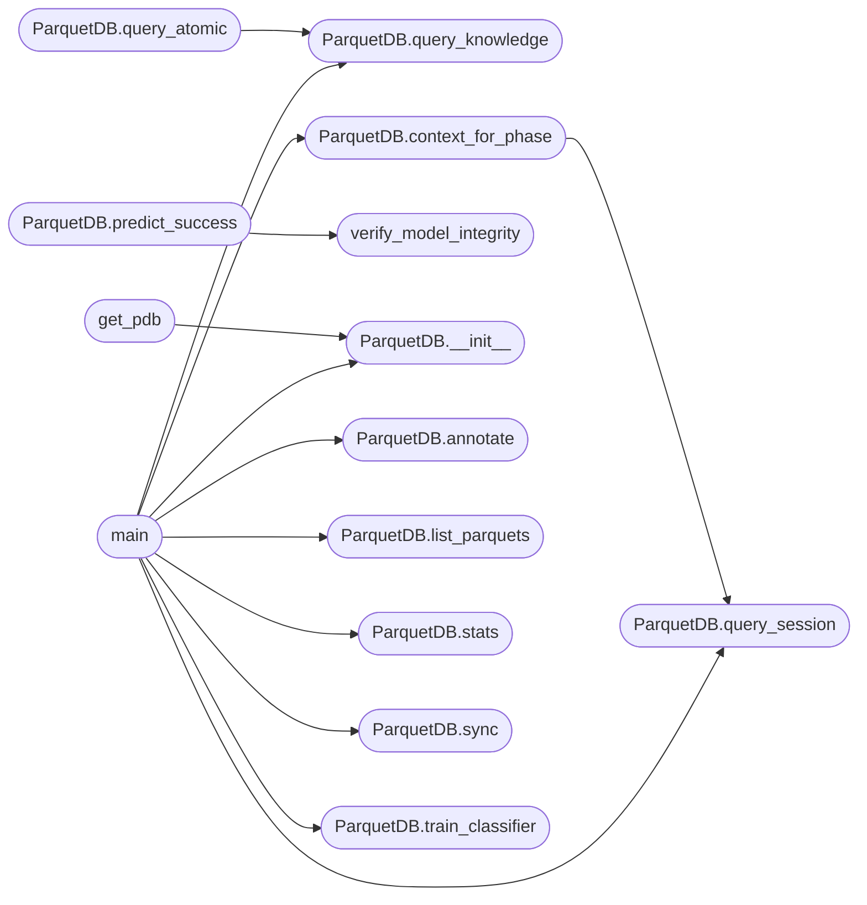

# `skills.lazyown_parquet_db`

> Source: [skills/lazyown_parquet_db.py:1](../../skills/lazyown_parquet_db.py#L1) | language `py` | coverage 70.6% | [API index](../index.md)

LazyOwn Parquet Knowledge Base ================================ Centralises session history and contextual knowledge in the parquets/ directory.

Two responsibilities
────────────────────
1. SESSION KNOWLEDGE  →  parquets/session_knowledge.parquet
   • Ingests sessions/LazyOwn_session_report.csv (which has no id/success/category)
   • Enriches each row with:
       - id           : stable UUID derived from (start, command, args, destination_ip)
       - category     : extracted from cmd2 @with_category decorators in lazyown.py
                        (parsed once at startup with a regex — no import needed)
       - success      : bool  (True by default from bootstrap; updated via annotate())
       - outcome      : "success" | "failure" | "unknown"
       - reward       : int from policy RewardCalculator
       - confidence   : float
       - tier         : classifier tier
       - reason       : why the outcome was chosen
   • Merges new CSV rows incrementally (existing rows preserved, not overwritten)
   • Supports annotate(row_id, success, category) to patch rows AFTER execution

2. KNOWLEDGE QUERY ENGINE  →  any .parquet in parquets/
   • query_knowledge(keyword, parquet, columns, limit) — generic keyword search
     over any parquet in parquets/  (binarios, lolbas_*, techniques, session_knowledge)
   • context_for_phase(phase, target) — rich context dict for MCP:
       * recent successes/failures in this phase
       * relevant GTFOBins binaries
       * relevant MITRE techniques
       * next recommended commands

Usage
─────
    python3 skills/lazyown_parquet_db.py sync          # ingest CSV → parquet
    python3 skills/lazyown_parquet_db.py query recon
    python3 skills/lazyown_parquet_db.py query --keyword smb
    python3 skills/lazyown_parquet_db.py annotate <row_id> --success --category recon

MCP integration
───────────────
    from lazyown_parquet_db import ParquetDB
    _pdb = ParquetDB(LAZYOWN_DIR)
    # In list_tools: add lazyown_parquet_query + lazyown_parquet_annotate
    # In call_tool:  _pdb.context_for_phase(phase, target)

## Contents

- **Classes:** [`ParquetDB`](#parquetdb)
- **Functions:** [`verify_model_integrity`](#verify_model_integrity), [`get_pdb`](#get_pdb), [`main`](#main)
- **Constants:** [`BASE_DIR`](#base_dir), [`PARQUETS_DIR`](#parquets_dir), [`SESSIONS_DIR`](#sessions_dir), [`CSV_PATH`](#csv_path), [`SESSION_PKT`](#session_pkt)

## Call Graph

Solid arrows stay in this module, dashed arrows leave it.



## Classes

<a id="parquetdb"></a>

### `ParquetDB`

`class` | [skills/lazyown_parquet_db.py:244](../../skills/lazyown_parquet_db.py#L244)

```python
class ParquetDB
```

Parquet-backed session knowledge base + generic parquet query engine.

**Attributes**

| Name | Type | Default | Description |
|---|---|---|---|
| [`SCHEMA_COLS`](#parquetdb-schema_cols) |  | `['id', 'start', 'end', 'source_ip', 'source_port', 'destination_ip', 'destination_port', 'domain', 'subdomain', 'url', 'pivot_port', 'command', 'args', 'category', 'success', 'outcome', 'reward', 'confidence', 'tier', 'reason', 'output_snippet', 'finding_type', 'mitre_id', 'target_service', 'target_port', 'campaign_id']` |  |

**Members**

| Member | Kind | Summary |
|---|---|---|
| [`__init__`](#parquetdb-__init__) | constructor |  |
| [`sync`](#parquetdb-sync) | method | Ingest sessions/LazyOwn_session_report.csv into session_knowledge.parquet. |
| [`annotate`](#parquetdb-annotate) | method | Patch a row in session_knowledge.parquet by its id. |
| [`annotate_rich`](#parquetdb-annotate_rich) | method | Full annotation after real execution: stores output snippet + all metadata. |
| [`query_session`](#parquetdb-query_session) | method | Query session_knowledge.parquet. |
| [`query_knowledge`](#parquetdb-query_knowledge) | method | Search for keyword across one or all parquets in parquets/. |
| [`query_atomic`](#parquetdb-query_atomic) | method | Structured query over the enriched Atomic Red Team catalogue (parquets/techniques_enriched.parquet). |
| [`context_for_phase`](#parquetdb-context_for_phase) | method | Return a rich context dict for MCP reasoning: |
| [`stats`](#parquetdb-stats) | method |  |
| [`list_parquets`](#parquetdb-list_parquets) | method |  |
| [`train_classifier`](#parquetdb-train_classifier) | method | Train a lightweight RandomForest classifier on session_knowledge.parquet. |
| [`predict_success`](#parquetdb-predict_success) | method | Use the trained classifier to estimate probability of success. |

<a id="parquetdb-__init__"></a>

#### `ParquetDB.__init__`

`constructor` | [skills/lazyown_parquet_db.py:295](../../skills/lazyown_parquet_db.py#L295)

```python
def __init__(self, lazyown_dir: Path = BASE_DIR) -> None
```

**Parameters**

| Name | Type | Default | Description |
|---|---|---|---|
| `lazyown_dir` | `Path` | `BASE_DIR` |  |

**Raises**

- `RuntimeError`: (raised in the body, not documented)

*Called by:* [`get_pdb`](#get_pdb), [`main`](#main), [`main`](skills.update_knowledge.py.md#main)

<a id="parquetdb-sync"></a>

#### `ParquetDB.sync`

`method` | [skills/lazyown_parquet_db.py:316](../../skills/lazyown_parquet_db.py#L316)

```python
def sync(self, csv_path: Path = CSV_PATH) -> int
```

Ingest sessions/LazyOwn_session_report.csv into session_knowledge.parquet.

New rows are enriched with id/category/success/outcome.
Existing rows (matched by id) are preserved — their manual annotations
(success, category) are NOT overwritten.

Returns the number of NEW rows added.

**Parameters**

| Name | Type | Default | Description |
|---|---|---|---|
| `csv_path` | `Path` | `CSV_PATH` |  |

**Returns:** `int`

*Called by:* [`main`](#main), [`main`](skills.update_knowledge.py.md#main)

<a id="parquetdb-annotate"></a>

#### `ParquetDB.annotate`

`method` | [skills/lazyown_parquet_db.py:405](../../skills/lazyown_parquet_db.py#L405)

```python
def annotate(self, row_id: str, success: bool | None = None, category: str | None = None, outcome: str | None = None) -> bool
```

Patch a row in session_knowledge.parquet by its id.

Only supplied fields are updated.  Returns True if found.

**Parameters**

| Name | Type | Default | Description |
|---|---|---|---|
| `row_id` | `str` |  |  |
| `success` | `bool \| None` | `None` |  |
| `category` | `str \| None` | `None` |  |
| `outcome` | `str \| None` | `None` |  |

**Returns:** `bool`

*Called by:* [`main`](#main)

<a id="parquetdb-annotate_rich"></a>

#### `ParquetDB.annotate_rich`

`method` | [skills/lazyown_parquet_db.py:434](../../skills/lazyown_parquet_db.py#L434)

```python
def annotate_rich(self, row_id: str, output: str = '', finding_type: str = '', target_service: str = '', target_port: str = '', campaign_id: str = '', success: bool | None = None, category: str | None = None, outcome: str | None = None) -> bool
```

Full annotation after real execution: stores output snippet + all metadata.

Use this instead of annotate() from the auto_loop for richer training data.

**Parameters**

| Name | Type | Default | Description |
|---|---|---|---|
| `row_id` | `str` |  |  |
| `output` | `str` | `''` |  |
| `finding_type` | `str` | `''` |  |
| `target_service` | `str` | `''` |  |
| `target_port` | `str` | `''` |  |
| `campaign_id` | `str` | `''` |  |
| `success` | `bool \| None` | `None` |  |
| `category` | `str \| None` | `None` |  |
| `outcome` | `str \| None` | `None` |  |

**Returns:** `bool`

<a id="parquetdb-query_session"></a>

#### `ParquetDB.query_session`

`method` | [skills/lazyown_parquet_db.py:490](../../skills/lazyown_parquet_db.py#L490)

```python
def query_session(self, phase: str | None = None, target: str | None = None, success_only: bool = False, limit: int = 20) -> list[dict[str, Any]]
```

Query session_knowledge.parquet.

phase:        filter by category column (e.g. "recon", "scanning")
target:       filter by destination_ip
success_only: only return rows where success == True
limit:        max rows returned

**Parameters**

| Name | Type | Default | Description |
|---|---|---|---|
| `phase` | `str \| None` | `None` |  |
| `target` | `str \| None` | `None` |  |
| `success_only` | `bool` | `False` |  |
| `limit` | `int` | `20` |  |

**Returns:** `list[dict[str, Any]]`

*Called by:* [`ParquetDB.context_for_phase`](#parquetdb-context_for_phase), [`main`](#main)

<a id="parquetdb-query_knowledge"></a>

#### `ParquetDB.query_knowledge`

`method` | [skills/lazyown_parquet_db.py:526](../../skills/lazyown_parquet_db.py#L526)

```python
def query_knowledge(self, keyword: str, parquet_name: str | None = None, columns: list[str] | None = None, limit: int = 15) -> dict[str, list[dict]]
```

Search for keyword across one or all parquets in parquets/.

parquet_name: stem of the parquet file (e.g. "binarios", "techniques").
              If None, searches all parquets.
columns:      restrict search to these columns (default: all string columns).
Returns dict {parquet_stem: [matching rows...]}.

**Parameters**

| Name | Type | Default | Description |
|---|---|---|---|
| `keyword` | `str` |  |  |
| `parquet_name` | `str \| None` | `None` |  |
| `columns` | `list[str] \| None` | `None` |  |
| `limit` | `int` | `15` |  |

**Returns:** `dict[str, list[dict]]`

*Called by:* [`ParquetDB.query_atomic`](#parquetdb-query_atomic), [`main`](#main)

<a id="parquetdb-query_atomic"></a>

#### `ParquetDB.query_atomic`

`method` | [skills/lazyown_parquet_db.py:576](../../skills/lazyown_parquet_db.py#L576)

```python
def query_atomic(self, keyword: str = '', mitre_id: str = '', platform: str = '', scope: str = '', has_prereqs: bool | None = None, complexity: str = '', limit: int = 10, include_command: bool = False) -> list[dict]
```

Structured query over the enriched Atomic Red Team catalogue (parquets/techniques_enriched.parquet).

Falls back to query_knowledge("techniques", keyword) if the enriched
parquet is not yet built.

**Parameters**

| Name | Type | Default | Description |
|---|---|---|---|
| `keyword` | `str` | `''` |  |
| `mitre_id` | `str` | `''` |  |
| `platform` | `str` | `''` |  |
| `scope` | `str` | `''` |  |
| `has_prereqs` | `bool \| None` | `None` |  |
| `complexity` | `str` | `''` |  |
| `limit` | `int` | `10` |  |
| `include_command` | `bool` | `False` |  |

**Returns:** `list[dict]`

*Calls:* [`ParquetDB.query_knowledge`](#parquetdb-query_knowledge)

<a id="parquetdb-context_for_phase"></a>

#### `ParquetDB.context_for_phase`

`method` | [skills/lazyown_parquet_db.py:630](../../skills/lazyown_parquet_db.py#L630)

```python
def context_for_phase(self, phase: str, target: str | None = None, limit: int = 10) -> dict[str, Any]
```

Return a rich context dict for MCP reasoning:

{
  "phase":             "recon",
  "target":            "10.10.11.78",
  "successful_cmds":   [{"command": ..., "args": ..., "start": ...}, ...],
  "failed_cmds":       [...],
  "gtfobins_relevant": [...],   # from binarios.parquet
  "mitre_techniques":  [...],   # from techniques.parquet
  "lolbas_relevant":   [...],   # from lolbas_index.parquet
  "summary":           "3 recon successes, 1 failure. Top commands: ..."
}

**Parameters**

| Name | Type | Default | Description |
|---|---|---|---|
| `phase` | `str` |  |  |
| `target` | `str \| None` | `None` |  |
| `limit` | `int` | `10` |  |

**Returns:** `dict[str, Any]`

*Calls:* [`ParquetDB.query_session`](#parquetdb-query_session)

*Called by:* [`main`](#main)

<a id="parquetdb-stats"></a>

#### `ParquetDB.stats`

`method` | [skills/lazyown_parquet_db.py:729](../../skills/lazyown_parquet_db.py#L729)

```python
def stats(self) -> str
```

**Returns:** `str`

*Called by:* [`main`](#main), [`main`](skills.update_knowledge.py.md#main)

<a id="parquetdb-list_parquets"></a>

#### `ParquetDB.list_parquets`

`method` | [skills/lazyown_parquet_db.py:743](../../skills/lazyown_parquet_db.py#L743)

```python
def list_parquets(self) -> list[str]
```

**Returns:** `list[str]`

*Called by:* [`main`](#main)

<a id="parquetdb-train_classifier"></a>

#### `ParquetDB.train_classifier`

`method` | [skills/lazyown_parquet_db.py:748](../../skills/lazyown_parquet_db.py#L748)

```python
def train_classifier(self, min_rows: int = 50) -> dict[str, Any]
```

Train a lightweight RandomForest classifier on session_knowledge.parquet.

Features: command name (hashed), first arg token (hashed), category label.
Target:   success (bool).

The trained model is saved to parquets/classifier.pkl.
Returns a dict with {accuracy, n_train, n_test, model_path, feature_importance}.

Auto-called by sync() when the parquet grows by more than 200 annotated rows.
Requires: scikit-learn (pip install scikit-learn)

**Parameters**

| Name | Type | Default | Description |
|---|---|---|---|
| `min_rows` | `int` | `50` |  |

**Returns:** `dict[str, Any]`

*Called by:* [`main`](#main), [`main`](skills.update_knowledge.py.md#main)

<a id="parquetdb-predict_success"></a>

#### `ParquetDB.predict_success`

`method` | [skills/lazyown_parquet_db.py:843](../../skills/lazyown_parquet_db.py#L843)

```python
def predict_success(self, command: str, category: str) -> float | None
```

Use the trained classifier to estimate probability of success.

Returns float 0.0–1.0 or None if no model exists.

**Parameters**

| Name | Type | Default | Description |
|---|---|---|---|
| `command` | `str` |  |  |
| `category` | `str` |  |  |

**Returns:** `float | None`

*Calls:* [`verify_model_integrity`](#verify_model_integrity)

---

## Functions

<a id="verify_model_integrity"></a>

### `verify_model_integrity`

`function` | [skills/lazyown_parquet_db.py:892](../../skills/lazyown_parquet_db.py#L892)

```python
def verify_model_integrity(model_path: Path, encoder_path: Path, hash_path: Path) -> bool
```

Verify SHA256 integrity of classifier model and encoder files.

**Parameters**

| Name | Type | Default | Description |
|---|---|---|---|
| `model_path` | `Path` |  | Path to the joblib model file. |
| `encoder_path` | `Path` |  | Path to the JSON encoder file. |
| `hash_path` | `Path` |  | Path to the stored hash manifest (classifier.sha256). |

**Returns:** `bool` - True if both files match their stored hashes, False otherwise.

*Called by:* [`ParquetDB.predict_success`](#parquetdb-predict_success)

---

<a id="get_pdb"></a>

### `get_pdb`

`function` | [skills/lazyown_parquet_db.py:948](../../skills/lazyown_parquet_db.py#L948)

```python
def get_pdb(lazyown_dir: Path = BASE_DIR) -> ParquetDB | None
```

**Parameters**

| Name | Type | Default | Description |
|---|---|---|---|
| `lazyown_dir` | `Path` | `BASE_DIR` |  |

**Returns:** `ParquetDB | None`

*Calls:* [`ParquetDB.__init__`](#parquetdb-__init__)

*Called by:* [`McpBridgeCommandSet.do_parquet_query`](cli.commands.mcp_bridge.py.md#mcpbridgecommandset-do_parquet_query), [`LongtermStore.recall`](skills.hive_mind.py.md#longtermstore-recall)

---

<a id="main"></a>

### `main`

`function` | [skills/lazyown_parquet_db.py:961](../../skills/lazyown_parquet_db.py#L961)

```python
def main() -> None
```

*Calls:* [`ParquetDB.__init__`](#parquetdb-__init__), [`ParquetDB.annotate`](#parquetdb-annotate), [`ParquetDB.context_for_phase`](#parquetdb-context_for_phase), [`ParquetDB.list_parquets`](#parquetdb-list_parquets), [`ParquetDB.query_knowledge`](#parquetdb-query_knowledge), [`ParquetDB.query_session`](#parquetdb-query_session), [`ParquetDB.stats`](#parquetdb-stats), [`ParquetDB.sync`](#parquetdb-sync), [`ParquetDB.train_classifier`](#parquetdb-train_classifier)

---

## Constants

<a id="base_dir"></a>

### `BASE_DIR`

`constant` | [skills/lazyown_parquet_db.py:72](../../skills/lazyown_parquet_db.py#L72)

```python
BASE_DIR = Path(__file__).parent.parent
```

---

<a id="parquets_dir"></a>

### `PARQUETS_DIR`

`constant` | [skills/lazyown_parquet_db.py:73](../../skills/lazyown_parquet_db.py#L73)

```python
PARQUETS_DIR = BASE_DIR / 'parquets'
```

---

<a id="sessions_dir"></a>

### `SESSIONS_DIR`

`constant` | [skills/lazyown_parquet_db.py:74](../../skills/lazyown_parquet_db.py#L74)

```python
SESSIONS_DIR = BASE_DIR / 'sessions'
```

---

<a id="csv_path"></a>

### `CSV_PATH`

`constant` | [skills/lazyown_parquet_db.py:75](../../skills/lazyown_parquet_db.py#L75)

```python
CSV_PATH = SESSIONS_DIR / 'LazyOwn_session_report.csv'
```

---

<a id="session_pkt"></a>

### `SESSION_PKT`

`constant` | [skills/lazyown_parquet_db.py:76](../../skills/lazyown_parquet_db.py#L76)

```python
SESSION_PKT = PARQUETS_DIR / 'session_knowledge.parquet'
```

---
