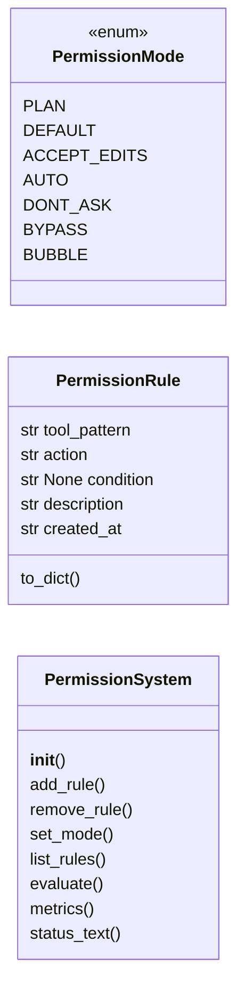
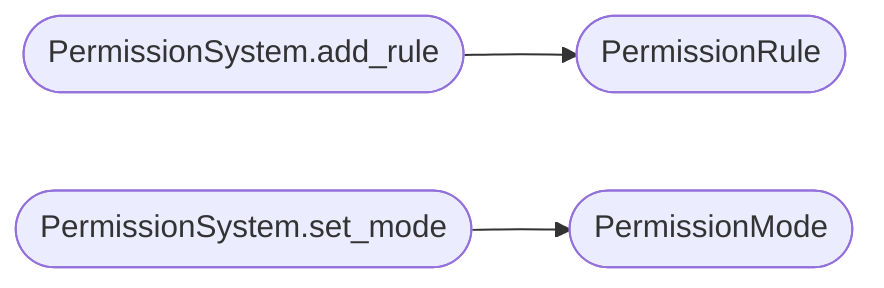

# `skills.lazyown_permissions`

> Source: [skills/lazyown_permissions.py:1](../../skills/lazyown_permissions.py#L1) | language `py` | coverage 30.8% | [API index](../index.md)

LazyOwn Permission System — Deny-First Rule Evaluation (Claude Code style)

Deny rules ALWAYS win over allow rules.
Modes: plan | default | accept_edits | auto | dont_ask | bypass_permissions

## Contents

- **Classes:** [`PermissionRule`](#permissionrule), [`PermissionSystem`](#permissionsystem)
- **Enums:** [`PermissionMode`](#permissionmode)

## Type Diagram



## Call Graph

Solid arrows stay in this module, dashed arrows leave it.



## Classes

<a id="permissionrule"></a>

### `PermissionRule`

`class` `dataclass` | [skills/lazyown_permissions.py:29](../../skills/lazyown_permissions.py#L29)

Decorators: `@dataclass`

```python
class PermissionRule
```

**Attributes**

| Name | Type | Default | Description |
|---|---|---|---|
| [`tool_pattern`](#permissionrule-tool_pattern) | `str` |  |  |
| [`action`](#permissionrule-action) | `str` |  |  |
| [`condition`](#permissionrule-condition) | `str \| None` | `None` |  |
| [`description`](#permissionrule-description) | `str` | `''` |  |
| [`created_at`](#permissionrule-created_at) | `str` | `field(default_factory=lambda: datetime.now().isoformat())` |  |

**Members**

| Member | Kind | Summary |
|---|---|---|
| [`to_dict`](#permissionrule-to_dict) | method |  |

<a id="permissionrule-to_dict"></a>

#### `PermissionRule.to_dict`

`method` | [skills/lazyown_permissions.py:36](../../skills/lazyown_permissions.py#L36)

```python
def to_dict(self) -> dict
```

**Returns:** `dict`

---

<a id="permissionsystem"></a>

### `PermissionSystem`

`class` | [skills/lazyown_permissions.py:91](../../skills/lazyown_permissions.py#L91)

```python
class PermissionSystem
```

Deny-first rule evaluator with persistent JSON rule store.

Rule evaluation order:
  1. Hard-coded always-deny patterns (catastrophic commands)
  2. Read-only tool bypass (never blocked by mode)
  3. User deny rules (wins over allow)
  4. User allow rules
  5. Mode default (dont_ask → deny; others → ask)

**Members**

| Member | Kind | Summary |
|---|---|---|
| [`__init__`](#permissionsystem-__init__) | constructor |  |
| [`add_rule`](#permissionsystem-add_rule) | method |  |
| [`remove_rule`](#permissionsystem-remove_rule) | method |  |
| [`set_mode`](#permissionsystem-set_mode) | method |  |
| [`list_rules`](#permissionsystem-list_rules) | method |  |
| [`evaluate`](#permissionsystem-evaluate) | method | Returns (decision, reason). decision: "allow" \| "deny" \| "ask" |
| [`metrics`](#permissionsystem-metrics) | method | Aggregate audit log into per-decision and per-tool counts. |
| [`status_text`](#permissionsystem-status_text) | method |  |

<a id="permissionsystem-__init__"></a>

#### `PermissionSystem.__init__`

`constructor` | [skills/lazyown_permissions.py:103](../../skills/lazyown_permissions.py#L103)

```python
def __init__(self, sessions_dir: Path)
```

**Parameters**

| Name | Type | Default | Description |
|---|---|---|---|
| `sessions_dir` | `Path` |  |  |

<a id="permissionsystem-add_rule"></a>

#### `PermissionSystem.add_rule`

`method` | [skills/lazyown_permissions.py:145](../../skills/lazyown_permissions.py#L145)

```python
def add_rule(self, tool_pattern: str, action: str, condition: str | None = None, description: str = '') -> str
```

**Parameters**

| Name | Type | Default | Description |
|---|---|---|---|
| `tool_pattern` | `str` |  |  |
| `action` | `str` |  |  |
| `condition` | `str \| None` | `None` |  |
| `description` | `str` | `''` |  |

**Returns:** `str`

*Calls:* [`PermissionRule`](#permissionrule)

<a id="permissionsystem-remove_rule"></a>

#### `PermissionSystem.remove_rule`

`method` | [skills/lazyown_permissions.py:151](../../skills/lazyown_permissions.py#L151)

```python
def remove_rule(self, tool_pattern: str, action: str) -> str
```

**Parameters**

| Name | Type | Default | Description |
|---|---|---|---|
| `tool_pattern` | `str` |  |  |
| `action` | `str` |  |  |

**Returns:** `str`

<a id="permissionsystem-set_mode"></a>

#### `PermissionSystem.set_mode`

`method` | [skills/lazyown_permissions.py:157](../../skills/lazyown_permissions.py#L157)

```python
def set_mode(self, mode: str) -> str
```

**Parameters**

| Name | Type | Default | Description |
|---|---|---|---|
| `mode` | `str` |  |  |

**Returns:** `str`

*Calls:* [`PermissionMode`](#permissionmode)

<a id="permissionsystem-list_rules"></a>

#### `PermissionSystem.list_rules`

`method` | [skills/lazyown_permissions.py:162](../../skills/lazyown_permissions.py#L162)

```python
def list_rules(self) -> list[dict]
```

**Returns:** `list[dict]`

<a id="permissionsystem-evaluate"></a>

#### `PermissionSystem.evaluate`

`method` | [skills/lazyown_permissions.py:167](../../skills/lazyown_permissions.py#L167)

```python
def evaluate(self, tool_name: str, arguments: dict) -> tuple[str, str]
```

Returns (decision, reason). decision: "allow" | "deny" | "ask"

**Parameters**

| Name | Type | Default | Description |
|---|---|---|---|
| `tool_name` | `str` |  |  |
| `arguments` | `dict` |  |  |

**Returns:** `tuple[str, str]`

<a id="permissionsystem-metrics"></a>

#### `PermissionSystem.metrics`

`method` | [skills/lazyown_permissions.py:237](../../skills/lazyown_permissions.py#L237)

```python
def metrics(self) -> dict
```

Aggregate audit log into per-decision and per-tool counts.

**Returns:** `dict`

<a id="permissionsystem-status_text"></a>

#### `PermissionSystem.status_text`

`method` | [skills/lazyown_permissions.py:279](../../skills/lazyown_permissions.py#L279)

```python
def status_text(self) -> str
```

**Returns:** `str`

---

## Enums

<a id="permissionmode"></a>

### `PermissionMode`

`enum` | [skills/lazyown_permissions.py:18](../../skills/lazyown_permissions.py#L18)

```python
class PermissionMode(Enum)
```

Bases: `Enum`

**Attributes**

| Name | Type | Default | Description |
|---|---|---|---|
| [`PLAN`](#permissionmode-plan) |  | `'plan'` |  |
| [`DEFAULT`](#permissionmode-default) |  | `'default'` |  |
| [`ACCEPT_EDITS`](#permissionmode-accept_edits) |  | `'accept_edits'` |  |
| [`AUTO`](#permissionmode-auto) |  | `'auto'` |  |
| [`DONT_ASK`](#permissionmode-dont_ask) |  | `'dont_ask'` |  |
| [`BYPASS`](#permissionmode-bypass) |  | `'bypass_permissions'` |  |
| [`BUBBLE`](#permissionmode-bubble) |  | `'bubble'` |  |

---
