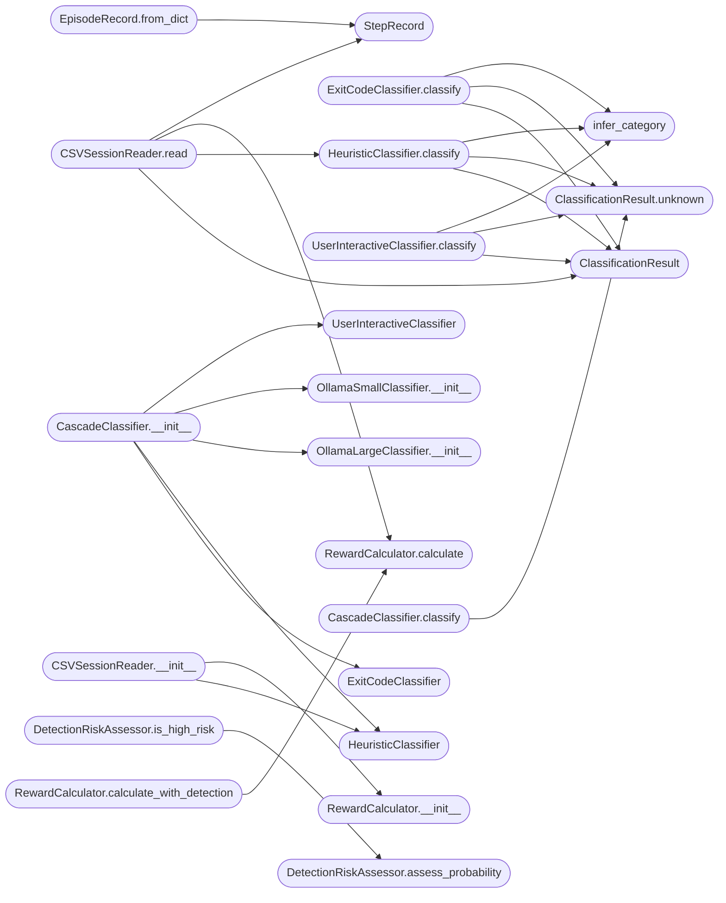

# `skills.lazyown_policy`

> Source: [skills/lazyown_policy.py:1](../../skills/lazyown_policy.py#L1) | language `py` | coverage 81.4% | [API index](../index.md)

LazyOwn Policy Engine ===================== Four-tier cascading outcome classifier with reward-based transition learning.

Reads sessions/LazyOwn_session_report.csv to bootstrap from historical data,
classifies command outcomes through a configurable cascade:

  Tier 1  — shell exit code (fast, low confidence)
  Tier 2a — regex heuristics on output (fast, medium confidence)
  Tier 2b — local Ollama small model (slow, higher confidence)
  Tier 3  — local Ollama large model as fallback (slow, higher confidence)
  Tier 4  — interactive operator prompt (authoritative, manual)

Each completed step receives a reward scalar derived from its category and
outcome.  Transitions between states are counted in a persistent table.
The policy engine uses that table, plus a set of hand-coded override rules,
to recommend the next action category.

Usage:
    python3 skills/lazyown_policy.py bootstrap
    python3 skills/lazyown_policy.py analyze \
        --target 10.0.0.1 --command lazynmap --args "-sV 10.0.0.1" \
        --exit-code 0 --output "22/open 80/open"
    python3 skills/lazyown_policy.py recommend --target 10.0.0.1
    python3 skills/lazyown_policy.py report

## Contents

- **Classes:** [`Config`](#config), [`ClassificationResult`](#classificationresult), [`StepRecord`](#steprecord), [`EpisodeRecord`](#episoderecord), [`IOutputClassifier`](#ioutputclassifier), [`ExitCodeClassifier`](#exitcodeclassifier), [`HeuristicClassifier`](#heuristicclassifier), [`OllamaSmallClassifier`](#ollamasmallclassifier), [`OllamaLargeClassifier`](#ollamalargeclassifier), [`UserInteractiveClassifier`](#userinteractiveclassifier), [`CascadeClassifier`](#cascadeclassifier), [`DetectionRiskAssessor`](#detectionriskassessor), [`RewardCalculator`](#rewardcalculator), [`CSVSessionReader`](#csvsessionreader), [`IEpisodeStore`](#iepisodestore), [`JSONLEpisodeStore`](#jsonlepisodestore), [`TransitionTable`](#transitiontable), [`OverrideRule`](#overriderule), [`PolicyEngine`](#policyengine), [`SessionClassificationPipeline`](#sessionclassificationpipeline), [`PolicyAdvisor`](#policyadvisor), [`LazyOwnPolicyIntegration`](#lazyownpolicyintegration), [`ApprovalRequest`](#approvalrequest), [`ApprovalOutcome`](#approvaloutcome), [`IApprovalSink`](#iapprovalsink), [`FileApprovalSink`](#fileapprovalsink), [`BroadcastApprovalSink`](#broadcastapprovalsink), [`StdinApprovalSink`](#stdinapprovalsink), [`CompositeApprovalSink`](#compositeapprovalsink), [`ApprovalGate`](#approvalgate), [`ScopeBoundAutoGate`](#scopeboundautogate), [`HistoryBootstrapper`](#historybootstrapper)
- **Enums:** [`ActionCategory`](#actioncategory), [`OutcomeType`](#outcometype), [`ApprovalDecision`](#approvaldecision)
- **Functions:** [`infer_category`](#infer_category), [`main`](#main)
- **Constants:** [`SCOPE_KEY`](#scope_key), [`SCOPE_ENFORCEMENT_KEY`](#scope_enforcement_key), [`ENFORCEMENT_OFF`](#enforcement_off), [`ENFORCEMENT_WARN`](#enforcement_warn), [`ENFORCEMENT_ENFORCE`](#enforcement_enforce)

## Type Diagram

```mermaid
classDiagram
    direction LR
    class Config
    Config : Path base_dir
    Config : Path sessions_dir
    Config : Path session_csv
    Config : Path episodes_file
    Config : Path transitions_file
    Config : Path rewards_file
    Config : str ollama_host
    Config : int ollama_port
    Config : str ollama_small_model
    Config : str ollama_large_model
    Config : str ollama_generate_path
    Config : int ollama_timeout_s
    Config : float min_confidence_to_accept
    Config : int max_output_chars_for_llm
    Config : Mapping[str, int] reward_table
    Config : int min_transition_count
    Config : int top_k_recommendations
    Config : str log_level
    Config : default()
    Config : ollama_url()
    class ActionCategory
    <<enum>> ActionCategory
    ActionCategory : RECON
    ActionCategory : ENUM
    ActionCategory : BRUTE_FORCE
    ActionCategory : EXPLOIT
    ActionCategory : INTRUSION
    ActionCategory : PRIVESC
    ActionCategory : CREDENTIAL
    ActionCategory : LATERAL
    ActionCategory : PAYLOAD
    ActionCategory : OTHER
    class OutcomeType
    <<enum>> OutcomeType
    OutcomeType : SUCCESS
    OutcomeType : FAIL
    OutcomeType : UNKNOWN
    class ClassificationResult
    ClassificationResult : bool success
    ClassificationResult : float confidence
    ClassificationResult : ActionCategory category
    ClassificationResult : OutcomeType outcome
    ClassificationResult : str reason
    ClassificationResult : str tier
    ClassificationResult : unknown()
    class StepRecord
    StepRecord : str timestamp
    StepRecord : str target
    StepRecord : str command
    StepRecord : str args
    StepRecord : str category
    StepRecord : str outcome
    StepRecord : int reward
    StepRecord : float confidence
    StepRecord : str tier
    StepRecord : str reason
    StepRecord : float detection_prob
    class EpisodeRecord
    EpisodeRecord : str episode_id
    EpisodeRecord : str target
    EpisodeRecord : list[StepRecord] steps
    EpisodeRecord : int total_reward
    EpisodeRecord : str created_at
    EpisodeRecord : str updated_at
    EpisodeRecord : to_dict()
    EpisodeRecord : from_dict()
    class IOutputClassifier
    IOutputClassifier : classify()
    class ExitCodeClassifier
    ExitCodeClassifier : classify()
    class HeuristicClassifier
    HeuristicClassifier : classify()
    class OllamaSmallClassifier
    OllamaSmallClassifier : __init__()
    class OllamaLargeClassifier
    OllamaLargeClassifier : __init__()
    class UserInteractiveClassifier
    UserInteractiveClassifier : classify()
    class CascadeClassifier
    CascadeClassifier : __init__()
    CascadeClassifier : classify()
    class DetectionRiskAssessor
    DetectionRiskAssessor : __init__()
    DetectionRiskAssessor : assess_probability()
    DetectionRiskAssessor : is_high_risk()
    class RewardCalculator
    RewardCalculator : __init__()
    RewardCalculator : calculate()
    RewardCalculator : calculate_with_detection()
    class CSVSessionReader
    CSVSessionReader : __init__()
    CSVSessionReader : read()
    class IEpisodeStore
    IEpisodeStore : append_step()
    IEpisodeStore : load_all()
    IEpisodeStore : get_episode()
    class JSONLEpisodeStore
    JSONLEpisodeStore : __init__()
    JSONLEpisodeStore : append_step()
    JSONLEpisodeStore : load_all()
    JSONLEpisodeStore : get_episode()
    class TransitionTable
    TransitionTable : __init__()
    TransitionTable : record()
    TransitionTable : query()
    class OverrideRule
    OverrideRule : str name
    OverrideRule : tuple[str, ] trigger_sequence
    OverrideRule : str inject_category
    OverrideRule : str reason
    OverrideRule : int priority
    class PolicyEngine
    PolicyEngine : __init__()
    PolicyEngine : recommend()
    class SessionClassificationPipeline
    SessionClassificationPipeline : __init__()
    SessionClassificationPipeline : process()
    class PolicyAdvisor
    PolicyAdvisor : __init__()
    PolicyAdvisor : advise()
    PolicyAdvisor : episode_summary()
    class LazyOwnPolicyIntegration
    LazyOwnPolicyIntegration : __init__()
    LazyOwnPolicyIntegration : on_command_complete()
    LazyOwnPolicyIntegration : get_recommendations()
    IOutputClassifier <|-- ExitCodeClassifier
    IOutputClassifier <|-- HeuristicClassifier
    IOutputClassifier <|-- UserInteractiveClassifier
    IEpisodeStore <|-- JSONLEpisodeStore
```



## Call Graph

Solid arrows stay in this module, dashed arrows leave it.



## Classes

<a id="config"></a>

### `Config`

`class` `dataclass` | [skills/lazyown_policy.py:54](../../skills/lazyown_policy.py#L54)

Decorators: `@dataclass(frozen=True)`

```python
class Config
```

Single source of truth for all tunable parameters and file paths.

**Attributes**

| Name | Type | Default | Description |
|---|---|---|---|
| [`base_dir`](#config-base_dir) | `Path` |  |  |
| [`sessions_dir`](#config-sessions_dir) | `Path` |  |  |
| [`session_csv`](#config-session_csv) | `Path` |  |  |
| [`episodes_file`](#config-episodes_file) | `Path` |  |  |
| [`transitions_file`](#config-transitions_file) | `Path` |  |  |
| [`rewards_file`](#config-rewards_file) | `Path` |  |  |
| [`ollama_host`](#config-ollama_host) | `str` |  |  |
| [`ollama_port`](#config-ollama_port) | `int` |  |  |
| [`ollama_small_model`](#config-ollama_small_model) | `str` |  |  |
| [`ollama_large_model`](#config-ollama_large_model) | `str` |  |  |
| [`ollama_generate_path`](#config-ollama_generate_path) | `str` |  |  |
| [`ollama_timeout_s`](#config-ollama_timeout_s) | `int` |  |  |
| [`min_confidence_to_accept`](#config-min_confidence_to_accept) | `float` |  |  |
| [`max_output_chars_for_llm`](#config-max_output_chars_for_llm) | `int` |  |  |
| [`reward_table`](#config-reward_table) | `Mapping[str, int]` |  |  |
| [`min_transition_count`](#config-min_transition_count) | `int` |  |  |
| [`top_k_recommendations`](#config-top_k_recommendations) | `int` |  |  |
| [`log_level`](#config-log_level) | `str` |  |  |

**Members**

| Member | Kind | Summary |
|---|---|---|
| [`default`](#config-default) | classmethod | Construct configuration anchored to this file's repository root. |
| [`ollama_url`](#config-ollama_url) | property | Full URL for the Ollama generate endpoint. |

<a id="config-default"></a>

#### `Config.default`

`classmethod` | [skills/lazyown_policy.py:82](../../skills/lazyown_policy.py#L82)

Decorators: `@classmethod`

```python
def default(cls) -> Config
```

Construct configuration anchored to this file's repository root.

**Returns:** `Config`

<a id="config-ollama_url"></a>

#### `Config.ollama_url`

`property` | [skills/lazyown_policy.py:123](../../skills/lazyown_policy.py#L123)

Decorators: `@property`

```python
def ollama_url(self) -> str
```

Full URL for the Ollama generate endpoint.

**Returns:** `str`

---

<a id="classificationresult"></a>

### `ClassificationResult`

`class` `dataclass` | [skills/lazyown_policy.py:306](../../skills/lazyown_policy.py#L306)

Decorators: `@dataclass`

```python
class ClassificationResult
```

Output of a single classifier tier.

**Attributes**

| Name | Type | Default | Description |
|---|---|---|---|
| [`success`](#classificationresult-success) | `bool` |  |  |
| [`confidence`](#classificationresult-confidence) | `float` |  |  |
| [`category`](#classificationresult-category) | `ActionCategory` |  |  |
| [`outcome`](#classificationresult-outcome) | `OutcomeType` |  |  |
| [`reason`](#classificationresult-reason) | `str` |  |  |
| [`tier`](#classificationresult-tier) | `str` |  |  |

**Members**

| Member | Kind | Summary |
|---|---|---|
| [`unknown`](#classificationresult-unknown) | classmethod | Produce a result indicating the tier could not classify. |

<a id="classificationresult-unknown"></a>

#### `ClassificationResult.unknown`

`classmethod` | [skills/lazyown_policy.py:317](../../skills/lazyown_policy.py#L317)

Decorators: `@classmethod`

```python
def unknown(cls, tier: str) -> ClassificationResult
```

Produce a result indicating the tier could not classify.

**Parameters**

| Name | Type | Default | Description |
|---|---|---|---|
| `tier` | `str` |  |  |

**Returns:** `ClassificationResult`

*Called by:* [`CascadeClassifier.classify`](#cascadeclassifier-classify), [`ExitCodeClassifier.classify`](#exitcodeclassifier-classify), [`HeuristicClassifier.classify`](#heuristicclassifier-classify), [`UserInteractiveClassifier.classify`](#userinteractiveclassifier-classify)

---

<a id="steprecord"></a>

### `StepRecord`

`class` `dataclass` | [skills/lazyown_policy.py:330](../../skills/lazyown_policy.py#L330)

Decorators: `@dataclass`

```python
class StepRecord
```

A single classified command execution within an episode.

**Attributes**

| Name | Type | Default | Description |
|---|---|---|---|
| [`timestamp`](#steprecord-timestamp) | `str` |  |  |
| [`target`](#steprecord-target) | `str` |  |  |
| [`command`](#steprecord-command) | `str` |  |  |
| [`args`](#steprecord-args) | `str` |  |  |
| [`category`](#steprecord-category) | `str` |  |  |
| [`outcome`](#steprecord-outcome) | `str` |  |  |
| [`reward`](#steprecord-reward) | `int` |  |  |
| [`confidence`](#steprecord-confidence) | `float` |  |  |
| [`tier`](#steprecord-tier) | `str` |  |  |
| [`reason`](#steprecord-reason) | `str` |  |  |
| [`detection_prob`](#steprecord-detection_prob) | `float` | `0.0` |  |

---

<a id="episoderecord"></a>

### `EpisodeRecord`

`class` `dataclass` | [skills/lazyown_policy.py:347](../../skills/lazyown_policy.py#L347)

Decorators: `@dataclass`

```python
class EpisodeRecord
```

A sequence of classified steps against a common target.

**Attributes**

| Name | Type | Default | Description |
|---|---|---|---|
| [`episode_id`](#episoderecord-episode_id) | `str` |  |  |
| [`target`](#episoderecord-target) | `str` |  |  |
| [`steps`](#episoderecord-steps) | `list[StepRecord]` |  |  |
| [`total_reward`](#episoderecord-total_reward) | `int` |  |  |
| [`created_at`](#episoderecord-created_at) | `str` |  |  |
| [`updated_at`](#episoderecord-updated_at) | `str` |  |  |

**Members**

| Member | Kind | Summary |
|---|---|---|
| [`to_dict`](#episoderecord-to_dict) | method | Serialise to a plain dict suitable for JSON encoding. |
| [`from_dict`](#episoderecord-from_dict) | classmethod | Deserialise from a dict produced by to_dict. |

<a id="episoderecord-to_dict"></a>

#### `EpisodeRecord.to_dict`

`method` | [skills/lazyown_policy.py:357](../../skills/lazyown_policy.py#L357)

```python
def to_dict(self) -> dict
```

Serialise to a plain dict suitable for JSON encoding.

**Returns:** `dict`

<a id="episoderecord-from_dict"></a>

#### `EpisodeRecord.from_dict`

`classmethod` | [skills/lazyown_policy.py:362](../../skills/lazyown_policy.py#L362)

Decorators: `@classmethod`

```python
def from_dict(cls, d: dict) -> EpisodeRecord
```

Deserialise from a dict produced by to_dict.

**Parameters**

| Name | Type | Default | Description |
|---|---|---|---|
| `d` | `dict` |  |  |

**Returns:** `EpisodeRecord`

*Calls:* [`StepRecord`](#steprecord)

*Called by:* [`JSONLEpisodeStore.load_all`](#jsonlepisodestore-load_all)

---

<a id="ioutputclassifier"></a>

### `IOutputClassifier`

`class` `abstract` | [skills/lazyown_policy.py:372](../../skills/lazyown_policy.py#L372)

```python
class IOutputClassifier(abc.ABC)
```

Bases: `abc.ABC`

Subclasses: [`ExitCodeClassifier`](#exitcodeclassifier), [`HeuristicClassifier`](#heuristicclassifier), [`UserInteractiveClassifier`](#userinteractiveclassifier)

Abstract base for all classifier tiers.

**Members**

| Member | Kind | Summary |
|---|---|---|
| [`classify`](#ioutputclassifier-classify) | method | Classify the outcome of one command execution. |

<a id="ioutputclassifier-classify"></a>

#### `IOutputClassifier.classify`

`method` `abstract` | [skills/lazyown_policy.py:376](../../skills/lazyown_policy.py#L376)

Decorators: `@abc.abstractmethod`

```python
def classify(self, command: str, args: str, output: str, exit_code: int | None) -> ClassificationResult
```

Classify the outcome of one command execution.

**Parameters**

| Name | Type | Default | Description |
|---|---|---|---|
| `command` | `str` |  |  |
| `args` | `str` |  |  |
| `output` | `str` |  |  |
| `exit_code` | `int \| None` |  |  |

**Returns:** `ClassificationResult`

---

<a id="exitcodeclassifier"></a>

### `ExitCodeClassifier`

`class` | [skills/lazyown_policy.py:389](../../skills/lazyown_policy.py#L389)

```python
class ExitCodeClassifier(IOutputClassifier)
```

Bases: [`IOutputClassifier`](#ioutputclassifier)

Tier 1: derive outcome from the shell exit code alone.

A zero exit code implies success but carries limited information about
the category, hence confidence is intentionally capped below the
acceptance threshold so richer tiers are always attempted first.

**Members**

| Member | Kind | Summary |
|---|---|---|
| [`classify`](#exitcodeclassifier-classify) | method | Return a low-confidence result based solely on the exit code. |

<a id="exitcodeclassifier-classify"></a>

#### `ExitCodeClassifier.classify`

`method` | [skills/lazyown_policy.py:401](../../skills/lazyown_policy.py#L401)

```python
def classify(self, command: str, args: str, output: str, exit_code: int | None) -> ClassificationResult
```

Return a low-confidence result based solely on the exit code.

**Parameters**

| Name | Type | Default | Description |
|---|---|---|---|
| `command` | `str` |  |  |
| `args` | `str` |  |  |
| `output` | `str` |  |  |
| `exit_code` | `int \| None` |  |  |

**Returns:** `ClassificationResult`

*Calls:* [`ClassificationResult`](#classificationresult), [`ClassificationResult.unknown`](#classificationresult-unknown), [`infer_category`](#infer_category)

---

<a id="heuristicclassifier"></a>

### `HeuristicClassifier`

`class` | [skills/lazyown_policy.py:434](../../skills/lazyown_policy.py#L434)

```python
class HeuristicClassifier(IOutputClassifier)
```

Bases: [`IOutputClassifier`](#ioutputclassifier)

Tier 2a: regex-based pattern matching on command output.

Checks ordered success patterns first, then failure patterns.
Returns UNKNOWN when no pattern exceeds a minimum match quality.

**Members**

| Member | Kind | Summary |
|---|---|---|
| [`classify`](#heuristicclassifier-classify) | method | Scan output for known success or failure signatures. |

<a id="heuristicclassifier-classify"></a>

#### `HeuristicClassifier.classify`

`method` | [skills/lazyown_policy.py:444](../../skills/lazyown_policy.py#L444)

```python
def classify(self, command: str, args: str, output: str, exit_code: int | None) -> ClassificationResult
```

Scan output for known success or failure signatures.

**Parameters**

| Name | Type | Default | Description |
|---|---|---|---|
| `command` | `str` |  |  |
| `args` | `str` |  |  |
| `output` | `str` |  |  |
| `exit_code` | `int \| None` |  |  |

**Returns:** `ClassificationResult`

*Calls:* [`ClassificationResult`](#classificationresult), [`ClassificationResult.unknown`](#classificationresult-unknown), [`infer_category`](#infer_category)

*Called by:* [`CSVSessionReader.read`](#csvsessionreader-read)

---

<a id="ollamasmallclassifier"></a>

### `OllamaSmallClassifier`

`class` | [skills/lazyown_policy.py:588](../../skills/lazyown_policy.py#L588)

```python
class OllamaSmallClassifier(_OllamaClassifierBase)
```

Bases: `_OllamaClassifierBase`

Tier 2b: classification via the configured small local model.

**Members**

| Member | Kind | Summary |
|---|---|---|
| [`__init__`](#ollamasmallclassifier-__init__) | constructor |  |

<a id="ollamasmallclassifier-__init__"></a>

#### `OllamaSmallClassifier.__init__`

`constructor` | [skills/lazyown_policy.py:591](../../skills/lazyown_policy.py#L591)

```python
def __init__(self, cfg: Config) -> None
```

**Parameters**

| Name | Type | Default | Description |
|---|---|---|---|
| `cfg` | `Config` |  |  |

*Called by:* [`CascadeClassifier.__init__`](#cascadeclassifier-__init__)

---

<a id="ollamalargeclassifier"></a>

### `OllamaLargeClassifier`

`class` | [skills/lazyown_policy.py:598](../../skills/lazyown_policy.py#L598)

```python
class OllamaLargeClassifier(_OllamaClassifierBase)
```

Bases: `_OllamaClassifierBase`

Tier 3: classification via the configured large local model as fallback.

**Members**

| Member | Kind | Summary |
|---|---|---|
| [`__init__`](#ollamalargeclassifier-__init__) | constructor |  |

<a id="ollamalargeclassifier-__init__"></a>

#### `OllamaLargeClassifier.__init__`

`constructor` | [skills/lazyown_policy.py:601](../../skills/lazyown_policy.py#L601)

```python
def __init__(self, cfg: Config) -> None
```

**Parameters**

| Name | Type | Default | Description |
|---|---|---|---|
| `cfg` | `Config` |  |  |

*Called by:* [`CascadeClassifier.__init__`](#cascadeclassifier-__init__)

---

<a id="userinteractiveclassifier"></a>

### `UserInteractiveClassifier`

`class` | [skills/lazyown_policy.py:608](../../skills/lazyown_policy.py#L608)

```python
class UserInteractiveClassifier(IOutputClassifier)
```

Bases: [`IOutputClassifier`](#ioutputclassifier)

Tier 4: request manual classification from the operator.

Used only when all automatic tiers are inconclusive and the pipeline
was constructed with interactive=True.

**Members**

| Member | Kind | Summary |
|---|---|---|
| [`classify`](#userinteractiveclassifier-classify) | method | Prompt the operator and return their authoritative verdict. |

<a id="userinteractiveclassifier-classify"></a>

#### `UserInteractiveClassifier.classify`

`method` | [skills/lazyown_policy.py:616](../../skills/lazyown_policy.py#L616)

```python
def classify(self, command: str, args: str, output: str, exit_code: int | None) -> ClassificationResult
```

Prompt the operator and return their authoritative verdict.

**Parameters**

| Name | Type | Default | Description |
|---|---|---|---|
| `command` | `str` |  |  |
| `args` | `str` |  |  |
| `output` | `str` |  |  |
| `exit_code` | `int \| None` |  |  |

**Returns:** `ClassificationResult`

*Calls:* [`ClassificationResult`](#classificationresult), [`ClassificationResult.unknown`](#classificationresult-unknown), [`infer_category`](#infer_category)

---

<a id="cascadeclassifier"></a>

### `CascadeClassifier`

`class` | [skills/lazyown_policy.py:657](../../skills/lazyown_policy.py#L657)

```python
class CascadeClassifier
```

Runs classifier tiers in order and stops at the first result whose confidence meets or exceeds Config.min_confidence_to_accept.

Retains the highest-confidence partial result in case all tiers
stay below the threshold.

**Members**

| Member | Kind | Summary |
|---|---|---|
| [`__init__`](#cascadeclassifier-__init__) | constructor |  |
| [`classify`](#cascadeclassifier-classify) | method | Return the first sufficiently confident result, or the best available. |

<a id="cascadeclassifier-__init__"></a>

#### `CascadeClassifier.__init__`

`constructor` | [skills/lazyown_policy.py:666](../../skills/lazyown_policy.py#L666)

```python
def __init__(self, cfg: Config, interactive: bool = False) -> None
```

**Parameters**

| Name | Type | Default | Description |
|---|---|---|---|
| `cfg` | `Config` |  |  |
| `interactive` | `bool` | `False` |  |

*Calls:* [`ExitCodeClassifier`](#exitcodeclassifier), [`HeuristicClassifier`](#heuristicclassifier), [`OllamaLargeClassifier.__init__`](#ollamalargeclassifier-__init__), [`OllamaSmallClassifier.__init__`](#ollamasmallclassifier-__init__), [`UserInteractiveClassifier`](#userinteractiveclassifier)

*Called by:* [`SessionClassificationPipeline.__init__`](#sessionclassificationpipeline-__init__)

<a id="cascadeclassifier-classify"></a>

#### `CascadeClassifier.classify`

`method` | [skills/lazyown_policy.py:677](../../skills/lazyown_policy.py#L677)

```python
def classify(self, command: str, args: str, output: str, exit_code: int | None) -> ClassificationResult
```

Return the first sufficiently confident result, or the best available.

**Parameters**

| Name | Type | Default | Description |
|---|---|---|---|
| `command` | `str` |  |  |
| `args` | `str` |  |  |
| `output` | `str` |  |  |
| `exit_code` | `int \| None` |  |  |

**Returns:** `ClassificationResult`

*Calls:* [`ClassificationResult.unknown`](#classificationresult-unknown)

*Called by:* [`SessionClassificationPipeline.process`](#sessionclassificationpipeline-process)

---

<a id="detectionriskassessor"></a>

### `DetectionRiskAssessor`

`class` | [skills/lazyown_policy.py:701](../../skills/lazyown_policy.py#L701)

```python
class DetectionRiskAssessor
```

Wraps the DetectionOracle to provide detection probability for a command.

Lazily imports modules.detection_oracle so that the oracle's sigma rule
catalog does not load unless this class is instantiated.  This preserves
the fast startup behaviour of lazyown_mcp.py.

Single Responsibility: detection probability query only.
Dependency Inversion: callers receive this via constructor injection.

**Members**

| Member | Kind | Summary |
|---|---|---|
| [`__init__`](#detectionriskassessor-__init__) | constructor |  |
| [`assess_probability`](#detectionriskassessor-assess_probability) | method | Return detection probability in [0.0, 1.0]. |
| [`is_high_risk`](#detectionriskassessor-is_high_risk) | method | Return True when detection probability meets or exceeds the threshold. |

<a id="detectionriskassessor-__init__"></a>

#### `DetectionRiskAssessor.__init__`

`constructor` | [skills/lazyown_policy.py:715](../../skills/lazyown_policy.py#L715)

```python
def __init__(self) -> None
```

*Called by:* [`SessionClassificationPipeline.__init__`](#sessionclassificationpipeline-__init__)

<a id="detectionriskassessor-assess_probability"></a>

#### `DetectionRiskAssessor.assess_probability`

`method` | [skills/lazyown_policy.py:733](../../skills/lazyown_policy.py#L733)

```python
def assess_probability(self, command: str, args: str, category: str) -> float
```

Return detection probability in [0.0, 1.0].

Returns 0.0 when the oracle is unavailable (fail-open for rewards).

**Parameters**

| Name | Type | Default | Description |
|---|---|---|---|
| `command` | `str` |  |  |
| `args` | `str` |  |  |
| `category` | `str` |  |  |

**Returns:** `float`

*Called by:* [`DetectionRiskAssessor.is_high_risk`](#detectionriskassessor-is_high_risk)

<a id="detectionriskassessor-is_high_risk"></a>

#### `DetectionRiskAssessor.is_high_risk`

`method` | [skills/lazyown_policy.py:746](../../skills/lazyown_policy.py#L746)

```python
def is_high_risk(self, command: str, args: str, category: str) -> bool
```

Return True when detection probability meets or exceeds the threshold.

**Parameters**

| Name | Type | Default | Description |
|---|---|---|---|
| `command` | `str` |  |  |
| `args` | `str` |  |  |
| `category` | `str` |  |  |

**Returns:** `bool`

*Calls:* [`DetectionRiskAssessor.assess_probability`](#detectionriskassessor-assess_probability)

---

<a id="rewardcalculator"></a>

### `RewardCalculator`

`class` | [skills/lazyown_policy.py:754](../../skills/lazyown_policy.py#L754)

```python
class RewardCalculator
```

Converts (ActionCategory, OutcomeType) pairs to scalar reward values, optionally applying a detection-risk penalty when a DetectionRiskAssessor is provided.

Detection penalty rule
----------------------
When detection probability >= 0.70 (high risk), the reward for a successful
action is zeroed out.  This forces the policy engine to prefer lower-noise
paths over high-value but high-visibility actions.

Failure rewards are unaffected by detection probability — the agent must
still learn that failed actions carry a negative signal.

**Members**

| Member | Kind | Summary |
|---|---|---|
| [`__init__`](#rewardcalculator-__init__) | constructor |  |
| [`calculate`](#rewardcalculator-calculate) | method | Return the reward integer for the given (category, outcome) pair. |
| [`calculate_with_detection`](#rewardcalculator-calculate_with_detection) | method | Return (reward, detection_probability) for the given execution. |

<a id="rewardcalculator-__init__"></a>

#### `RewardCalculator.__init__`

`constructor` | [skills/lazyown_policy.py:773](../../skills/lazyown_policy.py#L773)

```python
def __init__(self, cfg: Config, risk_assessor: DetectionRiskAssessor | None = None) -> None
```

**Parameters**

| Name | Type | Default | Description |
|---|---|---|---|
| `cfg` | `Config` |  |  |
| `risk_assessor` | `DetectionRiskAssessor \| None` | `None` |  |

*Called by:* [`CSVSessionReader.__init__`](#csvsessionreader-__init__), [`SessionClassificationPipeline.__init__`](#sessionclassificationpipeline-__init__)

<a id="rewardcalculator-calculate"></a>

#### `RewardCalculator.calculate`

`method` | [skills/lazyown_policy.py:783](../../skills/lazyown_policy.py#L783)

```python
def calculate(self, category: ActionCategory, outcome: OutcomeType) -> int
```

Return the reward integer for the given (category, outcome) pair.

Detection risk is NOT applied here — use calculate_with_detection() when command context is available.

**Parameters**

| Name | Type | Default | Description |
|---|---|---|---|
| `category` | `ActionCategory` |  |  |
| `outcome` | `OutcomeType` |  |  |

**Returns:** `int`

*Called by:* [`CSVSessionReader.read`](#csvsessionreader-read), [`RewardCalculator.calculate_with_detection`](#rewardcalculator-calculate_with_detection)

<a id="rewardcalculator-calculate_with_detection"></a>

#### `RewardCalculator.calculate_with_detection`

`method` | [skills/lazyown_policy.py:798](../../skills/lazyown_policy.py#L798)

```python
def calculate_with_detection(self, category: ActionCategory, outcome: OutcomeType, command: str, args: str) -> tuple[int, float]
```

Return (reward, detection_probability) for the given execution.

When detection_probability >= 0.70 and outcome is SUCCESS, the reward
is forced to zero to discourage noisy techniques.  This implements the
detection-aware reward shaping described in the architecture.

**Parameters**

| Name | Type | Default | Description |
|---|---|---|---|
| `category` | `ActionCategory` |  |  |
| `outcome` | `OutcomeType` |  |  |
| `command` | `str` |  |  |
| `args` | `str` |  |  |

**Returns:** `int, detection_prob: float)`

*Calls:* [`RewardCalculator.calculate`](#rewardcalculator-calculate)

*Called by:* [`SessionClassificationPipeline.process`](#sessionclassificationpipeline-process)

---

<a id="csvsessionreader"></a>

### `CSVSessionReader`

`class` | [skills/lazyown_policy.py:843](../../skills/lazyown_policy.py#L843)

```python
class CSVSessionReader
```

Reads LazyOwn_session_report.csv and converts each row to a StepRecord using heuristic classification (no output or exit code available for historical data).

**Members**

| Member | Kind | Summary |
|---|---|---|
| [`__init__`](#csvsessionreader-__init__) | constructor |  |
| [`read`](#csvsessionreader-read) | method | Parse the CSV and return all classifiable rows as StepRecord instances. |

<a id="csvsessionreader-__init__"></a>

#### `CSVSessionReader.__init__`

`constructor` | [skills/lazyown_policy.py:850](../../skills/lazyown_policy.py#L850)

```python
def __init__(self, cfg: Config) -> None
```

**Parameters**

| Name | Type | Default | Description |
|---|---|---|---|
| `cfg` | `Config` |  |  |

*Calls:* [`HeuristicClassifier`](#heuristicclassifier), [`RewardCalculator.__init__`](#rewardcalculator-__init__)

*Called by:* [`HistoryBootstrapper.__init__`](#historybootstrapper-__init__)

<a id="csvsessionreader-read"></a>

#### `CSVSessionReader.read`

`method` | [skills/lazyown_policy.py:855](../../skills/lazyown_policy.py#L855)

```python
def read(self) -> list[StepRecord]
```

Parse the CSV and return all classifiable rows as StepRecord instances.

**Returns:** `list[StepRecord]`

*Calls:* [`ClassificationResult`](#classificationresult), [`HeuristicClassifier.classify`](#heuristicclassifier-classify), [`RewardCalculator.calculate`](#rewardcalculator-calculate), [`StepRecord`](#steprecord), [`infer_category`](#infer_category)

*Called by:* [`HistoryBootstrapper.run`](#historybootstrapper-run)

---

<a id="iepisodestore"></a>

### `IEpisodeStore`

`class` `abstract` | [skills/lazyown_policy.py:899](../../skills/lazyown_policy.py#L899)

```python
class IEpisodeStore(abc.ABC)
```

Bases: `abc.ABC`

Subclasses: [`JSONLEpisodeStore`](#jsonlepisodestore)

Abstract persistence layer for episode records.

**Members**

| Member | Kind | Summary |
|---|---|---|
| [`append_step`](#iepisodestore-append_step) | method | Add a step to the episode for its target, creating the episode if needed. |
| [`load_all`](#iepisodestore-load_all) | method | Load every stored episode. |
| [`get_episode`](#iepisodestore-get_episode) | method | Return the episode for the given target, or None. |

<a id="iepisodestore-append_step"></a>

#### `IEpisodeStore.append_step`

`method` `abstract` | [skills/lazyown_policy.py:903](../../skills/lazyown_policy.py#L903)

Decorators: `@abc.abstractmethod`

```python
def append_step(self, step: StepRecord) -> None
```

Add a step to the episode for its target, creating the episode if needed.

**Parameters**

| Name | Type | Default | Description |
|---|---|---|---|
| `step` | `StepRecord` |  |  |

<a id="iepisodestore-load_all"></a>

#### `IEpisodeStore.load_all`

`method` `abstract` | [skills/lazyown_policy.py:907](../../skills/lazyown_policy.py#L907)

Decorators: `@abc.abstractmethod`

```python
def load_all(self) -> list[EpisodeRecord]
```

Load every stored episode.

**Returns:** `list[EpisodeRecord]`

<a id="iepisodestore-get_episode"></a>

#### `IEpisodeStore.get_episode`

`method` `abstract` | [skills/lazyown_policy.py:911](../../skills/lazyown_policy.py#L911)

Decorators: `@abc.abstractmethod`

```python
def get_episode(self, target: str) -> EpisodeRecord | None
```

Return the episode for the given target, or None.

**Parameters**

| Name | Type | Default | Description |
|---|---|---|---|
| `target` | `str` |  |  |

**Returns:** `EpisodeRecord | None`

---

<a id="jsonlepisodestore"></a>

### `JSONLEpisodeStore`

`class` | [skills/lazyown_policy.py:915](../../skills/lazyown_policy.py#L915)

```python
class JSONLEpisodeStore(IEpisodeStore)
```

Bases: [`IEpisodeStore`](#iepisodestore)

Persists each episode as one JSON line in a .jsonl file keyed by target.

The file is read and rewritten on every mutating call.  This is acceptable
given the expected cardinality of targets in a pentest engagement.

**Members**

| Member | Kind | Summary |
|---|---|---|
| [`__init__`](#jsonlepisodestore-__init__) | constructor |  |
| [`append_step`](#jsonlepisodestore-append_step) | method | Upsert the step into its target's episode and persist. |
| [`load_all`](#jsonlepisodestore-load_all) | method | Deserialise all episodes from the .jsonl file. |
| [`get_episode`](#jsonlepisodestore-get_episode) | method | Return the episode for target, or None if not found. |

<a id="jsonlepisodestore-__init__"></a>

#### `JSONLEpisodeStore.__init__`

`constructor` | [skills/lazyown_policy.py:923](../../skills/lazyown_policy.py#L923)

```python
def __init__(self, cfg: Config) -> None
```

**Parameters**

| Name | Type | Default | Description |
|---|---|---|---|
| `cfg` | `Config` |  |  |

*Called by:* [`HistoryBootstrapper.__init__`](#historybootstrapper-__init__), [`PolicyAdvisor.__init__`](#policyadvisor-__init__), [`SessionClassificationPipeline.__init__`](#sessionclassificationpipeline-__init__)

<a id="jsonlepisodestore-append_step"></a>

#### `JSONLEpisodeStore.append_step`

`method` | [skills/lazyown_policy.py:927](../../skills/lazyown_policy.py#L927)

```python
def append_step(self, step: StepRecord) -> None
```

Upsert the step into its target's episode and persist.

**Parameters**

| Name | Type | Default | Description |
|---|---|---|---|
| `step` | `StepRecord` |  |  |

*Calls:* [`EpisodeRecord`](#episoderecord), [`JSONLEpisodeStore.load_all`](#jsonlepisodestore-load_all)

*Called by:* [`HistoryBootstrapper.run`](#historybootstrapper-run), [`SessionClassificationPipeline.process`](#sessionclassificationpipeline-process)

<a id="jsonlepisodestore-load_all"></a>

#### `JSONLEpisodeStore.load_all`

`method` | [skills/lazyown_policy.py:947](../../skills/lazyown_policy.py#L947)

```python
def load_all(self) -> list[EpisodeRecord]
```

Deserialise all episodes from the .jsonl file.

**Returns:** `list[EpisodeRecord]`

*Calls:* [`EpisodeRecord.from_dict`](#episoderecord-from_dict)

*Called by:* [`JSONLEpisodeStore.append_step`](#jsonlepisodestore-append_step), [`JSONLEpisodeStore.get_episode`](#jsonlepisodestore-get_episode)

<a id="jsonlepisodestore-get_episode"></a>

#### `JSONLEpisodeStore.get_episode`

`method` | [skills/lazyown_policy.py:963](../../skills/lazyown_policy.py#L963)

```python
def get_episode(self, target: str) -> EpisodeRecord | None
```

Return the episode for target, or None if not found.

**Parameters**

| Name | Type | Default | Description |
|---|---|---|---|
| `target` | `str` |  |  |

**Returns:** `EpisodeRecord | None`

*Calls:* [`JSONLEpisodeStore.load_all`](#jsonlepisodestore-load_all)

*Called by:* [`PolicyAdvisor.advise`](#policyadvisor-advise), [`PolicyAdvisor.episode_summary`](#policyadvisor-episode_summary), [`SessionClassificationPipeline.process`](#sessionclassificationpipeline-process)

---

<a id="transitiontable"></a>

### `TransitionTable`

`class` | [skills/lazyown_policy.py:979](../../skills/lazyown_policy.py#L979)

```python
class TransitionTable
```

Persistent frequency table of observed (from_state → next_category) transitions.

State strings are formatted as "category:outcome" (e.g. "recon:success").
The table is written to disk after every update.

**Members**

| Member | Kind | Summary |
|---|---|---|
| [`__init__`](#transitiontable-__init__) | constructor |  |
| [`record`](#transitiontable-record) | method | Increment the counter for the given transition and persist. |
| [`query`](#transitiontable-query) | method | Return (next_category, success_rate, total_count) tuples for the given from_state, filtered by min_transition_count and sorted by success rate descending. |

<a id="transitiontable-__init__"></a>

#### `TransitionTable.__init__`

`constructor` | [skills/lazyown_policy.py:987](../../skills/lazyown_policy.py#L987)

```python
def __init__(self, cfg: Config) -> None
```

**Parameters**

| Name | Type | Default | Description |
|---|---|---|---|
| `cfg` | `Config` |  |  |

*Called by:* [`HistoryBootstrapper.__init__`](#historybootstrapper-__init__), [`PolicyAdvisor.__init__`](#policyadvisor-__init__), [`SessionClassificationPipeline.__init__`](#sessionclassificationpipeline-__init__)

<a id="transitiontable-record"></a>

#### `TransitionTable.record`

`method` | [skills/lazyown_policy.py:993](../../skills/lazyown_policy.py#L993)

```python
def record(self, from_state: str, to_category: str, outcome: str) -> None
```

Increment the counter for the given transition and persist.

**Parameters**

| Name | Type | Default | Description |
|---|---|---|---|
| `from_state` | `str` |  |  |
| `to_category` | `str` |  |  |
| `outcome` | `str` |  |  |

*Called by:* [`HistoryBootstrapper.run`](#historybootstrapper-run), [`SessionClassificationPipeline.process`](#sessionclassificationpipeline-process)

<a id="transitiontable-query"></a>

#### `TransitionTable.query`

`method` | [skills/lazyown_policy.py:1003](../../skills/lazyown_policy.py#L1003)

```python
def query(self, from_state: str) -> list[tuple[str, float, int]]
```

Return (next_category, success_rate, total_count) tuples for the given from_state, filtered by min_transition_count and sorted by success rate descending.

Always reloads from disk so that external edits (policy_transitions.json)
and concurrent writes from pipeline._transitions take effect immediately.

**Parameters**

| Name | Type | Default | Description |
|---|---|---|---|
| `from_state` | `str` |  |  |

**Returns:** `list[tuple[str, float, int]]`

---

<a id="overriderule"></a>

### `OverrideRule`

`class` `dataclass` | [skills/lazyown_policy.py:1042](../../skills/lazyown_policy.py#L1042)

Decorators: `@dataclass(frozen=True)`

```python
class OverrideRule
```

A hand-coded transition override that fires when recent session history matches a specific sequence of states.

**Attributes**

| Name | Type | Default | Description |
|---|---|---|---|
| [`name`](#overriderule-name) | `str` |  |  |
| [`trigger_sequence`](#overriderule-trigger_sequence) | `tuple[str, ...]` |  |  |
| [`inject_category`](#overriderule-inject_category) | `str` |  |  |
| [`reason`](#overriderule-reason) | `str` |  |  |
| [`priority`](#overriderule-priority) | `int` |  |  |

---

<a id="policyengine"></a>

### `PolicyEngine`

`class` | [skills/lazyown_policy.py:1097](../../skills/lazyown_policy.py#L1097)

```python
class PolicyEngine
```

Produces a ranked list of recommended next action categories for a target.

Override rules are evaluated first against a sliding window of recent states
and prepended to the list derived from transition table frequencies.

**Members**

| Member | Kind | Summary |
|---|---|---|
| [`__init__`](#policyengine-__init__) | constructor |  |
| [`recommend`](#policyengine-recommend) | method | Return up to top_k dicts with keys: category, reason, confidence, source. |

<a id="policyengine-__init__"></a>

#### `PolicyEngine.__init__`

`constructor` | [skills/lazyown_policy.py:1107](../../skills/lazyown_policy.py#L1107)

```python
def __init__(self, cfg: Config, transitions: TransitionTable) -> None
```

**Parameters**

| Name | Type | Default | Description |
|---|---|---|---|
| `cfg` | `Config` |  |  |
| `transitions` | `TransitionTable` |  |  |

*Called by:* [`PolicyAdvisor.__init__`](#policyadvisor-__init__)

<a id="policyengine-recommend"></a>

#### `PolicyEngine.recommend`

`method` | [skills/lazyown_policy.py:1111](../../skills/lazyown_policy.py#L1111)

```python
def recommend(self, recent_steps: list[StepRecord]) -> list[dict]
```

Return up to top_k dicts with keys: category, reason, confidence, source.

**Parameters**

| Name | Type | Default | Description |
|---|---|---|---|
| `recent_steps` | `list[StepRecord]` |  |  |

**Returns:** `list[dict]`

*Called by:* [`PolicyAdvisor.advise`](#policyadvisor-advise)

---

<a id="sessionclassificationpipeline"></a>

### `SessionClassificationPipeline`

`class` | [skills/lazyown_policy.py:1194](../../skills/lazyown_policy.py#L1194)

```python
class SessionClassificationPipeline
```

Main entry point for processing a completed command execution.

Runs the cascade classifier, computes the reward, persists the step,
and updates the transition table with the observed state change.

**Members**

| Member | Kind | Summary |
|---|---|---|
| [`__init__`](#sessionclassificationpipeline-__init__) | constructor |  |
| [`process`](#sessionclassificationpipeline-process) | method | Classify, reward, store, and return a StepRecord for the given execution. |

<a id="sessionclassificationpipeline-__init__"></a>

#### `SessionClassificationPipeline.__init__`

`constructor` | [skills/lazyown_policy.py:1202](../../skills/lazyown_policy.py#L1202)

```python
def __init__(self, cfg: Config, interactive: bool = False) -> None
```

**Parameters**

| Name | Type | Default | Description |
|---|---|---|---|
| `cfg` | `Config` |  |  |
| `interactive` | `bool` | `False` |  |

*Calls:* [`CascadeClassifier.__init__`](#cascadeclassifier-__init__), [`DetectionRiskAssessor.__init__`](#detectionriskassessor-__init__), [`JSONLEpisodeStore.__init__`](#jsonlepisodestore-__init__), [`RewardCalculator.__init__`](#rewardcalculator-__init__), [`TransitionTable.__init__`](#transitiontable-__init__)

*Called by:* [`LazyOwnPolicyIntegration.__init__`](#lazyownpolicyintegration-__init__)

<a id="sessionclassificationpipeline-process"></a>

#### `SessionClassificationPipeline.process`

`method` | [skills/lazyown_policy.py:1210](../../skills/lazyown_policy.py#L1210)

```python
def process(self, target: str, command: str, args: str, output: str, exit_code: int | None, timestamp: str | None = None) -> StepRecord
```

Classify, reward, store, and return a StepRecord for the given execution.

**Parameters**

| Name | Type | Default | Description |
|---|---|---|---|
| `target` | `str` |  |  |
| `command` | `str` |  |  |
| `args` | `str` |  |  |
| `output` | `str` |  |  |
| `exit_code` | `int \| None` |  |  |
| `timestamp` | `str \| None` | `None` |  |

**Returns:** `StepRecord`

*Calls:* [`CascadeClassifier.classify`](#cascadeclassifier-classify), [`JSONLEpisodeStore.append_step`](#jsonlepisodestore-append_step), [`JSONLEpisodeStore.get_episode`](#jsonlepisodestore-get_episode), [`RewardCalculator.calculate_with_detection`](#rewardcalculator-calculate_with_detection), [`StepRecord`](#steprecord), [`TransitionTable.record`](#transitiontable-record)

*Called by:* [`LazyOwnPolicyIntegration.on_command_complete`](#lazyownpolicyintegration-on_command_complete)

---

<a id="policyadvisor"></a>

### `PolicyAdvisor`

`class` | [skills/lazyown_policy.py:1262](../../skills/lazyown_policy.py#L1262)

```python
class PolicyAdvisor
```

Entry point for querying next-action recommendations for a target.

**Members**

| Member | Kind | Summary |
|---|---|---|
| [`__init__`](#policyadvisor-__init__) | constructor |  |
| [`advise`](#policyadvisor-advise) | method | Return the policy engine's recommendations for the given target. |
| [`episode_summary`](#policyadvisor-episode_summary) | method | Return a high-level summary dict for the target's episode. |

<a id="policyadvisor-__init__"></a>

#### `PolicyAdvisor.__init__`

`constructor` | [skills/lazyown_policy.py:1267](../../skills/lazyown_policy.py#L1267)

```python
def __init__(self, cfg: Config) -> None
```

**Parameters**

| Name | Type | Default | Description |
|---|---|---|---|
| `cfg` | `Config` |  |  |

*Calls:* [`JSONLEpisodeStore.__init__`](#jsonlepisodestore-__init__), [`PolicyEngine.__init__`](#policyengine-__init__), [`TransitionTable.__init__`](#transitiontable-__init__)

*Called by:* [`LazyOwnPolicyIntegration.__init__`](#lazyownpolicyintegration-__init__)

<a id="policyadvisor-advise"></a>

#### `PolicyAdvisor.advise`

`method` | [skills/lazyown_policy.py:1272](../../skills/lazyown_policy.py#L1272)

```python
def advise(self, target: str) -> list[dict]
```

Return the policy engine's recommendations for the given target.

**Parameters**

| Name | Type | Default | Description |
|---|---|---|---|
| `target` | `str` |  |  |

**Returns:** `list[dict]`

*Calls:* [`JSONLEpisodeStore.get_episode`](#jsonlepisodestore-get_episode), [`PolicyEngine.recommend`](#policyengine-recommend)

*Called by:* [`LazyOwnPolicyIntegration.get_recommendations`](#lazyownpolicyintegration-get_recommendations)

<a id="policyadvisor-episode_summary"></a>

#### `PolicyAdvisor.episode_summary`

`method` | [skills/lazyown_policy.py:1277](../../skills/lazyown_policy.py#L1277)

```python
def episode_summary(self, target: str) -> dict | None
```

Return a high-level summary dict for the target's episode.

**Parameters**

| Name | Type | Default | Description |
|---|---|---|---|
| `target` | `str` |  |  |

**Returns:** `dict | None`

*Calls:* [`JSONLEpisodeStore.get_episode`](#jsonlepisodestore-get_episode)

---

<a id="lazyownpolicyintegration"></a>

### `LazyOwnPolicyIntegration`

`class` | [skills/lazyown_policy.py:1294](../../skills/lazyown_policy.py#L1294)

```python
class LazyOwnPolicyIntegration
```

Convenience facade for use by lazyown_mcp.py or any other LazyOwn component.

Provides a stable two-method API so callers remain decoupled from the
internal cascade and storage details.

**Members**

| Member | Kind | Summary |
|---|---|---|
| [`__init__`](#lazyownpolicyintegration-__init__) | constructor |  |
| [`on_command_complete`](#lazyownpolicyintegration-on_command_complete) | method | Classify a completed command and record it in the episode store. |
| [`get_recommendations`](#lazyownpolicyintegration-get_recommendations) | method | Return ranked next-action recommendations for the target. |

<a id="lazyownpolicyintegration-__init__"></a>

#### `LazyOwnPolicyIntegration.__init__`

`constructor` | [skills/lazyown_policy.py:1302](../../skills/lazyown_policy.py#L1302)

```python
def __init__(self, cfg: Config | None = None) -> None
```

**Parameters**

| Name | Type | Default | Description |
|---|---|---|---|
| `cfg` | `Config \| None` | `None` |  |

*Calls:* [`Config.default`](skills.lazyown_facts.py.md#config-default), [`PolicyAdvisor.__init__`](#policyadvisor-__init__), [`SessionClassificationPipeline.__init__`](#sessionclassificationpipeline-__init__)

<a id="lazyownpolicyintegration-on_command_complete"></a>

#### `LazyOwnPolicyIntegration.on_command_complete`

`method` | [skills/lazyown_policy.py:1307](../../skills/lazyown_policy.py#L1307)

```python
def on_command_complete(self, target: str, command: str, args: str, output: str, exit_code: int | None) -> StepRecord
```

Classify a completed command and record it in the episode store.

**Parameters**

| Name | Type | Default | Description |
|---|---|---|---|
| `target` | `str` |  |  |
| `command` | `str` |  |  |
| `args` | `str` |  |  |
| `output` | `str` |  |  |
| `exit_code` | `int \| None` |  |  |

**Returns:** `StepRecord`

*Calls:* [`SessionClassificationPipeline.process`](#sessionclassificationpipeline-process)

<a id="lazyownpolicyintegration-get_recommendations"></a>

#### `LazyOwnPolicyIntegration.get_recommendations`

`method` | [skills/lazyown_policy.py:1318](../../skills/lazyown_policy.py#L1318)

```python
def get_recommendations(self, target: str) -> list[dict]
```

Return ranked next-action recommendations for the target.

**Parameters**

| Name | Type | Default | Description |
|---|---|---|---|
| `target` | `str` |  |  |

**Returns:** `list[dict]`

*Calls:* [`PolicyAdvisor.advise`](#policyadvisor-advise)

---

<a id="approvalrequest"></a>

### `ApprovalRequest`

`class` `dataclass` | [skills/lazyown_policy.py:1335](../../skills/lazyown_policy.py#L1335)

Decorators: `@dataclass(frozen=True)`

```python
class ApprovalRequest
```

Value object describing one human-in-the-loop request.

**Attributes**

| Name | Type | Default | Description |
|---|---|---|---|
| [`approval_id`](#approvalrequest-approval_id) | `str` |  | Stable identifier used to resolve the request later. |
| [`target`](#approvalrequest-target) | `str` |  | Engagement target the command will run against. |
| [`phase`](#approvalrequest-phase) | `str` |  | Engagement phase that triggered the gate (exploit, privesc...). |
| [`command`](#approvalrequest-command) | `str` |  | LazyOwn command line about to execute. |
| [`reason`](#approvalrequest-reason) | `str` |  | Short rationale shown to the operator. |
| [`created_ts`](#approvalrequest-created_ts) | `str` |  | ISO-8601 UTC timestamp of creation. |

---

<a id="approvaloutcome"></a>

### `ApprovalOutcome`

`class` `dataclass` | [skills/lazyown_policy.py:1356](../../skills/lazyown_policy.py#L1356)

Decorators: `@dataclass(frozen=True)`

```python
class ApprovalOutcome
```

Result returned by ApprovalGate.request.

**Attributes**

| Name | Type | Default | Description |
|---|---|---|---|
| [`decision`](#approvaloutcome-decision) | `ApprovalDecision` |  |  |
| [`approval_id`](#approvaloutcome-approval_id) | `str` |  |  |
| [`rationale`](#approvaloutcome-rationale) | `str` |  |  |
| [`operator`](#approvaloutcome-operator) | `str` | `''` |  |

**Members**

| Member | Kind | Summary |
|---|---|---|
| [`is_approved`](#approvaloutcome-is_approved) | property | True when the gate authorised execution. |
| [`is_denied`](#approvaloutcome-is_denied) | property | True when the gate denied execution. |

<a id="approvaloutcome-is_approved"></a>

#### `ApprovalOutcome.is_approved`

`property` | [skills/lazyown_policy.py:1365](../../skills/lazyown_policy.py#L1365)

Decorators: `@property`

```python
def is_approved(self) -> bool
```

True when the gate authorised execution.

**Returns:** `bool`

<a id="approvaloutcome-is_denied"></a>

#### `ApprovalOutcome.is_denied`

`property` | [skills/lazyown_policy.py:1370](../../skills/lazyown_policy.py#L1370)

Decorators: `@property`

```python
def is_denied(self) -> bool
```

True when the gate denied execution.

**Returns:** `bool`

---

<a id="iapprovalsink"></a>

### `IApprovalSink`

`class` `abstract` | [skills/lazyown_policy.py:1375](../../skills/lazyown_policy.py#L1375)

```python
class IApprovalSink(abc.ABC)
```

Bases: `abc.ABC`

Subclasses: [`BroadcastApprovalSink`](#broadcastapprovalsink), [`CompositeApprovalSink`](#compositeapprovalsink), [`FileApprovalSink`](#fileapprovalsink), [`StdinApprovalSink`](#stdinapprovalsink)

Persistence/notification contract for approval requests.

Implementations are responsible for making a request visible to a human
(collab UI, stdin prompt, ticketing system, ...) and for retrieving any
resolution later via [`resolution_for`](#iapprovalsink-resolution_for).

**Members**

| Member | Kind | Summary |
|---|---|---|
| [`announce`](#iapprovalsink-announce) | method | Publish the request so operators can see and resolve it. |
| [`resolution_for`](#iapprovalsink-resolution_for) | method | Return the latest resolution for the request or None if pending. |

<a id="iapprovalsink-announce"></a>

#### `IApprovalSink.announce`

`method` `abstract` | [skills/lazyown_policy.py:1384](../../skills/lazyown_policy.py#L1384)

Decorators: `@abc.abstractmethod`

```python
def announce(self, request: ApprovalRequest) -> None
```

Publish the request so operators can see and resolve it.

**Parameters**

| Name | Type | Default | Description |
|---|---|---|---|
| `request` | `ApprovalRequest` |  |  |

<a id="iapprovalsink-resolution_for"></a>

#### `IApprovalSink.resolution_for`

`method` `abstract` | [skills/lazyown_policy.py:1388](../../skills/lazyown_policy.py#L1388)

Decorators: `@abc.abstractmethod`

```python
def resolution_for(self, approval_id: str) -> ApprovalOutcome | None
```

Return the latest resolution for the request or None if pending.

**Parameters**

| Name | Type | Default | Description |
|---|---|---|---|
| `approval_id` | `str` |  |  |

**Returns:** `ApprovalOutcome | None`

---

<a id="fileapprovalsink"></a>

### `FileApprovalSink`

`class` | [skills/lazyown_policy.py:1392](../../skills/lazyown_policy.py#L1392)

```python
class FileApprovalSink(IApprovalSink)
```

Bases: [`IApprovalSink`](#iapprovalsink)

Persist approvals to sessions/engagement_approvals.jsonl.

Resolutions are appended as additional records with the same approval_id
and a non-pending status. resolution_for picks the latest non-pending
record for the id so the daemon can poll without holding file handles.

**Members**

| Member | Kind | Summary |
|---|---|---|
| [`__init__`](#fileapprovalsink-__init__) | constructor |  |
| [`path`](#fileapprovalsink-path) | property | Absolute path of the underlying JSONL file. |
| [`announce`](#fileapprovalsink-announce) | method | Publish the request so operators can see and resolve it. |
| [`resolution_for`](#fileapprovalsink-resolution_for) | method | Return the latest resolution for the request or None if pending. |

<a id="fileapprovalsink-__init__"></a>

#### `FileApprovalSink.__init__`

`constructor` | [skills/lazyown_policy.py:1400](../../skills/lazyown_policy.py#L1400)

```python
def __init__(self, sessions_dir: Path | None = None) -> None
```

**Parameters**

| Name | Type | Default | Description |
|---|---|---|---|
| `sessions_dir` | `Path \| None` | `None` |  |

*Called by:* [`BroadcastApprovalSink.__init__`](#broadcastapprovalsink-__init__)

<a id="fileapprovalsink-path"></a>

#### `FileApprovalSink.path`

`property` | [skills/lazyown_policy.py:1405](../../skills/lazyown_policy.py#L1405)

Decorators: `@property`

```python
def path(self) -> Path
```

Absolute path of the underlying JSONL file.

**Returns:** `Path`

<a id="fileapprovalsink-announce"></a>

#### `FileApprovalSink.announce`

`method` | [skills/lazyown_policy.py:1409](../../skills/lazyown_policy.py#L1409)

```python
def announce(self, request: ApprovalRequest) -> None
```

Publish the request so operators can see and resolve it.

**Parameters**

| Name | Type | Default | Description |
|---|---|---|---|
| `request` | `ApprovalRequest` |  |  |

> **Inherited:** Documentation from [`IApprovalSink.announce`](#iapprovalsink-announce) (skills/lazyown_policy.py:1384).

<a id="fileapprovalsink-resolution_for"></a>

#### `FileApprovalSink.resolution_for`

`method` | [skills/lazyown_policy.py:1426](../../skills/lazyown_policy.py#L1426)

```python
def resolution_for(self, approval_id: str) -> ApprovalOutcome | None
```

Return the latest resolution for the request or None if pending.

**Parameters**

| Name | Type | Default | Description |
|---|---|---|---|
| `approval_id` | `str` |  |  |

**Returns:** `ApprovalOutcome | None`

> **Inherited:** Documentation from [`IApprovalSink.resolution_for`](#iapprovalsink-resolution_for) (skills/lazyown_policy.py:1388).

*Calls:* [`ApprovalDecision`](#approvaldecision), [`ApprovalOutcome`](#approvaloutcome)

---

<a id="broadcastapprovalsink"></a>

### `BroadcastApprovalSink`

`class` | [skills/lazyown_policy.py:1455](../../skills/lazyown_policy.py#L1455)

```python
class BroadcastApprovalSink(IApprovalSink)
```

Bases: [`IApprovalSink`](#iapprovalsink)

Publish approvals through the engagement narrator/collab fabric.

Delegates persistence to a FileApprovalSink and additionally narrates
the request so teammates connected to /collab/ see the pending decision
in real time. Resolution is delegated back to the file sink.

**Members**

| Member | Kind | Summary |
|---|---|---|
| [`__init__`](#broadcastapprovalsink-__init__) | constructor |  |
| [`announce`](#broadcastapprovalsink-announce) | method | Publish the request so operators can see and resolve it. |
| [`resolution_for`](#broadcastapprovalsink-resolution_for) | method | Return the latest resolution for the request or None if pending. |

<a id="broadcastapprovalsink-__init__"></a>

#### `BroadcastApprovalSink.__init__`

`constructor` | [skills/lazyown_policy.py:1463](../../skills/lazyown_policy.py#L1463)

```python
def __init__(self, narrator: Any = None, file_sink: FileApprovalSink | None = None) -> None
```

**Parameters**

| Name | Type | Default | Description |
|---|---|---|---|
| `narrator` | `Any` | `None` |  |
| `file_sink` | `FileApprovalSink \| None` | `None` |  |

*Calls:* [`FileApprovalSink.__init__`](#fileapprovalsink-__init__)

*Called by:* [`ApprovalGate.__init__`](#approvalgate-__init__)

<a id="broadcastapprovalsink-announce"></a>

#### `BroadcastApprovalSink.announce`

`method` | [skills/lazyown_policy.py:1471](../../skills/lazyown_policy.py#L1471)

```python
def announce(self, request: ApprovalRequest) -> None
```

Publish the request so operators can see and resolve it.

**Parameters**

| Name | Type | Default | Description |
|---|---|---|---|
| `request` | `ApprovalRequest` |  |  |

> **Inherited:** Documentation from [`IApprovalSink.announce`](#iapprovalsink-announce) (skills/lazyown_policy.py:1384).

<a id="broadcastapprovalsink-resolution_for"></a>

#### `BroadcastApprovalSink.resolution_for`

`method` | [skills/lazyown_policy.py:1499](../../skills/lazyown_policy.py#L1499)

```python
def resolution_for(self, approval_id: str) -> ApprovalOutcome | None
```

Return the latest resolution for the request or None if pending.

**Parameters**

| Name | Type | Default | Description |
|---|---|---|---|
| `approval_id` | `str` |  |  |

**Returns:** `ApprovalOutcome | None`

> **Inherited:** Documentation from [`IApprovalSink.resolution_for`](#iapprovalsink-resolution_for) (skills/lazyown_policy.py:1388).

---

<a id="stdinapprovalsink"></a>

### `StdinApprovalSink`

`class` | [skills/lazyown_policy.py:1503](../../skills/lazyown_policy.py#L1503)

```python
class StdinApprovalSink(IApprovalSink)
```

Bases: [`IApprovalSink`](#iapprovalsink)

Interactive sink that asks the operator on stdin when a TTY is attached.

The sink only triggers when sys.stdin is a TTY. It writes a prompt,
reads a single line, and returns the matching ApprovalOutcome.
Falls back to a pending state when no TTY is available or input fails.

**Attributes**

| Name | Type | Default | Description |
|---|---|---|---|
| [`PROMPT`](#stdinapprovalsink-prompt) |  | `"[ENGAGE] approval required — type 'y' to approve, 'n' to deny (timeout 0 returns pending): "` |  |

**Members**

| Member | Kind | Summary |
|---|---|---|
| [`__init__`](#stdinapprovalsink-__init__) | constructor |  |
| [`announce`](#stdinapprovalsink-announce) | method | Publish the request so operators can see and resolve it. |
| [`resolution_for`](#stdinapprovalsink-resolution_for) | method | Return the latest resolution for the request or None if pending. |

<a id="stdinapprovalsink-__init__"></a>

#### `StdinApprovalSink.__init__`

`constructor` | [skills/lazyown_policy.py:1513](../../skills/lazyown_policy.py#L1513)

```python
def __init__(self, stream: Any = None) -> None
```

**Parameters**

| Name | Type | Default | Description |
|---|---|---|---|
| `stream` | `Any` | `None` |  |

*Called by:* [`ApprovalGate.__init__`](#approvalgate-__init__)

<a id="stdinapprovalsink-announce"></a>

#### `StdinApprovalSink.announce`

`method` | [skills/lazyown_policy.py:1523](../../skills/lazyown_policy.py#L1523)

```python
def announce(self, request: ApprovalRequest) -> None
```

Publish the request so operators can see and resolve it.

**Parameters**

| Name | Type | Default | Description |
|---|---|---|---|
| `request` | `ApprovalRequest` |  |  |

> **Inherited:** Documentation from [`IApprovalSink.announce`](#iapprovalsink-announce) (skills/lazyown_policy.py:1384).

*Calls:* [`ApprovalOutcome`](#approvaloutcome)

<a id="stdinapprovalsink-resolution_for"></a>

#### `StdinApprovalSink.resolution_for`

`method` | [skills/lazyown_policy.py:1552](../../skills/lazyown_policy.py#L1552)

```python
def resolution_for(self, approval_id: str) -> ApprovalOutcome | None
```

Return the latest resolution for the request or None if pending.

**Parameters**

| Name | Type | Default | Description |
|---|---|---|---|
| `approval_id` | `str` |  |  |

**Returns:** `ApprovalOutcome | None`

> **Inherited:** Documentation from [`IApprovalSink.resolution_for`](#iapprovalsink-resolution_for) (skills/lazyown_policy.py:1388).

---

<a id="compositeapprovalsink"></a>

### `CompositeApprovalSink`

`class` | [skills/lazyown_policy.py:1556](../../skills/lazyown_policy.py#L1556)

```python
class CompositeApprovalSink(IApprovalSink)
```

Bases: [`IApprovalSink`](#iapprovalsink)

Fan-out announces to every sink; resolution picks the first answer.

Order matters: faster channels (stdin) come first so an operator who
answers at the prompt resolves the request before the daemon polls
the slow file sink.

**Members**

| Member | Kind | Summary |
|---|---|---|
| [`__init__`](#compositeapprovalsink-__init__) | constructor |  |
| [`announce`](#compositeapprovalsink-announce) | method | Publish the request so operators can see and resolve it. |
| [`resolution_for`](#compositeapprovalsink-resolution_for) | method | Return the latest resolution for the request or None if pending. |

<a id="compositeapprovalsink-__init__"></a>

#### `CompositeApprovalSink.__init__`

`constructor` | [skills/lazyown_policy.py:1564](../../skills/lazyown_policy.py#L1564)

```python
def __init__(self, sinks: list[IApprovalSink]) -> None
```

**Parameters**

| Name | Type | Default | Description |
|---|---|---|---|
| `sinks` | `list[IApprovalSink]` |  |  |

**Raises**

- `ValueError`: (raised in the body, not documented)

*Called by:* [`ApprovalGate.__init__`](#approvalgate-__init__)

<a id="compositeapprovalsink-announce"></a>

#### `CompositeApprovalSink.announce`

`method` | [skills/lazyown_policy.py:1569](../../skills/lazyown_policy.py#L1569)

```python
def announce(self, request: ApprovalRequest) -> None
```

Publish the request so operators can see and resolve it.

**Parameters**

| Name | Type | Default | Description |
|---|---|---|---|
| `request` | `ApprovalRequest` |  |  |

> **Inherited:** Documentation from [`IApprovalSink.announce`](#iapprovalsink-announce) (skills/lazyown_policy.py:1384).

<a id="compositeapprovalsink-resolution_for"></a>

#### `CompositeApprovalSink.resolution_for`

`method` | [skills/lazyown_policy.py:1576](../../skills/lazyown_policy.py#L1576)

```python
def resolution_for(self, approval_id: str) -> ApprovalOutcome | None
```

Return the latest resolution for the request or None if pending.

**Parameters**

| Name | Type | Default | Description |
|---|---|---|---|
| `approval_id` | `str` |  |  |

**Returns:** `ApprovalOutcome | None`

> **Inherited:** Documentation from [`IApprovalSink.resolution_for`](#iapprovalsink-resolution_for) (skills/lazyown_policy.py:1388).

---

<a id="approvalgate"></a>

### `ApprovalGate`

`class` | [skills/lazyown_policy.py:1606](../../skills/lazyown_policy.py#L1606)

```python
class ApprovalGate
```

Human-in-the-loop gate consulted by the EngageOrchestrator.

Reads ``payload.json[auto_approve]`` at request time (never cached) so
operators can flip the value with ``set auto_approve false`` between
steps without restarting the daemon.

- auto_approve truthy (default) : every request returns APPROVED.
- auto_approve false            : requests in gated phases announce
                                  through the sink and poll up to
                                  ``poll_seconds`` for a decision. When
                                  the deadline expires the gate returns
                                  DENIED so the daemon falls back to a
                                  safer alternative instead of running
                                  an unsupervised exploit.
- phase not in _GATED_CATEGORIES: APPROVED without prompting.

SOLID:
  S — owns the policy decision only; persistence and notification live
      in the injected sink.
  O — gated categories are pulled from ActionCategory + a small string
      set; extend via a subclass that overrides ``_is_gated``.
  D — depends on the IApprovalSink interface, not on file or HTTP code.

**Attributes**

| Name | Type | Default | Description |
|---|---|---|---|
| [`DEFAULT_POLL_INTERVAL_S`](#approvalgate-default_poll_interval_s) |  | `2.0` |  |
| [`DEFAULT_POLL_TIMEOUT_S`](#approvalgate-default_poll_timeout_s) |  | `300.0` |  |

**Members**

| Member | Kind | Summary |
|---|---|---|
| [`__init__`](#approvalgate-__init__) | constructor |  |
| [`request`](#approvalgate-request) | method | Return an ApprovalOutcome for the proposed execution. |

<a id="approvalgate-__init__"></a>

#### `ApprovalGate.__init__`

`constructor` | [skills/lazyown_policy.py:1634](../../skills/lazyown_policy.py#L1634)

```python
def __init__(self, sink: IApprovalSink | None = None, payload_path: Path | None = None, poll_interval_s: float = DEFAULT_POLL_INTERVAL_S, poll_timeout_s: float = DEFAULT_POLL_TIMEOUT_S, sleep_fn: Any = None) -> None
```

**Parameters**

| Name | Type | Default | Description |
|---|---|---|---|
| `sink` | `IApprovalSink \| None` | `None` |  |
| `payload_path` | `Path \| None` | `None` |  |
| `poll_interval_s` | `float` | `DEFAULT_POLL_INTERVAL_S` |  |
| `poll_timeout_s` | `float` | `DEFAULT_POLL_TIMEOUT_S` |  |
| `sleep_fn` | `Any` | `None` |  |

*Calls:* [`BroadcastApprovalSink.__init__`](#broadcastapprovalsink-__init__), [`CompositeApprovalSink.__init__`](#compositeapprovalsink-__init__), [`StdinApprovalSink.__init__`](#stdinapprovalsink-__init__)

<a id="approvalgate-request"></a>

#### `ApprovalGate.request`

`method` | [skills/lazyown_policy.py:1667](../../skills/lazyown_policy.py#L1667)

```python
def request(self, target: str, phase: str, command: str, reason: str = '') -> ApprovalOutcome
```

Return an ApprovalOutcome for the proposed execution.

Steps:
  1. If auto_approve is on, immediately return APPROVED.
  2. If the phase is not in the gated set, return APPROVED.
  3. Otherwise build an ApprovalRequest, announce it, and poll the
     sink until a decision or the timeout.

**Parameters**

| Name | Type | Default | Description |
|---|---|---|---|
| `target` | `str` |  |  |
| `phase` | `str` |  |  |
| `command` | `str` |  |  |
| `reason` | `str` | `''` |  |

**Returns:** `ApprovalOutcome`

*Calls:* [`ApprovalOutcome`](#approvaloutcome), [`ApprovalRequest`](#approvalrequest)

---

<a id="scopeboundautogate"></a>

### `ScopeBoundAutoGate`

`class` | [skills/lazyown_policy.py:1820](../../skills/lazyown_policy.py#L1820)

```python
class ScopeBoundAutoGate
```

Headless approval gate backing the fully autonomous engage mode.

Drop-in replacement for [`ApprovalGate`](#approvalgate) that never blocks on a
human decision. Every request resolves immediately from the authorized
scope declared in ``payload.json``:

- scope empty OR `[`scope_enforcement`](lazyown.py.md#lazyownshell-scope_enforcement)` is ``off`` : APPROVED. The scope
  guard is dormant, so unattended autonomy runs unconstrained.
- target inside scope                             : APPROVED.
- target outside scope, enforcement ``warn``      : APPROVED, with a
  rationale flagging the out-of-scope target for the narrator/audit log.
- target outside scope, enforcement ``enforce``   : DENIED. This is the
  single fail-closed boundary unattended autonomy must keep — the
  engagement's legal authorization limit.

The payload is read at request time (never cached) so an operator can
tighten scope with ``scope enforce`` mid-run and have the next step
honour it.

SOLID:
  S — owns only the scope-versus-target decision; no I/O beyond reading
      the payload it is configured with.
  L — honours the same `[`request`](#approvalgate-request)` signature and `[`ApprovalOutcome`](#approvaloutcome)`
      return type as [`ApprovalGate`](#approvalgate), so `[`EngageOrchestrator`](skills.autonomous_daemon.py.md#engageorchestrator)`
      consumes either interchangeably.
  D — the scope predicate is injected via ``in_scope_fn`` so the gate is
      unit-testable without loading `[`cli.scope_guard`](cli.scope_guard.py.md)`.

**Members**

| Member | Kind | Summary |
|---|---|---|
| [`__init__`](#scopeboundautogate-__init__) | constructor |  |
| [`request`](#scopeboundautogate-request) | method | Return an ApprovalOutcome without ever prompting a human. |

<a id="scopeboundautogate-__init__"></a>

#### `ScopeBoundAutoGate.__init__`

`constructor` | [skills/lazyown_policy.py:1850](../../skills/lazyown_policy.py#L1850)

```python
def __init__(self, payload_path: Path | None = None, in_scope_fn: Any = None) -> None
```

**Parameters**

| Name | Type | Default | Description |
|---|---|---|---|
| `payload_path` | `Path \| None` | `None` |  |
| `in_scope_fn` | `Any` | `None` |  |

<a id="scopeboundautogate-request"></a>

#### `ScopeBoundAutoGate.request`

`method` | [skills/lazyown_policy.py:1866](../../skills/lazyown_policy.py#L1866)

```python
def request(self, target: str, phase: str, command: str, reason: str = '') -> ApprovalOutcome
```

Return an ApprovalOutcome without ever prompting a human.

**Parameters**

| Name | Type | Default | Description |
|---|---|---|---|
| `target` | `str` |  | Target the step will run against. |
| `phase` | `str` |  | Engagement phase tag (recon, enum, exploit, ...). |
| `command` | `str` |  | LazyOwn command line about to execute. |
| `reason` | `str` | `''` | Optional caller rationale, retained for interface parity with [`ApprovalGate`](#approvalgate). |

**Returns:** `ApprovalOutcome` - APPROVED for every in-scope step and for every step when the
scope guard is dormant; DENIED only for an out-of-scope target
under ``enforce``.

*Calls:* [`ApprovalOutcome`](#approvaloutcome)

---

<a id="historybootstrapper"></a>

### `HistoryBootstrapper`

`class` | [skills/lazyown_policy.py:1922](../../skills/lazyown_policy.py#L1922)

```python
class HistoryBootstrapper
```

One-shot importer that reads LazyOwn_session_report.csv and populates the episode store and transition table from historical session data.

**Members**

| Member | Kind | Summary |
|---|---|---|
| [`__init__`](#historybootstrapper-__init__) | constructor |  |
| [`run`](#historybootstrapper-run) | method | Process all CSV rows and return the total number of steps indexed. |

<a id="historybootstrapper-__init__"></a>

#### `HistoryBootstrapper.__init__`

`constructor` | [skills/lazyown_policy.py:1928](../../skills/lazyown_policy.py#L1928)

```python
def __init__(self, cfg: Config) -> None
```

**Parameters**

| Name | Type | Default | Description |
|---|---|---|---|
| `cfg` | `Config` |  |  |

*Calls:* [`CSVSessionReader.__init__`](#csvsessionreader-__init__), [`JSONLEpisodeStore.__init__`](#jsonlepisodestore-__init__), [`TransitionTable.__init__`](#transitiontable-__init__)

<a id="historybootstrapper-run"></a>

#### `HistoryBootstrapper.run`

`method` | [skills/lazyown_policy.py:1934](../../skills/lazyown_policy.py#L1934)

```python
def run(self) -> int
```

Process all CSV rows and return the total number of steps indexed.

**Returns:** `int`

*Calls:* [`CSVSessionReader.read`](#csvsessionreader-read), [`JSONLEpisodeStore.append_step`](#jsonlepisodestore-append_step), [`TransitionTable.record`](#transitiontable-record)

---

## Enums

<a id="actioncategory"></a>

### `ActionCategory`

`enum` | [skills/lazyown_policy.py:131](../../skills/lazyown_policy.py#L131)

```python
class ActionCategory(StrEnum)
```

Bases: `StrEnum`

Semantic category of a LazyOwn command execution.

**Attributes**

| Name | Type | Default | Description |
|---|---|---|---|
| [`RECON`](#actioncategory-recon) |  | `'recon'` |  |
| [`ENUM`](#actioncategory-enum) |  | `'enum'` |  |
| [`BRUTE_FORCE`](#actioncategory-brute_force) |  | `'brute_force'` |  |
| [`EXPLOIT`](#actioncategory-exploit) |  | `'exploit'` |  |
| [`INTRUSION`](#actioncategory-intrusion) |  | `'intrusion'` |  |
| [`PRIVESC`](#actioncategory-privesc) |  | `'privesc'` |  |
| [`CREDENTIAL`](#actioncategory-credential) |  | `'credential'` |  |
| [`LATERAL`](#actioncategory-lateral) |  | `'lateral'` |  |
| [`PAYLOAD`](#actioncategory-payload) |  | `'payload'` |  |
| [`OTHER`](#actioncategory-other) |  | `'other'` |  |

---

<a id="outcometype"></a>

### `OutcomeType`

`enum` | [skills/lazyown_policy.py:146](../../skills/lazyown_policy.py#L146)

```python
class OutcomeType(StrEnum)
```

Bases: `StrEnum`

Outcome of a classified command execution.

**Attributes**

| Name | Type | Default | Description |
|---|---|---|---|
| [`SUCCESS`](#outcometype-success) |  | `'success'` |  |
| [`FAIL`](#outcometype-fail) |  | `'fail'` |  |
| [`UNKNOWN`](#outcometype-unknown) |  | `'unknown'` |  |

---

<a id="approvaldecision"></a>

### `ApprovalDecision`

`enum` | [skills/lazyown_policy.py:1326](../../skills/lazyown_policy.py#L1326)

```python
class ApprovalDecision(StrEnum)
```

Bases: `StrEnum`

Outcome of a single ApprovalGate.request call.

**Attributes**

| Name | Type | Default | Description |
|---|---|---|---|
| [`APPROVED`](#approvaldecision-approved) |  | `'approved'` |  |
| [`DENIED`](#approvaldecision-denied) |  | `'denied'` |  |
| [`PENDING`](#approvaldecision-pending) |  | `'pending'` |  |

---

## Functions

<a id="infer_category"></a>

### `infer_category`

`function` | [skills/lazyown_policy.py:267](../../skills/lazyown_policy.py#L267)

```python
def infer_category(command: str, args: str = '') -> ActionCategory
```

Return the ActionCategory best matching the command and its arguments.

**Parameters**

| Name | Type | Default | Description |
|---|---|---|---|
| `command` | `str` |  |  |
| `args` | `str` | `''` |  |

**Returns:** `ActionCategory`

*Called by:* [`CSVSessionReader.read`](#csvsessionreader-read), [`ExitCodeClassifier.classify`](#exitcodeclassifier-classify), [`HeuristicClassifier.classify`](#heuristicclassifier-classify), [`UserInteractiveClassifier.classify`](#userinteractiveclassifier-classify)

---

<a id="main"></a>

### `main`

`function` | [skills/lazyown_policy.py:2036](../../skills/lazyown_policy.py#L2036)

```python
def main() -> int
```

Parse CLI arguments and dispatch to the appropriate command handler.

**Returns:** `int`

*Calls:* [`Config.default`](skills.lazyown_facts.py.md#config-default)

---

## Constants

<a id="scope_key"></a>

### `SCOPE_KEY`

`constant` | [skills/lazyown_policy.py:1728](../../skills/lazyown_policy.py#L1728)

```python
SCOPE_KEY = 'scope'
```

---

<a id="scope_enforcement_key"></a>

### `SCOPE_ENFORCEMENT_KEY`

`constant` | [skills/lazyown_policy.py:1729](../../skills/lazyown_policy.py#L1729)

```python
SCOPE_ENFORCEMENT_KEY = 'scope_enforcement'
```

---

<a id="enforcement_off"></a>

### `ENFORCEMENT_OFF`

`constant` | [skills/lazyown_policy.py:1730](../../skills/lazyown_policy.py#L1730)

```python
ENFORCEMENT_OFF = 'off'
```

---

<a id="enforcement_warn"></a>

### `ENFORCEMENT_WARN`

`constant` | [skills/lazyown_policy.py:1731](../../skills/lazyown_policy.py#L1731)

```python
ENFORCEMENT_WARN = 'warn'
```

---

<a id="enforcement_enforce"></a>

### `ENFORCEMENT_ENFORCE`

`constant` | [skills/lazyown_policy.py:1732](../../skills/lazyown_policy.py#L1732)

```python
ENFORCEMENT_ENFORCE = 'enforce'
```

---
