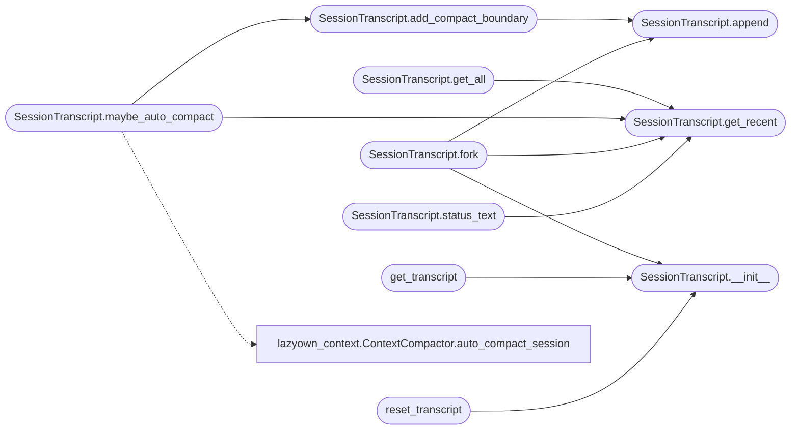

# `skills.lazyown_session`

> Source: [skills/lazyown_session.py:1](../../skills/lazyown_session.py#L1) | language `py` | coverage 69.2% | [API index](../index.md)

LazyOwn Append-Only Session Transcripts (Claude Code style)

All writes are append-only JSONL. Lines are never modified.
Compact boundaries mark where old content was summarized.

Usage:
    transcript = get_transcript()          # global singleton
    transcript.append("tool_use", {...})
    transcript.append("tool_result", {...})
    fork = transcript.fork()               # new session, no inherited permissions

## Contents

- **Classes:** [`SessionTranscript`](#sessiontranscript)
- **Functions:** [`get_transcript`](#get_transcript), [`reset_transcript`](#reset_transcript)

## Call Graph

Solid arrows stay in this module, dashed arrows leave it.



## Classes

<a id="sessiontranscript"></a>

### `SessionTranscript`

`class` | [skills/lazyown_session.py:71](../../skills/lazyown_session.py#L71)

```python
class SessionTranscript
```

Append-only JSONL session transcript.

Each line is a JSON object:
    {"ts": "...", "type": "...", "uuid": "...", "data": {...}}

Types: user_prompt | tool_use | tool_result | compact_boundary |
       permission_decision | hook_event | system

**Members**

| Member | Kind | Summary |
|---|---|---|
| [`__init__`](#sessiontranscript-__init__) | constructor |  |
| [`append`](#sessiontranscript-append) | method | Append a single event. |
| [`get_recent`](#sessiontranscript-get_recent) | method | Return the last n events. |
| [`get_all`](#sessiontranscript-get_all) | method |  |
| [`count`](#sessiontranscript-count) | method |  |
| [`maybe_auto_compact`](#sessiontranscript-maybe_auto_compact) | method | If event count since the last compact_boundary exceeds threshold, generate a template summary of those events and write a new boundary. |
| [`add_compact_boundary`](#sessiontranscript-add_compact_boundary) | method | Mark a compaction point. |
| [`fork`](#sessiontranscript-fork) | method | Create a new transcript forked from this one. |
| [`status_text`](#sessiontranscript-status_text) | method |  |

<a id="sessiontranscript-__init__"></a>

#### `SessionTranscript.__init__`

`constructor` | [skills/lazyown_session.py:82](../../skills/lazyown_session.py#L82)

```python
def __init__(self, sessions_dir: Path, session_id: str | None = None)
```

**Parameters**

| Name | Type | Default | Description |
|---|---|---|---|
| `sessions_dir` | `Path` |  |  |
| `session_id` | `str \| None` | `None` |  |

*Called by:* [`SessionTranscript.fork`](#sessiontranscript-fork), [`get_transcript`](#get_transcript), [`reset_transcript`](#reset_transcript)

<a id="sessiontranscript-append"></a>

#### `SessionTranscript.append`

`method` | [skills/lazyown_session.py:106](../../skills/lazyown_session.py#L106)

```python
def append(self, event_type: str, data: dict) -> str
```

Append a single event.

Returns the event UUID.

Sensitive fields (passwords, tokens, hashes) are redacted before the
event is written to disk. The transcript file is created with
owner-only permissions (0600) atomically via ``os.open`` so secrets
never sit on disk in a world-readable state, even for the very
first write.

**Parameters**

| Name | Type | Default | Description |
|---|---|---|---|
| `event_type` | `str` |  |  |
| `data` | `dict` |  |  |

**Returns:** `str`

*Called by:* [`SessionTranscript.add_compact_boundary`](#sessiontranscript-add_compact_boundary), [`SessionTranscript.fork`](#sessiontranscript-fork)

<a id="sessiontranscript-get_recent"></a>

#### `SessionTranscript.get_recent`

`method` | [skills/lazyown_session.py:143](../../skills/lazyown_session.py#L143)

```python
def get_recent(self, n: int = 100) -> list[dict]
```

Return the last n events.

**Parameters**

| Name | Type | Default | Description |
|---|---|---|---|
| `n` | `int` | `100` |  |

**Returns:** `list[dict]`

*Called by:* [`SessionTranscript.fork`](#sessiontranscript-fork), [`SessionTranscript.get_all`](#sessiontranscript-get_all), [`SessionTranscript.maybe_auto_compact`](#sessiontranscript-maybe_auto_compact), [`SessionTranscript.status_text`](#sessiontranscript-status_text)

<a id="sessiontranscript-get_all"></a>

#### `SessionTranscript.get_all`

`method` | [skills/lazyown_session.py:161](../../skills/lazyown_session.py#L161)

```python
def get_all(self) -> list[dict]
```

**Returns:** `list[dict]`

*Calls:* [`SessionTranscript.get_recent`](#sessiontranscript-get_recent)

<a id="sessiontranscript-count"></a>

#### `SessionTranscript.count`

`method` | [skills/lazyown_session.py:164](../../skills/lazyown_session.py#L164)

```python
def count(self) -> int
```

**Returns:** `int`

<a id="sessiontranscript-maybe_auto_compact"></a>

#### `SessionTranscript.maybe_auto_compact`

`method` | [skills/lazyown_session.py:174](../../skills/lazyown_session.py#L174)

```python
def maybe_auto_compact(self, threshold: int = 200) -> str | None
```

If event count since the last compact_boundary exceeds threshold, generate a template summary of those events and write a new boundary.

Returns the new boundary's UUID or None if no compaction was needed. Append-only: original events stay on disk.

**Parameters**

| Name | Type | Default | Description |
|---|---|---|---|
| `threshold` | `int` | `200` |  |

**Returns:** `str | None`

*Calls:* [`ContextCompactor.auto_compact_session`](skills.lazyown_context.py.md#contextcompactor-auto_compact_session), [`SessionTranscript.add_compact_boundary`](#sessiontranscript-add_compact_boundary), [`SessionTranscript.get_recent`](#sessiontranscript-get_recent)

<a id="sessiontranscript-add_compact_boundary"></a>

#### `SessionTranscript.add_compact_boundary`

`method` | [skills/lazyown_session.py:209](../../skills/lazyown_session.py#L209)

```python
def add_compact_boundary(self, summary: str, preserved_uuids: list[str] | None = None) -> str
```

Mark a compaction point.

The summary replaces older events logically but they remain on disk (append-only guarantee).

**Parameters**

| Name | Type | Default | Description |
|---|---|---|---|
| `summary` | `str` |  |  |
| `preserved_uuids` | `list[str] \| None` | `None` |  |

**Returns:** `str`

*Calls:* [`SessionTranscript.append`](#sessiontranscript-append)

*Called by:* [`SessionTranscript.maybe_auto_compact`](#sessiontranscript-maybe_auto_compact)

<a id="sessiontranscript-fork"></a>

#### `SessionTranscript.fork`

`method` | [skills/lazyown_session.py:227](../../skills/lazyown_session.py#L227)

```python
def fork(self, new_id: str | None = None) -> 'SessionTranscript'
```

Create a new transcript forked from this one.

Permissions are NOT inherited (security decision matching Claude Code). Recent history IS copied for context continuity.

**Parameters**

| Name | Type | Default | Description |
|---|---|---|---|
| `new_id` | `str \| None` | `None` |  |

**Returns:** `'SessionTranscript'`

*Calls:* [`SessionTranscript.__init__`](#sessiontranscript-__init__), [`SessionTranscript.append`](#sessiontranscript-append), [`SessionTranscript.get_recent`](#sessiontranscript-get_recent)

*Called by:* [`main`](modules.exp.c.md#main), [`execvp`](modules.mysql_hookandroot_lib.c.md#execvp), [`ensure_ld_preload`](modules.rootkit.mr.c.md#ensure_ld_preload), [`handle_client`](modules.rootkit.mr.c.md#handle_client), [`main`](modules.rootkit.mr.c.md#main), [`mon_shell`](modules.rootkit.mr.c.md#mon_shell)

<a id="sessiontranscript-status_text"></a>

#### `SessionTranscript.status_text`

`method` | [skills/lazyown_session.py:257](../../skills/lazyown_session.py#L257)

```python
def status_text(self) -> str
```

**Returns:** `str`

*Calls:* [`SessionTranscript.get_recent`](#sessiontranscript-get_recent)

---

## Functions

<a id="get_transcript"></a>

### `get_transcript`

`function` | [skills/lazyown_session.py:281](../../skills/lazyown_session.py#L281)

```python
def get_transcript(sessions_dir: Path | None = None, session_id: str | None = None) -> SessionTranscript
```

Return the active transcript singleton.

On first call, sessions_dir must be provided to initialize it.

**Parameters**

| Name | Type | Default | Description |
|---|---|---|---|
| `sessions_dir` | `Path \| None` | `None` |  |
| `session_id` | `str \| None` | `None` |  |

**Returns:** `SessionTranscript`

**Raises**

- `RuntimeError`: (raised in the body, not documented)

*Calls:* [`SessionTranscript.__init__`](#sessiontranscript-__init__)

---

<a id="reset_transcript"></a>

### `reset_transcript`

`function` | [skills/lazyown_session.py:294](../../skills/lazyown_session.py#L294)

```python
def reset_transcript(sessions_dir: Path, session_id: str | None = None) -> SessionTranscript
```

Force a new transcript (e.g., after fork or session reset).

**Parameters**

| Name | Type | Default | Description |
|---|---|---|---|
| `sessions_dir` | `Path` |  |  |
| `session_id` | `str \| None` | `None` |  |

**Returns:** `SessionTranscript`

*Calls:* [`SessionTranscript.__init__`](#sessiontranscript-__init__)

---
