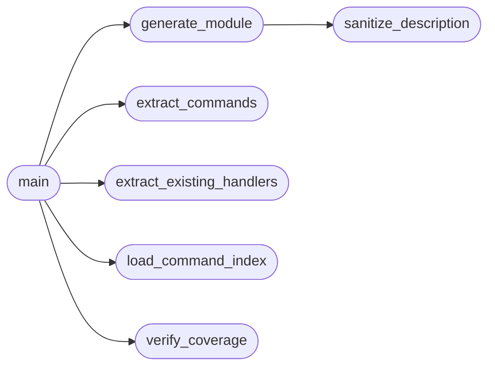

# `skills.mcp_tool_generator`

> Source: [skills/mcp_tool_generator.py:1](../../skills/mcp_tool_generator.py#L1) | language `py` | coverage 77.8% | [API index](../index.md)

Auto-generate MCP tool handlers from cli/command_index.json.

Reads the full command catalog, compares against existing handlers in
lazyown_mcp.py, and writes a new skills/mcp_generated_tools.py that can be
imported by lazyown_mcp.py to close the coverage gap.

Usage:
    python3 skills/mcp_tool_generator.py              # generate + verify
    python3 skills/mcp_tool_generator.py --check       # CI mode: verify only
    python3 skills/mcp_tool_generator.py --limit 50    # generate top N only

## Contents

- **Functions:** [`load_command_index`](#load_command_index), [`extract_commands`](#extract_commands), [`extract_existing_handlers`](#extract_existing_handlers), [`sanitize_description`](#sanitize_description), [`sanitize_docstring`](#sanitize_docstring), [`generate_module`](#generate_module), [`verify_coverage`](#verify_coverage), [`main`](#main)
- **Constants:** [`LAZYOWN_ROOT`](#lazyown_root), [`COMMAND_INDEX`](#command_index), [`MCP_FILE`](#mcp_file), [`OUTPUT_FILE`](#output_file)

## Call Graph

Solid arrows stay in this module, dashed arrows leave it.



## Functions

<a id="load_command_index"></a>

### `load_command_index`

`function` | [skills/mcp_tool_generator.py:29](../../skills/mcp_tool_generator.py#L29)

```python
def load_command_index() -> dict[str, Any]
```

**Returns:** `dict[str, Any]`

*Called by:* [`main`](#main)

---

<a id="extract_commands"></a>

### `extract_commands`

`function` | [skills/mcp_tool_generator.py:34](../../skills/mcp_tool_generator.py#L34)

```python
def extract_commands(index: dict[str, Any]) -> dict[str, str]
```

Return {command_name: summary} for all unique non-duplicate commands.

Strips the 'do_' prefix from method names so 'do_lazynmap' becomes 'lazynmap'.

**Parameters**

| Name | Type | Default | Description |
|---|---|---|---|
| `index` | `dict[str, Any]` |  |  |

**Returns:** `dict[str, str]`

*Called by:* [`main`](#main)

---

<a id="extract_existing_handlers"></a>

### `extract_existing_handlers`

`function` | [skills/mcp_tool_generator.py:55](../../skills/mcp_tool_generator.py#L55)

```python
def extract_existing_handlers() -> set[str]
```

Parse lazyown_mcp.py for all defined MCP tool names.

Looks at both @register_handler decorators and name= strings
inside the list_tools() function return statement.

**Returns:** `set[str]`

*Called by:* [`main`](#main)

---

<a id="sanitize_description"></a>

### `sanitize_description`

`function` | [skills/mcp_tool_generator.py:72](../../skills/mcp_tool_generator.py#L72)

```python
def sanitize_description(summary: str, max_len: int = 200) -> str
```

Truncate and clean a command summary for use as a tool description.

**Parameters**

| Name | Type | Default | Description |
|---|---|---|---|
| `summary` | `str` |  |  |
| `max_len` | `int` | `200` |  |

**Returns:** `str`

*Called by:* [`generate_module`](#generate_module)

---

<a id="sanitize_docstring"></a>

### `sanitize_docstring`

`function` | [skills/mcp_tool_generator.py:85](../../skills/mcp_tool_generator.py#L85)

```python
def sanitize_docstring(text: str) -> str
```

Escape backslashes and quotes for triple-quoted docstrings.

**Parameters**

| Name | Type | Default | Description |
|---|---|---|---|
| `text` | `str` |  |  |

**Returns:** `str`

---

<a id="generate_module"></a>

### `generate_module`

`function` | [skills/mcp_tool_generator.py:106](../../skills/mcp_tool_generator.py#L106)

```python
def generate_module(commands: dict[str, str], existing_handlers: set[str], limit: int | None = None) -> str
```

Build the complete Python source for mcp_generated_tools.py.

The generated file exports:
  - get_generated_tool_definitions() -> list[types.Tool]
  - register_all_generated_handlers(reg_fn, make_fn, run_fn) -> int

**Parameters**

| Name | Type | Default | Description |
|---|---|---|---|
| `commands` | `dict[str, str]` |  |  |
| `existing_handlers` | `set[str]` |  |  |
| `limit` | `int \| None` | `None` |  |

**Returns:** `str`

*Calls:* [`sanitize_description`](#sanitize_description)

*Called by:* [`main`](#main)

---

<a id="verify_coverage"></a>

### `verify_coverage`

`function` | [skills/mcp_tool_generator.py:203](../../skills/mcp_tool_generator.py#L203)

```python
def verify_coverage(commands: dict[str, str], existing_handlers: set[str]) -> tuple[set[str], set[str], set[str]]
```

Compare indexed commands against existing MCP tool coverage.

Returns (new, existing_match, missing_from_index) sets of tool names.

**Parameters**

| Name | Type | Default | Description |
|---|---|---|---|
| `commands` | `dict[str, str]` |  |  |
| `existing_handlers` | `set[str]` |  |  |

**Returns:** `tuple[set[str], set[str], set[str]]`

*Called by:* [`main`](#main)

---

<a id="main"></a>

### `main`

`function` | [skills/mcp_tool_generator.py:220](../../skills/mcp_tool_generator.py#L220)

```python
def main()
```

*Calls:* [`extract_commands`](#extract_commands), [`extract_existing_handlers`](#extract_existing_handlers), [`generate_module`](#generate_module), [`load_command_index`](#load_command_index), [`verify_coverage`](#verify_coverage)

---

## Constants

<a id="lazyown_root"></a>

### `LAZYOWN_ROOT`

`constant` | [skills/mcp_tool_generator.py:23](../../skills/mcp_tool_generator.py#L23)

```python
LAZYOWN_ROOT = Path(__file__).parent.parent
```

---

<a id="command_index"></a>

### `COMMAND_INDEX`

`constant` | [skills/mcp_tool_generator.py:24](../../skills/mcp_tool_generator.py#L24)

```python
COMMAND_INDEX = LAZYOWN_ROOT / 'cli' / 'command_index.json'
```

---

<a id="mcp_file"></a>

### `MCP_FILE`

`constant` | [skills/mcp_tool_generator.py:25](../../skills/mcp_tool_generator.py#L25)

```python
MCP_FILE = LAZYOWN_ROOT / 'skills' / 'lazyown_mcp.py'
```

---

<a id="output_file"></a>

### `OUTPUT_FILE`

`constant` | [skills/mcp_tool_generator.py:26](../../skills/mcp_tool_generator.py#L26)

```python
OUTPUT_FILE = LAZYOWN_ROOT / 'skills' / 'mcp_generated_tools.py'
```

---
