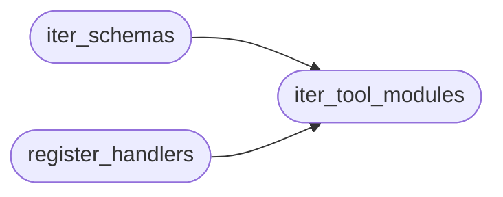

# `skills.mcp_tools`

> Source: [skills/mcp_tools/__init__.py:1](../../skills/mcp_tools/__init__.py#L1) | language `py` | coverage 100.0% | [API index](../index.md)

Auto-discovered one-file-per-tool registry for the LazyOwn MCP server.

Historically every MCP tool's JSON schema lived inside one multi-thousand
line ``list_tools`` literal and its handler inside a giant ``call_tool``
if/elif chain in ``skills/lazyown_mcp.py``. This package replaces that
with one module per tool: each ``mcp_tools/<name>.py`` exposes a ``TOOL``
schema and a ``handle(arguments, tool_name, ctx)`` function. The runtime
discovers them declaratively, exactly like [`cli.registry`](cli.registry.py.md) does for
``cmd2`` command sets, so adding or moving a tool is a single new file and
no edit to the god-file.

Modules whose leaf name starts with an underscore (``_context``) hold
shared scaffolding and are skipped by discovery.

## Contents

- **Functions:** [`iter_tool_modules`](#iter_tool_modules), [`iter_schemas`](#iter_schemas), [`register_handlers`](#register_handlers)
- **Constants:** [`PACKAGE_NAME`](#package_name)

## Call Graph

Solid arrows stay in this module, dashed arrows leave it.



## Functions

<a id="iter_tool_modules"></a>

### `iter_tool_modules`

`function` `generator` | [skills/mcp_tools/__init__.py:30](../../skills/mcp_tools/__init__.py#L30)

```python
def iter_tool_modules() -> Iterator[ModuleType]
```

Yield every discovered tool module exposing ``TOOL`` and ``handle``.

Each non-underscore module under [`mcp_tools`](skills.lazyown_automapper.py.md#automapper-mcp_tools) is imported and kept
only when it declares both the ``TOOL`` schema and a ``handle``
callable, so partial or helper modules are ignored rather than crashing
discovery.

**Returns:** `Iterator[ModuleType]`

**Yields:** Each tool module that satisfies the one-file-per-tool contract.

*Called by:* [`iter_schemas`](#iter_schemas), [`register_handlers`](#register_handlers)

---

<a id="iter_schemas"></a>

### `iter_schemas`

`function` `generator` | [skills/mcp_tools/__init__.py:51](../../skills/mcp_tools/__init__.py#L51)

```python
def iter_schemas() -> Iterator[object]
```

Yield the ``types.Tool`` schema of every discovered tool module.

**Returns:** `Iterator[object]`

*Calls:* [`iter_tool_modules`](#iter_tool_modules)

---

<a id="register_handlers"></a>

### `register_handlers`

`function` | [skills/mcp_tools/__init__.py:57](../../skills/mcp_tools/__init__.py#L57)

```python
def register_handlers(handlers: dict, ctx: MCPContext) -> list[str]
```

Bind each discovered tool's handler into the shared dispatch table.

The runtime passes its ``_TOOL_HANDLERS`` dict and a built
[`MCPContext`](skills.mcp_tools._context.py.md#mcpcontext). Every tool handler is wrapped so the dispatch
contract ``handler(arguments, tool_name)`` is honoured while the tool
file keeps its clean ``handle(arguments, tool_name, ctx)`` signature.
Both synchronous and coroutine handlers are supported.

**Parameters**

| Name | Type | Default | Description |
|---|---|---|---|
| `handlers` | `dict` |  | The live dispatch table to populate in place. |
| `ctx` | `MCPContext` |  | The dependency-injection context passed to each handler. |

**Returns:** `list[str]` - The list of tool names registered, for logging and tests.

*Calls:* [`iter_tool_modules`](#iter_tool_modules)

---

## Constants

<a id="package_name"></a>

### `PACKAGE_NAME`

`constant` | [skills/mcp_tools/__init__.py:26](../../skills/mcp_tools/__init__.py#L26)

```python
PACKAGE_NAME = 'mcp_tools'
```

---
