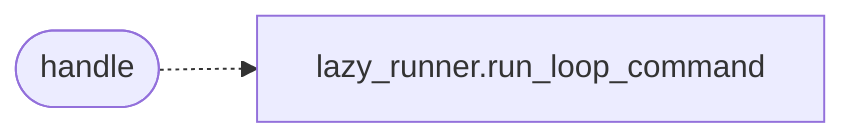

# `skills.mcp_tools.auto_loop`

> Source: [skills/mcp_tools/auto_loop.py:1](../../skills/mcp_tools/auto_loop.py#L1) | language `py` | coverage 100.0% | [API index](../index.md)

MCP tool ``lazyown_auto_loop`` (single runner, one path with the CLI).

Routes through [`modules.lazy_runner.run_loop_command`](modules.lazy_runner.py.md#run_loop_command) — the same
runner behind the ``auto_loop`` and ``lazy_loop`` CLI verbs — so MCP runs
receive the full gate set: budget confirmation, preflight, bootstrap,
terminal safety, loop audit and the proxy/browser-sync autostart.

## Contents

- **Functions:** [`handle`](#handle)
- **Constants:** [`TOOL`](#tool)

## Call Graph

Solid arrows stay in this module, dashed arrows leave it.



## Functions

<a id="handle"></a>

### `handle`

`function` | [skills/mcp_tools/auto_loop.py:128](../../skills/mcp_tools/auto_loop.py#L128)

```python
def handle(arguments: dict[str, Any], tool_name: str, ctx: MCPContext) -> list
```

Handle the lazyown_auto_loop MCP tool through the shared runner.

**Parameters**

| Name | Type | Default | Description |
|---|---|---|---|
| `arguments` | `dict[str, Any]` |  | Tool arguments (target, objective, rounds, workers, timeout, legacy). |
| `tool_name` | `str` |  | Tool name used by the context envelope. |
| `ctx` | `MCPContext` |  | Injected runtime context (payload loader, text renderer). |

**Returns:** `list` - The MCP text response for the run.

*Calls:* [`run_loop_command`](modules.lazy_runner.py.md#run_loop_command)

---

## Constants

<a id="tool"></a>

### `TOOL`

`constant` | [skills/mcp_tools/auto_loop.py:16](../../skills/mcp_tools/auto_loop.py#L16)

```python
TOOL
```

---
